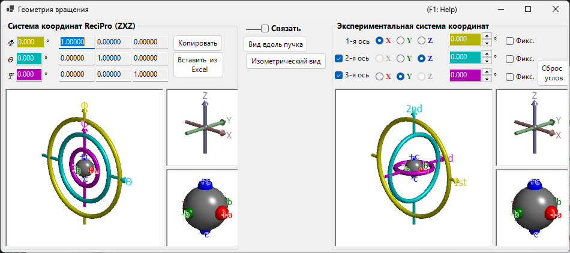

# Геометрия вращения

Это окно представляет состояние вращения кристалла в виде матрицы 3×3 и преобразует данные между различными эйлеровыми системами координат.

ReciPro использует три эйлеровых угла — **Ψ**, **θ** и **Φ**, — применяемых в порядке **Z–X–Z**. Однако это соглашение не обязательно совпадает с осями гониометра вашего реального прибора. Окно **Геометрия вращения** позволяет преобразовать эйлеровы углы ReciPro в произвольно заданную систему координат, помогая настраивать гониометр в лаборатории.

---

## Сочетания клавиш и мыши

Все шесть трёхмерных видов (панели ReciPro и экспериментального гониометра / осей / объектов) **связаны** — поворот любого из них поворачивает все шесть вместе. Они используют стандартную [навигацию по виду OpenGL](21-shortcuts.md) ReciPro.

| Сочетание | Действие |
|----------|--------|
| <kbd>F1</kbd> | Открыть эту страницу онлайн-руководства |
| Перетаскивание левой кнопкой в виде | Повернуть модель (все шесть видов поворачиваются вместе) |
| Колесо мыши или перетаскивание правой кнопкой вверх/вниз | Масштабирование (большие виды гониометра) |
| <kbd>CTRL</kbd> + перетаскивание правой кнопкой вверх/вниз | Изменить расстояние до камеры (только в перспективном режиме) |
| <kbd>CTRL</kbd> + двойной щелчок правой кнопкой | Переключить ортографическую / перспективную проекцию |

В малых видах *Axes* и *Objects* масштабирование и панорамирование отключены. Сочетаний клавиш, кроме <kbd>F1</kbd>, нет.

---

## Система координат ReciPro (ZXZ)

Верхняя половина окна показывает состояние вращения в «системе координат ReciPro».

- Значения **Φ, θ, Ψ** синхронизированы с эйлеровыми углами, заданными в Главном окне.
- **Rotation matrix** отображает матрицу 3×3, соответствующую текущему состоянию вращения.

### Φ, θ, Ψ (эйлеровы углы Z–X–Z)

Ориентация кристалла параметризуется тремя поворотами. В описании в **связанной с телом (внутренней)** системе отсчёта они применяются в следующем порядке:

1. **Φ** — первый поворот вокруг оси **Z**.
2. **θ** — поворот вокруг оси **X** однажды повёрнутой системы отсчёта.
3. **Ψ** — второй поворот вокруг оси **Z** дважды повёрнутой системы отсчёта.

Тот же поворот, рассматриваемый в **неподвижной лабораторной** системе отсчёта, представляет собой обратную последовательность — Ψ вокруг $Z$, затем θ вокруг $X$, затем Φ вокруг $Z$; именно это описание используется в [Приложении A1.1](appendix/a1-coordinate-system/1-orientation.md). Оба описания дают одну и ту же матрицу $R$, приведённую ниже; Φ — просто самая внешняя ось (как у гониометра), а Ψ — самая внутренняя.

Поля Φ, θ, Ψ и девять полей матрицы служат **только для отображения** (только чтение). Чтобы изменить ориентацию, поверните кристалл в Главном окне, используйте **Вставить из Excel** или (при включённом **Связать**) измените углы экспериментальных осей ниже; каждое изменение передаётся в Главное окно и все связанные симуляторы.

### Rotation matrix

Матрица 3 × 3, формируемая из текущих (Φ, θ, Ψ). Используйте **Копировать** / **Вставить из Excel**, чтобы передать матрицу в электронную таблицу и обратно.

Матрица подчиняется одному и тому же соглашению везде, где встречается в ReciPro:

$$
\mathbf{v}_{\mathrm{rot}} = R\,\mathbf{v}_{0}
$$

- \(R\) — **активное** вращение кристалла, выраженное в лабораторной системе, связанной с монитором (\(X\) вправо, \(Y\) вверх, \(Z\) к наблюдателю — см. [Приложение A1.1](appendix/a1-coordinate-system/1-orientation.md)).
- \(\mathbf{v}_{0}\) : декартовы координаты (вектор-столбец) связанного с кристаллом направления в **начальной ориентации** (\(c \parallel Z\), \(b\) в плоскости \(YZ\)).
- \(\mathbf{v}_{\mathrm{rot}}\) : координаты того же направления после поворота, по-прежнему в лабораторной системе.
- При \(\Phi=\theta=\Psi=0\) \(R\) — единичная матрица. \(R\) ортонормирована с определителем +1, поэтому обратное преобразование — это просто транспонирование: \(R^{-1}=R^{\mathsf T}\).

Через углы Эйлера \(R = R_Z(\Phi)\,R_X(\theta)\,R_Z(\Psi)\) (правые вращения вокруг неподвижных осей; \(\Psi\) действует на вектор первым):

$$
R=\begin{pmatrix}
\cos\Phi\cos\Psi-\cos\theta\,\sin\Phi\sin\Psi & -\cos\Phi\sin\Psi-\cos\theta\,\sin\Phi\cos\Psi & \sin\theta\,\sin\Phi\\
\sin\Phi\cos\Psi+\cos\theta\,\cos\Phi\sin\Psi & -\sin\Phi\sin\Psi+\cos\theta\,\cos\Phi\cos\Psi & -\sin\theta\,\cos\Phi\\
\sin\theta\,\sin\Psi & \sin\theta\,\cos\Psi & \cos\theta
\end{pmatrix}
$$

Чтобы применить её к кристаллографическим индексам, сначала переведите их в декартовы координаты начальной ориентации: направление \([uvw]\) — это \(\mathbf{v}_0 = u\mathbf{a}+v\mathbf{b}+w\mathbf{c}\), а нормаль плоскости \((hkl)\) — это \(\mathbf{v}_0 = h\mathbf{a}^{*}+k\mathbf{b}^{*}+l\mathbf{c}^{*}\) (оси обратной решётки).

Та же матрица (\(R_{ij}\) = строка \(i\), столбец \(j\)) появляется:

- в **Копировать** / **Вставить из Excel** этого окна (3 × 3, через табуляцию, строки сверху вниз);
- в [API макросов](20-macro/1-built-in-functions.md): `Dir.GetRotationMatrix()` / `Dir.SetRotationMatrix()` и `Dir.GetEuler()` (девять элементов в порядке строк \(R_{11}, R_{12}, R_{13}, R_{21}, \ldots, R_{33}\));
- в столбцах **R11**–**R33** списка кандидатов, сохраняемого [Spot ID v2](11-spot-id-v2.md).

### Окна OpenGL

Трёхмерный вид показывает текущее вращение с помощью трёх цветных торов (фигур в форме бублика):

| Цвет | Эйлеров угол | Уровень гониометра |
|--------|------------|-----------------|
| **Жёлтый** | Φ | 1-я (верхняя) ось |
| **Голубой** | θ | 2-я (средняя) ось |
| **Розовый** | Ψ | 3-я (нижняя) ось |

Стрелки **красная**, **зелёная** и **синяя** представляют оси X, Y, Z в декартовых координатах реального пространства. Они *не* совпадают с осями кристалла, показанными в Главном окне.

Серая сфера в центре представляет образец. Маленькие красная / зелёная / синяя сферы (подписи **+a/−a**, **+b/−b**, **+c/−c**) отмечают направления нормированных осей кристалла *a*, *b*, *c* после поворота (бо́льшая сфера — конец «+»). При Φ = θ = Ψ = 0 они показывают исходную ориентацию кристалла (*c* ∥ +Z, *b* в плоскости YZ), поэтому *a* и *b* совпадают с +X и +Y только для ортогональных ячеек.

> **Примечание**: Перетаскивание в окне OpenGL изменяет только *направление проецирования* этого вида, но не саму ориентацию кристалла. Чтобы повернуть кристалл, используйте Главное окно.

### Кнопки

| Кнопка | Действие |
|--------|--------|
| Копировать | Скопировать матрицу вращения 3×3 в формате с разделением табуляцией |
| Вставить из Excel | Задать матрицу вращения из буфера обмена (3×3 с разделением табуляцией) |
| Вид вдоль пучка | Сопоставить с проекцией Главного окна (ось Z перпендикулярна экрану) |
| Изометрический вид | Переключиться на изометрическую проекцию |

---

## Экспериментальная система координат

Нижняя половина задаёт эйлеровы углы на произвольном наборе осей вращения и считывает/устанавливает состояние гониометра. Это называется **Экспериментальной системой координат**.

### 1-я, 2-я, 3-я оси

Выберите ось вращения каждого уровня гониометра (1-я = верхний, 2-я = средний, 3-я = нижний) из **X**, **Y** или **Z** (только положительные направления лабораторной системы). 2-я ось не может совпадать с 1-й, а 3-я — со 2-й (конфликтующий переключатель отключается). По умолчанию — **X – Z – Y**. Графика обновляется соответствующим образом.

Угол каждой оси показывается в соответствующем цветном поле (жёлтом, голубом, розовом) и может вводиться напрямую (в градусах; значения вне диапазона −180…180° приводятся к нему). Экспериментальный поворот составляется так же, как собственная матрица ReciPro, с 1-й осью в качестве самой внешней:

$$
R_{\mathrm{exp}} = R_{\mathbf{e}_1}(\omega_1)\,R_{\mathbf{e}_2}(\omega_2)\,R_{\mathbf{e}_3}(\omega_3)
$$

(правые повороты вокруг неподвижных лабораторных осей $\mathbf{e}_i$).

| Элемент | Действие |
|---------|--------|
| **2-я ось** / **3-я ось** | Включить или отключить этот уровень (гониометр только с одной или двумя осями). При отключении его угол устанавливается в 0. Отключение 2-й оси отключает и 3-ю. |
| **Фикс.** | Удерживать этот угол на текущем значении, пока **Связать** раскладывает новую ориентацию на углы гониометра (см. ниже). |
| **Сброс углов** | Установить все три экспериментальных угла в 0. |

---

## Link

Когда установлен флажок **Связать**, система координат ReciPro и Экспериментальная система координат связаны: их эйлеровы углы корректируются так, чтобы ориентация объекта была согласована между двумя системами.

В момент установки флажка **Связать** запоминается смещение $R_{\mathrm{base}} = R_{\mathrm{exp}}^{-1} R$ между двумя системами, и с этого момента $R = R_{\mathrm{exp}}\,R_{\mathrm{base}}$. Пока связь включена:

- изменение экспериментального угла поворачивает кристалл во всех окнах;
- приращение поворота (кнопки-стрелки, CTRL+SHIFT+стрелки или перетаскивание в Главном окне или других окнах) численно раскладывается на включённые и не зафиксированные (**Фикс.**) углы гониометра, и кристалл устанавливается в **ближайшую ориентацию, достижимую гониометром**, — поэтому при зафиксированных или отключённых осях кристалл следует ограничениям гониометра, а не в точности движению мыши;
- задание абсолютной ориентации (поля углов Эйлера, **Сбросить поворот**, **Вид вдоль** Ось/Плоскость, **Вставить из Excel**) применяет её точно, снова включает 2-ю и 3-ю оси, снимает все **Фикс.** и заново раскладывает её на все три угла гониометра.

### Пример рабочего процесса

1. В лаборатории настройте гониометр так, чтобы ось *a* кристалла была совмещена с направлением падения рентгеновского излучения, а ось *b* располагалась горизонтально.
2. Введите эйлеровы углы лабораторного гониометра в Экспериментальной системе координат.
3. В Главном окне поверните кристалл так, чтобы ось *a* была направлена по нормали к экрану, а ось *b* — горизонтально.
4. Установите флажок **Связать** — теперь всякий раз, когда вы направляете кристалл в другую ориентацию в Главном окне, автоматически отображаются необходимые углы гониометра.

---

## См. также

- [Главное окно](0-main-window.md)
- [Стереосеть](6-stereonet.md)
- [Базовая система координат и ориентация кристалла](appendix/a1-coordinate-system/1-orientation.md)
- [Сочетания клавиш и мыши](21-shortcuts.md)
