# Просмотр структуры

**Просмотр структуры** отображает структуру выбранного кристалла в виде трёхмерного изображения с помощью OpenGL.

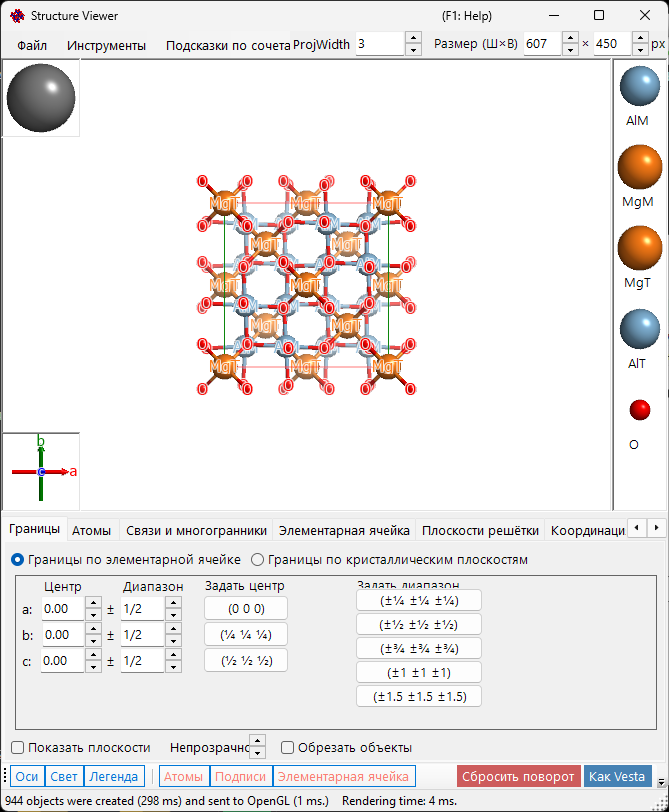

---

## Клавиатурные и мышиные сочетания

Окно содержит основную 3-D-область просмотра и два небольших гизмо — блок **осей кристалла** (внизу слева) и блок **направления света** (вверху слева), — и каждый из них по-своему реагирует на перетаскивание левой кнопкой. Основная область использует стандартную для ReciPro [навигацию по OpenGL-виду](21-shortcuts.md).

| Сочетание | Действие |
|----------|--------|
| <kbd>F1</kbd> | Открыть эту страницу онлайн-руководства |
| <kbd>CTRL</kbd>+<kbd>SHIFT</kbd>+<kbd>C</kbd> | Скопировать отрисованное изображение в буфер обмена |
| Перетаскивание левой кнопкой в основной области | Повернуть модель |
| Двойной щелчок левой кнопкой по атому | Показать координаты атома, по которому щёлкнули, а также расстояния и валентные углы окружающих его соседей (выбирать можно только отображаемые атомы) <!-- 261105Cl 監査: 近接原子はクリックした位置の周り (ca87b772, 8cc95680) --> |
| Перетаскивание правой кнопкой вверх/вниз или колесо мыши | Масштабирование |
| Перетаскивание средней кнопкой | Панорамирование |
| <kbd>CTRL</kbd> + перетаскивание правой кнопкой вверх/вниз | Изменить расстояние до камеры (только в режиме перспективы) |
| <kbd>CTRL</kbd> + двойной щелчок правой кнопкой | Переключить ортографическую / перспективную проекцию |
| Перетаскивание левой кнопкой за гизмо **осей кристалла** | Повернуть модель (без поворота в плоскости) |
| Перетаскивание левой кнопкой за гизмо **света** | Изменить направление освещения |

Общеприложенческие сочетания <kbd>CTRL</kbd>+<kbd>SHIFT</kbd> из [главного окна](0-main-window.md#keyboard-mouse-shortcuts) также работают, пока это окно находится в фокусе.

→ См. **[21. Клавиатурные и мышиные сочетания](21-shortcuts.md)** для обзора всех окон сразу.

---

## Основная область

Трёхмерная структура кристалла, отображаемая вместе с гизмо направления света, гизмо осей кристалла и легендой атомов. Положение и размер окна сохраняются до следующего запуска. <!-- 261106Cl 作者の決定 H6 -->
> Поле **Размер (Ш×В)** в правом верхнем углу окна задаёт размер трёхмерного вида в пикселях (размер окна подстраивается под него); сохраняемые и копируемые изображения имеют этот размер.
> Соседнее поле **ProjWidth** показывает ширину проецируемого вида в nm. Изменяя это значение, можно задавать масштаб численно — поле синхронизировано с масштабированием вида (перетаскивание правой кнопкой / колесо мыши).

---

## Строка меню

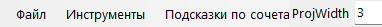

### Меню «Файл»

| Пункт меню | Описание |
|------------|----------|
| Сохранить изображение ▸ Основное изображение / Легенда / Кристаллографические оси / Направление света | Сохранить основной вид, легенду атомов или один из гизмо в формате PNG |
| Копировать изображение в буфер обмена ▸ Основное изображение / Легенда / Кристаллографические оси / Направление света <!-- 261105Cl 監査: copyToClipboardToolStripMenuItem.Text --> | Скопировать изображение (Ctrl+Shift+C копирует основной вид) |
| Сохранить видео ▸ Основное изображение / Кристаллографические оси | Сохранить видео вращения/переноса основного вида или гизмо осей кристалла в MP4 (скорость, длительность, fps, качество и т. д.) |
| Export 3D model (3MF/STL) | Вывести отображаемую структуру как объёмную модель для 3D-печати |

Меню **Инструменты**: **Мне нравится VESTA** (то же, что кнопка панели инструментов *Как Vesta*) и **Enable DDP** (показывает/скрывает пункт *Dual Depth Peeling* в разделе [Режим прозрачности](#режим-прозрачности)).

**Подсказки по сочетаниям клавиш** (отдельное меню верхнего уровня) перечисляет сочетания клавиш.

**Сохранить видео** открывает показанный ниже диалог настройки видео. Видео может вращать вид, перемещать центр проекции или делать и то и другое одновременно — установите флажки **Вращение** и/или **Перенос**:

- **Вращение**: вращает вид со скоростью **Скорость** (°/s; отрицательные значения обращают направление) вокруг оси, выбранной ниже — **Текущая проекция** (направление наклона задаётся кнопками со стрелками), **Индекс направления** [uvw] или нормаль к плоскости **Плоскость решётки** (hkl). Ось берётся из ориентации кристалла в момент нажатия **OK**. При включённых индексах Миллера–Браве четыре индекса показываются только для **Плоскость решётки**; **Индекс направления** — всегда трёхиндексный [uvw]. <!-- 261105Cl 監査: FormMovie.cs (OK の時点で回転軸を求め直す、4 指数は格子面だけ, 35fa72fc) -->
- **Перенос**: перемещает центр проекции вдоль индекса направления [uvw] со скоростью **Скорость** (периодов решётки в секунду). Этот параметр появляется, только когда диалог открыт из окна «Просмотр структуры», и, пока он включён, единственным доступным режимом направления остаётся **Индекс направления**.

Задайте длительность видео (**Длительность**), частоту кадров (**FPS**, 1–120) и качество кодирования (**Качество**, 1–100; чем выше значение, тем выше битрейт и тем больше файл), выберите кодек (**H264** / **H265**) и нажмите **OK**, чтобы создать файл MP4. **Включить последний кадр** добавляет в конец один дополнительный кадр при t = **Длительность**, чтобы видео заканчивалось точно в конечной ориентации/позиции. (Список скорости кодирования теперь лишь подписывает индикатор прогресса и больше не влияет на само кодирование.)

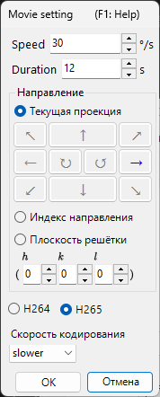

#### Export 3D model (3MF/STL)

**Export 3D model (3MF/STL)** выводит структурную модель, отрисованную на экране, в виде объёмной модели для 3D-печати. Экспортировать можно только замкнутые тела — атомы (сферы и эллипсоиды), связи (цилиндры) и координационные многогранники. Подписи атомов, ограничивающие плоскости, плоскости решётки и символы элементов симметрии не экспортируются. <!-- 261105Cl 監査: 配位多面体を出力し、対称要素は出さない (6c31fc0d) --> Каркас элементарной ячейки состоит из отрезков, поэтому он заменяется цилиндрами (со сферами в углах) только при включении соответствующего параметра. **Обрезать объекты по граничным плоскостям** к выводу не применяется: объекты, пересекающие ограничивающие плоскости, экспортируются целиком (об этом сообщает примечание в диалоге). <!-- 261106Cl 作者の決定 H10 -->

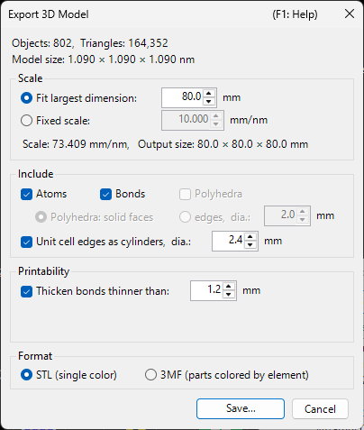

В верхней части диалога показаны число объектов и треугольников, а также реальный размер модели (**Размер модели**, nm).

**Масштаб** : как определяется размер вывода

- **Макс. размер** : автоматически масштабирует модель так, чтобы её самое длинное ребро достигло заданной длины (5–500 mm, по умолчанию 80 mm). Толщина цилиндров, заменяющих каркас элементарной ячейки и каркас рёбер многогранников, учитывается. <!-- 261105Cl 監査: 円柱の太さを含めて合わせる (82e50b62) -->
- **Фикс. масштаб** : задайте масштаб (mm/nm) напрямую. Пригодится, чтобы изготовить несколько кристаллов в одном масштабе и поставить их рядом. При переключении за начальное значение берётся масштаб, действовавший непосредственно перед этим.
- В строке ниже показаны полученный масштаб и печатные размеры (**Вывод**, mm), также с учётом толщины этих цилиндров.

**Включить** : какие элементы попадут в печать

- **Атомы** / **Связи** / **Полиэдры** : выбрать можно только те виды, которые отображаются сейчас; если снять флажок, объект останется на экране, но не будет напечатан.
- **Полиэдры: грани** / **рёбра, Ø** : координационные многогранники выводятся либо как сплошные тела с гранями, либо как каркас из рёбер (цилиндры плюс сферы в вершинах, по умолчанию 2.0 mm). Каркас оставляет видимыми атомы внутри.
- **ажурная сетка: Ø перемычки / шаг** : каркас рёбер плюс сетка тонких перемычек на каждой грани (диаметр перемычки 0.8–5.0 mm, по умолчанию 1.2 mm; шаг 1.5–20 mm, по умолчанию 5.0 mm). Издали грани выглядят заполненными, но внутренность остаётся видимой.
- **Рёбра ячейки (цил.), Ø** : включает каркас элементарной ячейки, заменённый цилиндрами заданного диаметра (по умолчанию 2.4 mm). Этот флажок отмечен по умолчанию всякий раз, когда отображается каркас ячейки.

**Пригодность к печати**

- **Утолщать связи тоньше** : связи, печатный диаметр которых оказался бы меньше заданного значения (по умолчанию 1.2 mm), пересоздаются с этим диаметром из исходного примитива, чтобы тонкие связи не ломались. Если оставить параметр выключенным при слишком тонкой связи, появится предупреждение красным.

**Формат** : формат файла

- **STL (один цвет)** : одноцветный двоичный STL.
- **3MF (цвет по элементам)** : 3MF с деталями, окрашенными по элементам; в названиях цветов стоят имена элементов.

**Сохранить...** запрашивает имя файла. По завершении экспорта число треугольников, печатные размеры и масштаб записываются в информационное поле в левом нижнем углу.

---

## Меню вкладок

### Границы, заданные ячейкой

Задаёт область отрисовки кристалла. Имеется два режима, переключаемых переключателями в верхней части.

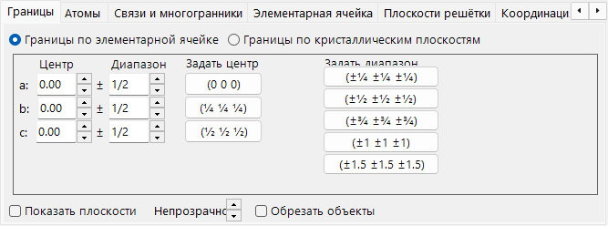

В этом режиме единицей области отрисовки служат оси *a*, *b*, *c* элементарной ячейки.

- **Центр**: смещение центра области отрисовки от [центра проекции](#центр-проекции) в дробных координатах (положительные значения смещают его к +*a*, +*b*, +*c*). Отрисовываемая область — (центр проекции + **Центр**) ± **Диапазон**. <!-- 261106Cl 作者の決定 H3/H18, C4 -->
- **Диапазон**: верхний/нижний предел для каждой из осей *a*, *b*, *c*.
- **Кнопки предустановок** справа задают часто используемые значения (например, ячейка 1×1×1, ячейка 2×2×2).

### Границы, заданные кристаллографическими плоскостями

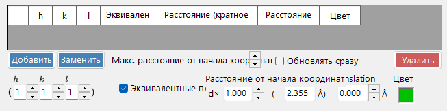

В этом режиме область отрисовки ограничивается набором кристаллографических плоскостей. Если плоскости не задают пространственно замкнутую область, ReciPro добавляет почти сферический многогранник радиуса **Макс. расст. от центра** (Å, отсчитывается от [центра проекции](#центр-проекции)), чтобы замкнуть её. <!-- 261106Cl 作者の決定 C4 -->

#### Список границ

Все ограничивающие плоскости, зарегистрированные для текущего кристалла. Используйте **Добавить** / **Заменить** / **Удалить** для работы со списком; крайний левый флажок временно отключает плоскость, не удаляя её.

> Чтобы сохранить изменения навсегда, нужно также нажать **Добавить** или **Заменить** в **главном окне**. Иначе изменения будут потеряны при следующей смене выбора в основном списке кристаллов.

#### Индексы H k l

Задаёт ограничивающую плоскость по её индексу Миллера. Флажок включает кристаллографически эквивалентные плоскости, порождённые из выбранного (*hkl*).

#### Расст. от центра проекции

Расстояние от [центра проекции](#центр-проекции) (а не от начала координат ячейки) до ограничивающей плоскости, вводимое либо <!-- 261106Cl 作者の決定 C4 --> как кратное межплоскостного расстояния *d* выбранного (*hkl*) (поле **d×**), либо в Å (поле в скобках). Оба поля связаны: изменение одного обновляет другое.

Каждая плоскость лежит со стороны +**g** от центра проекции (по направлению нормали (*hkl*)), и рисуется сторона, содержащая центр. Если плоскость одна, рисуется полупространство по ту сторону от неё, где находится центр. <!-- 261106Cl 作者の決定 D5 -->

- **Сдвиг** (Å): сдвигает всю область, ограниченную плоскостями, на эту величину вдоль нормали заданной (*hkl*); положительные значения сдвигают её к +**g**, т. е. в направлении нормали (*hkl*). Работает при любом числе плоскостей, в том числе для одной плоскости без **Эквивалентные плоскости**. <!-- 261106Cl 作者の決定 B11, C5 -->
- **Макс. расст. от центра** (Å): максимальное расстояние от центра проекции, т. е. радиус замыкающего многогранника, используемого, когда плоскости не ограничивают замкнутую область (см. выше). <!-- 261106Cl 作者の決定 D3 -->
- **Обновлять сразу**: применять изменения выбранной плоскости без нажатия **Заменить**.

#### Показать ограничивающие плоскости / Непрозрачность

Показывает или скрывает сами ограничивающие плоскости. Когда они показаны, **Непрозрачность** задаёт непрозрачность (0 = прозрачно, 1 = непрозрачно).

#### Обрезать объекты по граничным плоскостям

Если флажок установлен, отрисовывается только внутренняя область, заданная границами; атомы, связи и многогранники, пересекающие границы, обрезаются.

#### Скрытие атомов

На вкладке **Границы** для этого нет флажка. Вместо этого выключите кнопку панели инструментов **Атомы**: атомы не генерируются, поэтому исчезают и связи, и многогранники — удобно, когда нужно показать только ячейку или плоскости решётки.

### Атомы

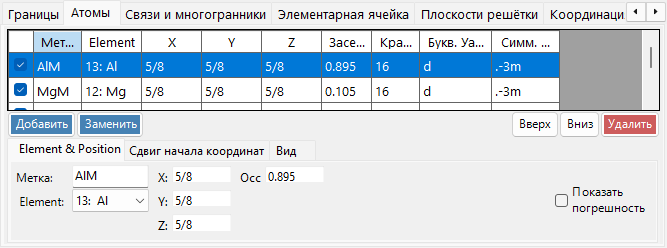

Задаёт тип, положение и заселённость каждого атома, а также способ его отрисовки (радиус, цвет, материал).

#### Список атомов

Список атомов в кристалле. Используйте **Add / Replace / Delete** для работы со списком; крайний левый флажок временно скрывает атом.

> Чтобы сохранить изменения навсегда, нажмите также **Добавить** или **Заменить** в **главном окне**.

#### Элемент и положение

- **Метка**: произвольная текстовая подпись атома (используется в легендах и подсказках).
- **Element**: химический элемент / степень ионизации.
- **X, Y, Z**: дробные координаты. Вещественные числа в диапазоне 0–1 либо дроби, такие как `1/2` или `2/3`.
- **Occ**: заселённость, вещественное число 0–1.

#### Сдвиг начала координат

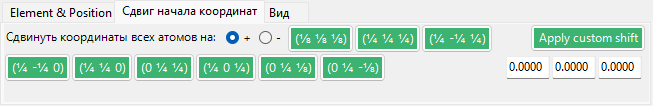

Сдвигает каждый атом на одинаковое дробное смещение. Нажмите кнопку предустановки (например, чтобы переключиться между выбором начала координат 1 / 2 для одной и той же пространственной группы) или введите пользовательский (Δx, Δy, Δz) и нажмите **Apply custom shift**.

#### Вид

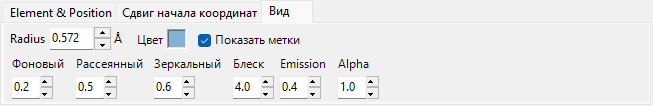

Радиус, цвет и материал каждого атома.

- **Radius**: отрисовываемый атомный радиус.
- **Atom color**: цвет поверхности.
- **Material**: свойства текстуры / материала, используемые OpenGL-шейдером.
- **Apply to same elements**: применяет текущий радиус и цвет ко всем атомам того же химического элемента.

### Связи и многогранники

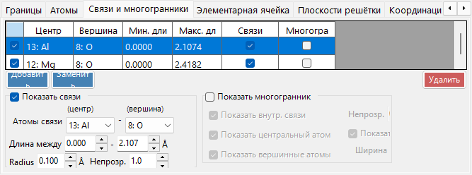

Определяет, какие пары атомов считаются связанными (по типам атомов и диапазону расстояний), и как отрисовываются получающиеся связи и координационные многогранники.

#### Список связей

Все правила связей/многогранников, зарегистрированные для кристалла. Используйте **Добавить** / **Заменить** / **Удалить**; крайний левый флажок временно отключает запись. Как и для атомов и границ, для постоянного сохранения изменения требуется **Добавить** / **Заменить** в **главном окне**.

#### Свойства связи

- **Показать связи**: отрисовывать связи этого правила (флажок над настройками связи).
- **Атомы связи** **(центр)** - **(вершина)**: химические элементы, используемые как центральный атом связи / многогранника и как вершина (другой конец).
- **Длина между** … **-** … (Å): нижний и верхний пороги расстояния. Пары атомов вне этого диапазона не отрисовываются.
- **Radius** (Å): отрисовываемая толщина связи (радиус цилиндра).
- **Непрозр.**: непрозрачность связи (0 = прозрачно, 1 = непрозрачно).

#### Свойства многогранника

- **Показать многогранник**: если флажок установлен, отрисовывается многогранник, заданный текущей связью (только если набор центр/вершины геометрически допустим).
- **Показать внутр. связи**: при включённом **Показать многогранник** отрисовывать связи от центра к вершинам (для них также нужен флажок **Показать связи**).
- **Показать центральный атом**: показать/скрыть центральный атом.
- **Показать вершинные атомы**: показать/скрыть вершинные атомы. Скрытый центральный или вершинный атом всё же отрисовывается, если его показывает другой отображаемый многогранник или если он находится на конце связи из определения без многогранника. <!-- 261105Cl 監査: 3 つのチェックが描画に効くようになった (7e198f9d) -->
- **Непрозр.**: непрозрачность граней (0 = прозрачно, 1 = непрозрачно).
- **Показать рёбра**: отрисовывать рёбра, соединяющие вершины.
- **Ширина**: толщина линии рёбер в пикселях (1–5). Значения меньше 1, сохранённые прежними версиями, отрисовываются как 1 px. <!-- 261106Cl 作者の決定 H4 -->
- На этой вкладке нет полей цвета: связи принимают цвета атомов на двух их концах, а многогранники — цвет своего центрального атома (цвета атомов задаются на вкладке [Атомы](#атомы)). <!-- 261105Cl 監査: BondControl の colorControlPolyhedron/Bond/Edges は Visible=False。色は原子の材質から (FormStructureViewer.cs) -->

### Элементарная ячейка

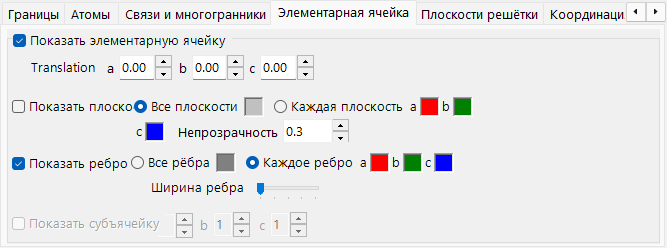

Задаёт положение отрисовываемой элементарной ячейки и отображение её граней и рёбер.

#### Трансляция

Каждая пространственная группа имеет начало координат по умолчанию. Чтобы сместить центр отрисованной элементарной ячейки от этого начала координат, задайте трансляцию вдоль *a*, *b*, *c*.

Трансляция связана с [центром проекции](#центр-проекции): задание центра проекции $(x, y, z)$ устанавливает трансляцию $(x-0.5,\ y-0.5,\ z-0.5)$. Положительная трансляция сдвигает отрисованную ячейку к +*a*, +*b*, +*c*. <!-- 261106Cl 作者の決定 H3/H18 -->

#### Показать плоскость ячейки

Отрисовывать ли шесть граней, ограничивающих элементарную ячейку. Когда включено, можно задать цвет грани и прозрачность.

#### Показать рёбра

Отрисовывать ли рёбра элементарной ячейки. Цвет рёбер настраивается.

Главный флажок **Показать элементарную ячейку** (= кнопка панели инструментов *Элементарная ячейка*) включает/выключает всю ячейку. Цвета граней и рёбер можно задать сразу для **Все плоскости** / **Все рёбра** или для **Каждая плоскость** / **Каждое ребро** (*a*, *b*, *c* по отдельности); **Ширина ребра** задаёт толщину линии, а **Непрозрачность** — прозрачность граней.

#### Показать субъячейку

**Показать субъячейку** рисует линии сетки, делящие ячейку на число частей, заданное в полях **a**, **b**, **c** (1–10 каждое; поля доступны, только пока флажок установлен), на гранях и внутри ячейки. Линии, совпадающие с рёбрами ячейки, не рисуются. Линии принимают цвет рёбер (**Все рёбра** / **Каждое ребро**), половину ширины ребра (не менее 1 px) и непрозрачность 0,5 и показываются независимо от **Показать ребро ячейки**. В экспорт 3D-модели они не включаются. <!-- 261106Cl 作者の決定 H5 -->

### Плоскости решётки

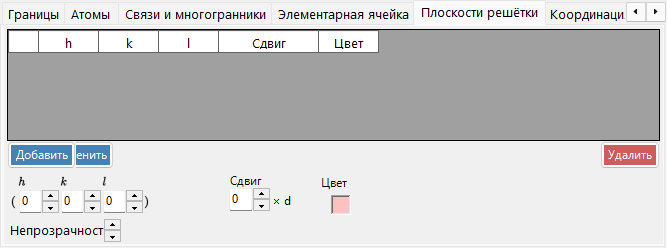

Рисует плоскости решётки, заданные индексом Миллера, при необходимости вместе с кристаллографически эквивалентными плоскостями.

#### Индексы H k l

Задаёт плоскость решётки по её индексу Миллера. Флажок при необходимости включает кристаллографически эквивалентные плоскости, порождённые из (*hkl*).

#### Трансляция

Сдвигает отрисованные плоскости решётки вдоль их нормали на долю межплоскостного расстояния *d* (**× d**, от −0.5 до 0.5); положительные значения сдвигают их к +**g** (плоскости лежат при **g**·**r** = (*m* + T)*d*). Поэтому значения, сохранённые в списках кристаллов прежними версиями, отрисовываются с противоположной стороны (0 и ±0.5 выглядят одинаково). <!-- 261106Cl 作者の決定 C5 --> Отрисовывается каждая плоскость семейства, пересекающая область отрисовки, — по одной на каждое *d*. Плоскости привязаны к кристаллической решётке: при 0 они проходят через узлы решётки и перемещаются вместе со структурой при изменении [центра проекции](#центр-проекции). <!-- 261105Cl 監査: LatticePlaneControl numericBoxDistance (−0.5〜0.5, × d)、FormStructureViewer.cs:SetLatticePlanes (4fd9e8c3)。「d の整数倍」は誤り -->

### Координация

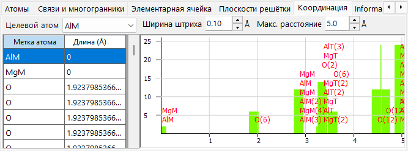

Перечисляет в таблице и показывает на графике атомы, координирующие выбранный целевой атом.

#### Таблица (слева)

Перечисляет, какие атомы окружают выбранный целевой атом и на каком расстоянии. Целевой атом выбирается из выпадающего списка над таблицей.

#### График (справа)

Гистограмма числа соседей в зависимости от расстояния, построенная по тем же данным, что и таблица. Подберите **Полуширина** (полуширину *w* каждого столбца, покрывающего *d* ± *w*) так, чтобы столбцы чётко разделяли координационные сферы <!-- 261106Cl 作者の決定 B18 --> — это даёт визуальную оценку координационного числа.

### Информация

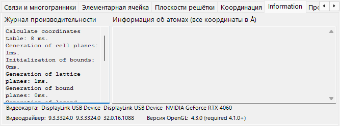

Журнал отрисовки (время кадра, сведения о GPU) и базовая информация о выбранном атоме. В разработке — со временем поля могут расширяться.

### Проекция

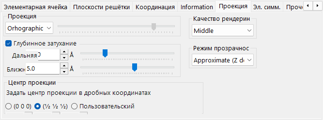

Задаёт режим проекции (ортографическая / перспективная), затухание по глубине, центр проекции, качество отрисовки и алгоритм прозрачности.

#### Проекция

- **Orthographic**: идеальная параллельная проекция (точка наблюдения в бесконечности).
- **Perspective**: перспективная проекция с расстояния наблюдения, заданного ползунком.

#### Затухание по глубине

Постепенно приглушает удалённые объекты в направлении глубины (**Глубинное затухание**). Цвет линейно смешивается с **цветом фона**: объекты ближе **Ближняя** сохраняют собственный цвет, объекты дальше **Дальняя** принимают цвет фона, а промежуточные интерполируются. (Сама непрозрачность не меняется.) **Ближняя** и **Дальняя** задаются в Å.

#### Центр проекции

Устанавливает центр проекции в указанные координаты. Включите **Пользовательский**, чтобы ввести произвольные координаты. Введённые значения (от −1 до 1) используются как есть. Видео с **Перенос** (см. [меню «Файл»](#меню-файл)) автоматически управляет этими значениями и по ходу движения приводит каждую координату к диапазону от −0.5 до +0.5 (один период решётки). <!-- 261105Cl 監査: 折り畳むのは SetProjectionCenter (動画の経路) だけ。マクロに投影中心の関数は無い -->

#### Качество отрисовки

Качество отрисовки (разбиение сетки, сглаживание). Более высокое качество медленнее — выберите настройку, соответствующую вашему GPU.

#### Режим прозрачности

Алгоритм, используемый для полупрозрачных атомов и многогранников.

- **Approximate (Z depth sorting, OpenGL 4.1+)**: быстрый, но может быть неточным, когда перекрывается много полупрозрачных объектов.
- **High quality (dual depth peeling, OpenGL 4.1+)**: независимая от порядка прозрачность методом послойного снятия глубины (depth peeling). Показывается, только когда включено **Инструменты ▸ Enable DDP** (по умолчанию включено, если PPLL недоступен). Число проходов следует настройке [Качество отрисовки](#качество-отрисовки).
- **High quality (per-pixel linked list, OpenGL 4.3+)**: точная независимая от порядка прозрачность; показывается, только когда GPU поддерживает OpenGL 4.3. Точная, но медленная; фактически требует дискретного GPU.

### Элементы симметрии

Вкладка **Эл. симм.** отрисовывает операторы симметрии пространственной группы прямо на 3D-модели (переключается кнопкой панели инструментов **Эл. симм.**). Каждый класс элементов можно показывать/скрывать независимо:

- **Оси симметрии**: **Повороты**, **Винтовые оси**, **Инверсионные повороты**
- **Плоскости**: **Отражения**, **Скольжения**
- **Центры инверсии**

Главный переключатель — **Показать элементы симметрии**. Для каждой группы можно настроить размер символа (%) и цвет, а для осей и плоскостей — также толщину линии.

### Прочее

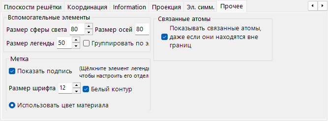

- **Вспомогательные элементы**: задаёт размеры отображения (шар света, оси, легенда). **Группировать по элементу** переключает отображение легенды.
- **Связанные атомы**: **Показывать связанные атомы, даже если они находятся вне границ** продолжает отрисовывать атомы, связанные с атомами внутри области отрисовки, даже когда они оказываются за её пределами.
- **Метка**: настройки подписей атомов в 3D-виде (не в легенде) — **Показать подпись**, **Размер шрифта**, **Белый контур** и цвет подписи (**Использовать цвет материала** или **Использовать фиксированный цвет**). Щелчок по записи в легенде атомов переключает подписи этого атома (или элемента, при **Группировать по элементу**) по отдельности.

---

## Панель инструментов

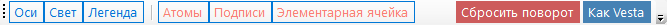

| Кнопка | Описание |
|--------|-------------|
| Оси | Показать ориентацию осей (размер = постоянная решётки) |
| Свет | Задать направление света |
| Легенда | Легенда атомов |
| Атомы | Показать/скрыть атомы; связи, многогранники и подписи строятся на атомах, поэтому они тоже скрываются <!-- 261105Cl 監査: toolStripButtonAtomObjects.ToolTipText (2028c4a1) --> |
| Подписи | Переключить подписи атомов |
| Элементарная ячейка | Переключить рёбра элементарной ячейки |
| Эл. симм. | Переключить наложение элементов симметрии (см. выше) |
| Сбросить поворот | Вернуться к исходной ориентации |
| Как Vesta | Переключиться на внешний вид в стиле VESTA: цвета и радиусы атомов сбрасываются, а список связей **заменяется** связями по умолчанию |

---

## См. также

- [Главное окно](0-main-window.md)
- [База данных кристаллов](1-crystal-database.md)
- [Сведения о симметрии](2-symmetry-information.md)
- [Симулятор дифракции](7-diffraction-simulator/index.md)
- [Клавиатурные и мышиные сочетания](21-shortcuts.md)
