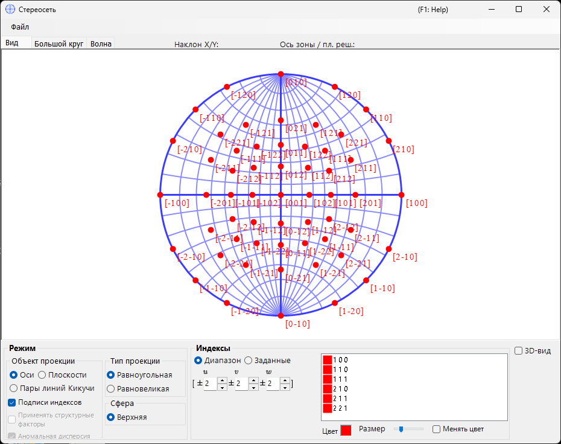
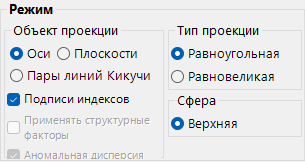
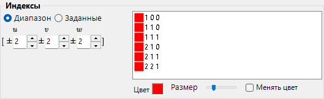
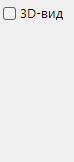
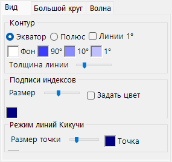
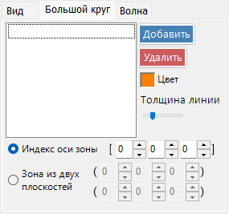
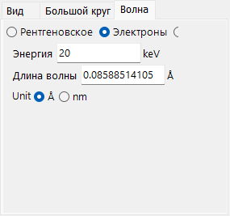

# Стереосеть

**Стереосеть** отображает направления кристаллических плоскостей и осей с помощью стереографической проекции.

---

## Сочетания клавиш и мыши

Сама стереосеть представляет собой 2-D-проекцию; при необходимости можно отобразить 3-D-сферу с помощью **3D-вид**.

| Сочетание | Действие |
|----------|--------|
| <kbd>F1</kbd> | Открыть эту страницу онлайн-руководства |
| Перетаскивание левой кнопкой вблизи центра | Наклонить кристалл |
| Перетаскивание левой кнопкой во внешней области | Вращать кристалл вокруг оси обзора |
| Двойной щелчок левой кнопкой | Переключение между проекцией **Плоскости** и **Оси** |
| Щелчок правой кнопкой | Уменьшить масштаб |
| Перетаскивание рамки правой кнопкой | Увеличить масштаб выбранной области |
| Перетаскивание средней кнопкой | Панорамирование |
| Перемещение мыши (без нажатой кнопки) | Считать (hkl)/[uvw] под курсором — удобно для индицирования измеренного рефлекса (также в нижней полусфере) <!-- 261105Cl 監査: 下半球の読み取り (268779a1) --> |

Перетаскивание по сети вращает **кристалл**; состояние поворота является общим для всех окон.

3-D-визуализация использует стандартную [навигацию по виду OpenGL](21-shortcuts.md) ReciPro (перетаскивание левой кнопкой — поворот, перетаскивание правой кнопкой / колесо — масштабирование, <kbd>CTRL</kbd> + двойной щелчок правой кнопкой переключает проекцию) и вращает только 3-D-вид, а не сам кристалл.

Общеприложенческие сочетания <kbd>CTRL</kbd>+<kbd>SHIFT</kbd> из [главного окна](0-main-window.md#keyboard-mouse-shortcuts) также работают, когда это окно находится в фокусе.

→ См. **[21. Сочетания клавиш и мыши](21-shortcuts.md)** для обзора всех окон сразу.

---

## Главная область

Здесь отображается стереосетевая проекция кристаллических плоскостей, индексов направления и линий Кикучи выбранного кристалла.

---

## Меню «Файл»

Сохранение или копирование в виде растрового изображения (PNG) либо векторного метафайла (EMF). Вставленный метафайл позволяет редактировать шрифты и толщину линий в PowerPoint или других векторных редакторах.

| Пункт меню | Описание |
|-----------|-------------|
| Сохранить изображение ▸ как изображение (формат PNG) / как метафайл (EMF) | Сохранить стереосеть в файл PNG или в векторный файл EMF <!-- 261105Cl 監査: as Metafile (EMF) の保存を配線 (FormStereonet.cs, 268779a1) --> |
| Копировать в буфер обмена ▸ Как изображение / как метафайл (EMF) | Скопировать стереосеть |
| Сохранить видео ▸ Стереосеть / 3D | Сохранить видео вращения (MP4) стереосети или 3-D-вида с помощью того же диалога настройки видео, что и в [Просмотре структуры](5-structure-viewer.md#меню-файл) (только вращение) |
| Параметры страницы / Предварительный просмотр / Печать | Печать стереосети |

---

## Режим {#mode}

### Цель проекции

Выберите, что проецировать на сеть.

- **Оси** — проецирует индексы направления \([uvw]\).
- **Плоскости** — проецирует нормали кристаллических плоскостей \((hkl)\).
- **Пары линий Кикучи** — проецирует пары линий Кикучи.

### Метод проекции

| Метод | Описание |
|--------|-------------|
| **Равноугольная** (Вульф / стереографическая) | Сохраняет угловое соотношение между проецируемыми элементами, но не телесный угол. Используется классическими кристаллографами при считывании углов между осями или плоскостями. |
| **Равновеликая** (Шмидт / равновеликая / Ламберта) | Сохраняет телесный угол (площадь) каждой области, но искажает углы. Предпочтительна для статистических полюсных фигур, где важна относительная плотность. |

### Полусфера

Выберите **Верхняя** или **Нижняя** полусферу в качестве источника проекции — это переключает, является ли видимая сторона сферы той, что ближе к наблюдателю, или той, что дальше от него.
**Верхняя** = сторона $+Z$ (к наблюдателю, см. [Приложение A1.1](appendix/a1-coordinate-system/1-orientation.md)); при **Нижняя** компонента $Z$ каждого направления перед проецированием инвертируется, а точки рисуются **незакрашенными кружками** вместо закрашенных.

### Параметры отображения

- **Подписи индексов**: показывать подписи индексов.
- **Структурные факторы к интенсивности**: когда выбрано **Плоскости** или **Пары линий Кикучи**, каждый элемент взвешивается по своему структурному фактору (задайте источник волны и длину волны на [вкладке Волна](#wave)). Вес равен $I_{\mathrm{rel}} = |F_{hkl}|^2 / \max|F|^2$ по отображаемому набору: в режиме **Плоскости** радиус точки умножается на $\sqrt{I_{\mathrm{rel}}}$ (т. е. $\propto |F_{hkl}|$); в режиме **Пары линий Кикучи** непрозрачность линии равна $I_{\mathrm{rel}}$.
- **Аномальная дисперсия**: включать в структурные факторы члены рентгеновской аномальной дисперсии $f'$, $f''$. Доступно только для рентгеновских лучей и в режимах **Плоскости** / **Пары линий Кикучи**.

> Для тригональных/гексагональных кристаллов нотацию Миллера–Браве (4-индексную) можно включить через **Параметры ▸ Использовать индексы Миллера–Браве (hkil)** в главном окне.

---

## Индексы {#indices}

Задаёт, какие кристаллические плоскости / оси отображаются.

### Режим диапазона

Укажите диапазон индексов \([uvw]\) или \((hkl)\). ReciPro перебирает каждый индекс в пределах заданных границ и проецирует каждый из них.

В режиме **Диапазон** границами служат ± введённые значения; берутся только несократимые индексы, сгруппированные в наборы кристаллографически эквивалентных индексов (каждому набору присваивается один цвет).

### Режим структурного фактора

Доступен только для **Плоскости** и **Пары линий Кикучи**. Проецирует плоскости с наибольшим $|F_{hkl}|^2$ для текущего источника волн. **Макс.** задаёт число рисуемых плоскостей (эквивалентные плоскости считаются по отдельности; в режиме **Плоскости** рефлекс, параллельный более сильному, — его более высокий или более низкий порядок, например 222 при более сильном 111, — пропускается).

### Заданный режим

Задаёт отдельные оси или плоскости по отдельности. Введите индекс, нажмите **Добавить**, чтобы зарегистрировать его, или **Удалить**, чтобы удалить. Когда установлен флажок **Включать эквивалентные индексы**, отображаются также все кристаллографически эквивалентные индексы.

### Colour / Size

Задайте **colour** и **size** наносимых точек. Установите флажок **Менять цвет**, чтобы кодировать цветом каждый набор эквивалентных осей/плоскостей по-разному — удобно для различения семейств на многоиндексной диаграмме.

---

## 3D Options

Показывается, когда отмечен **3D-вид**; 3-D-сфера появляется на панели справа от сети.

- **Сброс вида**: вернуть 3-D-вид к направлению и масштабу по умолчанию.
- **Метка**: рисовать подписи индексов в 3-D. Направления подписываются как [uvw]; четырёхиндексная форма (при включённом **Использовать индексы Миллера–Браве (hkil)**) используется только для плоскостей и линий Кикучи. <!-- 261105Cl 監査: 3D のラベル (FormStereonet.cs, 268779a1) -->
- **Полусфера**: рисовать только полюсы на верхней ($Z>0$) полусфере.
- **Стереосеть**: рисовать в 3-D плоскость проекции (сеть) с проецированными точками полюсов верхней полусферы.
- **Контур сферы**: рисовать сетку широт/долгот сферы.
- **Линии проекции** (при включённой **Стереосеть**): рисовать вспомогательные линии проекции каждого полюса верхней полусферы — прямую от южного полюса $(0,0,-1)$ до полюса для проекции Вульфа, дугу для проекции Шмидта.
- **Глубинное затухание**: сила глубинного затухания 3-D-вида.

---

## Меню вкладок

### Вид {#appearance}

#### Контур {#outline}

Как отрисовывается контур стереосети — ограничивающая окружность и необязательная сетка больших кругов по широте/долготе. Выберите **Экватор** или **Полюс**, переключите **Линии 1°** и заливку **Background**, задайте цвета сетки **90° / 10° / 1°** и настройте **Толщина линии** с помощью ползунка.

#### Подписи индексов {#index-labels}

- **Размер** — размер подписей индексов.
- **Цвет** — использовать единый фиксированный цвет для всех подписей индексов вместо цвета каждой точки; удобно, когда точки закодированы цветом, но вы хотите, чтобы все подписи были одного цвета для удобочитаемости.
- **Раздел.** — символ, помещаемый между индексами в каждой подписи: **Нет** (например, 100), **Пробел** (1 0 0) или **Запятая** (1,0,0).

#### Режим линий Кикучи {#kikuchi-line-mode}

- **Размер точки** — размер наносимых точек.
- **Point** / **Label** — цвета точек и их подписей.

### Большой круг

Рисование больших кругов (малые круги не поддерживаются). Задайте их либо по **Индекс оси зоны** \([uvw]\) (большой круг, образованный зоной этой оси), либо по **Зона из двух плоскостей** (ось зоны — их векторное произведение). Для редактирования списка используйте **Добавить** / **Удалить**; снятие флажка у записи скрывает этот круг. Цвет и толщина линий кругов также настраиваются. Круги следуют методу проекции и полусфере, выбранным в разделе [Режим](#mode) (Вульф или Шмидт, верхняя или нижняя). <!-- 261105Cl 監査: Schmidt・下半球の大円 (268779a1) -->

### Волна {#wave}

Используется только когда в качестве цели проекции выбрано **Плоскости** или **Пары линий Кикучи** (в режиме **Пары линий Кикучи** длина волны задаёт также брэгговский угол, т. е. расстояние между линиями каждой пары). Задаёт источник волны (X-ray / electron / neutron), а также длину волны или энергию, необходимые для вычисления структурных факторов кристалла, используемых параметром **Структурные факторы к интенсивности** в разделе [Режим](#mode).

---

## См. также

- [Главное окно](0-main-window.md)
- [Геометрия вращения](4-rotation-geometry.md)
- [Просмотр структуры](5-structure-viewer.md)
- [Симулятор дифракции](7-diffraction-simulator/index.md)
- [Базовая система координат и ориентация кристалла](appendix/a1-coordinate-system/1-orientation.md)
