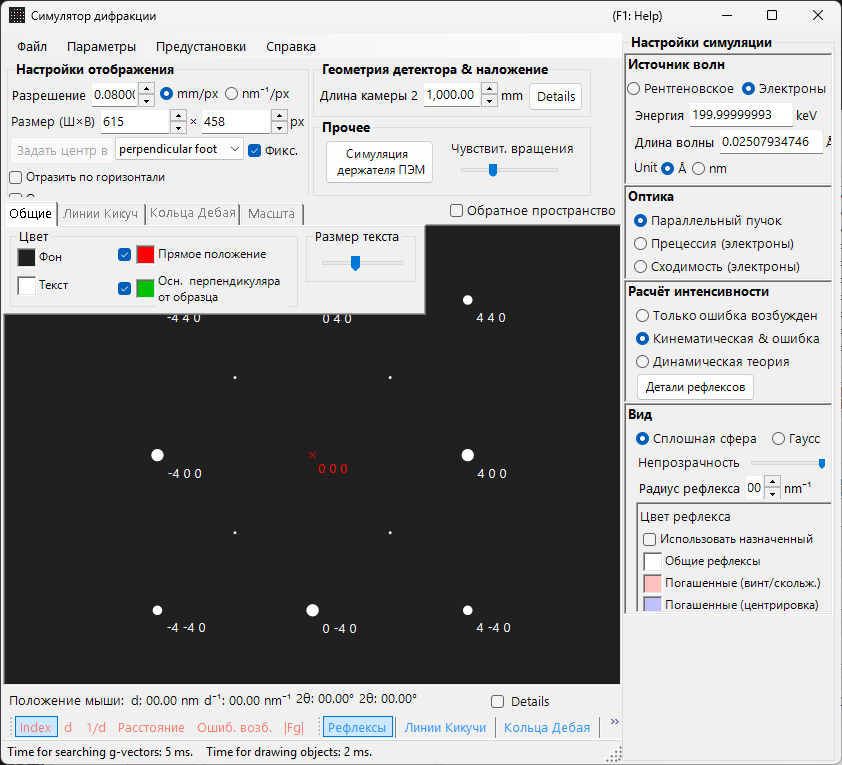
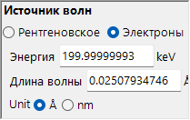
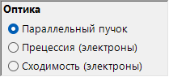
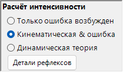
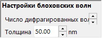
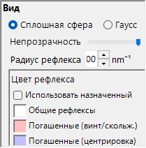

# Моделирование SAED (Selected Area Electron Diffraction)

**Моделирование SAED (Selected Area Electron Diffraction)** рассчитывает картины электронной дифракции монокристалла, создаваемые параллельным электронным пучком. Это режим по умолчанию [симулятора дифракции](index.md).

> На этой странице перечислены все настройки, появляющиеся в панели **Настройки симуляции** справа, когда вы выбираете **Источник волн** = **Электроны** и **Оптика** = **Параллельный пучок**. Операции в масштабе всего окна, такие как рисование и сохранение, описаны на [обзорной странице](index.md).

Условия GUI: Источник волн = Электроны, Оптика = Параллельный пучок, Расчёт интенсивности = Только ошибка возб. / Кинемат. & ошибка возб. / Динамическая теория.

---

## Обзор

Моделирует картину дифракции, возникающую при прохождении параллельного электронного пучка через тонкий образец. Положения рефлексов задаются геометрическим соотношением между сферой Эвальда и узлами обратной решётки, а яркость каждого рефлекса вычисляется в соответствии с выбранным режимом расчёта интенсивности.

---

## Источник волн {#wave-length}

Установите источник излучения на **Электроны**. Введите энергию (keV) или длину волны (Å или nm, переключается; по умолчанию Å), и будет вычислена релятивистски скорректированная длина волны. Начальное значение — 200 keV; меню **Предустановки** одним щелчком задаёт 300 / 200 / 120 kV. Для рентгеновских и нейтронных источников см. [Моделирование рентгеновской дифракции](5-x-ray-neutron-diffraction.md).

---

## Оптика {#incident-beam-mode}

Установите **Оптика** (геометрию падающего пучка) на **Параллельный пучок**. Это стандартная геометрия плоской волны, используемая для SAED и рентгеновской дифракции.

> **Примечание**: Для электронов можно выбрать **Параллельный пучок** / **Прецессия (электроны)** / **Сходимость (электроны)**. Выбор **Прецессия (электроны)** даёт [моделирование PED](2-ped-simulation.md), а выбор **Сходимость (электроны)** даёт [моделирование CBED](3-cbed-simulation.md); в обоих случаях расчёт интенсивности автоматически переключается на **Динамическая теория**.

---

## Расчёт интенсивности {#intensity-calculation}

Определяет, как вычисляются интенсивности рефлексов.

### Только ошибка возбуждения

Интенсивность определяется исключительно по геометрическому расстоянию между сферой Эвальда и узлом обратной решётки (ошибке возбуждения $S_g$). Она максимальна при $S_g = 0$ — точно на сфере — и убывает с ростом $\lvert S_g\rvert$, обращаясь в нуль, как только $\lvert S_g\rvert$ превышает **Радиус рефлекса**, заданный для узла обратной решётки. Поскольку структурный фактор кристалла игнорируется, это самый быстрый режим, подходящий для проверки положений дифракционных рефлексов.

Только в этом режиме появляются следующие параметры:

| Параметр | Описание |
|--------|-------------|
| **Исключить все запрещённые рефлексы** | Скрыть все рефлексы, запрещённые пространственной группой (центрировка решётки, винтовые оси и плоскости скользящего отражения). При отметке этого флажка следующий параметр также отмечается и блокируется. |
| **Исключить рефлексы, запрещённые центрировкой решётки** | Скрыть только рефлексы, запрещённые центрировкой решётки (по умолчанию включено). |
| **Рисовать все рефлексы с одинаковым радиусом** | Рисовать каждый возбуждённый рефлекс с полным радиусом *R* независимо от $S_g$. |

Запрещённые рефлексы, остающиеся видимыми, рисуются цветами **Погашенные (винт/скольж.)** / **Погашенные (центрировка)** (см. [Spot appearance](#spot-appearance)).

### Кинематическая

В дополнение к ошибке возбуждения в интенсивность включается кинематический структурный фактор $\lvert F_{hkl} \rvert^2$. Правила погасания воспроизводятся корректно, что делает этот режим подходящим для тонких образцов или слабой дифракции.

### Динамическая (метод блоховских волн, только электрон)

Строгий динамический расчёт методом блоховских волн (метод Бете). Он воспроизводит многократное рассеяние и зависящее от толщины изменение интенсивности и необходим для толстых образцов или сильной дифракции. Доступен только при выборе Electron. По теории см. [Приложение A3. Метод блоховских волн](../appendix/a3-bloch-wave/calculation.md).

> **Примечание**: При выборе **Динамическая теория** ниже появляется панель **Настройки блоховских волн**.

---

## Bloch wave settings (динамическая теория)

Активна только при **Расчёт интенсивности** = **Динамическая теория**.

| Параметр | Описание |
|-----------|-------------|
| **Число дифрагированных волн** | Число блоховских волн, учитываемых в задаче на собственные значения (8–1000, по умолчанию 240). Бо́льшие значения дают более точные интенсивности, но увеличивают время вычислений как $O(N^3)$ |
| **Толщина** | Толщина образца (nm), используемая в динамическом расчёте (0,01–10000 nm, по умолчанию 50 nm) |

---

## Spot appearance

Управляет тем, как отображается каждый дифракционный рефлекс.

- **Сплошная сфера / Гаусс** : геометрическая модель узла обратной решётки (по умолчанию **Сплошная сфера**). **Сплошная сфера** рисует сечение (окружность) между сферой и сферой Эвальда: радиус сферы равен $R\,I^{1/3}$ для **Кинемат. & ошибка возб.** (объём сферы ∝ интенсивности) и $R$ для **Только ошибка возб.**; для **Динамическая теория** рисуется диск радиуса $R\,I_\text{dyn}^{1/2}$ (площадь ∝ интенсивности) без сечения сферой Эвальда. **Гаусс** рисует сечение (2-мерную гауссиану) 3-мерной гауссианы с $\sigma = R$, интеграл которой соответствует интенсивности дифракции.
- **Непрозрачность** : прозрачность рефлекса (0 = прозрачный, 1 = непрозрачный).
- **Радиус рефлекса** (R) : виртуальный радиус узла обратной решётки (nm⁻¹; 0,01–1, по умолчанию 0,2). Размер рефлекса задаётся сочетанием режима **Вид** и **Расчёт интенсивности** (см. выше).
- **Яркость**, **Цветовая шкала**, **Лог. шкала** : показываются только в режиме **Гаусс**. **Яркость** масштабирует интегральную интенсивность отрисованной гауссианы; **Цветовая шкала** — **Gray** (рефлексы рисуются цветами рефлексов, см. ниже), **Cold-warm**, **Spectrum** или **Fire**; **Лог. шкала** отображает интенсивности в логарифмической шкале (полезно для картин с большим контрастом интенсивностей).
- **Цвет рефлекса** : показывается, пока **Цветовая шкала** = **Gray** (начальная настройка). **Общие рефлексы**, **Погашенные (винт/скольж.)** и **Погашенные (центрировка)** задают цвета разрешённых и запрещённых рефлексов.
- **Цвет по кристаллу** : если флажок установлен, рефлексы рисуются цветом, назначенным каждому кристаллу (также и в случае одного кристалла).

---

## Spot labels

Подписи, накладываемые на рефлексы, выбираются в [панели инструментов](index.md#toolbar).

| Подпись | Содержание |
|-------|---------|
| **Index** | индексы Миллера $(hkl)$; четыре индекса $(hkil)$, когда в главном окне включено **Параметры ▸ Использовать индексы Миллера–Браве (hkil)** и кристалл использует гексагональные оси (подписи линий Кикучи, колец Дебая и 3-D следуют той же настройке) <!-- 261105Cl 監査: C23 --> |
| **d** | межплоскостное расстояние $d$, в Å или nm в соответствии с единицей длины главного окна <!-- 261106Cl 作者の決定 C20 --> |
| **1/d** | величина, обратная межплоскостному расстоянию, $1/d$, в nm⁻¹ или Å⁻¹ в соответствии с единицей длины главного окна <!-- 261106Cl 作者の決定 C2 --> |
| **Расстояние** | расстояние на детекторе от рефлекса до прошедшего (прямого) пучка (mm), измеренное между отрисованными положениями, поэтому оно верно и для наклонённого детектора, рентгеновской прецессионной камеры и Back Laue (отсчёт от отверстия для пучка); не показывается, если прошедший пучок не попадает на детектор <!-- 261105Cl 監査: DrawDiffractionSpotsLabel (C15)。L2 tan2θ は傾けない平板の検出器だけ --> |
| **2θ** | угол рассеяния $2\theta$ (то же определение, что и у концентрических окружностей шкалы 2θ) |
| **χ** | азимутальный угол $\chi$, отсчитываемый от направления вверх (12 часов), положительный по часовой стрелке (то же определение, что и у радиальных линий азимутальной шкалы) |
| **Ошиб. возб.** | ошибка возбуждения $S_g$, в nm⁻¹ или Å⁻¹ в соответствии с единицей длины главного окна |
| **Интенс.** | относительная интенсивность (%) в режиме **Кинемат. & ошибка возб.**; в режиме **Динамическая теория** — относительная интенсивность (% от сильнейшего дифрагированного пучка, без 000) и комплексная амплитуда на выходной поверхности. В режиме **Только ошибка возб.** ничего не показывается |

---

## Общие операции

Сведения о детекторе, отражение, отображение обратного пространства, линии Кикучи, кольца Дебая, масштабные линии, настройки цвета, сохранение и тому подобное являются общими для всех режимов. См. [обзорную страницу](index.md). Детали по каждому рефлексу, полученные из динамического расчёта, можно просмотреть в [сведениях о дифракционном рефлексе](index.md#diffraction-spot-information).

---

## См. также

- [Симулятор дифракции (обзор)](index.md)
- [Расчёт SAED с параллельным пучком](../appendix/a3-bloch-wave/calculation.md#parallel-beam-saed)
- [Моделирование рентгеновской дифракции](5-x-ray-neutron-diffraction.md)
- [Моделирование прецессионной электронной дифракции (PED)](2-ped-simulation.md)
- [Определение системы координат](../appendix/a1-coordinate-system/1-orientation.md)
