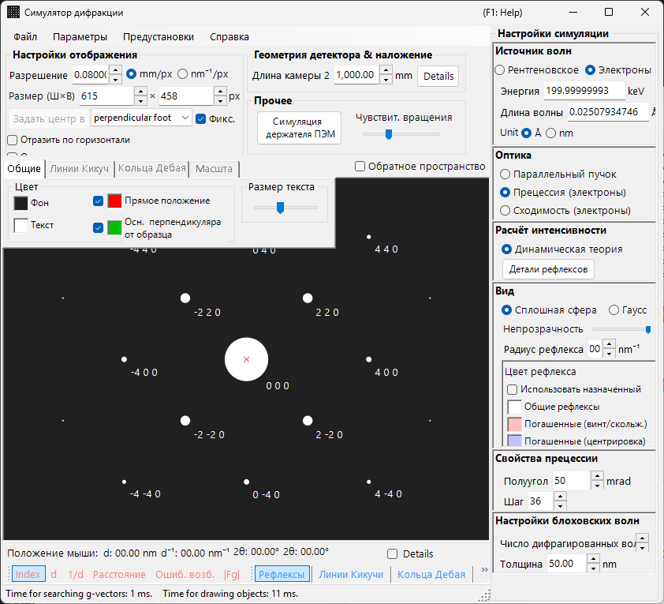
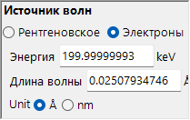
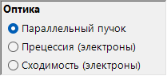
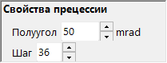
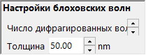
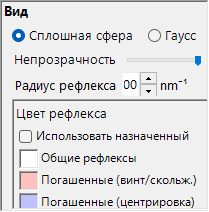

# Моделирование прецессионной электронной дифракции (PED)

Моделирование **PED (Precession Electron Diffraction)** вычисляет картины электронной дифракции, получаемые при прецессии падающего пучка по конусу вокруг оптической оси.

> На этой странице перечислены все настройки, которые появляются в правой части окна при выборе **Источник волн = Электроны, Оптика = Прецессия (электроны), Расчёт интенсивности = Динамическая теория (автоматически)**. Обратите внимание, что **выбор Прецессия (электроны) в Оптика автоматически переключает расчёт интенсивности на Динамическая теория**. Об операциях на уровне всего окна, таких как рисование и сохранение, см. [обзорную страницу](index.md).

Условия GUI: **Источник волн = Электроны, Оптика = Прецессия (электроны), Расчёт интенсивности = Динамическая теория (автоматически)**

---

## Обзор

При PED электронный пучок прецессирует по конусу вокруг оптической оси, а картины дифракции, полученные для каждого направления пучка на конусе прецессии, интегрируются. По сравнению с обычной SAED это даёт следующие преимущества:

- Динамические эффекты усредняются, что даёт данные об интенсивности, близкие к кинематическим соотношениям интенсивностей
- Рефлексы зон Лауэ высшего порядка (HOLZ) наблюдаются более отчётливо
- Можно получить данные об интенсивности, пригодные для структурного анализа

---

## Источник волн {#wavelength-setup}

Поскольку PED — это электронная дифракция, выберите **Электроны** в качестве **Источник волн**. Ввод энергии электронов (keV) или длины волны (Å или nm, переключается; по умолчанию Å) вычисляет релятивистски скорректированную длину волны.

---

## Оптика {#incident-beam}

В **Оптика** (геометрия падающего пучка) выберите **Прецессия (электроны)** (доступно только при выбранном источнике **Электроны**).

> **Примечание** : Выбор **Прецессия (электроны)** **автоматически переключает расчёт интенсивности на Динамическая теория**, и появляются панель настроек метода блоховских волн и панель настроек прецессии. **Только ошибка возб.** / **Кинемат. & ошибка возб.** больше нельзя выбрать.

---

## Настройки прецессии

Задайте форму и дискретизацию конуса прецессии.

| Параметр | Описание | Рекомендуется |
|-----------|-------------|-------------|
| **Угол прец.** | Угол прецессии = половинный угол раствора конуса прецессии (mrad; 0,1–500, по умолчанию 50) <!-- 261106Cl 作者の決定 D1 --> | 10–40 mrad |
| **Шаг** | Число направлений параллельного пучка, дискретизируемых на конусе прецессии (2–1080, по умолчанию 36). Большие значения дают более гладкое интегрирование, но линейно увеличивают время вычислений | 36–72 |

---

## Расчёт интенсивности и настройки метода блоховских волн

В момент выбора **Прецессия (электроны)** **Расчёт интенсивности** фиксируется на **Динамическая теория** (автоматически). Для параллельного пучка в каждом направлении прецессии интенсивность дифракции вычисляется методом блоховских волн (динамический расчёт), и интегрирование по всем направлениям даёт картину PED.

| Параметр | Описание | Рекомендуется |
|-----------|-------------|-------------|
| **Число дифрагированных волн** | Число блоховских волн, учитываемых в задаче на собственные значения (8–1000, по умолчанию 240). Большие значения дают более точные интенсивности, но время вычислений растёт как $O(N^3)$ | 50–200 |
| **Толщина** | Толщина образца, используемая в динамическом расчёте (nm; 0,01–10000, по умолчанию 50) | — |

Вычислительная стоимость примерно равна «число шагов × расчёт блоховских волн на одно направление». Подробности динамического расчёта см. в разделе [Динамический расчёт (метод блоховских волн)](../appendix/a3-bloch-wave/calculation.md).

---

## Отображение рефлексов

Управляет тем, как рисуется каждый дифракционный рефлекс.

- **Сплошная сфера** / **Гаусс** : Геометрическая модель узлов обратной решётки. **Сплошная сфера** рисует сечение сферы радиуса $R$ со сферой Эвальда, а **Гаусс** рисует сечение (2D-гауссиану) 3D-гауссианы с $\sigma = R$ со сферой Эвальда.
- **Непрозрачность** : Прозрачность рефлекса (0 = прозрачный, 1 = непрозрачный).
- **Радиус рефлекса** (R) : Радиус узлов обратной решётки. Для динамических интенсивностей интеграл гауссианы $=$ **Яркость** $\times I_\text{dyn}$, а **Сплошная сфера** использует радиус $R \times I_\text{dyn}^{1/2}$ (так что площадь пропорциональна динамической интенсивности).
- **Яркость**, **Цветовая шкала**, **Лог. шкала** : показываются только в режиме **Гаусс**. **Яркость** масштабирует интегральную интенсивность рисуемой гауссианы; **Цветовая шкала** — **Gray** (рефлексы рисуются цветами рефлексов, см. ниже), **Cold-warm**, **Spectrum** или **Fire**; **Лог. шкала** отображает интенсивность в логарифмическом масштабе.
- **Цвет рефлекса** : показывается, пока **Цветовая шкала** = **Gray** (начальная настройка): **Общие рефлексы** / **Погашенные (винт/скольж.)** / **Погашенные (центрировка)**.
- **Цвет по кристаллу** : Рисует рефлексы цветом, назначенным каждому кристаллу.

---

## Сравнение с SAED

| Свойство | SAED | PED |
|---------|------|-----|
| Пучок | Параллельный, фиксированный | Прецессирующий (сканирование по конусу) |
| Динамические эффекты | Большие | Усреднённые, меньше |
| Рефлексы HOLZ | Слабые | Проявляются сильно |
| Надёжность интенсивности | Может быть недостаточной для структурного анализа | Пригодна для структурного анализа |
| Время вычислений | Короткое | Длинное |

---

## См. также

- [Симулятор дифракции (обзор)](index.md)
- [Моделирование рентгеновской дифракции](5-x-ray-neutron-diffraction.md)
- [Моделирование SAED](1-saed-simulation.md)
- [Динамический расчёт (метод блоховских волн)](../appendix/a3-bloch-wave/calculation.md)
