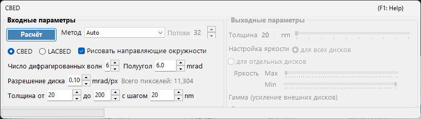
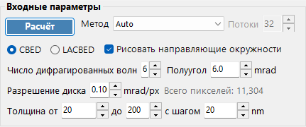
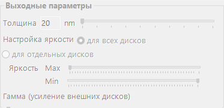

# Моделирование CBED

**Моделирование CBED (Convergent-Beam Electron Diffraction)** рассчитывает и отображает картины дифракции сходящегося пучка с помощью метода блоховских волн (Бете). Картины CBED показывают дифракционные диски вместо рефлексов-точек и содержат богатую информацию о симметрии кристалла, толщине и структуре.

> На этой странице перечислены все настройки специального окна, которое открывается, когда в [Симуляторе дифракции](index.md) вы выбираете источник **Электроны** и в группе **Оптика** — **Сходимость (электроны)**. При выборе **Сходимость (электроны)** **Расчёт интенсивности** автоматически устанавливается в **Динамическая теория**, и это окно настроек CBED открывается. Закрытие этого окна кнопкой × переключает **Оптика** обратно на **Параллельный пучок**. <!-- 261105Cl 監査: FormDiffractionSimulatorMultislice_FormClosing (UserClosing) --> Рассчитанные диски можно сохранить командами **Файл > Сохранить диски CBED** / **Копировать диски CBED** главного окна. О рисовании и сохранении картин дифракции, а также о других операциях, общих для симулятора дифракции, см. [обзорную страницу](index.md).

Условия GUI: Источник волн = Электроны · Оптика = Сходимость (электроны) · Расчёт интенсивности = Динамическая теория (автоматически)

---

## Входные параметры

Пока это окно открыто, панели **Настройки блоховских волн** и **Вид** главного окна отключены; число волн и толщины берутся отсюда.

| Параметр | Описание | По умолчанию / Типично |
|-----------|-------------|-------------------|
| **CBED** / **LACBED** | **CBED**: стандартная картина со сходящимся пучком, в которой каждый диск соответствует одному рефлексу, с проходящим диском (000) в центре. **LACBED** (Large-Angle CBED): рассчитывается и рисуется только проходящий диск (000), без добавления перекрывающихся соседних дисков, поэтому можно использовать полуугол больше брэгговских углов (светлопольная LACBED; сам режим полуугол не расширяет). <!-- 261105Cl 監査: BetheMethod.cs cbed_DoWork (LACBED は 000 だけ)、radioButtonLACBED.ToolTip。「ディスクが重なる」は誤り --> Полезна для наблюдения линий HOLZ (higher-order Laue zone) и симметрии | CBED |
| **Полуугол сход. α** (mrad) | Полуугол конуса сходящегося пучка (0–2000 mrad). Определяет размер каждого дифракционного диска (диаметр диска в обратном пространстве соответствует $2\alpha$) | по умолчанию 6 mrad; обычно 5–30 mrad |
| **Разрешение диска** (mrad/px) | Угловое разрешение внутри каждого диска. Диск дискретизируется на сетке $N\times N$ с $N = \lceil 2\alpha / \text{resolution} \rceil$, и рассчитываются только точки внутри окружности. Меньшие значения дают более высокое разрешение, но число направлений пучка растёт квадратично, поэтому и время расчёта возрастает квадратично. Получающееся число — число пикселей в каждом диске, т. е. направлений падающего пучка внутри круга сходимости, каждое из которых требует одного расчёта блоховских волн, — показывается как **Всего пикселей** <!-- 261105Cl 監査: label2/labelDivisionNumber.ToolTip --> | по умолчанию 0,1 mrad/px |
| **Дифр. волны** | Максимальное число пучков, включаемых в расчёт методом блоховских волн при каждом направлении падающего пучка (1–2048). Большее число пучков даёт более высокую точность, но затраты на решение задачи на собственные значения растут как $O(N^3)$ | по умолчанию 64; обычно 100–500 |
| **Толщина от / до / с шагом** | Начальное, конечное значения и шаг толщины образца (nm, каждое 1–1000). Несколько толщин рассчитываются вместе и переключаются ползунком толщины на стороне вывода | по умолчанию от 20 до 200 nm, шаг 20 nm |
| **Метод** | Расчётный движок. **Auto**; **Eigenproblem with Eigen lib.** / **Eigenproblem with MKL lib.** (диагонализация); **Matrix exp. with Eigen lib.** / **Matrix exp. with MKL lib.** (метод матричной экспоненты, v4.794). **Auto** использует метод матричной экспоненты с Eigen и всеми логическими процессорами, если Eigen доступна, иначе — задачу на собственные значения с MKL. Путь матричной экспоненты требует равноотстоящих толщин, иначе выполняется возврат к задаче на собственные значения. Пункты MKL не предлагаются на ARM64, а пункты Eigen скрываются, если нативная библиотека Eigen недоступна | Auto |
| **Потоки** | Число параллельных потоков (1–128). Отключено для **Auto**; при выборе метода устанавливается равным числу логических процессоров (¼ от него для MKL) | — |
| **Рисовать направляющие окружности** | Если флажок установлен, на основной картине рисуются жёлтые окружности, обозначающие границу каждого дифракционного диска (в LACBED — окружность для 000 и крестики для остальных рефлексов) | вкл. |

---

## Run / Stop

- **Расчёт** : запускает моделирование CBED с текущими входными параметрами.
- **Стоп** : отменяет выполняющийся расчёт. Результат последнего завершённого расчёта остаётся на экране (также при неудачном расчёте). <!-- 261105Cl 監査: Bethe_CbedCompleted (completedDisks ほか) -->

---

## Выходные параметры

После завершения расчёта выходные параметры становятся доступными. Все они изменяют только отображение без повторного расчёта.

| Параметр | Описание |
|-----------|-------------|
| **Толщина** | Выбирает ползунком отображаемую толщину образца среди толщин последнего завершённого расчёта (последующее изменение полей толщины на входе её не меняет; за ней следует таблица [сведений о дифракционных рефлексах](index.md#diffraction-spot-information)) <!-- 261105Cl 監査: CompletedThicknesses (最後に完了した計算の厚み) --> |
| **Настройка яркости** | **для всех дисков**: одна шкала яркости, нормированная на максимум по всем дискам. **для отдельных дисков**: каждый диск нормируется на собственный максимум (γ сбрасывается в 0 и отключается) |
| **Яркость** (**Max** / **Min**) | Верхний и нижний пределы отображаемой интенсивности в долях максимума (положение ползунка применяется в 4-й степени). Настраивайте, когда нужно выделить слабые особенности |
| **Гамма (усиление внешних дисков)** | Умножает каждый пиксель на $\exp(\gamma\,r)$, где $r$ — его расстояние от центра картины, чтобы тёмные внешние диски при больших углах были заметнее по сравнению с центральным проходящим диском. Действует только при **для всех дисков** |
| **Градиент** | Выбирает градацию интенсивности из **Positive** / **Negative** (чёрно-белое инвертирование) |
| **Цвет** | Цветовая карта для отображения: **Gray**, **Cold-warm**, **Spectrum** или **Fire** |

---

## Физическая основа

В CBED падающий пучок рассматривается как конус плоских волн с разными направлениями. Для каждого направления (каждой точки внутри апертуры сходимости = парциальной падающей плоской волны) метод блоховских волн решает уравнение Шрёдингера для электрона внутри кристалла, и результаты компонуются как дифракционные диски. Линии HOLZ (higher-order Laue zone) появляются как тонкие тёмные/светлые линии внутри дисков и возникают из-за рефлексов в высших зонах Лауэ. Они чувствительны к параметру решётки вдоль оси $c$ и полезны для трёхмерного структурного анализа.

Подробности теории см. в разделе [Расчёт CBED](../appendix/a3-bloch-wave/cbed.md).

---

## См. также

- [Симулятор дифракции (обзор)](index.md)
- [Моделирование SAED](1-saed-simulation.md)
- [Моделирование PED](2-ped-simulation.md)
- [Расчёт CBED](../appendix/a3-bloch-wave/cbed.md)
