# Crystal Diffraction (Симулятор дифракции)

**Crystal Diffraction (Симулятор дифракции)** моделирует монокристальные картины рентгеновской, нейтронной и электронной дифракции.

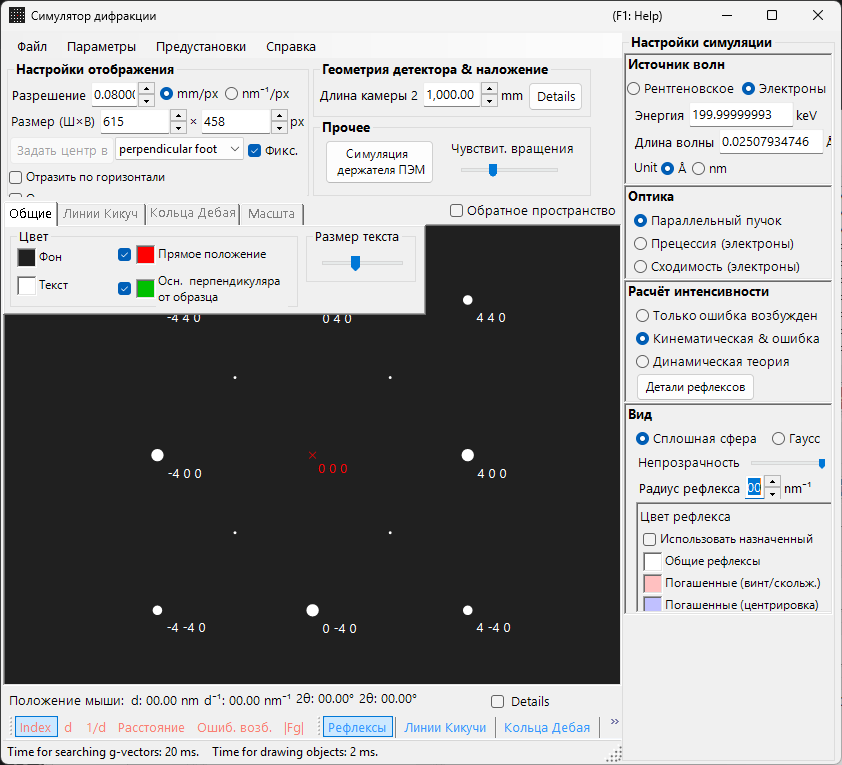

Окно содержит область построения дифракционной картины **слева** и **справа** — панель **Настройки симуляции** (источник волн, оптика, расчёт интенсивности, отображение и т. д.). Сочетание источника волн и оптики определяет режим съёмки (рентгеновская дифракция, SAED, PED, CBED), и правые панели перенастраиваются соответствующим образом.

---

## Как эта страница и страницы режимов распределяют работу

- **Эта страница (концентратор)**: собирает операции, общие для всех режимов (сочетания клавиш, меню, панель инструментов, сведения об экране/детекторе, вкладки наложений, сведения о рефлексах, геометрия детектора, динамическое сжатие).
- **Каждая страница режима**: охватывает **все настройки, появляющиеся справа** при выборе данного режима (длина волны, падающий пучок, расчёт интенсивности, отображение, настройки блоховских волн, настройки прецессии и т. д.), так что каждая страница самодостаточна (между режимами есть некоторые пересечения).

| Режим | Содержание | Страница |
|------|----------|------|
| **Рентгеновская (и нейтронная) дифракция** | Монокристальная картина рентгеновской / нейтронной дифракции (параллельная, прецессионная рентгеновская, Back Laue) | [Моделирование рентгеновской дифракции](5-x-ray-neutron-diffraction.md) |
| **SAED** | Электронная дифракция в параллельном пучке (selected-area electron diffraction) | [Моделирование SAED](1-saed-simulation.md) |
| **PED** | Прецессионная электронная дифракция | [Моделирование PED](2-ped-simulation.md) |
| **CBED** | Электронная дифракция сходящегося пучка | [Моделирование CBED](3-cbed-simulation.md) |

> **ALCHEMI — не режим.** В отличие от рентгена / SAED / PED / CBED, которые определяются сочетанием длины волны и падающего пучка, симулятор ALCHEMI — это **дочернее окно**, открываемое из меню **Параметры**, поэтому здесь он приведён отдельно.

| Дочернее окно | Содержание | Страница |
|------|------|------|
| **Симулятор ALCHEMI** | Качательные кривые ионизации с разрешением по позициям (микроанализ с усилением каналированием) | [Моделирование ALCHEMI](4-alchemi-simulation.md) |

Скрытие симулятора дифракции скрывает и все его дочерние окна (сведения о рефлексах, геометрия детектора, CBED, динамическое сжатие, моделирование держателя ПЭМ и симулятор ALCHEMI). Когда симулятор снова показывается, само по себе открывается заново только окно CBED (в режиме сходимости). <!-- 261105Cl 監査: FormElectronDiffraction_VisibleChanged (f98bc0d) -->

---

## Быстрый справочник по режимам

Найдите нужную страницу по сочетанию **Источник волн** и **Оптика** (падающий пучок).

| Источник волн | Оптика | Режим | Страница |
|------------|--------------------|------|------|
| Электроны | Параллельный пучок | SAED | [Моделирование SAED](1-saed-simulation.md) |
| Электроны | Прецессия (электроны) | PED | [Моделирование PED](2-ped-simulation.md) |
| Электроны | Сходимость (электроны) | CBED | [Моделирование CBED](3-cbed-simulation.md) |
| Рентгеновское | Параллельный пучок | Рентгеновская дифракция | [Моделирование рентгеновской дифракции](5-x-ray-neutron-diffraction.md) |
| Рентгеновское | Прецессия (рентген, ZOLZ) | Прецессионная рентгеновская (прецессионная камера) | [Моделирование рентгеновской дифракции](5-x-ray-neutron-diffraction.md) |
| Рентгеновское | Обратный Лауэ (рентген) | Лауэ на отражение | [Моделирование рентгеновской дифракции](5-x-ray-neutron-diffraction.md) |
| Нейтроны | Параллельный пучок | Нейтронная дифракция | [раздел о нейтронах в моделировании рентгеновской дифракции](5-x-ray-neutron-diffraction.md) |

> **Примечание**: Варианты выбора падающего пучка (**Оптика**) меняются вместе с длиной волны. Для электронов: **Параллельный пучок, Прецессия (электроны), Сходимость (электроны)**; для рентгеновских лучей: **Параллельный пучок, Прецессия (рентген, ZOLZ), Обратный Лауэ (рентген)**; для нейтронов: только **Параллельный пучок**. При смене источника волн оптика всегда сбрасывается на **Параллельный пучок**. Выбор **Прецессия (электроны)** или **Сходимость (электроны)** автоматически переключает расчёт интенсивности на **Динамическая теория**; **Динамическая теория** доступна только для электронов (при выборе рентгеновских лучей или нейтронов расчёт возвращается к **Кинемат. & ошибка возб.**). Back Laue использует белый (полихроматический) пучок.

---

## Сочетания клавиш и мыши

Они применимы к окну дифракционной картины, общему для моделирований рентгеновской дифракции, SAED и PED. Перетаскивание по картине вращает **кристалл**. Масштабируйте колёсиком мыши или щелчком правой кнопки / перетаскиванием правой кнопкой.

| Сочетание | Действие |
|----------|--------|
| <kbd>F1</kbd> | Открыть эту страницу онлайн-руководства |
| Перетаскивание левой кнопкой вблизи центра | Наклонить кристалл |
| Перетаскивание левой кнопкой во внешней области | Вращать кристалл вокруг оси пучка |
| Двойной щелчок левой кнопкой по рефлексу | Показать сведения о рефлексе (индекс, *d*, структурный фактор, ошибка возбуждения) |
| Перетаскивание средней кнопкой | Панорамировать картину |
| <kbd>CTRL</kbd> + Перетаскивание средней кнопкой | Переместить центр детектора (когда показана область детектора) |
| Колёсико мыши | Увеличить / уменьшить масштаб в 2 раза за один щелчок колёсика; точка под курсором переносится в центр вида (если отмечено **Фикс.**, вместо этого сохраняется зафиксированный центр) |
| Щелчок правой кнопкой | Уменьшить масштаб (×1/1,2) |
| Перетаскивание правой кнопкой рамки | Увеличить масштаб до выбранной области |
| Двойной щелчок правой кнопкой по строке состояния | Скопировать текстовую сводку текущих настроек: кристалл и углы Эйлера, источник, энергия, длина волны, оптика, форма рефлексов, расчёт интенсивности (для **Динамическая теория** также толщина, число дифрагированных волн и, для PED, угол прецессии) и геометрия детектора <!-- 261105Cl 監査: statusStrip1_MouseDown (C24) --> |
| Двойной щелчок правой кнопкой по активной кнопке слоя (Рефлексы / Линии Кикучи / Кольца Дебая / Масштаб) | Включить и выключить мигание этого слоя |

Вспомогательные окна, открываемые отсюда, добавляют ещё несколько:

| Сочетание | Действие |
|----------|--------|
| Двойной щелчок левой кнопкой по стереосети — **Моделирование держателя ПЭМ** | Установить наклон держателя в эту точку |
| Клавиши-стрелки — **Моделирование держателя ПЭМ** | Пошагово изменять наклон держателя (сначала отметьте **Включить клавиши со стрелками**; действует, только пока окно держателя активно) <!-- 261106Cl 作者の決定 D25 --> |
| Перетаскивание файла `.prm` или изображения — **Геометрия детектора** | Загрузить геометрию детектора / накладываемое изображение |
| Перетаскивание профиля `.txt` — **Динамическое сжатие** | Загрузить профили глубина/время/давление (момент времени выбирается ползунком **Время**; перетаскивайте вертикальные линии на графике, чтобы задать фронт/тыл) |

Общеприложенческие сочетания <kbd>CTRL</kbd>+<kbd>SHIFT</kbd> главного окна также работают, пока это окно в фокусе (см. [главное окно](../0-main-window.md)).

→ См. **[21. Сочетания клавиш и мыши](../21-shortcuts.md)** для обзора всех окон.

---

## Быстрые маршруты по цели

| Цель | Начать с | Справка |
|------|------------|-----------|
| Получить электронную дифракцию в параллельном пучке (SAED) | В группе **Оптика** выберите **Параллельный пучок**, а для **Источник волн** — **Электроны** | [Моделирование SAED](1-saed-simulation.md), [расчёт SAED в параллельном пучке](../appendix/a3-bloch-wave/calculation.md) |
| Получить монокристальную рентгеновскую дифракцию | Переключите **Источник волн** на **Рентгеновское** (для синхротронного излучения установите **Element** в **0: Custom**) | [Моделирование рентгеновской дифракции](5-x-ray-neutron-diffraction.md) |
| Получить прецессионную электронную дифракцию (PED) | В группе **Оптика** выберите **Прецессия (электроны)**, затем задайте угол прецессии и шаг | [Моделирование PED](2-ped-simulation.md) |
| Получить электронную дифракцию сходящегося пучка (CBED) | В группе **Оптика** выберите **Сходимость (электроны)** и задайте условия в окне CBED | [Моделирование CBED](3-cbed-simulation.md), [расчёт CBED](../appendix/a3-bloch-wave/cbed.md) |
| Просмотреть список рефлексов из динамического расчёта | Выберите **Динамическая теория** и нажмите **Детали рефлексов** | [Динамический расчёт (общее ядро)](../appendix/a3-bloch-wave/calculation.md) |
| Сопоставить геометрию детектора с экспериментальным изображением | Откройте настройки геометрии детектора кнопкой **Детали** в группе **Геометрия детектора & наложение** и используйте накладываемое изображение | [Система координат детектора](../appendix/a1-coordinate-system/2-diffraction.md) |

---

## Основная область

Дифракционная картина моделируется в центре экрана.

### Управление мышью

См. «Сочетания клавиш и мыши» в начале этой страницы.

### Положение мыши

Строка **Положение мыши:** над картиной показывает для положения курсора *d* и *d*⁻¹ (в нм и нм⁻¹ или в Å и Å⁻¹, в соответствии с единицей длины главного окна) и 2θ <!-- 261106Cl 作者の決定 C2 --> (в градусах и в рад, либо в мрад, если угол меньше 0,1 рад). Отметка **Details** добавляет три набора координат: координаты детектора (мм, начало — основание перпендикуляра, опущенного из образца), координаты в реальном пространстве (мм, начало — кристалл) и координаты в обратном пространстве (нм⁻¹). В режиме Back Laue значения *d* и координаты обратного пространства показываются как «-», а 2θ — это угол рассеяния, т. е. 180° минус угол от оси пучка (180° у отверстия для пучка в центре). <!-- 261105Cl 監査: Back Laue の 2θ (C13) -->

---

## Меню «Файл» {#file-menu}

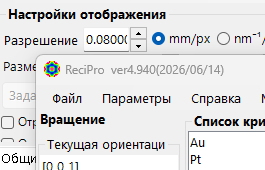

| Пункт меню | Описание |
|-----------|-------------|
| **Сохранить изображение** | Сохранить отображаемую дифракционную картину **как изображение (формат PNG)** или **как метафайл (EMF)**. |
| **Сохранить область детектора** | Сохранить только обрезок области детектора (PNG / EMF) на пиксельной сетке детектора. Показывается, только пока отображается область детектора. Вопрос о том, включать ли наложенное изображение, задаётся, только когда оно загружено. <!-- 261105Cl 監査: SaveOrCopyDetector (C18) --> |
| **Сохранить диски CBED** | Только в режиме CBED: сохранить рассчитанные диски **как отдельные изображения (формат PNG / TIFF)** или **как сводное изображение (формат PNG / TIFF)**. Всегда сохраняются диски CBED, даже пока отображается область детектора. |
| **Копировать** | Скопировать отображаемое изображение в буфер обмена (**как изображение** / **как метафайл (EMF)**). |
| **Копировать область детектора** | Скопировать только обрезок области детектора на пиксельной сетке детектора. Показывается, только пока отображается область детектора. Вопрос о том, включать ли наложенное изображение, задаётся, только когда оно загружено. |
| **Копировать диски CBED** | Только в режиме CBED: скопировать диски **как сводное изображение** (всегда диски CBED, даже пока отображается область детектора). |
| **Сохранить видео** | Записать видео дифракционной картины (**Дифракционная картина**) или вида обратного пространства (**Обратное пространство**). |
| **Параметры страницы / Предварительный просмотр / Печать** | Печать отображаемой картины. |

### Предустановки {#preset}

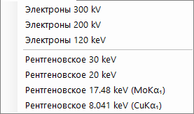

Фиксированные предустановки источника волн, задающие только вид излучения и его энергию: **Электроны 300 kV**, **Электроны 200 kV**, **Электроны 120 kV**, **Рентгеновское 30 keV**, **Рентгеновское 20 keV**, **Рентгеновское 17.48 keV (MoKα₁)** и **Рентгеновское 8.041 keV (CuKα₁)** (две последние выбирают характеристическую линию Mo / Cu Kα₁). Прочие настройки (геометрия детектора, вкладки, свойства рефлексов) не сохраняются и не изменяются.

### Меню «Параметры» и «Справка»

| Пункт меню | Описание |
|-----------|-------------|
| **Параметры > Динамическое сжатие** | Открывает окно [Динамическое сжатие](#dynamic-compression) (вместе с окном геометрии детектора). |
| **Параметры > Симулятор ALCHEMI...** | Открывает [симулятор ALCHEMI](4-alchemi-simulation.md). |
| **Справка > Основная концепция метода Бете** | Открывает в браузере [приложение о блоховских волнах](../appendix/a3-bloch-wave/index.md) онлайн-руководства. |

---

## Панель инструментов {#toolbar}

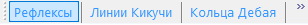

| Кнопка | Описание |
|--------|-------------|
| Рефлексы | Показать / скрыть слой дифракционных рефлексов |
| Линии Кикучи | Показать / скрыть слой линий Кикучи |
| Кольца Дебая | Показать / скрыть слой колец Дебая |
| Масштаб | Показать / скрыть слой линий шкалы |
| Index / d / 1/d / Расстояние / 2θ / χ / Ошиб. возб. / Интенс. <!-- 261106Cl 作者の決定 C11, C1 --> | Выбор подписи, прикрепляемой к каждому рефлексу |

---

## Сведения об экране и детекторе

### Экран

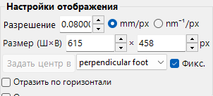

| Элемент | Описание |
|------|-------------|
| **Разрешение** | Размер одного экранного пикселя в **mm/px** (в плоскости детектора) или **nm⁻¹/px** (переключается; по умолчанию 0,08 mm/px). Он не обязан совпадать с фактическим размером пикселя детектора; он трактуется как масштаб отображения и автоматически обновляется при масштабировании мышью. |
| **Размер (Ш×В)** | Ширина и высота области построения в пикселях. В зависимости от разрешения вашего дисплея очень большие значения могут оказаться недоступными для установки. |
| **Задать центр в / Фикс.** | Помещает центр области построения в **perpendicular foot** (основание перпендикуляра), **direct spot** (прямой пучок) или в центр **detector** (последнее — только если задана область детектора). При отмеченном **Фикс.** (по умолчанию) центр остаётся на месте: панорамирование мышью отключено, а масштабирование сохраняет этот центр. |
| **Отразить по горизонтали / Отразить по вертикали / Негативное изображение** | Геометрические отражения (по горизонтали / по вертикали) и инверсия цвета картины: **Негативное изображение** инвертирует фон, рефлексы, подписи, линии Кикучи, запрещённые рефлексы, прямой пучок, основание перпендикуляра, кольца Дебая и линии шкалы (цвета кристаллов, цветовые шкалы гауссова отображения, 3-D-вид и наложенное изображение не инвертируются). <!-- 261105Cl 監査: checkBoxNegativeImage_CheckedChanged (C21) --> Используйте их для согласования ориентации или контраста с экспериментальным изображением. |
| **Обратное пространство** | Открывает рядом с картиной трёхмерный вид сферы Эвальда и точек обратной решётки, наглядно показывающий, какие рефлексы возбуждены. Его панель **Параметры** задаёт цвета (рефлексы вблизи / вдали от сферы Эвальда, сфера Эвальда, начало координат, указатель направления), радиус рефлексов в 3D (нм⁻¹), порог относительной интенсивности (%), прозрачность рефлексов вдали от сферы Эвальда, подписи и направление обзора (кнопки со стрелками с угловым шагом **Шаг**, **Сброс вида**). |

### Детектор (длина камеры)

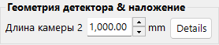

- **Длина камеры 2** : Расстояние (мм) от образца до основания перпендикуляра, опущенного на плоскость детектора (по умолчанию 1000 мм). Совпадает с обычной длиной камеры, когда детектор не наклонён (τ = 0).
- **Детали** : Открывает окно настроек геометрии детектора (см. [Геометрия детектора](#detector-geometry) ниже).

### Прочее {#misc}

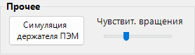

- **Чувствит. вращения** : Величина поворота кристалла на пиксель перетаскивания мышью.
- **Симуляция держателя ПЭМ** : Открывает окно моделирования, связанное с держателем (см. ниже).

---

## Моделирование держателя ПЭМ

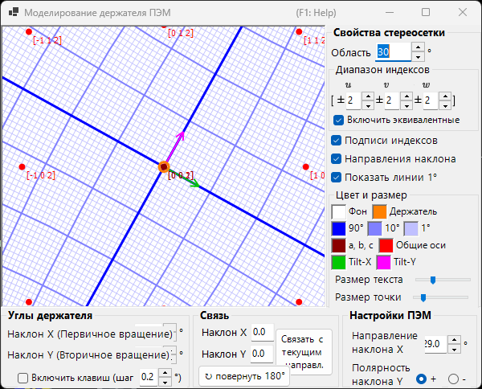

Открывает окно, которое связывает дифракционную картину с двухосевым **держателем ПЭМ** (**Наклон X** — первичное, **Наклон Y** — вторичное вращение). Задание углов наклона держателя обновляет картину и ориентацию кристалла, а достижимые ориентации можно показать на стереосети (добавлено в v4.914). **Связать с текущим направл.** принимает текущую ориентацию кристалла за опорную ориентацию держателя (при заданных Наклон X / Наклон Y); **Настройки ПЭМ** задают направление оси Наклон X на экране (по умолчанию −29°) и полярность Наклон Y, а **↻ повернуть 180°** поворачивает кристалл на 180° вокруг пучка (всегда вокруг оси пучка, даже если в главном окне зафиксирована ось или плоскость). Двойной щелчок левой кнопкой по стереосети устанавливает наклон держателя в эту точку, а отметка **Включить клавиши со стрелками** позволяет клавишами ←/→ пошагово менять Наклон X, а клавишами ↑/↓ — Наклон Y (шаг 0,1–2°, по умолчанию 0,2°). Клавиши со стрелками наклоняют держатель, только пока это окно активно. <!-- 261106Cl 作者の決定 D25 --> Когда окно снова показывается после скрытия (вместе с симулятором) или когда меняется Наклон X / Наклон Y, поворот или смена кристалла, сделанные за это время, принимаются за новую опору: текущая ориентация считается ориентацией при нынешнем наклоне, а список осей зон перестраивается для текущего кристалла. <!-- 261105Cl 監査: FormDiffractionSimulatorHolder.cs OnVisibleChanged / numericBoxTilt_ValueChanged (54e23f0) -->

---

## Вкладки наложений рисования {#drawing-overlay-tabs}

### Общие {#general}

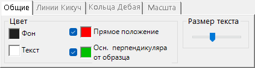

Задаёт **Разм. текста** подписей и цвета: **Текст** подписей, маркера **Осн. перпендикуляра от образца**, маркера **Прямое положение** и **Фон** (каждый из двух маркеров можно отключить). Цвета рефлексов задаются в **Вид** (см. страницы режимов); цвета линий Кикучи, колец Дебая и линий шкалы — на их собственных вкладках. Заданные здесь настройки применяются ко всем режимам отображения.

### Линии Кикучи

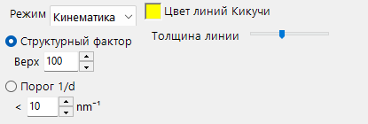

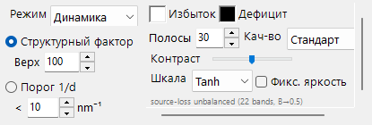

Активна, когда линии Кикучи включены на панели инструментов.

- **Reflection selection** : Выбор того, какие рефлексы порождают линии Кикучи. Либо **Структурный фактор** (**Макс.** *N* рефлексов по $\lvert F_{hkl}\rvert$; 1–1000, по умолчанию 100), либо **Порог 1/d** (все рефлексы, у которых 1/d ниже порога; 0–100 нм⁻¹, по умолчанию 10).
- **Режим** : Способ отрисовки линий Кикучи (по умолчанию **Кинематика**). Настройки под полем со списком меняются вместе с режимом.
    - **Геометрия** : все выбранные линии одним фиксированным цветом.
    - **Кинематика** : темнота линии следует кинематической относительной интенсивности каждого отражения.
    - **Динамика** : двухволновые динамические профили полос избыток/дефицит с источником в виде термодиффузного рассеяния, вычисляемые в фоновом потоке. Полосы избытка появляются на стороне больших углов, дефицитные черты — в сторону прямого пучка; толщина образца общая с настройками интенсивности. Во время вычисления рисуются геометрические линии. Динамические полосы рассчитываются только для пучка **Электроны**; для рентгеновских лучей и нейтронов линии рисуются как геометрические, а примечание гласит *Только электроны: линии*. <!-- 261105Cl 監査: DrawKikuchiLine / UpdateKikuchiNotice -->
- **Настройки «Геометрия» / «Кинематика»** : **Цвет линий Кикучи** и **Толщина линии**.
- **Настройки «Динамика»** :
    - **Избыток** / **Дефицит** : цвета светлой (положительный контраст) и тёмной (отрицательный контраст) стороны полос.
    - **Полосы** : Число полос с динамическими профилями (лучшие *N* по динамическому контрасту; 1–50, по умолчанию 30).
    - **Качество** : Точки выборки поперёк каждой полосы (Быстро 65 / Стандарт 129 / Высокое 257; по умолчанию Стандарт).
    - **Контраст** : Усиление отображения контраста полос перед сжатием.
    - **Шкала** : Кривая сжатия яркости (Linear / Log / Tanh; по умолчанию Tanh). Это визуализационные преобразования, а не физический отклик камеры.
    - **Фикс. яркость** : Фиксирует нормировку яркости, например для сравнения разных ориентаций или толщин.
    - Серая строка примечания показывает пометку о несогласованности источника и поглощения, число нарисованных полос и диагностику (например, подстановку *B*-фактора по умолчанию для атомов с *B* = 0).
- (Прежнего отдельного параметра **Threshold** больше нет; рефлексы ограничиваются только описанным выше выбором.)

### Кольца Дебая

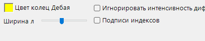

Активна, когда кольца Дебая включены на панели инструментов.

- **Игнорировать интенсивность дифракции** : Если отмечено, все кольца Дебая рисуются с одинаковым цветом и интенсивностью (игнорируя структурный фактор кристалла). Используйте это для чисто геометрического сравнения.
- **Подписи индексов** : Если отмечено, около каждого кольца появляются индексы {*hkl*} (четыре индекса {*hkil*}, когда в главном окне включено **Параметры ▸ Использовать индексы Миллера–Браве (hkil)** и кристалл использует гексагональные оси). <!-- 261105Cl 監査: DrawDebyeRing (C23)。ラベルは波かっこ -->

### Масштаб {#scale}

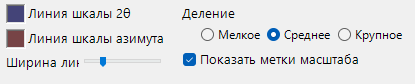

Активна, когда линии шкалы включены на панели инструментов.

- **2θ / Azimuth scale lines** : **2θ** представляет постоянный угол рассеяния (концентрические окружности), **Azimuth** представляет постоянный азимутальный угол (радиальные линии из центра). Цвета настраиваются независимо. В режиме Back Laue подписи 2θ — это углы рассеяния, поэтому в центре 180°.
- **Толщина линии** : Толщина линий шкалы.
- **Деление** : Плотность линий шкалы: **Мелкое** / **Среднее** (по умолчанию) / **Крупное**.
- **Показать метки масштаба** : Рисовать ли числовые подписи на линиях шкалы.

(Отдельной вкладки *Misc* нет; **Чувствит. вращения** мыши находится в группе **Прочее** правой панели, см. [Прочее](#misc) выше.)

---

## Сведения о дифракционных рефлексах {#diffraction-spot-information}

Перечисляет рассчитанные для каждого рефлекса сведения, полученные методом блоховских волн (Dynamical-расчёт). Откройте их кнопкой **Детали рефлексов** на панели расчёта интенсивности. В режиме **Только ошибка возб.** / **Кинемат. & ошибка возб.** кнопка выводит список нарисованных в данный момент рефлексов с их электронными потенциалами и $P_g$, $Q_g$ (без динамических амплитуд); в режиме CBED таблица следует толщине, выбранной в окне CBED. Для рентгеновских лучей и нейтронов $S_g$, $P_g$ и $Q_g$ вычисляются с фактической длиной волны (без поправки на преломление), столбцы потенциала и выбор единицы потенциала скрыты, а ускоряющее напряжение, $m/m_0$ и $v/c$ показываются как «-». <!-- 261105Cl 監査: FormDiffractionSpotInfo.cs SetTable (C 組) -->

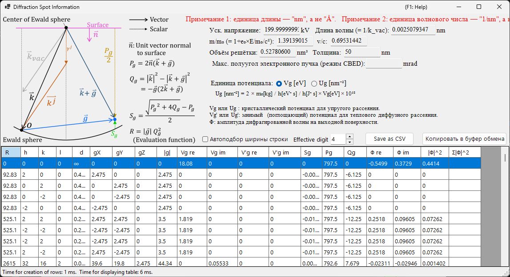

### Схема и определения

Схема (вверху слева) показывает векторы на сфере Эвальда и определяет величины, используемые в таблице ($\hat{\mathbf{n}}$ — единичный вектор нормали к поверхности образца, $\mathbf{k}$ — волновой вектор падающего пучка, $\mathbf{g}$ — вектор обратной решётки).

- $P_g = 2\,\hat{\mathbf{n}} \cdot (\mathbf{k} + \mathbf{g})$
- $Q_g = |\mathbf{k}|^2 - |\mathbf{k} + \mathbf{g}|^2 = -\mathbf{g} \cdot (2\mathbf{k} + \mathbf{g})$
- **Ошибка возбуждения:** $S_g = \dfrac{\sqrt{P_g^2 + 4 Q_g} - P_g}{2}$
- **Функция оценки:** $R = |\mathbf{g}|\, Q_g^2$ — упорядочивает рефлексы по тому, насколько сильно они возбуждены (меньше = ближе к сфере Эвальда = сильнее возбуждён; прошедший пучок $g=0$ имеет $R=0$ и идёт первым). Таблица отсортирована по возрастанию $R$.

### Столбцы таблицы

| Столбец | Значение |
|--------|---------|
| **R** | функция оценки $R = \lvert\mathbf{g}\rvert\, Q_g^2$ (выше; используется для отбора / упорядочивания рефлексов) |
| **h, k, (i,) l** | индексы Миллера (*i* — избыточный гексагональный индекс, показывается только для гексагональных кристаллов) |
| **d** | межплоскостное расстояние (нм) |
| **gX, gY, gZ** | компоненты вектора обратной решётки *g* (1/нм) |
| **\|g\|** | модуль *g* (1/нм) |
| **Vg re / Vg im** | коэффициент Фурье кристаллического потенциала для упругого рассеяния, $V_g$ (действительная / мнимая часть) |
| **V'g re / V'g im** | мнимый (поглощающий) потенциал для теплового диффузного рассеяния (TDS), $V'_g$ (действительная / мнимая часть) |
| **Sg** | ошибка возбуждения $S_g$ (выше; 1/нм) |
| **Pg** | вспомогательная величина $P_g = 2\,\hat{\mathbf{n}}\cdot(\mathbf{k}+\mathbf{g})$ (выше) |
| **Qg** | вспомогательная величина $Q_g = -\mathbf{g}\cdot(2\mathbf{k}+\mathbf{g})$ (выше) |
| **Φ re / Φ im** | комплексная амплитуда $\Phi$ динамической дифрагированной волны на выходной поверхности (действительная / мнимая часть) |
| **\|Φ\|^2** | дифрагированная интенсивность $\lvert\Phi\rvert^2$ этого рефлекса |
| **Σ\|Φ\|^2** | накопленная сумма $\lvert\Phi\rvert^2$ (суммарно по рефлексам; полезна как проверка сохранения интенсивности) |

### Единицы потенциала и другие элементы управления

- **Единица потенциала** : Переключает отображаемый потенциал между **Vg [eV]** (электростатический потенциал, эВ) и **Ug [nm⁻²]** (масштабированная величина $U_g = (2 m_0/h^2)\, V_g$, входящая в уравнения блоховских волн). Заголовки столбцов меняются соответственно между *Vg / V'g* и *Ug / U'g*. Показывается только для электронов. <!-- 261106Cl 作者の決定 C5 -->
- Над таблицей показаны ускоряющее напряжение, длина волны ($\lambda = 1/k_\text{vac}$), релятивистское отношение масс $m/m_0$, отношение скоростей $v/c$, объём решётки, толщина образца и (в режиме CBED) полуугол сходимости α. Толщина показывается только при расчёте **Динамическая теория** (в режиме CBED — толщина из окна CBED), а полуугол — только в режиме CBED; иначе в них стоит «-».
- **Прим. 1:** единица длины — **nm**, не Å. **Прим. 2:** единица волнового числа — **1/nm**, не 2π/nm.
- **Значащая цифра** : число значащих цифр, показываемых в таблице (1–16, по умолчанию 4). **Автоподбор ширины строки** : автоподбор ширины столбцов. **Копировать в буфер обмена** : экспортирует таблицу как текст, который можно вставить в электронную таблицу. **Сохранить как CSV** : записывает ту же таблицу (видимые столбцы) в файл CSV; десятичный разделитель всегда точка, поэтому файл остаётся корректным и в локалях с десятичной запятой. **Копировать в буфер обмена** и **Сохранить как CSV** работают, даже если в таблице одна строка. Обе начинаются со строк `# key: value` с условиями (источник, ускоряющее напряжение или энергия, длина волны, толщина, полуугол сходимости в CBED, кристалл, углы Эйлера, режим расчёта), а заголовки столбцов содержат единицы, например `d (nm)`, `Sg (nm⁻¹)`, `Qg (nm⁻²)`. <!-- 261106Cl 作者の決定 C22 -->

---

## Геометрия детектора {#detector-geometry}

Окно для детальной настройки геометрии детектора (длина камеры, наклон, поворот) и наложения экспериментального изображения. Откройте его кнопкой **Детали** в группе **Геометрия детектора & наложение**.

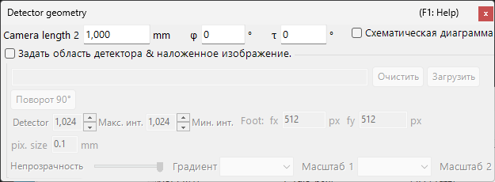

### Настройки геометрии детектора

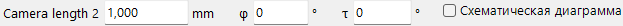

Задайте геометрию отражения: **Длина камеры 2** (мм, 1–10000, по умолчанию 1000) и наклон детектора **τ** (от −200 до 200°) вокруг оси, лежащей в плоскости детектора под азимутом **φ**. Для Back Laue (Лауэ на отражение) используется только **Длина камеры 2**: картина всегда проецируется на детектор, перпендикулярный пучку, со стороны источника, а τ / φ к этой проекции не применяются. Перетаскивание файла `.prm` загружает сохранённые в нём элементы — источник (элемент и линия рентгеновского излучения, электроны или нейтроны) с его длиной волны, длину камеры 2, τ, φ, положение основания перпендикуляра, размер пикселя и размер детектора — и включает область детектора; элементы, которых нет в файле, не меняются. <!-- 261105Cl 監査: FormDiffractionSimulatorGeometry_DragDrop (952b457)。以前の「常に X 線・任意波長」は誤り -->

### Область детектора и наложенное изображение

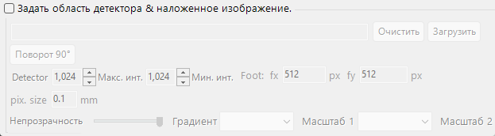

Отметьте **Задать область детектора & наложенное изображение.**, чтобы задать детектор: размер в пикселях (по умолчанию 1024 × 1024), **Разм. пикс.** (мм, по умолчанию 0,1) и положение **Осн.перп.** **fx, fy** (px, по умолчанию 512, 512) — основание перпендикуляра, опущенного из образца на плоскость детектора; оно совпадает с положением прямого пучка, только когда детектор не наклонён (τ = 0). <!-- 261105Cl 監査: numericBoxFootX/Y.ToolTip, convertDetectorToReal --> Экспериментальное изображение можно загрузить (**Загрузить** или перетаскиванием) и наложить, настроив **Непрозрачность**, **Градиент** (позитивная/негативная плёнка), **Масштаб 1** (log/linear), **Масштаб 2** (Gray / Cold-warm / Spectrum / Fire), **Макс. инт.** / **Мин. инт.**, **Поворот 90°** и **Очистить**. Загрузка изображения `.ipa` устанавливает τ = 0 (файл не содержит наклона), помещает основание перпендикуляра в центр изображения и задаёт длину камеры 2 равной расстоянию до плёнки. О файле, который нельзя прочитать ни как файл `.prm`, ни как изображение, сообщается сообщением. <!-- 261105Cl 監査: ReadImage / showCannotRead (4dc847a) --> **Схем. диаграмма** показывает эскиз геометрии. Используйте это, чтобы наложить смоделированную картину и экспериментальное изображение и точно настроить геометрию детектора.

См. также [Система координат детектора](../appendix/a1-coordinate-system/2-diffraction.md) для определений системы координат.

---

## Динамическое сжатие {#dynamic-compression}

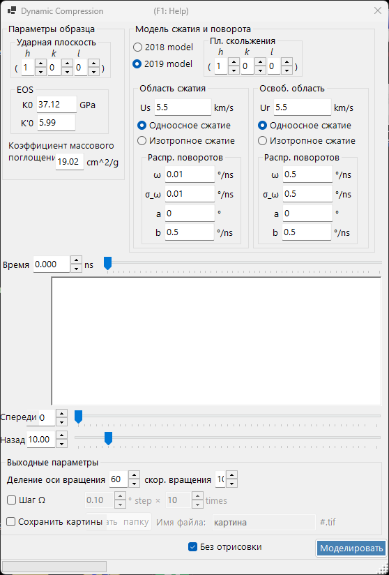

Окно для моделирования дифракции на образце, подвергнутом ударному (динамическому) сжатию. Перетащите на это окно файл `.txt` с разделителями-табуляциями из трёх столбцов (глубина в µm, время в нс, давление в МБар), чтобы загрузить профили давления для каждого момента времени; горизонтальная ось графика — глубина (µm); ползунок **Время** (нс) выбирает профиль, показанный на графике. Две вертикальные линии на графике (**Спереди** / **Сзади**) можно перетаскивать, задавая фронт и тыл сжатия. В окне также задаются модель сжатия (**2018 model** / **2019 model**), скорости ударной волны (**Us**, **Ur**, км/с), **EOS** (K0, K'0), **Ударная плоскость** / **Пл. скольжения**, распределения поворотов в сжатой и освобождённой областях, массовый коэффициент поглощения, шаг по Ω и **Сохранить картины** (`#.tif`); расчёт запускается кнопкой **Моделировать**. Ширина распределения поворотов σ, равная 0 (или число делений угла поворота, равное 0), рассматривается как одна ориентация. Независимо от того, успешен ли расчёт, кристалл и его ориентация затем восстанавливаются. <!-- 261105Cl 監査: FormDiffractionSimulatorDynamicCompression.cs execute / buttonSimulate_Click (fb26838, 4a21154, 8461e90) -->

---

## Симулятор ALCHEMI

Открывает дочернее окно, которое рассчитывает **качательные кривые ионизации с разрешением по позициям**: выход выбранного канала ионизации при наклоне кристалла через брэгговские условия систематического ряда, раздельно по атомным позициям. Открывается из меню **Параметры**. В отличие от окна CBED, оно имеет собственную область вывода и не рисует на холсте родительского окна.

→ Все настройки, а также область применимости и известные ограничения см. в разделе **[Моделирование ALCHEMI](4-alchemi-simulation.md)**.

---

## Связанные темы

- [Моделирование рентгеновской дифракции](5-x-ray-neutron-diffraction.md)
- [Моделирование SAED](1-saed-simulation.md)
- [Моделирование PED](2-ped-simulation.md)
- [Моделирование CBED](3-cbed-simulation.md)
- [Моделирование ALCHEMI](4-alchemi-simulation.md)
- [Динамический расчёт (общее ядро)](../appendix/a3-bloch-wave/calculation.md)
- [Система координат детектора](../appendix/a1-coordinate-system/2-diffraction.md)
