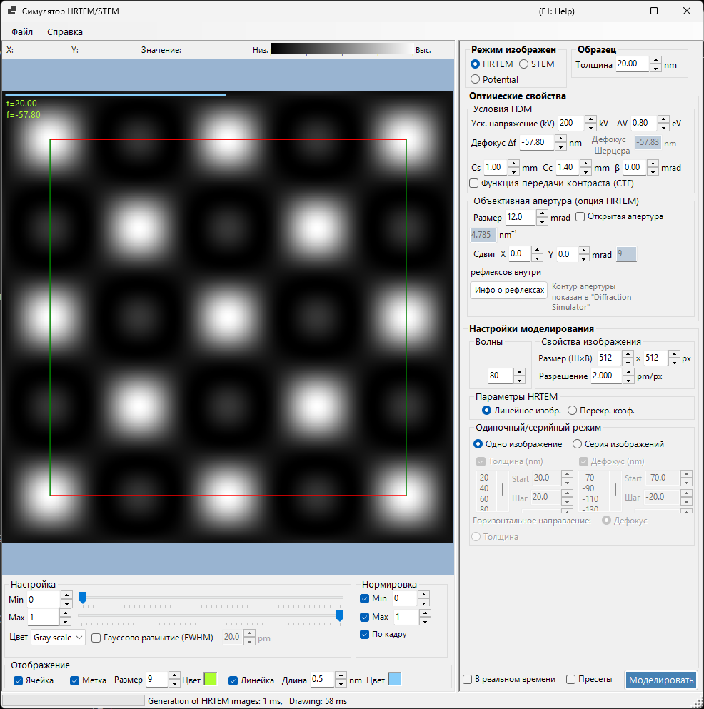
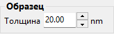
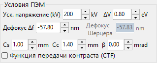
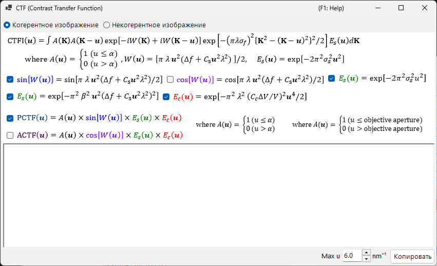
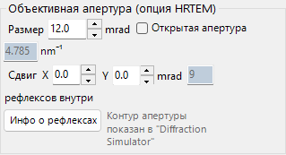
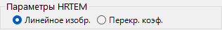
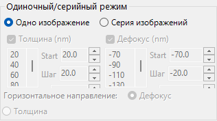
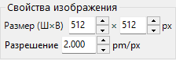
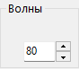

# Моделирование HRTEM

Моделирование **HRTEM (High-Resolution Transmission Electron Microscopy)** вычисляет изображения решёточных полос высокоразрешающей ПЭМ. Это основной режим [симулятора HRTEM/STEM](index.md).

> На этой странице описаны все настройки, которые появляются справа, когда выбрано **Режим изображения = HRTEM**. Об элементах управления на левой стороне — отображении результата и настройке его яркости — см. [страницу обзора](index.md#display-settings).

---

## Обзор

HRTEM-изображение формируется, когда электронная волна, прошедшая через образец, отображается под влиянием аберраций объективной линзы. ReciPro вычисляет распространение электронной волны внутри образца методом блоховских волн (динамический расчёт) и формирует HRTEM-изображение через функцию передачи фазового контраста (PCTF).

### Ход расчёта

1. **Метод блоховских волн**: вычисляет распространение электронной волны в потенциале кристалла и даёт амплитуду и фазу выходящей волны
2. **Функция линзы**: применяет аберрации объективной линзы (сферическая аберрация $C_s$, дефокусировка $\Delta f$)
3. **Частичная когерентность**: учитывает конечный размер источника (пространственная когерентность) и флуктуацию энергии (временная когерентность)
4. **Формирование изображения**: вычисляет распределение интенсивности $|\psi(\mathbf{r})|^2$

Теорию см. в [Приложении A3.2 — Формирование HRTEM-изображения](../appendix/a3-bloch-wave/hrtem.md).

---

## Образец

- **Толщина** : толщина образца (nm). HRTEM-изображения сильно зависят от толщины. В режиме **Серия изображений** это значение игнорируется и вместо него используется описанный ниже список толщин.

---

## Условия ПЭМ {#tem-conditions}

Задаёт условия формирования изображения объективной линзой.

| Параметр | Описание | По умолчанию / типично |
|-----------|-------------|-------------------|
| **Уск. напряжение** <!-- 261105Cl 監査: 見出しから (kV) を外した (numericBoxAccVol.HeaderText)。単位は欄の右に出る --> | Ускоряющее напряжение (kV). Справа показана релятивистски скорректированная длина волны электрона | 200 kV |
| **Дефокус Δf** | Дефокусировка объективной линзы (nm). Под ним для справки показано значение **Дефокус Шерцера** | −57.8 nm |
| **Cs** | Коэффициент сферической аберрации (mm). Влияет на CTF и дефокусировку Шерцера. Допускаются отрицательные значения (от −20 до 20 mm) | 1.0 mm (по умолчанию); 0.5–1.0 (обычная), < 0.01 (с коррекцией Cs) |
| **Cc** | Коэффициент хроматической аберрации (mm). Определяет размытие изображения, вызванное энергетическим разбросом | 1.4 mm (по умолчанию); 1.0–2.0 mm |
| **β** | Полуугол освещения (mrad). Описывает влияние конечного размера источника (пространственная когерентность) | 0 mrad (по умолчанию); 0.1–1.0 mrad |
| **ΔV** | Полная ширина на половине высоты энергетического разброса электронов (eV). Вместе с Cc определяет разброс фокуса из-за хроматической аберрации | 0.8 eV (по умолчанию); 0.5–2.0 eV |

Приведённые выше значения по умолчанию действуют только при первом запуске; в дальнейшем восстанавливаются последние использованные значения. Внутри программы ΔV (FWHM) пересчитывается в стандартное отклонение $\sigma_V = \Delta V / (2\sqrt{2\ln 2})$, а разброс фокуса равен $\delta = C_c\,\sigma_V / V$. Функция аберраций имеет вид

$$\chi(u) = \pi\lambda\,\Delta f\,u^2 + \tfrac{\pi}{2}\,C_s\lambda^3 u^4 ,$$

и каждая дифрагированная волна умножается на $\exp[-i\chi(u)]$, так что **отрицательная Δf соответствует недофокусировке** (соглашение, при котором дефокусировка Шерцера отрицательна).

> **Контекстное меню**: на панели условий ПЭМ одним щелчком можно применить **Установить дефокус 0 nm** / **Установить дефокус по Шерцеру** / **Идеальные условия (Cs, Cc, β, ΔV, Δf = 0)** (последний пункт обнуляет Cs, Cc, β, ΔV **и дефокусировку**). <!-- 261106Cl 作者の決定 E19: 表示名を理想条件に --> В том же меню есть четыре пресета микроскопов — *300kV Cold-FEG Cs-free (Cs 0, Cc 2.8, ΔV 0.3) ARM300F*, *200kV Schottky-FEG UHR (Cs 0.5, Cc 1.1, ΔV 0.8) 2100F*, *200kV Schottky-FEG HR (Cs 1.0, Cc 1.4, ΔV 0.8) 2100F* и *200kV Lab6 HR (Cs 1.0 , Cc 1.4, ΔV 2.0) 2100*, — которые задают ускоряющее напряжение, Cs, Cc и ΔV, как указано в названии пункта, а затем устанавливают дефокусировку по Шерцеру (β не меняется). Флажок **Пресеты** в правой нижней части окна открывает окно, в котором хранятся ваши собственные условия (см. [Список пресетов](index.md#preset-list)). <!-- 261105Cl 監査: プリセット名は ΔV (FormImageSimulator.resx presets1〜4ToolStripMenuItem.Text) -->

### Дефокусировка Шерцера

Значение дефокусировки, вблизи которого фазовый контраст оптимален; вычисляется из текущей длины волны и сферической аберрации $C_s$ (показывается для справки). Для отрицательного $C_s$ показывается значение $+\sqrt{\tfrac{4}{3}|C_s|\lambda}$.

$$\Delta f_{\text{Scherzer}} = -\sqrt{\tfrac{4}{3}\,C_s \lambda}\quad\left(\approx -1.155\,\sqrt{C_s \lambda}\right)$$

При этом условии PCTF отрицательна в широком диапазоне пространственных частот, поэтому положения атомов выглядят как тёмный контраст. ReciPro использует это исходное значение Шерцера (выведенное приравниванием минимума фазы аберраций $\chi$ к $-2\pi/3$), и значение, показанное в GUI, следует этой формуле. Заметим, что в некоторых источниках вместо этого используется *расширенное значение Шерцера* $-1.2\sqrt{C_s\lambda}$, которое ещё больше расширяет полосу передачи.

---

## Функция линзы / функция передачи контраста (CTF)

Если отметить **Функция передачи контраста (CTF)**, открывается окно с графиками того, как аберрации линзы и дефокусировка передают контраст изображения на каждой пространственной частоте.

- $\sin\chi(u)$ : функция передачи фазового контраста ($\chi(u)$ — функция аберраций линзы)
- $E_\text{s}(u)$ : огибающая функция пространственной когерентности; затухание из-за конечного размера источника ($\beta$)
- $E_\text{c}(u)$ : огибающая функция временной когерентности; затухание из-за флуктуации энергии ($C_c$, $\Delta V$)

Для каждой кривой есть свой флажок: $\sin\chi$, $\cos\chi$, $E_\text{s}$, $E_\text{c}$, **PCTF** $=\sin\chi\,E_\text{s}E_\text{c}$ и **ACTF** $=\cos\chi\,E_\text{s}E_\text{c}$; вне объективной апертуры PCTF и ACTF полагаются равными нулю. В режиме HRTEM

$$E_\text{s}(u)=\exp\!\left[-\pi^2\beta^2u^2\left(\Delta f+C_s\lambda^2u^2\right)^2\right],\qquad E_\text{c}(u)=\exp\!\left[-\tfrac{1}{2}\pi^2\lambda^2\delta^2u^4\right].$$

**Макс. u** (nm⁻¹, по умолчанию 6) задаёт верхнюю границу горизонтальной оси. **Копировать** помещает построенные кривые в буфер обмена в виде текста с разделителями-табуляциями. Окно доступно и в режиме STEM (см. [Моделирование STEM](2-stem-simulation.md#ctf-stem)); в режиме Potential оно отключено.

---

## Объективная апертура (опция HRTEM)

Ограничивает дифрагированные волны, проходящие через объективную апертуру. Сам расчёт блоховских волн всегда использует число волн, заданное в **Волны**; апертура затем отбирает, какие из этих пучков вносят вклад в изображение (пучок проходит, если $|\mathbf{g}-\mathbf{c}| < 2\sin(\alpha_\text{obj}/2)/\lambda$, где $\mathbf{c}$ — центр апертуры). Если проходит меньше двух пучков, расчёт останавливается с сообщением, предлагающим увеличить апертуру.

- **Размер** : полуугол объективной апертуры (mrad, по умолчанию 12). Чем он меньше, тем больше дифрагированных волн под большими углами отсекается и тем более сглаженными становятся высокоразрешающие детали. Отображается соответствующий радиус в обратном пространстве $\sin\theta/\lambda$ (nm⁻¹).
- **Сдвиг X** / **Y** : смещение центра объективной апертуры (mrad). Используется для темнопольной съёмки со смещённой апертурой; само освещение не наклоняется.
- **Открытая апертура** : открывает объективную апертуру (бесконечную), так что для формирования изображения используются все дифрагированные волны.
- **рефлексов внутри** : число дифрагированных пучков (рефлексов), попадающих внутрь апертуры (только для чтения).
- **Инфо о рефлексах** : открывает таблицу дифрагированных пучков внутри апертуры (интенсивность, комплексная амплитуда и т. д.).

> Размер объективной апертуры также показывается в **Симуляторе дифракции**.

---

## Параметры HRTEM (модель частичной когерентности)

Выбирает, как учитывается частичная когерентность (β и разброс фокуса δ). Выходная волна вычисляется для одного направления падения (оси пучка); разброс освещения и энергетический разброс входят только через описанные ниже огибающие функции.

- **Линейное изобр.** (Linear image, квазикогерентная модель) : вычислительно дешёвая модель. Каждая дифрагированная волна $\psi_g$ динамической выходной волны умножается на $\exp[-i\chi(g)]\,E_\text{s}(g)\,E_\text{c}(g)$, и волны суммируются когерентно: $I(\mathbf{r}) = \left|\sum_g \psi_g\,e^{-i\chi(g)}\,E_\text{s}(g)\,E_\text{c}(g)\,e^{2\pi i\,\mathbf{g}\cdot\mathbf{r}}\right|^2$. Точна, когда в изображении доминирует интерференция с проходящим пучком (тонкие образцы).
- **Перекр. коэф.** (Transmission cross coefficient) : вычислительно затратная, но более точная модель. Каждая пара пучков $(g,h)$ суммируется со взаимной огибающей (полный перекрёстный коэффициент пропускания); это модель для сильных рассеивателей, возбуждающих много сильных дифрагированных волн. Затраты растут как квадрат числа пучков внутри апертуры.

Подробнее см. [Приложение A3.2 — Формирование HRTEM-изображения](../appendix/a3-bloch-wave/hrtem.md).

---

## Одиночный/серийный режим

- **Одно изображение** : вычисляет одно HRTEM-изображение при текущих толщине и дефокусировке.
- **Серия изображений** : создаёт набор изображений с пошаговым изменением толщины и дефокусировки (серия по толщине / по фокусу). Полезно для поиска условия, наилучшим образом совпадающего с экспериментальным изображением.

Для серии изображений задайте следующее.

| Элемент | Описание |
|------|-------------|
| **Толщина (nm)** / **Дефокус (nm)** | Какую величину варьировать (допускаются обе) |
| **Нач.** / **Шаг** / **N** | Начальное значение, шаг и число изображений. Они разворачиваются в список ниже, который также можно редактировать напрямую |
| **Горизонтальное направление:** | Когда варьируются и толщина, и дефокусировка, — величина, откладываемая по горизонтали сетки (**Дефокус** или **Толщина**) |

При варьировании и толщины, и дефокусировки получается матрица изображений «строки × столбцы». **N** ограничено 20 для каждой величины. Если варьируется только одна величина и изображений больше двух, ряд переносится в сетку, близкую к квадратной.

---

## Свойства изображения

- **Размер (Ш×В)** : число пикселей смоделированного изображения (по умолчанию 512×512).
- **Разрешение** : разрешение дискретизации (pm/px, по умолчанию 2). Поле зрения равно Размер × Разрешение, поэтому меньшее значение дискретизирует полосы мельче, но на меньшей площади. Изображение синтезируется прямым суммированием Фурье по пучкам в каждом пикселе (без FFT), поэтому время расчёта зависит от числа пикселей и числа пучков, а не от этого значения.

---

## Волны

- Максимальное число блоховских волн, используемых в методе Бете (динамический расчёт), по умолчанию 80. Большее число повышает точность, но решение задачи на собственные значения требует времени $O(N^3)$.

---

## См. также

- [Симулятор HRTEM/STEM (обзор)](index.md)
- [Моделирование STEM](2-stem-simulation.md)
- [Моделирование потенциала](3-potential-simulation.md)
- [Приложение A3.2 — Формирование HRTEM-изображения](../appendix/a3-bloch-wave/hrtem.md)
