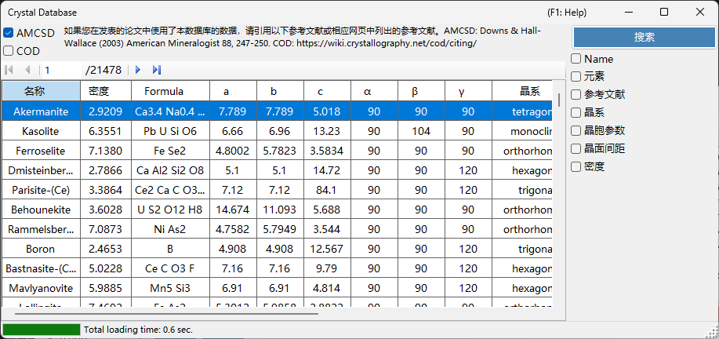
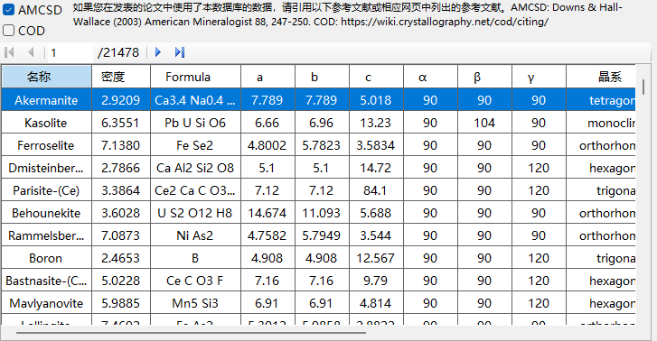
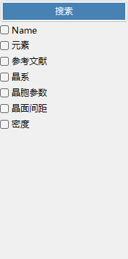
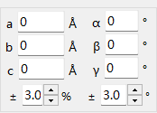

# 晶体数据库

**晶体数据库** 提供从两个来源搜索并导入晶体结构的功能，可通过 **AMCSD** 和 **COD** 复选框进行选择：

- **AMCSD** ：随软件捆绑的 [American Mineralogist Crystal Structure Database](https://www.rruff.net/)（超过 20,000 个结构）。
- **COD** ：[Crystallography Open Database](https://www.crystallography.net/cod/)。由于文件较大，它不随安装程序一起捆绑；数据库文件会在首次使用时自动下载。当该文件在服务器上更新时，会提示您重新下载。

使用这些数据库时，请引用以下文献。

使用 **AMCSD** 时：

> Downs, R.T. and Hall-Wallace, M. (2003) The American Mineralogist Crystal Structure Database. *American Mineralogist* **88**, 247-250.

使用 **COD** 时：

> Gražulis, S. et al. (2009) Crystallography Open Database – an open-access collection of crystal structures. *Journal of Applied Crystallography* **42**, 726-729.
>
> Gražulis, S. et al. (2012) Crystallography Open Database (COD): an open-access collection of crystal structures and platform for world-wide collaboration. *Nucleic Acids Research* **40**, D420-D427.

---

## 键盘和鼠标快捷键

此窗口没有修饰键组合键；它通过普通的单击操作。唯一不太直观的输入方式是：

| 快捷键 | 操作 |
|----------|--------|
| <kbd>F1</kbd> | 打开在线手册的本页 |
| 在任意搜索框中按 <kbd>ENTER</kbd> | 执行数据库搜索（与 **搜索** 按钮相同） |
| 单击结果表中的某一行 | 将该晶体加载到主窗口 |
| 单击 **周期表** 弹出窗口中的某个元素 | 循环切换其筛选状态：*可包含可不包含* → *必须包含* → *必须排除* |

→ 请参阅 **[21. 键盘和鼠标快捷键](21-shortcuts.md)** 一览每个窗口的快捷键。

---

## 表格

显示与搜索条件匹配的晶体。选择某个晶体即可将其传输到主窗口的晶体信息。按 **添加** 或 **替换** 将其添加到晶体列表。

---

## 搜索选项

在下面输入搜索条件，然后按 **搜索** 按钮或 **Enter** 键。

| 条件 | 说明 |
|-----------|-------------|
| **Name** | 晶体名称 |
| **元素** | 周期表选择器（可包含/必须包含/必须不包含） |
| **参考文献** | 标题、期刊、作者 |
| **晶系** | 选择晶系 |
| **晶胞参数** | 点阵常数及误差 |
| **晶面间距** | 强反射的 d 值及误差 |
| **密度** | 密度及误差 |

### Name

针对晶体名称的自由文本匹配。允许部分匹配，不区分大小写。只应用已勾选复选框的条件，各条件之间以 AND 组合。

### 元素

按 **周期表** 按钮以打开元素选择器。每个元素按钮在三种状态之间循环切换：

- **可包含可不包含**（默认 — 黄色）
- **必须包含**（蓝色）
- **必须排除**（红色）

晶体必须包含所有 *必须包含* 的元素，且不含任何 *必须排除* 的元素；启用 **元素** 条件时，没有原子数据的条目会被排除。

窗口顶部的三个按钮可一键将每个元素重置为这三种状态之一。

### 参考文献

针对出版物元数据的自由文本匹配（部分匹配，不区分大小写）：论文标题、期刊名称和作者列表。

### 晶系

将搜索限制为特定晶系（cubic、tetragonal、orthorhombic、hexagonal、trigonal、monoclinic、triclinic）。第一项 *Unknown* 不施加任何限制。

### 晶胞参数搜索

输入目标点阵常数 *a*、*b*、*c*（Å）和 *α*、*β*、*γ*（°）以及可接受的误差：*a*、*b*、*c* 共用一个相对容差（±%），三个角度共用一个绝对容差（±°）。值为 0 表示忽略该参数。

### 晶面间距

最多可输入三个 *d* 值（Å；勾选各项即可使用），每个值都带有相对容差（±%）。当输入的每个值都与数据库中保存的该晶体的某个最强反射一致时（最多 16 个，按 λ = 1.54 Å 下的 X 射线粉末衍射强度排序），该晶体即为匹配。勾选 **忽略散射因子** 后，改为与由晶胞计算出的所有几何上可能的 *d* 值（包括系统消光的反射）进行比较。当实验中仅已知衍射峰位置时很有用。

### 密度

按质量密度（g/cm³）在相对容差（±%）范围内进行筛选。

---

## 另请参阅

- [主窗口](0-main-window.md)
- [对称性信息](2-symmetry-information.md)
- [射束相互作用](3-beam-interaction.md)
- [结构查看器](5-structure-viewer.md)
