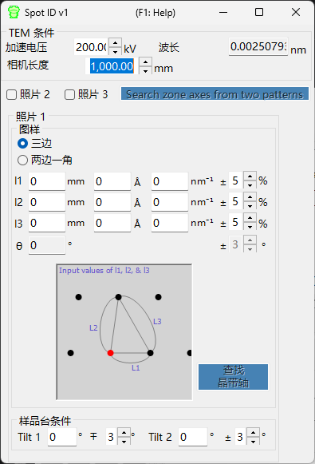

# Spot ID v1

**Spot ID v1**（原先的 **TEM ID**）根据以数值方式输入的一至三张衍射图样的斑点几何，搜索候选晶带轴。在图像上进行斑点检测、拟合和标定，请使用 [Spot ID v2](11-spot-id-v2.md)。

---

## 键盘与鼠标快捷键

Spot ID v1 以**数值输入**方式接收斑点几何（即原先的 *TEM ID* 工作流程）；它没有图像视图（图像加载、鼠标缩放、斑点检测和手动选取斑点属于 [Spot ID v2](11-spot-id-v2.md) 的功能）。唯一的快捷键位于结果窗口中：

| 快捷键 | 操作 |
|----------|--------|
| <kbd>F1</kbd> | 打开本页的在线手册 |
| 双击结果列表中的某一行 | 选择该晶体并将其旋转到对应的晶带轴 |

→ 各窗口快捷键一览请参见 **[21. 键盘与鼠标快捷键](21-shortcuts.md)**。

---

## 根据斑点几何进行晶带轴搜索（原先的 TEM ID）

当你没有可加载的图像时，仍然可以通过手动输入选区电子衍射（SAED）图样的几何来搜索候选晶带轴。输入 TEM 观测条件和斑点几何，然后按下某张照片的 **查找晶带轴**（或按 **从两张图样查找晶带轴** / **从三张图样查找晶带轴** 同时使用多张照片），即可找出候选的晶体取向。

### TEM 条件

输入 **加速电压**（kV，默认 200）和 **相机长度**（mm，默认 1000）。**波长**（nm）由电压计算得出，以只读方式显示。

### 照片 1, 2, 3

输入衍射斑点的几何。

- 要输入探测器上斑点之间的距离，请使用 **mm** 输入框。
- 如果你已知 *d* 值，请以 **Å** 或 **nm⁻¹** 为单位输入。

**三边** : 输入以 direct spot 为一个顶点的三角形三条边的长度。

**两边一角** : 输入两条边的长度（含 direct spot）以及它们之间的夹角。

- 容差（**±** 输入框）: 各长度的容差以 % 表示（0–50，默认 5），θ 的容差以度表示（0–30，默认 3）。未输入的值（三边模式下的 θ、两边一角模式下的 l3）会被计算并显示，输入栏旁还会绘制所得图样的示意图。
- **样品台条件** : 拍摄该照片时测角样品台的 **Tilt 1** / **Tilt 2**（°），各自带有容差（0–10°，默认 3°）。各照片的样品台设置之间的夹角会被计算并显示。
- **照片 2** / **照片 3** : 启用第二张和第三张照片。照片之间的复选框将两张照片的 l1（或 l2）视为同一反射，并复制其长度。
- **查找晶带轴** 搜索单张照片；**从两张图样查找晶带轴** / **从三张图样查找晶带轴** 搜索与这些照片以及它们之间的样品台倾转角都一致的组合；只有在勾选 **照片 3** 且其所有值都已输入时才使用照片 3，否则使用两张照片。在单张照片（**查找晶带轴**）的结果表中，始终显示 g1、d1、g2 和 d2，三边模式下另外显示 g3 和 d3，两边一角模式下另外显示 θ。<!-- 261105Cl 監査: buttonSearchAll_Click (afd65e0)、FormSpotIDv1Results.SetDataSet (46d91db) --> 搜索针对主窗口列表中选中的每一个晶体进行（Spot ID v1 打开期间可多选）。若找到的候选超过 1000 个，则不列出任何结果，并提示你缩小条件；否则会打开结果窗口。双击某一行即可选择该晶体并将其旋转到该取向。各候选晶带轴的符号遵循教科书的约定 **g**₁ × **g**₂，因此与 2026-11 之前的版本相比符号相反（取向相同）。<!-- 261106Cl 作者の決定 B16 -->

---

## 另请参阅

- [Spot ID v2](11-spot-id-v2.md)
- [衍射模拟器](7-diffraction-simulator/index.md)
- [主窗口](0-main-window.md)
- [晶体数据库](1-crystal-database.md)
- [EBSD 模拟](12-ebsd-simulation.md)
