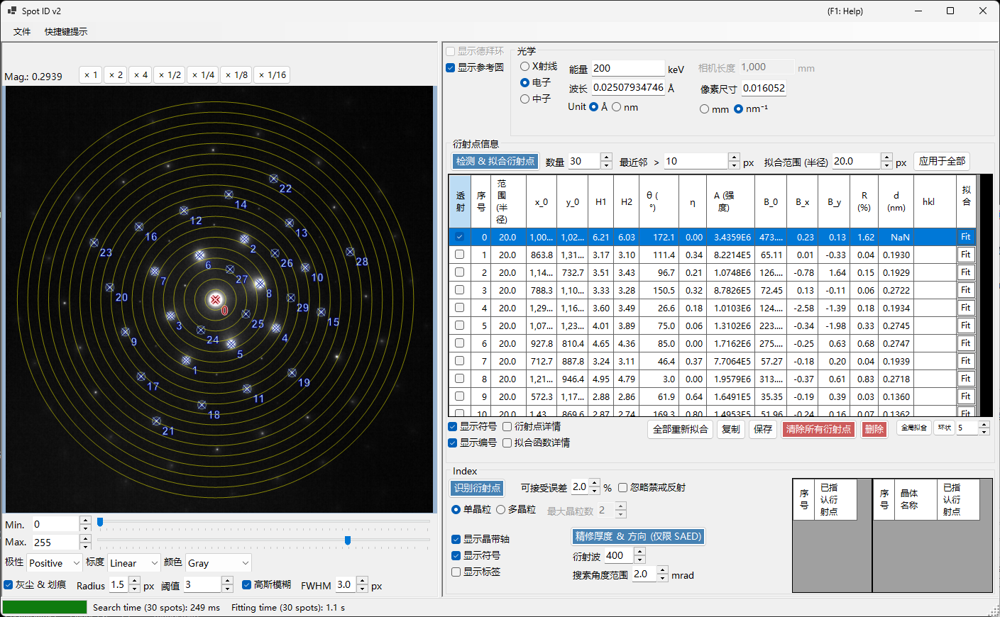
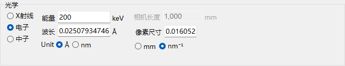
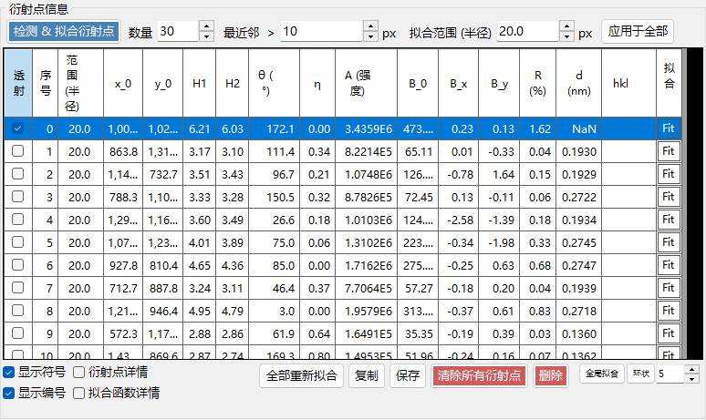
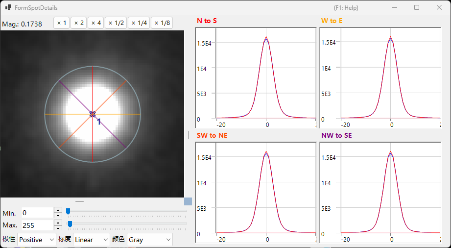
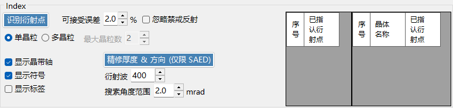

# Spot ID v2

**Spot ID v2** 在实验衍射图像上检测、拟合并标定衍射斑点。[Spot ID v1](10-spot-id.md)（原先的 TEM ID）则以数值输入的方式接收斑点几何。

---

## 键盘和鼠标快捷键

衍射斑点列表直接在加载的图像上建立。图像窗格使用 ReciPro 标准的[图像视图导航](21-shortcuts.md)进行平移/缩放；衍射斑点编辑则增加了下列组合键。

| 快捷键 | 操作 |
|----------|--------|
| <kbd>F1</kbd> | 打开本页的在线手册 |
| 左键双击图像 | 在该点添加一个衍射斑点（经峰拟合） |
| <kbd>CTRL</kbd> + 左键双击 | 添加一个衍射斑点并将其标记为直射（000）束 |
| 左键单击某衍射斑点 | 选择最近的衍射斑点 |
| <kbd>CTRL</kbd> + 右键单击某衍射斑点 | 删除最近的衍射斑点 |
| <kbd>CTRL</kbd> + 方向键 | 将选中的衍射斑点移动一个像素 |
| 左键拖动 / 中键拖动（空白区域） | 平移图像 |
| 鼠标滚轮 | 以光标为中心放大 / 缩小 |
| 右键拖出一个矩形框 | 放大到选定区域 |
| 右键双击 | 缩小 |
| 双击某衍射斑点的行表头（表格） | 缩放到该衍射斑点（×2） |

→ 全部窗口一览请参阅 **[21. 键盘和鼠标快捷键](21-shortcuts.md)**。

---

## 文件菜单

打开衍射图像；**保存** / **复制** 以图元文件 (EMF) 或图像 (PNG) 写出显示的图像。也可以通过拖放加载图像。对于以 nm⁻¹ 标定的 Gatan DM3/DM4 文件，辐射类型被设为电子，并从文件中读取加速电压和像素尺寸（nm⁻¹）（此时不需要相机长度）。

**保存 ▸ Candidate list (CSV)...** 可导出指数标定得到的取向候选，**复制 ▸ Candidate list (TSV)** 则把同一表格放入剪贴板：每个候选 × 晶粒一行，包含排名、晶粒序号、晶体名称、ZXZ 欧拉角（°）、旋转矩阵的九个分量、均方残差（nm⁻²）、已分配衍射斑数以及衍射斑 → (hkl) 的对应关系。CSV 的小数点始终为句点；TSV 可直接粘贴到电子表格中。

---

## 光学

### 入射源

选择辐射类型（X 射线 / 电子 / 中子）并设置能量或波长。

### 相机长度 / 像素尺寸

相机长度（mm）和探测器像素尺寸（mm 或 nm⁻¹）。加载以 nm⁻¹ 标定的 Gatan DM 文件时，像素尺寸（nm⁻¹）从文件头中读取，相机长度不被使用（单位为 nm⁻¹ 时相机长度输入框被禁用）。更改波长、相机长度或像素尺寸的单位时，衍射斑点的位置（像素）保持不变，并以新的标定重新计算其 *d* 值。

窗口位置和标定（入射源、能量、相机长度，以及像素尺寸的单位和数值）会保留到下次启动；打开带有标定信息的图像文件时会覆盖这些值。<!-- 261105Cl 監査: NumericBoxPixelSize_ValueChanged (8860d40)、FormMain.cs の保存・復元 (dc42de3) -->

**显示德拜环**（默认关闭）绘制主窗口中所选每个晶体的德拜环——选择多个晶体时各晶体以各自的颜色显示——以直射斑为中心，并使用当前的标定（波长、相机长度、像素尺寸）；被消光规则禁止的反射的环不绘制。**显示参考圆**（默认开启）在图样上绘制参考圆。<!-- 261106Cl 作者の決定 I10 -->

---

## 衍射点信息

- **检测 & 拟合衍射点**：使用局部极大值和背景扣除进行自动衍射斑点检测。
- **数量**：要检测的衍射斑点的最大数量。
- **最近邻**：检测到的衍射斑点之间允许的最小间隔（px）。比此值更接近的峰会被合并，从而防止同一衍射斑点被重复检测。
- **拟合范围 (半径)**：用于拟合每个衍射斑点峰的圆形区域的半径（px）。该圆内的像素使用伪 Voigt 函数进行拟合。
- **应用于全部**：将每个衍射斑点的拟合半径设置为当前 **拟合范围 (半径)** 的值。
- **删除 / 清除所有衍射点**：删除所选的衍射斑点，或删除全部已检测的衍射斑点。
- **保存** / **复制**：将衍射点表格保存为 CSV 文件，或以制表符分隔的文本复制到剪贴板。即使只有一个衍射斑点也可使用。CSV 始终以句点作为小数分隔符，可通过 **文件 ▸ 载入** 读回（须先加载图像；读入的衍射斑点会追加到已列出的衍射斑点之后）。<!-- 261105Cl 監査: GetSpotListText / readCSV (7f65908) -->
- **全部重新拟合**：重新拟合所有已检测衍射斑点的位置和强度。
- **显示符号** / **显示编号**：在观测到的衍射斑点上显示标记符号 / 编号（默认均开启）。
- **全局拟合**：一次性对所有衍射斑点的位置进行全局拟合（实验性功能）。
- **环状**：施加环形（甜甜圈形）背景扣除（实验性功能）；旁边的输入框设置每个衍射斑点周围环带的宽度 (px)，该环带的平均值作为局部背景被扣除。
- **衍射点详情**：勾选后，将打开一个窗口，显示当前选中衍射斑点的详细信息。
- **拟合函数详情**（打开窗口时为关闭）：显示衍射点表格中所用的二维伪 Voigt 函数及其参数（x_0、y_0、H1、H2、θ、η、A、B_0、B_x、B_y）的示意图。

---

## Index

- **识别衍射点**：运行指标化算法以找到最匹配的晶体和晶带轴。运行期间，该按钮的位置会显示 **停止** 按钮，用于中断搜索。需要已加载图像、至少两个衍射斑点，并且在主窗口的晶体列表中至少选中一个晶体；否则会显示一条消息说明缺少什么。Spot ID v2 打开期间，主窗口的晶体列表允许多选。<!-- 261105Cl 監査: buttonIdentifySpots_Click (494ef52)、FormMain.cs の複数選択 (4020433) -->
- **可接受误差**：面间距的相对容差，以 % 表示（0.1–10，默认 2）。衍射点之间的角度容差由它导出，为 asin(容差)/2。
- **忽略禁戒反射**（默认关闭；仅限电子衍射）：勾选后，所有系统消光的反射（包括由螺旋轴和滑移面所禁止的反射）都从候选反射中排除。不勾选时，只排除由点阵带心（I、F、A、B、C、R）引起的消光，因此可能通过多重衍射出现的螺旋轴/滑移面禁戒反射仍保留为候选。对于 X 射线和中子，所有消光反射总是被排除（运动学处理）；此时该复选框显示为勾选并变灰，入射源切回电子时恢复为之前的状态。<!-- 261106Cl 作者の決定 I4 -->
- **单晶粒 / 多晶粒**：搜索单一取向（单晶），或搜索多个取向（多晶 / 多晶粒区域）。对于多晶粒，**最大晶粒数** 设置要搜索的晶粒数量上限。
- **显示晶带轴** / **显示符号** / **显示标签**：叠加显示晶带轴以及计算所得衍射斑点的符号 / 指数标签。
- **精修厚度 & 方向 (仅限 SAED)**：仅在入射源为 **电子** 时有效（否则状态栏会给出提示，不进行计算）。<!-- 261105Cl 監査: ButtonRefineThicknessAndDirection_Click / Bethe_CbedCompleted (ed018ca) --> 通过将观测到的衍射斑点强度与动力学（布洛赫波）计算相匹配，精修所选晶粒的样品厚度（nm）和入射束方向。**衍射波**（1–2048，默认 400）为束的数量，**搜索角度范围**（mrad，1–10，默认 2）为所搜索的入射方向的角度半范围。精修无法中断（**停止** 按钮仅属于 **识别衍射点**）；在计算完成之前窗口处于禁用状态。程序会尝试 50–549 nm（步长 1 nm）的厚度，以及晶粒当前取向周围正方形网格上的入射方向（步长 = 搜索范围的 1/15），并采用使已标定衍射斑点上的 Σ (Iobs − a·Icalc)²（a：最佳比例因子）最小的组合。最佳厚度会传递给衍射模拟器，晶粒的取向（除非计算期间主窗口中的晶体被更换，否则也会应用到主窗口）会被倾转，使最佳方向成为入射束方向；面内旋转保持不变。结果（厚度、以 mrad 表示的倾转量、晶带轴、残差）显示在状态栏中。如果最佳方向位于搜索范围的边缘，状态栏会给出提示，因为最优值可能位于范围之外：请再次按下该按钮（此时搜索以精修后的取向为中心），或扩大搜索范围。<!-- 261105Cl 方位の精密化の実装に合わせて追記 (根拠: FormSpotIDV2.cs: ButtonRefineThicknessAndDirection_Click / Bethe_CbedCompleted) -->
- **Results**：最佳匹配结果会与晶体名称、晶带轴 [uvw] 以及各衍射斑点的指数（hkl）一并显示。选择单个晶粒的行时，也会在主窗口中选中其晶体并设置该取向。<!-- 261105Cl 監査: bindingSourceGrains_CurrentChanged (I11) -->

---

## 另请参阅

- [Spot ID v1](10-spot-id.md)
- [衍射模拟器](7-diffraction-simulator/index.md)
- [主窗口](0-main-window.md)
- [键盘和鼠标快捷键](21-shortcuts.md)
