# EBSD 模拟

**EBSD 模拟器** 使用动力学理论计算，模拟在扫描电子显微镜 (SEM) 中获得的电子背散射衍射 (EBSD) 花样——菊池花样。它通过蒙特卡罗模拟计算背散射电子 (BSE) 的角度/能量/深度分布，构建晶体的动力学 (布洛赫波) **master pattern**，并将其投影到当前晶体取向对应的探测器上。也可以载入实验 EBSD 图像并进行**指数标定**：自动搜索最能解释该图像的取向（[实验图像](#实验图像)）。

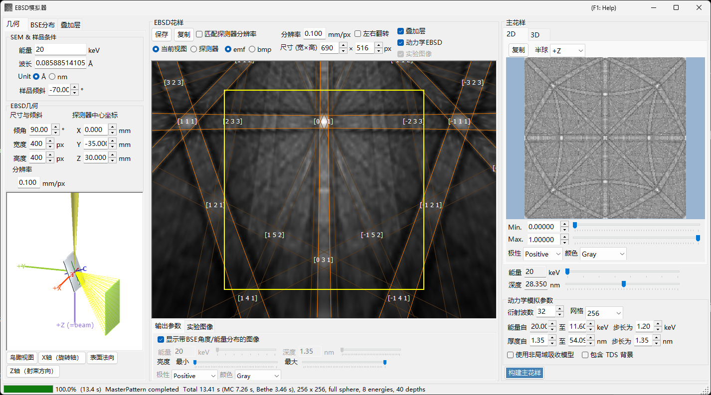

该窗口分为三列。

- **左侧** : 模拟条件。各选项卡用于选择 **几何**（样品/探测器几何及 3D 视图）、**BSE分布**（背散射电子分布）以及 **叠加层**（菊池线及其他标注）。
- **中间** : 当前晶体取向对应的 EBSD（菊池）花样。其下方的选项卡用于选择 **模拟图像** 和 **实验图像**。
- **右侧** : 与取向无关的 master pattern，位于 **2D** 和 **3D** 选项卡中。

底部的状态栏显示当前计算的进度及其结果摘要。窗口较窄时，过长的消息会在右端被截断；将鼠标悬停在上面即可看到完整内容。

---

## 键盘与鼠标快捷键

中间的 EBSD（菊池）花样视图和右侧的 master pattern 视图响应不同的鼠标操作。

| 快捷键 | 操作 |
|----------|--------|
| <kbd>F1</kbd> | 打开本页在线手册 |
| 在花样中心附近左键拖动 | 倾斜晶体 |
| 在花样外侧区域左键拖动 | 旋转晶体 |
| 双击花样 | 选取光标下的探测器子单元并显示其统计信息（**Zone axis** 拾取开启时：添加一个晶带轴；参见[晶带轴拾取](#晶带轴拾取)） |
| 将图像文件拖放到窗口上 | 作为实验 EBSD 图像载入 |
| 在 3D 视图（几何 / master 球面）中左键拖动 | 旋转视图 |
| 在 3D 视图中右键拖动或滚动鼠标滚轮 | 缩放 |
| <kbd>CTRL</kbd> + 在 3D 视图中右键双击 | 切换正交 / 透视投影 |
| 在 2D master pattern 上拖动 / 滚轮 | 平移 / 缩放图像 |

3D 视图使用 ReciPro 的标准[视图导航](21-shortcuts.md)（已禁用平移）。

→ 参见 **[21. 键盘与鼠标快捷键](21-shortcuts.md)**，可一览所有窗口。

---

## 工作流程

按下 **构建主花样** 会依次执行以下步骤。

1. **蒙特卡罗 BSE 模拟** : 使用当前的晶体组成、密度、加速电压和样品倾斜，在样品内部追踪 1000 万个入射电子（弹性散射：Mott/NIST 截面；非弹性散射：介电响应模型）。由此得到背散射电子的*穿透深度 × 出射方向 × 出射能量*的联合分布。
2. **自动范围选择** : 根据该分布，自动设定动力学计算中所用的能量范围（从入射能量到能量损失约第 95 百分位）和深度范围。这里的深度是 master pattern 的厚度，即沿出射方向测量的路径长度（源深度 ÷ cos χ，χ 为出射方向与样品表面法线的夹角）。深度范围取到达探测器的电子的该路径长度的第 99.9 百分位（向上取整到 2 位有效数字），并划分为越靠近表面越细的 40 个不等间距步长。
3. **master pattern 构建** : 对每个能量和深度，求解动力学衍射 (布洛赫波) 问题，并按蒙特卡罗分布加权，在方向球面上积分，从而给出每个方向上的背散射衍射强度。结果存储在等面积 (Roşca–Lambert) 网格上。
4. **带加权的探测器投影** : 对当前晶体取向，从 master pattern 中查找每个探测器像素所张方向对应的强度，并绘制为菊池花样，可选地用 BSE 的角度/能量分布加权。

勾选 **由 MC 自动设定能量与深度范围** 时（默认；此时范围输入框为只读），能量范围和深度范围在第 1–2 步中自动设定。取消勾选即可用手动输入的范围构建：此时蒙特卡罗不会改动这些输入框，手动输入的范围会被保存，并在下次启动时恢复。<!-- 261106Cl 作者の決定 C11 --> 无法使用的范围——下限不小于上限、能量高于加速电压（在蒙特卡罗开始之前检查），或范围完全落在蒙特卡罗分布之外——不会被构建；会显示一条消息，说明原因和数值。<!-- 261106Cl 作者の決定 F5/F15 -->

---

## 几何

### SEM & 样品条件

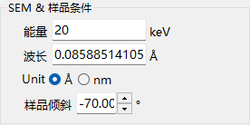

- **能量** : 入射束的加速电压 (keV)。
- **波长** : 电子波长，与能量关联。**Unit** 用于选择 Å 或 nm。
- **样品倾斜** : 样品倾斜角（通常为 −70°）。EBSD 中较大的倾斜可提高背散射电子产额。更改该值会丢弃蒙特卡罗结果（BSE 分布及其权重；请重新运行 **模拟**）；master pattern 与倾斜无关，因此会保留。<!-- 261106Cl 作者の決定 F17 -->

### EBSD几何

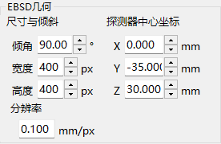

探测器（荧光屏）是由像素数和像素尺寸定义的矩形。

- **尺寸与倾斜** : **倾角** 为探测器屏的倾斜角 (°)，从水平面（垂直于入射束）起算：0° = 水平屏，90° = 竖直屏（默认）。**宽度** 和 **高度** 为探测器的像素数。<!-- 261105Cl 監査: numericBoxDetTilt.ToolTip (EbsdDetectorGeometry の法線 (0, sin d, −cos d)) -->
- **分辨率** : 探测器单个像素的物理尺寸 (mm/px)。因此探测器的物理尺寸为 宽度 × 分辨率 乘以 高度 × 分辨率。
- **探测器中心坐标** : 探测器中心相对于束流入射点的位置 **X**、**Y**、**Z** (mm)，以显微镜（实验室）坐标系表示。**Y** 是同时垂直于入射束 (Z) 和样品倾斜轴 (X) 的水平偏移，而不是倾斜样品表面内的方向。<!-- 261105Cl 監査: numericBoxDetY.ToolTip --> Y 和 Z 与倾斜一起决定相机长度；X 为左右方向的偏移。

载入实验图像时，**宽度** 和 **高度** 会设为图像尺寸，使探测器的一个像素对应图像的一个像素（**分辨率** 保持不变）。

可在 **几何** 选项卡的 3D 视图中查看几何。

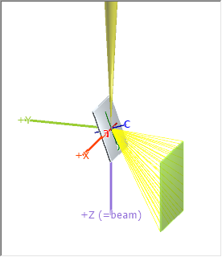

灰色板为样品，绿色矩形板为探测器，紫色的 **+Z (=beam)** 为入射束。同时显示晶体 **a / b / c** 轴（固定于样品）。按钮 **鸟瞰视图**、**表面法向**、**X轴（旋转轴）** 和 **Z轴（射束方向）** 可将视图对齐到标准方向。坐标系定义参见[附录 A1. 坐标系](appendix/a1-coordinate-system/2-diffraction.md)。

---

## BSE 分布

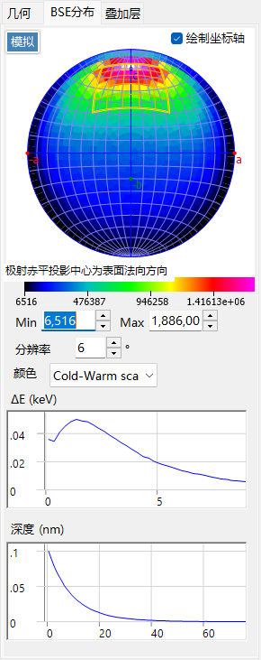

**BSE分布** 选项卡显示蒙特卡罗背散射电子分布。使用 **模拟** 重新计算它们。一次只运行一个蒙特卡罗：运行期间（由 **模拟** 或 **构建主花样** 的第一步启动），**模拟** 不会再启动另一个，状态栏会提示等待或按 **停止**。<!-- 261105Cl 監査: FormEBSD.cs buttonBSE_Click (monteCarloCts) -->

- **Stereonet** : 背散射电子的角度分布（出射方向的直方图）。中心为表面法线方向，黄色轮廓标出探测器所张的矩形区域。**绘制坐标轴** 叠加晶轴，色阶（**Min** / **Max**、**Resolution**、**颜色**）可调。
- **ΔE (keV)** : 背散射电子的能量损失分布。
- **深度 (nm)** : 被探测到的背散射电子的源深度分布，源深度按 **源深度 (MC)** 的定义（默认：最后一次非弹性散射事件）——与对 master pattern 加权时所用的深度定义相同。

这些分布由与[电子轨迹](8-electron-trajectory.md)相同的蒙特卡罗引擎计算，用于对 master pattern 加权。更改晶体或加速电压会将这些结果连同 master pattern 一起丢弃（窗口关闭期间所做的更改在重新打开时生效）；状态栏会说明丢弃了什么。双击 **ΔE** 或 **深度** 图，可将其数值以文本形式（x 和 y，以制表符分隔）复制到剪贴板。<!-- 261106Cl 作者の決定 F23 --> <!-- 261105Cl 監査: FormEBSD.cs SetCrystal / 電圧の変更 / 開き直し (4bc81f06) -->

---

## 叠加层

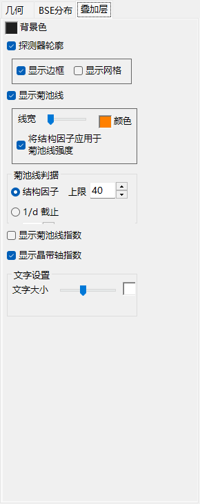

**叠加层** 选项卡用于配置绘制在 EBSD 花样上的标注。

- **背景色** : 背景颜色。
- **探测器轮廓** : 探测器轮廓。**显示边框**（探测器边缘的黄色矩形）/ **显示网格**（分割网格）。
- **显示菊池线** : 绘制菊池线。**线宽** / **颜色**，以及 **将结构因子应用于菊池线强度**（各条线按其结构因子比例向背景色淡出）。
- **菊池线判据** : 选择绘制哪些菊池线：**结构因子**（按结构因子排名的 **上限** *N* 条）或 **1/d 截止**（1/d 低于阈值的，nm⁻¹）。在两者之间切换会立即重绘菊池线。<!-- 261105Cl 監査: 1/d Cutoff 側にもハンドラを配線 (d88da429) -->
- **显示菊池线指数** : 显示菊池线（带）的指数。
- **显示晶带轴指数** : 显示晶带轴指数。
- **文字设置** : 指数标签的 **文字大小** / **颜色**。

---

## Master pattern

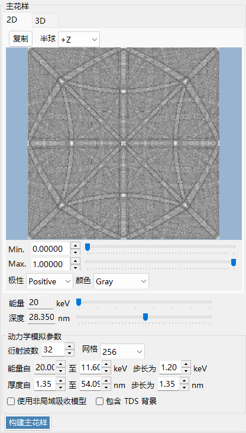

master pattern 是所有方向上的背散射衍射强度，由动力学理论通过 **构建主花样** 预先计算（**停止** 可中断正在进行的计算）。

若有原子位点的原子位移参数为 0 (B = 0)，按下 **构建主花样** 时会弹出确认对话框。B = 0 的位点不产生吸收；若所有位点的 B 都为 0，启用 **非局域背散射源** 时 master pattern 将全黑。**确定** 会为这些位点设置各向同性的 B = 0.5 Ų 并开始计算 (之后可在主窗口中修改该值)；**取消** 则不计算。已输入各向异性参数 (Bij) 的位点保持不变。

- **2D** 选项卡 : 半球的等面积 (Lambert) 投影。**半球** 选择投影的半球 (+Z / −Z)。
- **3D** 选项卡 : 将强度映射到其上的球面。可用鼠标旋转，左上角的插图显示同步的晶轴 (a/b/c)。**坐标轴标签** / **坐标轴箭头** 切换标签/箭头，**沿轴观察** 沿旁边输入的晶带轴 [u v w] 俯视。
- **能量** / **深度** 滑块 : 选择要预览的能量/深度切片。
- 任一视图都可用 **复制** 发送到剪贴板。
- **保存视频**（**3D** 选项卡） : 保存球面 master pattern 旋转的视频 (MP4)。旋转方向、速度、时长、fps 和质量在与[结构查看器](5-structure-viewer.md)相同的“Movie setting”对话框中设置。仅旋转此 3D 视图，晶体取向（主窗口中的欧拉角）不变。

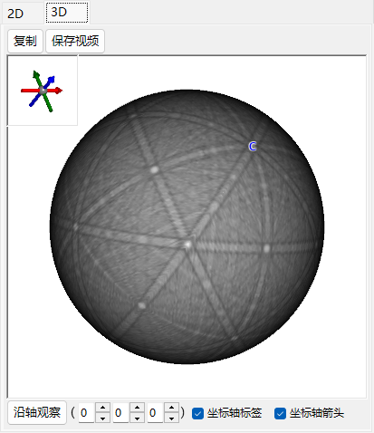

### 动力学模拟参数

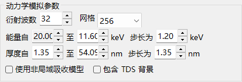

- **衍射波数** : 布洛赫波计算中纳入的衍射束（波）数量。波数越多越精确，但越慢。
- **网格** : master pattern 网格的分辨率（每边像素数，64–8192；默认 256）。4096 和 8192 的中间数据需要极大的内存（在默认的 16 个能量 × 40 个深度下，4096 约需 344 GB，8192 约需 1374 GB；2048 已约需 86 GB），因此必须大幅减少能量和深度的步数才能实际使用。内存不足时，计算以“MasterPattern failed”结束（ReciPro 本身继续运行）。
- **由 MC 自动设定能量与深度范围**（默认开启） : 勾选时，由蒙特卡罗设定下面两个范围，其输入框为只读；取消勾选时，用输入框中键入的范围构建 master pattern（参见[工作流程](#工作流程)），这些范围会保留到下次启动。该设置会保留到下次启动。<!-- 261106Cl 作者の決定 F5/F15 -->
- **能量自 … 至 … 步长为 …** : 积分的能量范围和步长 (keV)；上面的复选框勾选期间，由蒙特卡罗结果自动设定。
- **深度自 … 至 … 步长为 …** : 积分的深度范围和步长 (nm)，以沿出射方向的路径长度计；同样自动设定。自动设定的深度为不等间距，因此输入框中显示最浅点、上限和第一个区间宽度作为参考；手动修改输入框后，将切换为按这些值等间距排列的深度。
- **使用非局域吸收模型** : 使用非局域吸收形式。
- **非局域背散射源**（默认开启） : 将局域于原子位置的背散射源替换为在后半球积分的非局域吸收势形式 (U'_back)。两者使用相同的物理截面，因此这是模型切换，而不是叠加背景。
- **源深度 (MC)** : 选择用哪个蒙特卡洛事件定义 (能量 × 深度) 加权所用的相干背散射源深度：最后一次非弹性事件 (默认)、任意类型的最后一次输运事件，或最后一次退相干。在最后一种情况下，只有局域到足以在样品中留下“哪个原子散射”信息的事件才重置源：弹性事件以 Debye–Waller 因子给出的热漫散射概率 1 − exp(−2B s²) 重置 (Bloch 波已描述的相干 Bragg 散射不重置)，非弹性事件对内壳/高损失激发总是重置，对价电子激发仅按动量转移超过等离激元截止 q_c = ω_p/v_F 的比例重置 (等离激元和非局域电子–空穴对保持 Bloch 态)。源越浅，菊池调制越弱，因此最后一个选项仅由输运决定漫背景，无自由参数。切换只对已保存的电子重新分箱，不会重新运行蒙特卡洛。
- **对比度随能量损失衰减**（默认开启；该设置会保留到下次启动，E_c 不保留；非对称高斯模式 E_c = 0.8 keV，直方图 + 逐电子 A 模式为 0.9 keV） : 将每个能量切片的菊池对比度乘以 A(E) = exp(−(E0 − E)/E_c)（E0 为入射能量，E 为出射能量），并把损失的部分转为按方向平均的平坦基座，因此去掉带对比度后的亮度不变。蒙特卡洛权重逐个计数背散射电子，但损失大量能量的电子几乎不带有锐利的菊池对比度；关闭此修正时，所有切片都带满额对比度，带比 E0 的单色电子宽约 12 %（Si，20 kV）。E_c 是值越小衰减越强的有效参数，并非各物质共通的常数。非对称高斯模式的默认值 0.8 keV 以在原有计算条件下拟合 Si 20 kV 实测图样（Si004 数据）的带宽（有效波长比 α ≈ 1.017）所得的校准值为参考。该值随物质和校准所用的反射而变，在 Botallackite 的校准例中，按所采用的反射得到约 0.43~0.71 keV。定量比较带宽时，若更改能量·深度网格、合成方法或评价指标等，请重新校准。修改该值只会对现有切片重新加权，不会重新计算 master pattern 或蒙特卡洛。
- **表面非晶层** : 非晶表面层 (自然氧化膜、污染、抛光或离子减薄损伤层) 的厚度 (nm)。相干背散射源位于该层内的电子不带菊池调制，以每个电子相同强度的方向平均均匀成分叠加；层以下的源从晶体表面起算深度。输运按晶体的成分和密度计算，几 nm 足够。0 为禁用；更改只对已保存的电子重新分箱，不会重新运行蒙特卡洛。
- **按荧光体响应加权电子**（默认开启，E_dead = 2 keV） : 以荧光屏的发光量 φ(E) = max(0, E − E_dead) 对每个蒙特卡罗电子加权，而不是每个电子计 1 票。能量越高的电子越倾向于从倾斜样品向前方出射，因此加权会使图样自上而下的强度梯度变缓（Si、20 kV 时探测器上下比约从 2.5 降到 1.7），晶带轴亮度也略有下降。它作用于探测器平面的分箱和每箱的能量分布；更改时只对已保存的电子重新分箱，不重新运行蒙特卡罗。对于直接计数电子的探测器请关闭。E_dead 是荧光体的死层（阈值）能量；带铝镀层的 P43 荧光屏典型值为 0–3 keV。
- **Energy filter E >**（keV；默认 0 = 关闭） : 位于探测器前方的理想高通能量过滤器。出射能量等于或低于该值的电子对花样没有贡献。更改时只对已保存的电子重新分箱，不重新运行蒙特卡罗，也不重建 master pattern。
- **用 MC 直方图生成能量分布**（默认关闭） : 按方向分箱的出射能量分布不再用由平均值和左右展宽构成的非对称高斯函数，而用蒙特卡罗电子的原始直方图（φ 加权，线性分配到主图案相邻的两个能量切片）生成。高斯函数把加速电压附近的峰低估 2~3 倍，使菊池带显得更宽。开启后，**对比度随能量损失衰减** 的 A(E) 也不再按能量切片的能量取值，而是对每个电子按其自身的出射能量相乘后再分配。在直方图 + 逐电子 A 模式下，只要 E_c 尚未编辑，就会切换到基于 20 kV Si004 固定 18 条带宽中位数的暂定值 0.9 keV；其他指标（例如整幅图像相关性）会给出不同数值。编辑 E_c 后，切换分布时保留输入值。更改时只对已保存的电子重新分箱，不重新运行蒙特卡罗。

---

## EBSD 花样

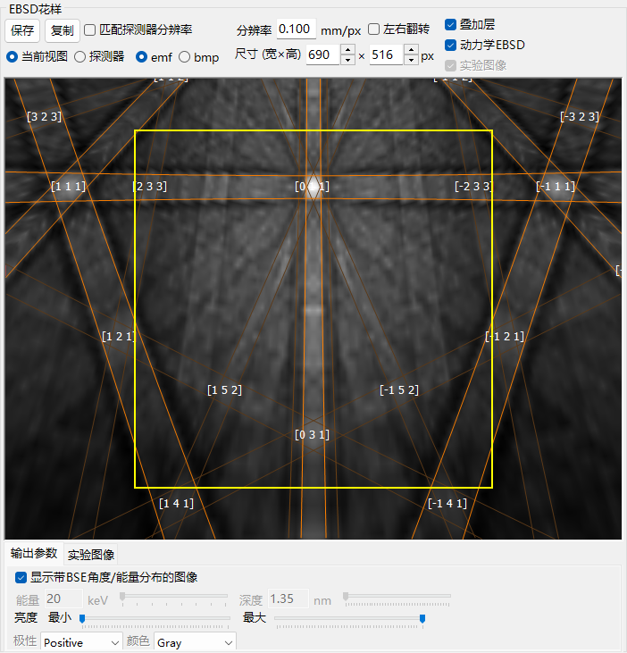

中间面板显示当前晶体取向对应的 EBSD（菊池带）花样。花样上方的工具栏控制绘制内容和复制方式。

- **动力学EBSD** : 将构建好的 master pattern 投影到探测器上；取消勾选时仅保留背景。
- **叠加层** : 绘制在 **叠加层** 选项卡中设置的菊池线、指数和探测器轮廓。
- **实验图像** : 叠加已载入的实验图像（见下文）。
- **左右翻转** : 将花样及其全部叠加层左右镜像。取消勾选（默认）时为从探测器看向样品的方向，即 EBSD 相机记录到的图像；仅当您的实验图像左右相反时才勾选。
- **分辨率**（mm/px）和 **尺寸 (宽×高)**（px）: 显示视图的分辨率与尺寸。
- **保存** : 按旁边选择的范围与分辨率，将花样保存到文件。格式（PNG / TIFF / EMF）在保存对话框中选择。
  - 选择 **Pattern values (\*.csv)** 时，写出的不是图像，而是探测器像素网格上的原始强度值。开头以 `#` 起始的各行记录了条件（晶体、探测器像素网格和像素尺寸、电压、以度表示的探测器与样品倾斜角、探测器的 X/Y/Z 等）以及最小值和最大值。<!-- 261105Cl 監査: 傾斜角は度で書く (FormEBSD.cs, 5f7484d1) -->
  - 当范围为 **探测器**、显示 **动力学EBSD** 且没有叠加实验图像（未载入，或未勾选 **实验图像**）时，<!-- 261105Cl 監査: 16 bit の条件 (FormEBSD.cs, 5f7484d1) --> TIFF 以 16 位灰度写出（不会被量化为 256 级）。此时无论是否勾选，**叠加层** 都不包含在内，像素值是将花样自身的最小值–最大值线性映射到 0–65535 的结果（所用的最小值和最大值显示在状态栏中；需要绝对值时请使用 csv 导出）。
- **复制** : 按旁边选择的范围与格式，将花样复制到剪贴板。
  - **当前视图** 复制当前显示的范围（保持平移与缩放）；**探测器** 仅复制探测器区域，此时不含黄色边框，图像正好在探测器边缘处结束。
  - **emf** 复制为增强型图元文件，菊池线和指数标签保持矢量；**bmp** 则将全部内容栅格化。
  - **匹配探测器分辨率** 以图像 1 像素 = 探测器 1 像素复制（长边限制为 4096 px）。取消勾选时使用屏幕分辨率。

### 模拟图像

构建第一个 master pattern 之前，只有下面的显示行（BSE 分布与切片、亮度与对比度、颜色）被禁用；蒙特卡罗的设置（**源深度 (MC)**、**对比度随能量损失衰减**、**表面非晶层**、**按荧光体响应加权电子**、**Energy filter E >**、**用 MC 直方图生成能量分布**）从一开始就可以更改。<!-- 261106Cl 作者の決定 F16 -->

- **含 BSE 角度/能量分布**（默认开启） : 勾选时，花样通过用 BSE 分布（能量、深度、方向）加权合成，而非使用单一切片。
- **能量** / **深度** : 关闭上述选项时，选择要显示的能量/深度切片。
- **亮度**（**最小** / **最大**）、**对比度**、**极性**、**颜色** : 模拟花样的黑点与白点（以显示范围的百分比给出，滑块为线性）、该显示范围的宽度、极性以及色阶。对比度为 0 时，显示范围等于花样自身的强度范围；-1 时显示范围扩大到 10 倍（对比度减弱为十分之一），+1 时缩小到十分之一，中心保持不变。
- **平坦化背景**（**FWHM**，px；默认关闭，100 px） : 从模拟图样中减去其高斯模糊副本，去除缓慢变化的亮度分布，以便与经背景校正的实验图样比较条带和晶带轴。半高全宽以探测器像素给出，与缩放无关。影响显示图像和 PNG/TIFF 导出；CSV 导出保留原始值。

### 实验图像

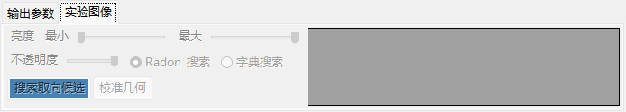

将 EBSD 图像文件（TIFF、PNG、BMP 或 JPEG；16 位 TIFF 以完整位深读取）拖放到窗口的任意位置，即可作为实验花样载入。图像绘制在探测器区域上——位于模拟花样之上、菊池线叠加层之下——因此可以直接比较模拟与实测。载入时还会把探测器的 **Width** 和 **Height** 设为图像尺寸。

- **亮度**（**最小** / **最大**）、**对比度** : 叠加的实验图像的黑点与白点（以其显示范围的百分比给出），以及该显示范围的宽度（滑块为线性，约定与模拟花样相同）。这些设置仅作用于实验图像。
- **平坦化背景**（**FWHM**，px；默认关闭，100 px） : 从实验图像中减去其高斯模糊副本，去除缓慢变化的亮度分布。此后强度滑块作用于平坦化后的值。
- **匹配到图像** : 设置模拟花样的 **最小**、**最大** 和 **对比度**，使其 2 % 和 98 % 强度水平以与实验图像相同的灰度显示。匹配基于百分位数，因此不依赖于取向解，也不受基底强度或少数明亮晶带轴像素的影响。极性、颜色以及两侧的 **平坦化背景** 设置保持不变，因此在按下此按钮之前，请两侧都做平坦化或都不做。
- **不透明度** : 叠加的实验图像的不透明度，从 0（不可见）到 100 %（不透明）。调低即可看到下方的模拟花样。

随后可用两种引擎之一搜索解释该图像的取向。

- **Radon 搜索** : 将运动学菊池带模板与实验图像的 Radon（直线检测）图进行匹配。无需 master pattern 即可工作；若已有 master pattern，则用与模拟花样之间的 robust ZNCC（零均值归一化互相关）对候选重新排序。
- **字典搜索** : 由动力学 master pattern 生成所有取向的字典花样，并全部用 robust ZNCC 比较。需要 master pattern 且耗时数秒，但比 Radon 搜索更可靠。

**搜索取向候选** 运行所选引擎，按优劣顺序列出最多 10 个候选；若已有 master pattern，最佳候选会精修到 ±0.25°。各列含义如下：

| 列 | 含义 |
|----|------|
| **#** | 排名（0 为最佳） |
| **Score** | Radon 带证据的 *z* 值 |
| **Bands** | 匹配的带数 / 视场内预测的带数 |
| **ZNCC** | 与模拟花样的相关性 |
| **Strong bands (hkl)** | 匹配带的指数（仅 Radon 搜索） |

**单击某一行即可将该取向应用到整个程序**，模拟花样会重新绘制在实验图像之上，其他窗口的晶体取向也随之改变。

### 晶带轴拾取

除了匹配整幅图像之外，也可以根据在实验图像上手动拾取的菊池带交点（晶带轴）来求取向。

- **Zone axis** : 开启拾取。开启期间，在花样上左键双击添加一个点，<kbd>CTRL</kbd> + 左键双击删除 5 个屏幕像素以内的点，<kbd>SHIFT</kbd> + 左键双击选中一个点（选中的点以黄色绘制；其他点为青色并带编号）。关闭时，双击照常选取探测器单元。
- **[u v w]** : 所选点的晶带轴指数。保持 0 0 0 则由搜索自动指定；输入指数会约束搜索（对低对称晶体和高指数轴很有用）。
- **+ geometry** : 通过使预测的晶带轴位置与拾取位置之间的像素残差最小化，同时优化探测器中心（X、Y、Z，mm）和取向。至少需要 4 个已指定指数的点；之后选择候选时，也会一并应用精修后的几何。
- **Find** : 搜索能解释所拾取晶带轴的取向（至少 2 个点；通常 3 个就足够，2 个时存在歧义）。角度容差为 2°，若未找到则以 5° 重试。最多 10 个候选写入同一个候选表，单击某一行即可如上应用。
- **Clear** : 删除所有拾取的点、输入的指数以及上一次晶带轴搜索的候选（无法撤销）。载入新的实验图像时也会执行同样的操作。

**校准几何** 将探测器几何（花样中心 PC 与探测器距离 DD）与取向交替优化，使模拟花样与实验花样的 ZNCC 最大化。该功能需要 master pattern，探测器倾斜保持固定，结果会写回 **探测器中心坐标** 的 X/Y/Z 输入框，探测器保持在其原先所在的一侧（+Y 或 −Y）。<!-- 261105Cl 監査: +Y 側の検出器も側を保つ (e1d645d5) -->由于 SEM 的束流扫描只会使花样中心移动不到 1 mm，通常在实验开始时校准一次即可用于整个图像序列。

---

## 另请参见

- [电子轨迹](8-electron-trajectory.md) — 用于角度/能量/深度加权的蒙特卡罗电子轨迹 / BSE 模拟。
- [衍射模拟器](7-diffraction-simulator/index.md) — 动力学 (布洛赫波) 电子衍射。
- [附录 A1. 坐标系](appendix/a1-coordinate-system/2-diffraction.md) — 样品/探测器坐标系的定义。
