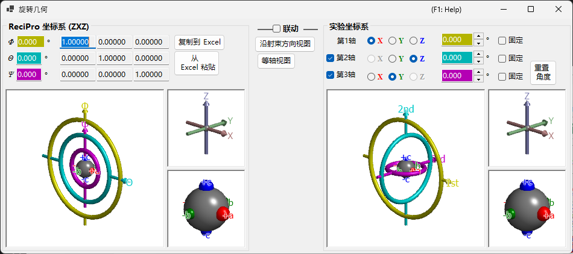

# 旋转几何

此窗口将晶体的旋转状态表示为 3×3 矩阵，并在不同的欧拉坐标系之间进行转换。

ReciPro 使用三个欧拉角 — **Ψ**、**Θ** 和 **Φ** — 按 **Z–X–Z** 顺序应用。然而，此约定不一定与您实际仪器的测角仪轴一致。**旋转几何** 窗口允许您将 ReciPro 的欧拉角转换到任意定义的坐标系，从而支持实验室中的测角仪调整。<!-- 261105Cl 監査: 画面の欄の見出し・ツールチップ (Φ, Θ, Ψ) に合わせ θ → Θ に統一 -->

---

## 键盘和鼠标快捷键

所有六个 3D 视图（ReciPro 与实验测角仪 / 坐标轴 / 对象面板）都是**联动**的 — 旋转其中任意一个，六个视图会一起旋转。它们共享 ReciPro 标准的 [OpenGL 视图导航](21-shortcuts.md)。

| 快捷键 | 操作 |
|----------|--------|
| <kbd>F1</kbd> | 打开在线手册的此页面 |
| 在视图中左键拖动 | 旋转模型（所有六个视图一起旋转） |
| 鼠标滚轮，或右键上下拖动 | 缩放（大型测角仪视图） |
| <kbd>CTRL</kbd> + 右键上下拖动 | 更改相机距离（仅透视模式） |
| <kbd>CTRL</kbd> + 右键双击 | 切换正交 / 透视投影 |

较小的 *Axes* 和 *Objects* 视图禁用了缩放和平移。除 <kbd>F1</kbd> 外没有其他键盘快捷键。

---

## ReciPro 坐标系 (ZXZ)

窗口的上半部分以 "ReciPro 坐标系" 显示旋转状态。

- **Φ, Θ, Ψ** 是显示当前取向（主窗口的欧拉角）的只读输入框。在本窗口关闭期间进行的旋转，会在重新打开时显示。<!-- 261105Cl 監査: 読み取り専用の表示・開き直したときの反映 (FormRotation.cs) -->
- **旋转矩阵** 显示对应于当前旋转状态的 3×3 矩阵。

### Φ, Θ, Ψ (Z–X–Z 欧拉角)

晶体取向由三个旋转来参数化。在 **随体（内禀）** 坐标系中描述时，它们按以下顺序施加：

1. **Φ** — 第一次绕 **Z** 轴旋转。
2. **Θ** — 绕一次旋转后参考系的 **X** 轴旋转。
3. **Ψ** — 第二次绕两次旋转后参考系的 **Z** 轴旋转。

在 **固定的实验室** 坐标系中看，同一旋转则是相反的顺序——先绕 $Z$ 转 Ψ，再绕 $X$ 转 Θ，最后绕 $Z$ 转 Φ——这正是[附录 A1.1](appendix/a1-coordinate-system/1-orientation.md)中采用的描述方式。两者给出下文完全相同的矩阵 $R$；Φ 只是最外层（类似测角台）的轴，Ψ 则是最内层的轴。

Φ、Θ、Ψ 框和九个矩阵框都是**只读**显示。要改变取向，请在主窗口中旋转晶体、使用 **从 Excel 粘贴**，或（在 **联动** 开启时）编辑下方的实验坐标轴角度；每次更改都会传递到主窗口以及所有联动的模拟器。

### 旋转矩阵

由当前 (Φ, Θ, Ψ) 生成的 3 × 3 矩阵。使用 **复制到 Excel** / **从 Excel 粘贴** 可将矩阵通过电子表格往返传输。

该矩阵在 ReciPro 中出现的所有位置都遵循同一约定：

$$
\mathbf{v}_{\mathrm{rot}} = R\,\mathbf{v}_{0}
$$

- \(R\) 是晶体的**主动旋转**（active rotation），在固定于显示器的实验室坐标系（\(X\)=右、\(Y\)=上、\(Z\)=朝向观察者 — 参见[附录 A1.1](appendix/a1-coordinate-system/1-orientation.md)）中表示。
- \(\mathbf{v}_{0}\)：固定于晶体的方向在**初始取向**（\(c \parallel Z\)，\(b\) 位于 \(YZ\) 面内）下的笛卡尔坐标（列向量）。
- \(\mathbf{v}_{\mathrm{rot}}\)：旋转后同一方向的坐标（仍在实验室坐标系中）。
- 当 \(\Phi=\Theta=\Psi=0\) 时 \(R\) 为单位矩阵。\(R\) 为正交归一矩阵且行列式为 +1，因此逆变换就是转置：\(R^{-1}=R^{\mathsf T}\)。

用欧拉角表示为 \(R = R_Z(\Phi)\,R_X(\Theta)\,R_Z(\Psi)\)（绕固定轴的右手旋转；\(\Psi\) 最先作用于向量）：

$$
R=\begin{pmatrix}
\cos\Phi\cos\Psi-\cos\Theta\,\sin\Phi\sin\Psi & -\cos\Phi\sin\Psi-\cos\Theta\,\sin\Phi\cos\Psi & \sin\Theta\,\sin\Phi\\
\sin\Phi\cos\Psi+\cos\Theta\,\cos\Phi\sin\Psi & -\sin\Phi\sin\Psi+\cos\Theta\,\cos\Phi\cos\Psi & -\sin\Theta\,\cos\Phi\\
\sin\Theta\,\sin\Psi & \sin\Theta\,\cos\Psi & \cos\Theta
\end{pmatrix}
$$

应用于晶体学指数时，先换算成初始取向下的笛卡尔坐标：方向 \([uvw]\) 为 \(\mathbf{v}_0 = u\mathbf{a}+v\mathbf{b}+w\mathbf{c}\)，面法线 \((hkl)\) 为 \(\mathbf{v}_0 = h\mathbf{a}^{*}+k\mathbf{b}^{*}+l\mathbf{c}^{*}\)（倒易点阵基矢）。

同一矩阵（\(R_{ij}\) = 第 \(i\) 行第 \(j\) 列）出现于：

- 本窗口的 **复制到 Excel** / **从 Excel 粘贴**（3 × 3 制表符分隔，自上而下逐行）；
- [宏 API](20-macro/1-built-in-functions.md) 的 `Dir.GetRotationMatrix()` / `Dir.SetRotationMatrix()` 与 `Dir.GetEuler()`（9 个元素按行序 \(R_{11}, R_{12}, R_{13}, R_{21}, \ldots, R_{33}\) 排列）；
- [Spot ID v2](11-spot-id-v2.md) 保存的候选列表中的 **R11**–**R33** 列。

### OpenGL 窗口

3D 视图使用三个彩色圆环（甜甜圈）显示当前旋转：

| 颜色 | 欧拉角 | 测角仪层级 |
|--------|------------|-----------------|
| **黄色** | Φ | 第 1（上）轴 |
| **浅蓝色** | Θ | 第 2（中）轴 |
| **粉色** | Ψ | 第 3（下）轴 |

**红色**、**绿色** 和 **蓝色** 箭头表示实空间笛卡尔坐标中的 X、Y、Z 轴。它们与主窗口中显示的晶轴 *不* 相同。

中心的灰色球体表示样品。小的红 / 绿 / 蓝球体（标为 **+a/−a**、**+b/−b**、**+c/−c**）标示旋转后晶体归一化的 *a*、*b*、*c* 轴方向（较大的球 = + 端）。当 Φ = Θ = Ψ = 0 时，它们显示晶体的初始取向（*c* ∥ +Z，*b* 位于 YZ 面内），因此只有对于正交晶胞，*a* 和 *b* 才与 +X 和 +Y 重合。

> **注意**：在 OpenGL 窗口中拖动只会改变此视图的 *投影方向*，而不是晶体取向本身。要旋转晶体，请使用主窗口。

### 按钮

| 按钮 | 操作 |
|--------|--------|
| 复制到 Excel | 以制表符分隔的文本复制 3×3 旋转矩阵，每行一行；可用 **从 Excel 粘贴** 粘贴回来 |
| 从 Excel 粘贴 | 从剪贴板设置旋转矩阵（3×3，制表符分隔）。不是旋转矩阵的值（行和列正交归一、行列式为 +1）会被拒绝并显示消息；电子表格舍入之类的小偏差（最大 10⁻³）会被修正为最接近的旋转矩阵 <!-- 261105Cl 監査: FormRotation.cs の Paste の検査 (RᵀR − I ≤ 1e-3, det > 0) と Copy の改行 (\r\n) --> |
| 沿射束方向视图 | 匹配主窗口的投影（Z 轴垂直于屏幕） |
| 等轴视图 | 切换到等轴测投影 |

---

## 实验坐标系

下半部分在一组任意的旋转轴上定义欧拉角，并读取 / 设置测角仪状态。这称为 **实验坐标系**。

### 第 1、第 2、第 3 轴

为测角仪的每个层级（第 1 = 上、第 2 = 中、第 3 = 下）从 **X**、**Y** 或 **Z**（仅实验室坐标系的正方向）中选择旋转轴。第 2 轴不能与第 1 轴相同，第 3 轴也不能与第 2 轴相同（冲突的单选按钮会被禁用）。默认为 **X – Z – Y**。图形会相应更新。

各轴的角度显示在相应的彩色框（黄色、浅蓝色、粉色）中，也可以直接输入（单位为度；超出 −180…180° 的值会被折回）。实验旋转的合成方式与 ReciPro 自身的矩阵相同，第 1 轴位于最外层：

$$
R_{\mathrm{exp}} = R_{\mathbf{e}_1}(\omega_1)\,R_{\mathbf{e}_2}(\omega_2)\,R_{\mathbf{e}_3}(\omega_3)
$$

（绕固定实验室轴 $\mathbf{e}_i$ 的右手旋转）。

| 控件 | 操作 |
|---------|--------|
| **第2轴** / **第3轴** | 启用或禁用该层级（用于只有一个或两个轴的测角仪）。禁用时其角度被设为 0。禁用第 2 轴也会同时禁用第 3 轴。 |
| **固定** | 在联动把新的取向分解为测角仪角度时（见下文），将该角度保持为当前值。 |
| **重置角度** | 将三个实验角度全部设为 0。 |

---

## 联动

当勾选 **联动** 时，ReciPro 坐标系与实验坐标系耦合在一起：它们的欧拉角会被调整，使得对象取向在两个系统之间保持一致。

在勾选 **联动** 的那一刻，两个坐标系之间的偏移 $R_{\mathrm{base}} = R_{\mathrm{exp}}^{-1} R$ 会被保存，此后 $R = R_{\mathrm{exp}}\,R_{\mathrm{base}}$。联动期间：

- 编辑某个实验角度会在所有窗口中旋转晶体；
- 增量旋转（箭头按钮、CTRL+SHIFT+方向键，或在主窗口及其他窗口中拖动）会被数值分解为已启用且未 **固定** 的测角仪角度，晶体被设置为**测角仪所能达到的最接近的取向** —— 因此在有固定或禁用的轴时，晶体遵循测角仪的约束，而不是精确跟随鼠标；
- 主窗口的 **固定** 复选框仍然有效：勾选其中之一时，增量旋转先绕该晶带轴或晶面法线进行，然后再被分解；<!-- 261105Cl 監査: Link 中も主窓の Fix が効く (FormMain.cs, bc75fdc4) -->
- 设置绝对取向——在主窗口的 **欧拉角** 框中输入（本窗口的 Φ、Θ、Ψ 框为只读）、**重置旋转**、**观察方向** ▸ **轴** / **晶面**、本窗口的 **从 Excel 粘贴**、在晶体列表中选择取向不同的晶体，或从其他窗口（例如应用指数标定结果）或宏设置取向——会精确应用该取向并 **关闭联动**；主窗口的状态栏会给出提示。测角仪角度、**固定** 设置和已启用的轴保持不变。再次勾选 **联动** 即可在新的取向上联动。不改变取向的操作（例如编辑晶体）会保持联动开启。<!-- 261106Cl 作者の決定 G-13: FormRotation.cs SetRotation(bool) -->

如果在 **联动** 开启的状态下关闭本窗口后旋转了晶体，重新打开窗口时会以当前取向重新建立联动的基准（如同再次勾选 **联动**），因此晶体取向和测角仪角度都不会跳变。<!-- 261105Cl 監査: 開き直したときの Link の扱い (FormRotation.cs, ecdcec9a) -->

### 示例工作流程

1. 在实验室中，设置测角仪使晶体的 *a* 轴与 X 射线入射方向对齐，*b* 轴水平。
2. 在实验坐标系中输入实验室测角仪的欧拉角。
3. 在主窗口中旋转晶体，使 *a* 轴朝向屏幕法线，*b* 轴朝向水平方向。
4. 勾选 **联动** — 现在，每当您在主窗口中将晶体指向不同取向时，所需的测角仪角度会自动显示。

---

## 另请参阅

- [主窗口](0-main-window.md)
- [极射赤平投影](6-stereonet.md)
- [基本坐标系与晶体取向](appendix/a1-coordinate-system/1-orientation.md)
- [键盘和鼠标快捷键](21-shortcuts.md)
