# 结构查看器

**结构查看器** 使用 OpenGL 将选定晶体的结构绘制为三维图像。

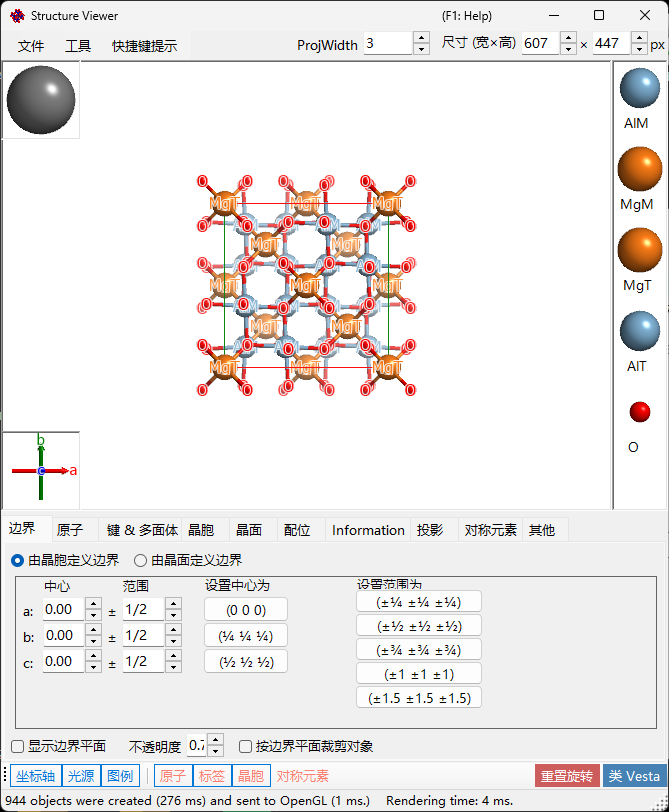

---

## 键盘和鼠标快捷键

该窗口包含一个主三维视图，以及两个小部件——**晶体轴** 框（左下角）和 **光源方向** 框（左上角）——它们对左键拖动的响应各不相同。主视图使用 ReciPro 的标准 [OpenGL 视图导航](21-shortcuts.md)。

| 快捷键 | 操作 |
|----------|--------|
| <kbd>F1</kbd> | 打开本页在线手册 |
| <kbd>CTRL</kbd>+<kbd>SHIFT</kbd>+<kbd>C</kbd> | 将渲染的图像复制到剪贴板 |
| 在主视图中左键拖动 | 旋转模型 |
| 左键双击某个原子 | 显示其坐标、最近邻距离和键角 |
| 右键向上/向下拖动，或滚动鼠标滚轮 | 缩放 |
| 中键拖动 | 平移 |
| <kbd>CTRL</kbd> + 右键向上/向下拖动 | 更改相机距离（仅透视模式） |
| <kbd>CTRL</kbd> + 右键双击 | 在正交/透视投影之间切换 |
| 拖动 **晶体轴** 小部件 | 旋转模型（无平面内自旋） |
| 拖动 **光源** 小部件 | 更改照明方向 |

来自[主窗口](0-main-window.md#keyboard-mouse-shortcuts)的应用程序级 <kbd>CTRL</kbd>+<kbd>SHIFT</kbd> 快捷键在此窗口处于焦点状态时也同样有效。

→ 请参阅 **[21. 键盘和鼠标快捷键](21-shortcuts.md)** 以一览所有窗口。

---

## 主区域

三维晶体结构，与光源方向小部件、晶体轴小部件以及原子图例一同绘制。
> 窗口右上角的 **尺寸 (宽×高)** 框设置 3-D 视图的像素尺寸（窗口会随之调整大小）；保存和复制的图像即为该尺寸。
> 旁边的 **ProjWidth** 框显示投影视图的宽度（单位 nm）。编辑该值即可按数值缩放——它与视图上的右键拖动/滚轮缩放保持同步。

---

## 菜单栏

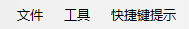

### 文件菜单

| 菜单项 | 说明 |
|--------|------|
| 保存图像 ▸ 主图像 / 图例 / 晶轴 / 光照方向 | 将主视图、原子图例或其中一个小部件保存为 PNG |
| 复制主图像到剪贴板 ▸ 主图像 / 图例 / 晶轴 / 光照方向 | 复制图像（Ctrl+Shift+C 复制主视图） |
| 保存视频 ▸ 主图像 / 晶轴 | 将主视图或晶轴小部件的旋转/平移动画保存为 MP4（可设置速度、时长、fps、质量等） |
| Export 3D Model (3MF/STL) | 将显示中的结构导出为可用于 3D 打印的实体数据 |

**工具** 菜单：**我喜欢 VESTA**（与工具栏的 *类 Vesta* 按钮相同）和 **Enable DDP**（显示/隐藏[透明度模式](#透明度模式)中的 *Dual Depth Peeling* 项）。

**快捷键提示**（单独的顶层菜单）列出键盘快捷键。

**保存影片** 会打开下方的影片设置对话框。影片可以旋转视图、平移投影中心，或两者同时进行——请勾选 **Rotation** 和/或 **Translation**：

- **Rotation**：使视图以 **Speed**（°/s；负值反转旋转方向）绕下方选择的轴旋转——**当前投影**（用箭头按钮选择的倾斜方向）、**方向指数** [uvw]，或 **晶面** (hkl) 的法线。
- **Translation**：使投影中心沿方向指数 [uvw] 以 **Speed**（晶格周期/秒）平移。此选项仅在从结构查看器打开该对话框时显示；启用期间，方向模式只能选择 **方向指数**。

设置影片长度（**Duration**）、帧率（**FPS**，1–120）和编码器质量（**Quality**，1–100；数值越大比特率越高，文件也越大），选择编解码器（**H264** / **H265**），然后按 **OK** 生成 MP4 文件。勾选 **Include final frame** 会在 t = Duration 处额外追加一帧，使影片恰好结束于最终的取向/位置。（编码速度列表现在仅用于标注进度显示，不再影响实际编码。）

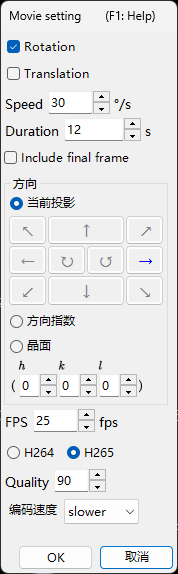

#### Export 3D Model (3MF/STL)

**Export 3D Model (3MF/STL)** 将屏幕上当前绘制的结构模型导出为可用于 3D 打印的实体数据。只有闭合实体才能导出——原子（球、椭球）、化学键（圆柱）和配位多面体。原子标签、边界面和晶面无法打印，因此被忽略。晶胞边框由线段构成，只有勾选相应选项时才会替换为圆柱（角上加球）后输出。

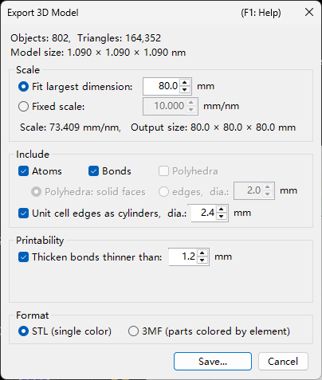

对话框顶部显示参与导出的对象数与三角形数，以及模型的实际尺寸（**Model size**，nm）。

**Scale** : 输出尺寸的确定方式

- **Fit largest dimension** : 自动确定比例，使模型的最长边达到指定长度（5–500 mm，默认 80 mm）。
- **Fixed scale** : 直接指定比例（mm/nm）。用于按同一比例制作多个晶体并排比较。切换到该项时，会以刚才生效的比例作为初始值。
- 下面一行显示确定后的比例与输出尺寸（**Output size**，mm）。

**Include** : 打印中包含的要素

- **原子** / **键** / **配位多面体** : 只能选择当前显示的种类；取消勾选后仍留在屏幕上，但不会进入打印。
- **多面体: 实心面** / **棱, 直径** : 选择将配位多面体输出为带面的实心体，还是仅棱边的骨架（圆柱＋顶点球，默认 2.0 mm）。骨架可以看到内部的原子。
- **镂空网格: 杆直径 / 间距** : 在棱边骨架之外，再在每个面上加上由细杆组成的网格（杆直径 0.8–5.0 mm，默认 1.2 mm；间距 1.5–20 mm，默认 5.0 mm）。从远处看各面像是填满的，但内部仍然可见。
- **晶胞棱作圆柱, 直径** : 将晶胞边框替换为指定直径（默认 2.4 mm）的圆柱后包含进来。只要显示了晶胞边框，此框默认即为勾选。

**Printability** : 打印适性

- **Thicken bonds thinner than** : 打印后直径低于指定值（默认 1.2 mm）的化学键，会依据原始图元以该直径重新生成，以免细键折断。若关闭该项而存在过细的化学键，则会出现红色警告。

**Format** : 文件格式

- **STL (single color)** : 单色二进制 STL。
- **3MF (parts colored by element)** : 按元素着色的 3MF；颜色名称中带有元素名。

按 **Save...** 会询问文件名。导出结束后，三角形数、输出尺寸与比例会记录在左下角的信息栏中。

---

## 选项卡菜单

### 由晶胞定义的边界

指定晶体的绘制范围。共有两种模式，通过顶部的单选按钮切换。

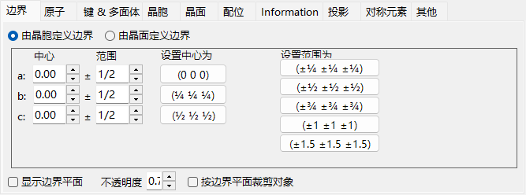

在此模式下，晶胞的 *a*、*b*、*c* 轴是绘制范围的单位。

- **中心**：绘制体积的中心分数坐标。
- **范围**：*a*、*b*、*c* 各轴的上限/下限。
- 右侧的 **预设按钮** 提供常用值（例如 1×1×1 晶胞、2×2×2 晶胞）。

### 由晶面定义的边界

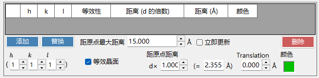

在此模式下，绘制区域由一组晶面界定。如果这些面未能定义出一个空间上封闭的区域，ReciPro 会添加一个半径为 **距原点最大距离**（Å）的近球形多面体，使其封闭。

#### 边界列表

为当前晶体注册的所有边界面。使用 **添加 / 替换 / 删除** 来操作列表；最左侧的复选框可在不删除某个面的情况下临时禁用它。

> 要永久保存更改，您还必须在 **主窗口** 中按 **添加** 或 **替换**。否则，下次在主晶体列表中更改选择时，更改将丢失。

#### H k l 指数

通过米勒指数设置边界面。该复选框会包含由选定的 (*hkl*) 生成的晶体学等价面。

#### 距原点的距离

从原点到边界面的距离，可以以选定 (*hkl*) 的 *d* 值（晶面间距）的倍数（**d×** 框）或以 Å（括号中的框）输入。两个框相互联动：更改其中之一会更新另一个。

- **Translation**（Å）：仅当勾选 **等效晶面** 且恰好生成两个等效面（通常为 (*hkl*) 及其反向面）时生效。此时第一个面以该量远离原点，第二个面以该量靠近原点，即平板沿法线方向平移。其他情况下该值被忽略。
- **距原点最大距离**（Å）：当这些面不能围成一个区域时所用的封闭多面体的半径（见上文）。
- **立即更新**：无需按 **替换** 即可应用对所选面的编辑。

#### 显示边界平面 / 不透明度

显示或隐藏边界面本身。显示时，**Opacity** 设置透明度（0 = 透明，1 = 不透明）。

#### 按边界平面裁剪对象

如果勾选，则仅渲染由边界定义的内部区域；与边界相交的原子、化学键和多面体将被裁剪。

#### 隐藏原子

“边界”选项卡中没有用于此目的的复选框。请改为关闭工具栏的 **原子** 按钮：这样不会生成任何原子，化学键和多面体也随之消失——当只需要可视化晶胞或晶面时很有用。

### 原子

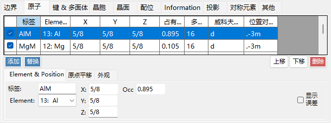

设置每个原子的种类、位置和占有率，以及每个原子的绘制方式（半径、颜色、材质）。

#### 原子列表

晶体中的原子列表。使用 **添加 / 替换 / 删除** 来操作列表；最左侧的复选框可临时隐藏某个原子。

> 要永久保存更改，也请在 **主窗口** 中单击 **添加** 或 **替换**。

#### 元素和位置

- **标签**：原子的自由文本标签（用于图例和工具提示）。
- **Element**：化学元素 / 电离状态。
- **X, Y, Z**：分数坐标。0–1 之间的实数，或诸如 `1/2`、`2/3` 之类的分数。
- **Occ**：占有率，0–1 之间的实数。

#### 原点平移

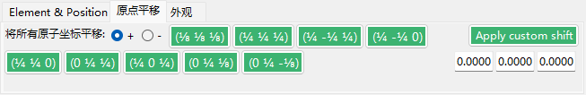

将每个原子平移相同的分数偏移量。按一个预设按钮（例如，为同一空间群在原点选择 1 / 2 之间切换），或输入自定义的 (Δx, Δy, Δz) 并按 **Apply custom shift**。

#### 外观

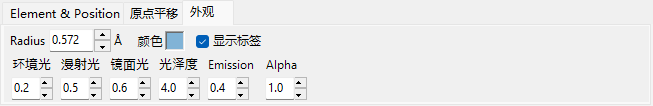

每个原子的半径、颜色和材质。

- **Radius**：绘制的原子半径。
- **Atom color**：表面颜色。
- **Material**：OpenGL 着色器所用的纹理 / 材质属性。
- **应用于相同元素**：将当前的半径和颜色应用于同一元素种类的每个原子。

### 键 & 多面体

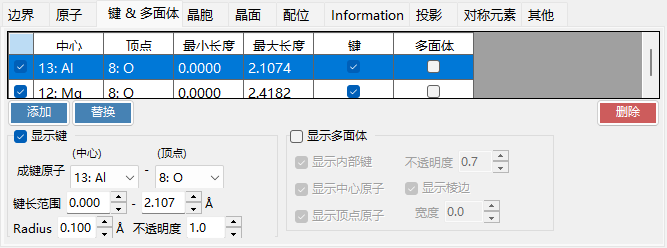

定义哪些原子对之间成键（按元素种类和距离范围），以及所得化学键和配位多面体的绘制方式。

#### 化学键列表

为晶体注册的所有化学键/多面体规则。使用 **添加 / 替换 / 删除**；最左侧的复选框可临时禁用某个条目。与原子和边界一样，要使更改永久生效，需在 **主窗口** 中按 **添加** / **替换**。

#### 化学键属性

- **成键原子(中心)**：用作化学键 / 多面体中心原子的元素种类。
- **成键原子(顶点)**：用作顶点（另一端）的元素种类。
- **Length between … and …**：距离的下限和上限阈值。超出此范围的原子对不会被绘制。
- **Bond Radius**：绘制的化学键粗细（圆柱半径）。
- **不透明度**：化学键透明度（0 = 透明，1 = 不透明）。

#### 多面体属性

- **显示多面体**：勾选时，绘制由当前化学键定义的多面体（仅当中心/顶点组合在几何上有效时）。
- **内部键**：显示/隐藏多面体内部的化学键。
- **中心原子**：显示/隐藏中心原子。
- **顶点原子**：显示/隐藏顶点原子。
- **Color** / **Alpha**：面颜色和透明度。
- **显示棱边**：绘制连接各顶点的棱边。
- **Edge Color** / **宽度**：棱边的颜色和线宽。

### 晶胞

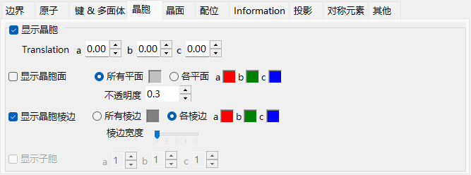

设置所绘制晶胞的位置，以及是否显示其面和棱边。

#### 平移

每个空间群都有一个默认原点。要将绘制的晶胞中心从该原点移开，请沿 *a*、*b*、*c* 设置平移量。

平移量与[投影中心](#投影中心)相关联：把投影中心设为 $(x, y, z)$ 时，平移量被设为 $(0.5-x,\ 0.5-y,\ 0.5-z)$。

#### 显示晶胞面

是否绘制界定晶胞的六个面。启用时，您可以设置面颜色和透明度。

#### 显示棱边

是否绘制晶胞的棱边。棱边颜色可配置。

总开关复选框 **显示晶胞**（= 工具栏的 *晶胞* 按钮）整体开关晶胞。面和棱边的颜色可以对 **所有平面** / **所有棱边** 一次性设置，也可以对 **各平面** / **各棱边**（*a*、*b*、*c* 分别）设置；**棱边宽度** 设置线宽，**不透明度** 设置面的透明度。

### 晶面

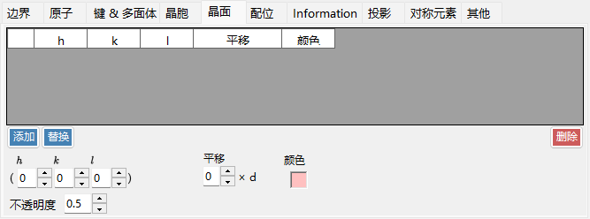

绘制由米勒指数给定的晶面，并可选择同时包含晶体学等价的晶面。

#### H k l 指数

通过米勒指数指定晶面。该复选框可选择性地包含由 (*hkl*) 生成的晶体学等价面。

#### 平移

将绘制的晶面平移其 *d* 值（晶面间距）的整数倍——可用于可视化同一族的连续晶面。

### 配位

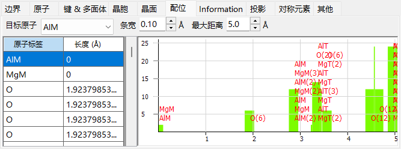

列出并绘制与所选目标原子配位的原子。

#### 表格（左侧）

列出哪些原子环绕选定的目标原子以及它们之间的距离。目标原子从表格上方的下拉菜单中选择。

#### 图表（右侧）

由与表格相同的数据导出的邻原子数量与距离的直方图。调整 **Bar Width**，直到各柱清晰分离出配位壳层——这可对配位数给出一个直观的估计。

### Information

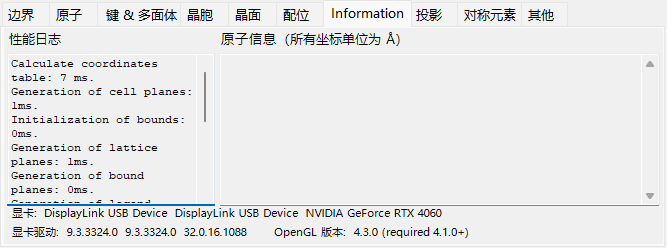

渲染日志（帧时间、GPU 信息）以及选定原子的基本信息。正在建设中——字段可能会随时间增加。

### 投影

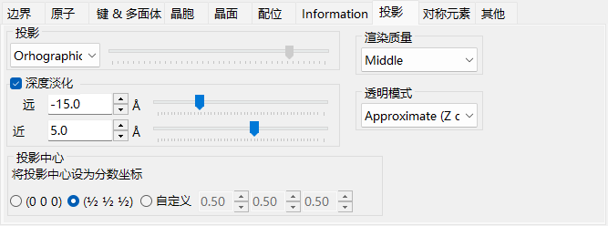

设置投影模式（正交 / 透视）、深度淡出、投影中心、渲染质量以及透明度算法。

#### 投影

- **Orthographic**：完美的平行投影（视点位于无穷远处）。
- **Perspective**：从滑块所设视点距离进行的透视投影。

#### 深度淡出

在深度方向上淡出远处的对象（**深度淡化**）。颜色朝 **背景色** 线性混合：比 **近** 更近的对象保持自身颜色，比 **远** 更远的对象取背景色，介于两者之间的对象进行插值。（不透明度本身不变。）**近** 和 **远** 以 Å 给出。

#### 投影中心

将投影中心设置为指定的坐标。打开 **自定义** 以输入任意坐标。每个坐标都会被折叠到 −0.5 至 +0.5（一个晶格周期）的范围内。**Translation** 影片（见[文件菜单](#文件菜单)）会自动驱动这些值。

#### 渲染质量

绘制质量（网格细分、抗锯齿）。质量越高速度越慢——请选择与您的 GPU 相匹配的设置。

#### 透明度模式

用于半透明原子和多面体的算法。

- **Approximate (Z depth sorting, OpenGL 4.1+)**：快速，但当许多半透明对象重叠时可能不准确。
- **High quality (Dual Depth Peeling, OpenGL 4.1+)**：基于深度剥离的顺序无关透明度。仅当 **工具 ▸ Enable DDP** 开启时显示（PPLL 不可用时默认开启）。剥离的遍数遵循[渲染质量](#渲染质量)设置。
- **High quality (Per-Pixel Linked List, OpenGL 4.3+)**：精确的顺序无关透明度；仅当 GPU 支持 OpenGL 4.3 时显示。准确但较慢；实际上需要独立 GPU。

### 对称元素

**对称元素** 选项卡将空间群的对称操作直接绘制到三维模型上（用工具栏的 **对称元素** 按钮切换）。每一类元素都可以独立显示/隐藏：

- **对称轴**：**旋转**、**螺旋**、**旋转反演**
- **平面**：**镜面**、**滑移面**
- **反演中心**

总开关为 **显示对称元素**。对于每一组，您都可以调整符号大小（%）和颜色，对于轴和平面还可以调整线宽。

### 其他

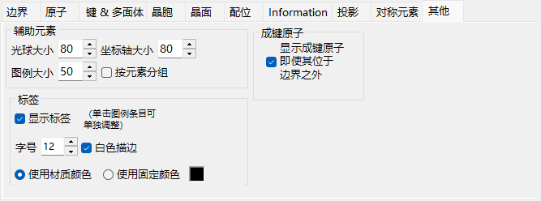

- **辅助元素**：设置显示大小（光球、轴、图例）。**按元素分组** 切换图例显示。
- **成键原子**：**显示成键原子即使其位于边界之外** 会继续绘制那些与绘制范围内原子成键的原子，即使它们位于范围之外。
- **标签**：**显示标签**、**字号**、**白色描边**，以及标签颜色（**使用材质颜色** 或 **使用固定颜色**）。单击原子图例中的某个条目，可单独切换该原子（勾选 **按元素分组** 时为该元素）的标签。

---

## 工具栏

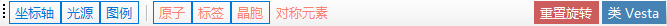

| 按钮 | 说明 |
|--------|-------------|
| 坐标轴 | 显示轴的方向（大小 = 晶格常数） |
| 光照 | 设置光源方向 |
| 图例 | 原子图例 |
| 原子 | 切换原子对象 |
| 标签 | 切换原子标签 |
| 晶胞 | 切换晶胞棱边 |
| 对称元素 | 切换对称元素叠加层（见上文） |
| 重置旋转 | 返回初始取向 |
| 类 Vesta | 切换为 VESTA 风格的外观：原子颜色和半径被重置，化学键列表被默认化学键**替换** |

---

## 另请参阅

- [主窗口](0-main-window.md)
- [晶体数据库](1-crystal-database.md)
- [对称性信息](2-symmetry-information.md)
- [衍射模拟器](7-diffraction-simulator/index.md)
- [键盘和鼠标快捷键](21-shortcuts.md)
