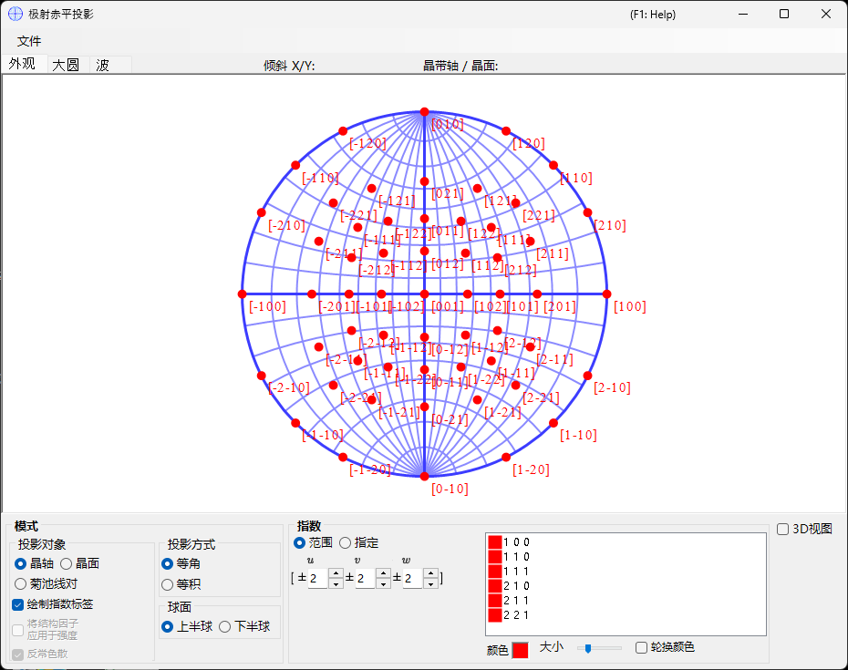
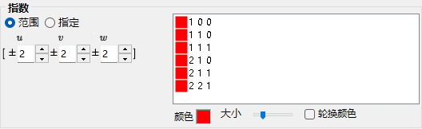
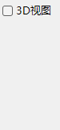
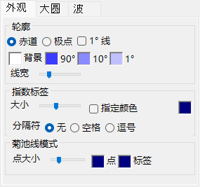
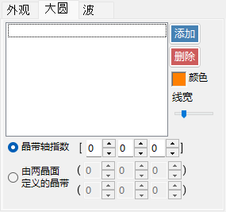
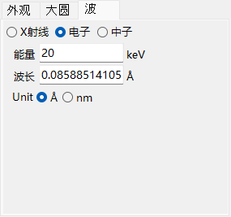

# 极射赤平投影

**极射赤平投影**使用极射赤平投影法显示晶面和轴方向。

---

## 键盘和鼠标快捷键

极射赤平投影本身是二维投影；可通过 **3D视图** 显示一个可选的三维球面。

| 快捷键 | 操作 |
|----------|--------|
| <kbd>F1</kbd> | 打开在线手册的本页 |
| 在中心附近左键拖动 | 倾斜晶体 |
| 在外侧区域左键拖动 | 围绕视轴旋转晶体 |
| 左键双击 | 在 **晶面** 和 **晶轴** 投影之间切换 |
| 右键单击 | 缩小 |
| 右键拖出一个矩形框 | 放大到所选区域 |
| 中键拖动 | 平移 |
| 移动鼠标（不按任何按键） | 读取光标下的 (hkl)/[uvw]——用于标定测得的衍射斑点（下半球也可） <!-- 261105Cl 監査: 下半球の読み取り (268779a1) --> |

在投影网上拖动会旋转**晶体**；旋转状态在所有窗口之间共享。

三维渲染使用 ReciPro 的标准 [OpenGL 视图导航](21-shortcuts.md)（左键拖动旋转，右键拖动 / 滚轮缩放，<kbd>CTRL</kbd> + 右键双击切换投影方式），并且只旋转三维视图，而不旋转晶体本身。

来自[主窗口](0-main-window.md#keyboard-mouse-shortcuts)的应用程序级 <kbd>CTRL</kbd>+<kbd>SHIFT</kbd> 快捷键在本窗口获得焦点时同样有效。

→ 参见 **[21. 键盘和鼠标快捷键](21-shortcuts.md)**，一览所有窗口的快捷键。

---

## 主区域

此处显示所选晶体的晶面、方向指数和菊池线的极射赤平投影。

---

## 文件菜单

可保存或复制为光栅图像（PNG）或矢量图元文件（EMF）。粘贴的图元文件可在 PowerPoint 或其他矢量编辑器中编辑字体和线宽。

| 菜单项 | 说明 |
|-----------|-------------|
| 保存图像 ▸ 为图像 (PNG格式) / 为图元文件 (EMF) | 将极射赤平投影保存为 PNG 文件或矢量 EMF 文件 <!-- 261105Cl 監査: as Metafile (EMF) の保存を配線 (FormStereonet.cs, 268779a1) --> |
| 复制到剪贴板 ▸ 为图像 / 为图元文件 (EMF) | 复制极射赤平投影 |
| 保存视频 ▸ 极射赤平投影 / 3D | 保存极射赤平投影或三维视图的旋转视频（MP4），使用与[结构查看器](5-structure-viewer.md#文件菜单)相同的影片设置对话框（仅旋转） |
| 页面设置 / 打印预览 / 打印 | 打印极射赤平投影 |

---

## 模式 {#mode}

### 投影目标

选择要投影到网上的对象。

- **晶轴** — 投影方向指数 \([uvw]\)。
- **晶面** — 投影晶面法线 \((hkl)\)。
- **菊池线对** — 投影菊池线对。

### 投影方法

| 方法 | 说明 |
|--------|-------------|
| **等角**（Wulff / 极射赤平投影） | 保持投影特征之间的角度关系，但不保持立体角。经典晶体学家在读取轴间角或面间角时使用。 |
| **等积**（Schmidt / 等面积 / 兰伯特投影） | 保持每个区域的立体角（面积），但会扭曲角度。在关注相对密度的统计极图中更受青睐。 |

### 半球

选择 **上半球** 或 **下半球** 作为投影源——切换可见球面是离观察者最近的一面还是最远的一面。
上半球 = $+Z$ 一侧（朝向观察者，参见[附录 A1.1](appendix/a1-coordinate-system/1-orientation.md)）；选择 **下半球** 时，每个方向的 $Z$ 分量在投影前被反转，并且各点以**空心圆**而非实心圆绘制。

### 显示选项

- **绘制指数标签**：显示指数标签。
- **将结构因子应用于强度**：当选择 **晶面** 或 **菊池线对** 时，按结构因子对每一项加权（在 [波 选项卡](#wave) 中设置波源和波长）。权重为在所显示集合上的 $I_{\mathrm{rel}} = |F_{hkl}|^2 / \max|F|^2$：在 **晶面** 模式下，点的半径乘以 $\sqrt{I_{\mathrm{rel}}}$（即 $\propto |F_{hkl}|$）；在 **菊池线对** 模式下，线的不透明度为 $I_{\mathrm{rel}}$。
- **反常色散**：在结构因子中计入 X 射线反常色散项 $f'$、$f''$。仅对 X 射线且在 **晶面** / **菊池线对** 模式下可用。

> 对于三方/六方晶系，可在主窗口中通过 **选项 ▸ 使用米勒-布拉维 (hkil) 指数** 启用米勒-布拉维（四指数）表示法。

---

## 指数 {#indices}

设置要绘制哪些晶面 / 轴。

### 范围模式

指定 \([uvw]\) 或 \((hkl)\) 指数的范围。ReciPro 会枚举范围内的每个指数并逐一投影。

在范围模式下，上下限为所输入值的 $\pm$；只取既约指数，并将其归为晶体学等价指数的集合（每个集合使用一种颜色）。

### 结构因子模式

仅适用于 **晶面** 和 **菊池线对**。投影当前波源下 $|F_{hkl}|^2$ 最大的那些晶面。**上限** 设定要绘制的晶面数（等价晶面逐个计数；在 **晶面** 模式下，与某个更强反射平行的反射——即其高阶或低阶反射，例如 111 更强时的 222——会被跳过）。

### 指定模式

逐个指定特定的轴或面。输入一个指数，按 **添加** 进行注册，或按 **删除** 进行删除。勾选 **包含等效指数** 后，所有晶体学等价指数也会被绘制出来。

### Colour / Size

设置所绘制点的 **颜色** 和 **大小**。勾选 **轮换颜色** 可为每组等价的轴/面分别进行颜色编码——便于在多指数图上区分各个族。

---

## 3D Options

勾选 **3D视图** 时显示；三维球面出现在投影网右侧的窗格中。

- **重置视角**：将三维视图恢复为默认的方向和缩放。
- **标签**：在三维中绘制指数标签。方向以 [uvw] 标注；四指数形式（开启 **使用米勒-布拉维 (hkil) 指数** 时）只用于晶面和菊池线。<!-- 261105Cl 監査: 3D のラベル (FormStereonet.cs, 268779a1) -->
- **半球**：只绘制上（$Z>0$）半球上的极点。
- **极射赤平投影**：在三维中绘制投影平面（网），并绘出上半球极点的投影点。
- **球面轮廓**：绘制球面的经纬网格。
- **投影线**（**极射赤平投影** 开启时）：为上半球的每个极点绘制辅助投影线——Wulff 投影为从南极 $(0,0,-1)$ 到该极点的直线，Schmidt 投影为圆弧。
- **深度淡化**：三维视图深度淡化的强度。

---

## 选项卡菜单

### 外观 {#appearance}

#### 轮廓

极射赤平投影轮廓的绘制方式——边界圆以及可选的大圆经纬度网格。选择 **赤道** 或 **极点**，切换 **1° 线** 和 **背景** 填充，设置 **90° / 10° / 1°** 网格颜色，并用轨道滑块调节 **线宽**。

#### 指数标签

- **大小** — 指数标签的大小。
- **指定颜色** — 为所有指数标签使用单一固定颜色，而非各斑点的颜色；当点采用颜色编码而你希望所有标签使用同一颜色以便阅读时，此功能很有用。
- **分隔符** — 每个标签中各指数之间放置的字符：**无**（如 100）、**空格**（1 0 0）或 **逗号**（1,0,0）。

#### 菊池线模式

- **点大小** — 所绘制点的大小。
- **点** / **标签** — 点及其标签的颜色。

### 大圆

绘制大圆（不支持小圆）。可通过 **晶带轴指数** \([uvw]\)（由该轴所属晶带形成的大圆）指定，或通过 **由两晶面定义的晶带**（晶带轴为两者的叉积）指定。用 **添加** / **删除** 编辑列表；取消勾选某个条目会隐藏该圆。圆的颜色和线宽同样可以配置。这些圆遵循[模式](#mode)中所选的投影方法和半球（Wulff 或 Schmidt，上半球或下半球）。<!-- 261105Cl 監査: Schmidt・下半球の大円 (268779a1) -->

### 波 {#wave}

仅当选择 **晶面** 或 **菊池线对** 作为投影目标时使用（在 **菊池线对** 模式下，波长还决定布拉格角，即每对线的间距）。设置波源（X 射线 / 电子 / 中子）以及计算晶体结构因子所需的波长或能量，这些结构因子用于[模式](#mode)中的 **将结构因子应用于强度**。

---

## 另请参阅

- [主窗口](0-main-window.md)
- [旋转几何](4-rotation-geometry.md)
- [结构查看器](5-structure-viewer.md)
- [衍射模拟器](7-diffraction-simulator/index.md)
- [基本坐标系与晶体取向](appendix/a1-coordinate-system/1-orientation.md)
