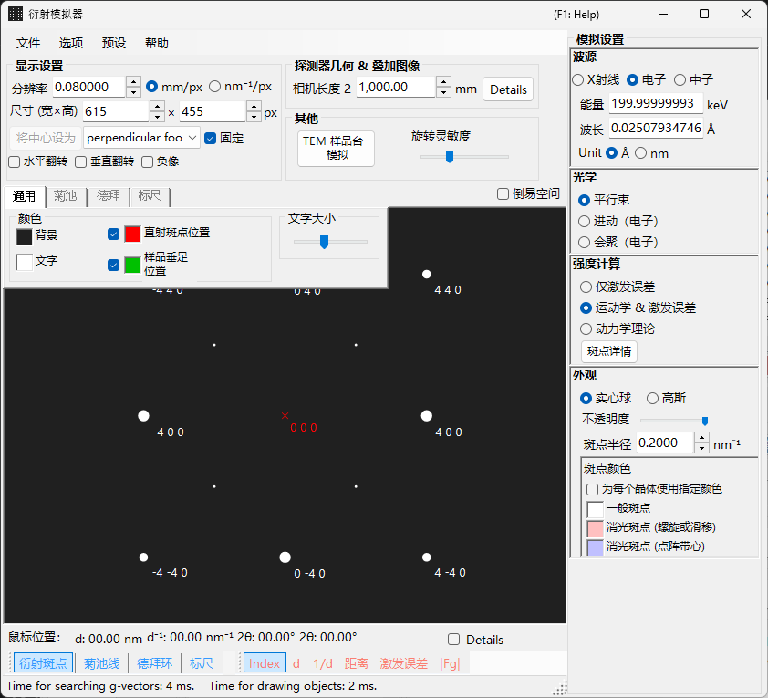
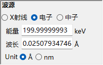
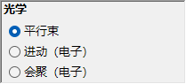
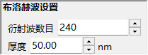
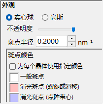

# SAED（选区电子衍射）模拟

**SAED（Selected Area Electron Diffraction，选区电子衍射）** 模拟用于计算平行电子束产生的单晶电子衍射图样。这是[衍射模拟器](index.md)的默认模式。

> 本页列出当您选择 **波源** = **电子** 且 **光学** = **平行束** 时，右侧 **模拟设置** 面板中出现的每一项设置。关于绘制和保存等窗口级操作，请参见[概览页](index.md)。

GUI 条件：波源 = 电子，光学 = 平行束，强度计算 = 仅激发误差 / 运动学 & 激发误差 / 动力学理论。

---

## 概览

模拟平行电子束穿过薄样品时产生的衍射图样。衍射斑点的位置由埃瓦尔德球与倒易点阵点之间的几何关系确定，每个斑点的亮度则按照所选的强度计算模式来计算。

---

## 波源 {#wave-length}

将辐射源设置为 **电子**。输入能量（keV）或波长（Å 或 nm，可切换；默认 Å），即可计算出经相对论修正的波长。初始值为 200 keV；**预设** 菜单可一键设置 300 / 200 / 120 kV。关于 X 射线和中子源，请参见 [X 射线衍射模拟](5-x-ray-neutron-diffraction.md)。

---

## 光学 {#incident-beam-mode}

将 **光学**（入射束的几何形状）设置为 **平行束**。这是用于 SAED 和 X 射线衍射的标准平面波几何。

> **Note**：对于电子束，您可以选择 **平行束** / **进动（电子）** / **会聚（电子）**。选择 **进动（电子）** 将得到 [PED 模拟](2-ped-simulation.md)，选择 **会聚（电子）** 将得到 [CBED 模拟](3-cbed-simulation.md)；在这两种情况下，强度计算都会自动切换为 **动力学理论**。

---

## 强度计算

选择如何计算斑点强度。

### 仅激发误差

强度仅由埃瓦尔德球与倒易点阵点之间的几何距离（偏离矢量 $S_g$）决定。$S_g = 0$（即恰好位于球面上）时强度最大，随 $\lvert S_g\rvert$ 增大而减小，当 $\lvert S_g\rvert$ 超过为倒易点阵点设定的 **斑点半径** 时降为零。由于忽略了晶体结构因子，这是最快的模式，适合检查衍射斑点的位置。

仅在此模式下会出现以下选项：

| 选项 | 说明 |
|--------|-------------|
| **排除所有禁戒衍射** | 隐藏空间群禁止的所有反射（点阵带心、螺旋轴和滑移面）。勾选此项也会勾选并锁定下一个选项。 |
| **排除由点阵带心禁戒的衍射** | 仅隐藏由点阵带心禁止的反射（默认开启）。 |
| **以相同半径绘制所有斑点** | 不论 $S_g$ 如何，都以完整半径 *R* 绘制每个被激发的斑点。 |

仍然显示的禁戒反射以 **消光斑点** 的颜色绘制（见[斑点外观](#斑点外观)）。

### 运动学

在偏离矢量之外，还将运动学结构因子 $\lvert F_{hkl} \rvert^2$ 计入强度。消光规则得到正确反映，因此该模式适合薄样品或弱衍射。

### 动力学（布洛赫波法，仅限电子）

采用布洛赫波法（Bethe 法）进行严格的动力学计算。它再现多重散射以及强度随厚度的变化，对于厚样品或强衍射是必需的。仅当选择 **电子** 时可用。关于理论，请参见 [附录 A3. 布洛赫波法](../appendix/a3-bloch-wave/calculation.md)。

> **Note**：当选择 **动力学理论** 时，下方会出现 **布洛赫波设置** 面板。

---

## 布洛赫波设置（动力学理论）

仅当 **强度计算 = 动力学理论** 时才有效。

| 参数 | 说明 |
|-----------|-------------|
| **衍射波数目** | 本征值问题中纳入的布洛赫波数量（8–1000，默认 240）。值越大，强度越精确，但计算时间按 $O(N^3)$ 增加 |
| **厚度** | 动力学计算中使用的样品厚度（nm）（0.01–10000 nm，默认 50 nm） |

---

## 斑点外观

控制每个衍射斑点的绘制方式。

- **实心球 / 高斯** ：倒易点阵点的几何模型（默认 **实心球**）。**实心球** 绘制某个球与埃瓦尔德球之间的截面（一个圆）：对 **运动学 & 激发误差**，球半径为 $R\,I^{1/3}$（球体积 ∝ 强度）；对 **仅激发误差**，球半径为 $R$；对 **动力学理论**，则不经埃瓦尔德球截取，直接绘制半径为 $R\,I_\text{dyn}^{1/2}$ 的圆盘（面积 ∝ 强度）。**高斯** 绘制 $\sigma = R$ 的三维高斯函数的截面（二维高斯），其积分对应衍射强度。
- **不透明度** ：斑点的透明度（0 = 透明，1 = 不透明）。
- **斑点半径 (R)** ：倒易点阵点的虚拟半径（nm⁻¹；0.01–1，默认 0.2）。斑点大小由 **外观** 模式与 **强度计算** 的组合确定（见上）。
- **亮度**、**色阶**、**对数刻度** ：仅在 **高斯** 模式下显示。**亮度** 缩放所绘制高斯函数的积分强度；**色阶** 可选 **Gray**（斑点使用下面的斑点颜色）、**Cold-warm**、**Spectrum** 或 **Fire**；**对数刻度** 以对数刻度显示强度（对强度对比度大的图样很有用）。
- **斑点颜色** ：在 **色阶** 为 **Gray**（初始设置）时显示。**一般斑点**、**消光斑点 (螺旋或滑移)** 和 **消光斑点 (点阵心化)** 分别设定允许反射与禁戒反射的颜色。
- **按晶体指定颜色** ：勾选后，斑点以分配给各晶体的颜色绘制（只有一个晶体时也是如此）。

---

## 斑点标签

叠加在斑点上的标签可从[工具栏](index.md#toolbar)中选择。

| 标签 | 内容 |
|-------|---------|
| **Index** | 米勒指数 $(hkl)$；当主窗口的 **选项 ▸ 使用米勒-布拉维 (hkil) 指数** 开启且晶体采用六方轴时为四指数 $(hkil)$（菊池线、德拜环和 3-D 的标签遵循相同设置） <!-- 261105Cl 監査: C23 --> |
| **d** | 晶面间距 $d$，按主窗口的长度单位以 Å 或 nm 表示 <!-- 261106Cl 作者の決定 C20 --> |
| **1/d** | 晶面间距的倒数 $1/d$，按主窗口的长度单位以 nm⁻¹ 或 Å⁻¹ 表示 <!-- 261106Cl 作者の決定 C2 --> |
| **距离** | 探测器上从斑点到透射（直射）斑点的距离（mm），在绘制位置之间测量，因此对倾斜的探测器、X 射线进动相机和背反射劳厄（从射束孔起算）同样成立；透射束未落在探测器上时不显示 <!-- 261105Cl 監査: DrawDiffractionSpotsLabel (C15)。L2 tan2θ は傾けない平板の検出器だけ --> |
| **2θ** | 散射角 $2\theta$（与 2θ 刻度的同心圆定义相同） |
| **χ** | 方位角 $\chi$，以屏幕正上方（12 点钟方向）为 0°，顺时针为正（与方位角刻度的放射线定义相同） |
| **激发误差** | 偏离矢量 $S_g$，按主窗口的长度单位以 nm⁻¹ 或 Å⁻¹ 表示 |
| **强度** | 在 **运动学 & 激发误差** 模式下为相对强度（%）；在 **动力学理论** 模式下为相对强度（最强衍射束的 %，不含 000）以及出射面上的复振幅。**仅激发误差** 模式下不显示任何内容 |

---

## 共用操作

探测器信息、翻转、倒易空间显示、菊池线、德拜环、刻度线、颜色设置、保存等操作在所有模式下都是共用的。请参见[概览页](index.md)。从动力学计算获得的各反射的详细信息可在[衍射斑点信息](index.md#diffraction-spot-information)中浏览。

---

## 另请参见

- [衍射模拟器（概览）](index.md)
- [平行束 SAED 计算](../appendix/a3-bloch-wave/calculation.md#parallel-beam-saed)
- [X 射线衍射模拟](5-x-ray-neutron-diffraction.md)
- [进动电子衍射 (PED) 模拟](2-ped-simulation.md)
- [坐标系的定义](../appendix/a1-coordinate-system/1-orientation.md)
