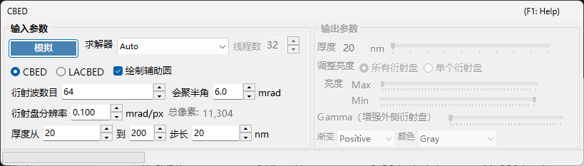
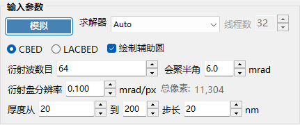
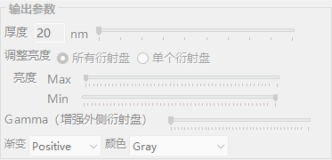

# CBED 模拟

**CBED（会聚束电子衍射，Convergent-Beam Electron Diffraction）模拟** 使用布洛赫波（Bethe）法计算并显示会聚束衍射图样。CBED 图样显示的是衍射盘而非衍射斑点，包含关于晶体对称性、厚度和结构的丰富信息。

> 本页列出在 [衍射模拟器](index.md) 中选择 **波源** = **电子** 和 **光学** = **会聚（电子）** 时打开的专用窗口的所有设置。选择 **会聚（电子）** 会自动将 **强度计算** 切换为 **动力学理论**，并打开此 CBED 设置窗口。用 × 按钮关闭此窗口时，**光学** 会切换回 **平行束**。<!-- 261105Cl 監査: FormDiffractionSimulatorMultislice_FormClosing (UserClosing) --> 计算得到的衍射盘可以通过主窗口的 **文件 > 保存 CBED 盘** / **复制 CBED 盘** 保存。关于绘制和保存衍射图样以及衍射模拟器的其他通用操作，请参阅 [概览页](index.md)。

GUI 条件：波源 = 电子 · 光学 = 会聚（电子） · 强度计算 = 动力学理论（自动）

---

## 输入参数

此窗口打开期间，主窗口的 **布洛赫波设置** 和 **外观** 面板被禁用；波数和厚度取自此处。

| 参数 | 说明 | 默认值 / 典型值 |
|-----------|-------------|-------------------|
| **CBED** / **LACBED** | **CBED**：标准会聚束图样，其中每个盘对应一个反射，透射盘（000）位于中心。**LACBED**（Large-Angle CBED，大角度 CBED）：只计算并绘制透射（000）盘，不叠加相互重叠的相邻盘，因此可以使用大于布拉格角的半角（明场 LACBED；该模式本身并不会扩大半角）。<!-- 261105Cl 監査: BetheMethod.cs cbed_DoWork (LACBED は 000 だけ)、radioButtonLACBED.ToolTip。「ディスクが重なる」は誤り --> 适用于观察高阶劳厄带（HOLZ）线和对称性 | CBED |
| **会聚半角 α** (mrad) | 会聚束锥的半角（0–2000 mrad）。决定每个衍射盘的大小（倒易空间中的盘直径对应 $2\alpha$） | 默认 6 mrad；典型值 5–30 mrad |
| **衍射盘分辨率 (mrad/px)** | 每个盘内部的角分辨率。衍射盘在 $N\times N$ 网格上采样，$N = \lceil 2\alpha / \text{resolution} \rceil$，且只计算圆内的点。值越小分辨率越高，但束方向的数量随其平方增长，因此计算时间也呈二次方增加。所得到的数目——每个盘内的像素数，即会聚圆内的入射束方向数，每个方向需要一次布洛赫波计算——显示为 **总像素** <!-- 261105Cl 監査: label2/labelDivisionNumber.ToolTip --> | 默认 0.1 mrad/px |
| **衍射波数目** | 在每个入射束方向上纳入布洛赫波计算的最大束数（1–2048）。束数越多精度越高，但本征值问题的开销随 $O(N^3)$ 增长 | 默认 64；典型值 100–500 |
| **厚度从 / 到 / 步长** | 样品厚度（nm，各为 1–1000）的起始值、终止值和步长值。多个厚度一起计算，并通过输出侧的厚度滑块切换 | 默认 20 至 200 nm，步长 20 nm |
| **求解器** | 计算引擎。**Auto**；**Eigenproblem with Eigen lib.** / **Eigenproblem with MKL lib.**（对角化）；**Matrix exp. with Eigen lib.** / **Matrix exp. with MKL lib.**（矩阵指数法，v4.794）。**Auto** 在 Eigen 可用时使用 Eigen 的矩阵指数法并使用全部逻辑处理器，否则使用 MKL 的本征值问题求解。矩阵指数法要求厚度等间隔，否则会退回到本征值问题求解。在 ARM64 上不提供 MKL 选项；原生 Eigen 库不可用时，Eigen 选项会被隐藏 | Auto |
| **线程数** | 并行线程数（1–128）。选择 **Auto** 时不可用；选择某个求解器时会设为逻辑处理器数（MKL 时为其 ¼） | — |
| **绘制辅助圆** | 勾选时，在主图样上绘制黄色圆以指示每个衍射盘的边界（LACBED 时，000 画圆，其他反射画十字） | 开启 |

---

## Run / Stop

- **模拟** ：以当前输入参数启动 CBED 模拟。
- **停止** ：取消正在运行的计算。最后一次完成的计算结果保持显示（计算失败时也是如此）。<!-- 261105Cl 監査: Bethe_CbedCompleted (completedDisks ほか) -->

---

## 输出参数

计算完成后，输出参数即可用。所有这些参数都只改变显示，而不会重新计算。

| 参数 | 说明 |
|-----------|-------------|
| **厚度** | 通过滑块，在最后一次完成的计算所含的厚度中选择要显示的样品厚度（之后更改输入参数中的厚度框不会改变它；[衍射斑点信息](index.md#diffraction-spot-information)表格随之更新） <!-- 261105Cl 監査: CompletedThicknesses (最後に完了した計算の厚み) --> |
| **调整亮度** | **所有衍射盘**：使用统一的亮度刻度，按所有盘中的最大值归一化。**单个衍射盘**：每个盘按其自身的最大值归一化（γ 被重置为 0 并禁用） |
| **亮度 (Max / Min)** | 所显示强度的上限和下限，以最大值的比例表示（滑块位置取 4 次方后应用）。当您想强调微弱特征时进行调整 |
| **Gamma（增强外侧衍射盘）** | 将每个像素乘以 $\exp(\gamma\,r)$（$r$ 为该像素到图样中心的距离），使暗淡的外侧大角度盘相对于中心透射盘更易于观察。仅在 **所有衍射盘** 时有效 |
| **渐变** | 从 **Positive** / **Negative**（黑白反转）中选择强度灰度 |
| **颜色** | 用于显示的颜色映射：**Gray**、**Cold-warm**、**Spectrum** 或 **Fire** |

---

## 物理背景

在 CBED 中，入射束被视为由不同方向的平面波组成的锥体。对于每个方向（会聚光阑内的每个点 = 一个部分入射平面波），布洛赫波法求解晶体内部的电子薛定谔方程，并将结果重新排列为衍射盘。HOLZ（高阶劳厄带）线表现为盘内部精细的暗/亮线，由上层劳厄带中的反射产生。它们对沿 $c$ 轴的点阵参数敏感，对三维结构分析很有用。

关于理论细节，请参阅 [CBED 计算](../appendix/a3-bloch-wave/cbed.md)。

---

## 另请参阅

- [衍射模拟器（概览）](index.md)
- [SAED 模拟](1-saed-simulation.md)
- [PED 模拟](2-ped-simulation.md)
- [CBED 计算](../appendix/a3-bloch-wave/cbed.md)
