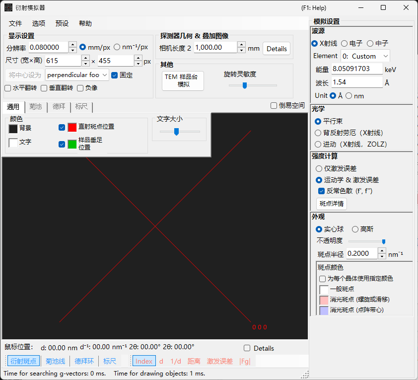
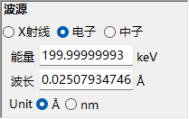
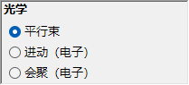
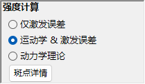
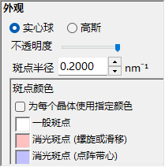
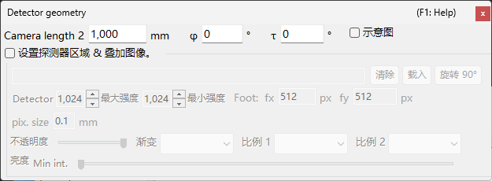

# X 射线 / 中子衍射模拟

**X 射线 / 中子衍射模拟**计算单晶的 X 射线和中子衍射图样。它是[衍射模拟器](index.md)的主要模式之一。

> 本页列出当你选择 **波源** = **X射线**（或 **中子**）时在右侧出现的每一项设置。绘制、保存等窗口级操作请参见[概览页](index.md)。

GUI 条件: 波源 = X射线 / 中子 · 光学 = 平行束 / 进动（X射线，ZOLZ） / 背反射劳厄（X射线） · 强度计算 = 仅激发误差 / 运动学 & 激发误差

---

## 概览

X 射线的波长比电子长（Cu Kα: 0.15406 nm = 1.5406 Å），因此埃瓦尔德球的曲率更大。结果同时满足衍射条件的倒易点阵点数量比电子少。由于原子散射能力较小且多重散射较弱，运动学衍射理论对衍射强度即可给出足够的精度（动力学计算仅支持电子）。

---

## 波源 {#wave-length}

选择 **X射线** 作为 **波源**。X 射线可以用两种方式指定: 特征 X 射线和同步辐射。

### 特征 X 射线

选择一个**元素**和一个**跃迁**即可确定特征 X 射线的波长。跃迁以 Siegbahn 记号指定（Kα₁ / Kα₂ / Kβ 等）。代表性元素的 Kα₁ 波长:

| 元素 | 谱线 | 波长 (Å) | 能量 (keV) |
|---------|------|-----------------|--------------|
| Cu | Kα₁ | 1.5406 | 8.048 |
| Mo | Kα₁ | 0.7093 | 17.479 |
| Co | Kα₁ | 1.7890 | 6.930 |
| Cr | Kα₁ | 2.2897 | 5.415 |

### 同步辐射

将 **Element** 设为 **0: Custom**，直接输入能量 (keV) 或波长 (Å)。可以使用任意波长。

---

## 光学 {#incident-beam-mode}

选择入射束的几何。X 射线有三种模式可用。

### 平行束 {#parallel}

标准平面波。用于 SAED 和单晶 X 射线衍射的平行入射束。

### 进动（X射线，ZOLZ）— 进动相机 {#precession-x-ray--precession-camera}

模拟 X 射线进动相机。这是一张捕获倒易点阵单一层面的进动照片。德拜环被绘制为半径 $2L_2\sin\theta$（$L_2$ = 相机长度 2）的圆，与 2θ 刻度圆相同。<!-- 261105Cl 監査: DrawDebyeRing (C6) -->

### 背反射劳厄（X射线）— 背反射劳厄法 {#back-laue-back-reflection-laue}

用白色（多色）X 射线模拟背反射劳厄图样。在这种背反射几何中，探测器放置在辐射源一侧；**波源** 控件中的能量 / 波长输入框和元素选择器被隐藏，改为显示 **Flat white**。斑点投影到源侧、位于相机长度处并**垂直于射束**的平面探测器上；[探测器几何](index.md#detector-geometry)中的探测器倾斜 **Tau / Phi** 不用于该投影。

- 白光谱在 **50 keV** 处截断：收集 $d$ 不小于 $\lambda(50\ \text{keV})/2$ 的反射，且不施加谱权重。
- 位于过原点的同一直线上的高次谐波 $n\mathbf{g}$ 落在同一个斑点上；它们的 $\lvert F\rvert^2$ 被加总到最低阶反射上，斑点强度按最强斑点归一化。
- **反常色散 (f', f'')** 被禁用（能量不是单一值），在此模式下 **斑点半径** 没有单位。
- 2θ（鼠标位置、斑点标签和 2θ 刻度）为散射角：中心的射束孔处为 180°，向外减小。<!-- 261105Cl 監査: Back Laue の 2θ (C13) -->
- 会绘制所有选中的晶体；选中多个晶体时（或勾选 **按晶体指定颜色** 时），各晶体的斑点使用该晶体的颜色。<!-- 261105Cl 監査: Back Laue の複数結晶 -->

> **注记**: **光学** 的选项随波源而变化。**进动（电子）** 和 **会聚（电子）** 仅在选择 **电子** 时出现，而上述 **进动（X射线，ZOLZ）** 和 **背反射劳厄（X射线）** 选项仅在选择 **X射线** 时出现。对于中子，只有 **平行束** 可用。根据截图时的状态，屏幕截图可能未显示 X 射线专用的选项。

---

## 强度计算

选择用于计算斑点强度的方法。X 射线有两种模式可用。

### 仅激发误差

强度仅由埃瓦尔德球与倒易点阵点之间的几何距离（偏离矢量 $S_g$）决定。$S_g = 0$（即恰好位于球面上）时强度最大，随 $\lvert S_g\rvert$ 增大而减小，当 $\lvert S_g\rvert$ 超过为倒易点阵点设定的 **斑点半径** 时降为零。结构因子被忽略。

仅在此模式下会出现以下选项：

- **排除所有禁戒衍射** / **排除由点阵带心禁戒的衍射**（默认：仅点阵带心） : 隐藏空间群禁止的反射。未被隐藏的禁戒反射以 **斑点颜色** 中单独设定的颜色绘制（螺旋/滑移禁戒与点阵禁戒）。
- **以相同半径绘制所有斑点** : 不论偏离矢量如何，都以 $S_g = 0$ 时的大小绘制每个斑点。

### 运动学 & 激发误差

除偏离矢量外，运动学结构因子 $\lvert F_{hkl} \rvert^2$ 也被纳入强度。严格遵守消光规则。不包含洛伦兹因子和偏振因子（这是对几何图样的模拟）。

- **反常色散 (f', f'')**（仅 X 射线，默认开启） : 把当前 X 射线能量下的反常色散项 f′、f″ 加入结构因子（德拜环也同样）。在含有化学上不同的反常散射体的非中心对称结构中，Friedel 定律随之失效，$hkl$ 与 $\bar h\bar k\bar l$ 的强度不同（Bijvoet 对）；在吸收边附近效应最强。背反射劳厄时禁用。参见[结构因子](../appendix/a2-beam-interaction/structure-factor.md)。

> **注记**: **动力学理论**对 X 射线被禁用（仅在选择电子辐射时可用）。

---

## 斑点外观

控制每个衍射斑点的渲染方式。

- **实心球 / 高斯** : 倒易点阵点的几何模型。**实心球** 绘制某个球与埃瓦尔德球的截面；在 **运动学 & 激发误差** 下球半径为 $R \times I_\text{rel}^{1/3}$（使球的*体积*正比于相对强度），在 **仅激发误差** 下就是 *R* 本身。**高斯** 使用 σ = *R* 的三维高斯函数与埃瓦尔德球的截面（二维高斯函数的积分对应于衍射强度）；$\lvert S_g\rvert \ge 3R$ 的斑点不绘制。
- **不透明度** : 斑点的透明度（0 = 透明，1 = 不透明）。
- **斑点半径 (R)** : 倒易点阵点的半径。渲染出的斑点尺寸由 **外观** 和 **强度计算** 的组合决定。
- **亮度** : 仅在 **高斯** 模式下有效。设定所渲染高斯函数的积分强度。
- **色阶**（仅高斯） : **Gray**、**Cold-warm**、**Spectrum** 或 **Fire**。
- **对数刻度**（仅高斯） : 以对数刻度显示强度。
- **斑点颜色** : 色阶为 **Gray** 时使用的斑点颜色（其他色阶时此组被隐藏）。
- **按晶体指定颜色** : 勾选后，以分配给每个晶体的颜色绘制斑点。

---

## 德拜环（多晶）

可以显示多晶样品的德拜环。在工具栏上启用 **德拜环**（参见[工具栏](index.md#toolbar)）。

- **忽略衍射强度** : 以相同的颜色和强度绘制所有环（用于忽略结构因子的纯几何比较）。
- **显示指数标签** : 在每个环附近显示指数 {*hkl*}（对于六方轴，开启 **选项 ▸ 使用米勒-布拉维 (hkil) 指数** 时为四指数 {*hkil*}）。<!-- 261105Cl 監査: DrawDebyeRing (C23) -->

详细设置位于[选项卡菜单](index.md#drawing-overlay-tabs)的 德拜环 选项卡。

---

## 中子衍射

在 **波源** 中选择 **中子** 即可计算中子衍射图样。输入能量 (meV) 或波长（Å 或 nm，可切换；默认 Å）。**光学** 只能为 **平行束**。强度计算可以是 **仅激发误差** 或 **运动学 & 激发误差**（不提供 **动力学理论**）。运动学强度使用中子散射长度代替原子散射因子。

---

## X 射线衍射与电子衍射的区别

| 特征 | X 射线衍射 | 电子衍射 |
|---------|-------------------|----------------------|
| 波长 | 长 (0.5–2.5 Å) | 短 (0.02–0.04 Å) |
| 埃瓦尔德球曲率 | 大 | 小（近乎平坦） |
| 同时反射数 | 少 | 多 |
| 散射因子 | 原子散射因子 $f(s)$ | 电子散射因子 $f_e(s)$ |
| 动力学效应 | 通常较小 | 大 |
| 消光规则 | 严格遵守 | 可能因多重散射而被违反 |

---

## 通用操作

相机长度、探测器几何、保存图样、颜色设置等窗口级操作请参见[概览页](index.md)。详细的探测器几何在下面的几何窗口中配置。

---

## 另请参阅

- [衍射模拟器（概览）](index.md)
- [SAED 模拟](1-saed-simulation.md)
- [进动电子衍射 (PED) 模拟](2-ped-simulation.md)
- [会聚束电子衍射 (CBED) 模拟](3-cbed-simulation.md)
- [坐标系 — 晶体取向](../appendix/a1-coordinate-system/1-orientation.md)
