# Crystal Diffraction (衍射模拟器)

**Crystal Diffraction (衍射模拟器)** 模拟单晶 X 射线、中子和电子衍射图样。

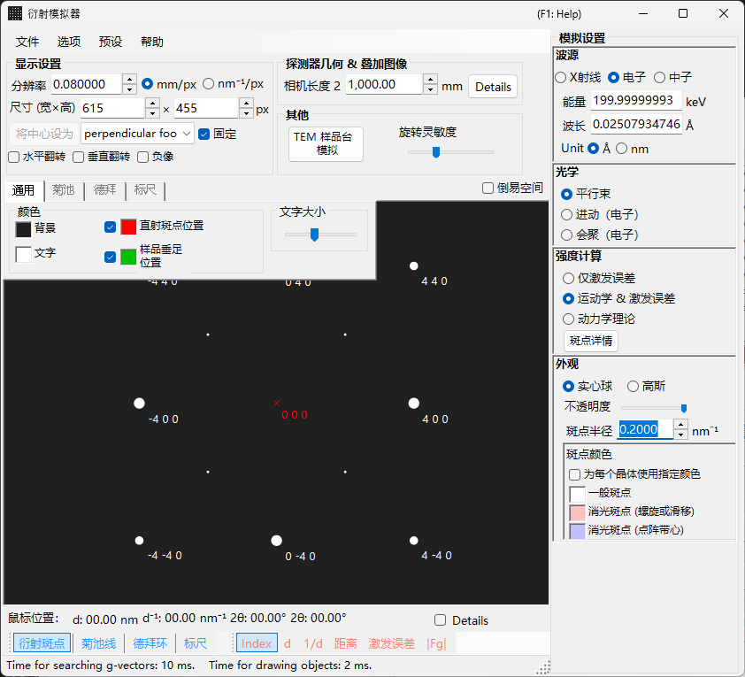

窗口**左侧**为衍射图样的绘制区，**右侧**为衍射斑点属性的设置面板（波长、入射束、强度计算、外观等）。波长与入射束的组合决定采集模式（X 射线衍射、SAED、PED、CBED），右侧面板也随之重新配置。

---

## 本页与各模式页面如何分工

- **本页（枢纽页）**：汇总每个模式共有的操作（快捷键、菜单、工具栏、屏幕/探测器信息、叠加层选项卡、衍射斑点信息、探测器几何、动态压缩）。
- **各模式页面**：涵盖选中该模式时**右侧出现的每一项设置**（波长、入射束、强度计算、外观、布洛赫波设置、进动设置等），因此每个页面都是自包含的（各模式之间存在一些重叠）。

| 模式 | 内容 | 页面 |
|------|----------|------|
| **X 射线（及中子）衍射** | 单晶 X 射线 / 中子衍射图样（平行束、进动 X 射线、Back Laue） | [X 射线衍射模拟](5-x-ray-neutron-diffraction.md) |
| **SAED** | 平行束电子衍射（选区电子衍射） | [SAED 模拟](1-saed-simulation.md) |
| **PED** | 进动电子衍射 | [PED 模拟](2-ped-simulation.md) |
| **CBED** | 会聚束电子衍射 | [CBED 模拟](3-cbed-simulation.md) |

> **ALCHEMI 不是一种模式。** 与由波长和入射束的组合决定的 X 射线 / SAED / PED / CBED 不同，ALCHEMI 模拟器是从 **选项** 菜单打开的**子窗口**，故在此单独列出。

| 子窗口 | 内容 | 页面 |
|------|------|------|
| **ALCHEMI 模拟器** | 按位点分解的电离摇摆曲线（沟道增强微分析） | [ALCHEMI 模拟](4-alchemi-simulation.md) |

---

## 模式速查

根据**波长（源）**与**入射束**的组合，查找你需要的页面。

| 波长 | 入射束 | 模式 | 页面 |
|------------|--------------------|------|------|
| 电子 | 平行 | SAED | [SAED 模拟](1-saed-simulation.md) |
| 电子 | 进动（电子 = PED） | PED | [PED 模拟](2-ped-simulation.md) |
| 电子 | 会聚（CBED） | CBED | [CBED 模拟](3-cbed-simulation.md) |
| X 射线 | 平行 | X 射线衍射 | [X 射线衍射模拟](5-x-ray-neutron-diffraction.md) |
| X 射线 | 进动（X 射线） | 进动 X 射线（进动相机） | [X 射线衍射模拟](5-x-ray-neutron-diffraction.md) |
| X 射线 | Back Laue | 背反射劳厄 | [X 射线衍射模拟](5-x-ray-neutron-diffraction.md) |
| 中子 | 平行 | 中子衍射 | [X 射线衍射模拟的中子部分](5-x-ray-neutron-diffraction.md) |

> **Note**: 入射束（**光学**）的可选项随波长而变化。对于电子：**平行束、进动（电子）、会聚（电子）**；对于 X 射线：**平行束、进动（X射线，ZOLZ）、背反射劳厄（X射线）**；对于中子：仅 **平行束**。更改波源时，光学设置总会重置为 **平行束**。选择 **进动（电子）** 或 **会聚（电子）** 会自动将强度计算切换为 **动力学理论**；**动力学理论** 仅对电子提供（选择 X 射线或中子时会退回到 **运动学 & 激发误差**）。背反射劳厄使用白光（多色）射束。

---

## 键盘与鼠标快捷键

这些快捷键适用于 X 射线、SAED 和 PED 模拟共用的衍射图样窗口。在图样上拖动可旋转**晶体**。可用鼠标滚轮或右键单击 / 右键拖动进行缩放。

| 快捷键 | 操作 |
|----------|--------|
| <kbd>F1</kbd> | 打开在线手册的本页 |
| 在中心附近左键拖动 | 倾斜晶体 |
| 在外侧区域左键拖动 | 使晶体绕束轴自旋 |
| 在斑点上左键双击 | 显示反射详情（指数、*d*、结构因子、偏离矢量） |
| 中键拖动 | 平移图样 |
| <kbd>CTRL</kbd> + 中键拖动 | 移动探测器中心（当显示探测器区域时） |
| 鼠标滚轮 | 每格放大 / 缩小 ×2；光标下的点被移到视图中心（勾选 **固定** 时则保持固定的中心） |
| 右键单击 | 缩小（×1/1.2） |
| 右键拖出选框 | 放大到所选区域 |
| 在状态栏右键双击 | 复制当前设置的文本摘要 |
| 在已点亮的图层按钮（衍射斑点 / 菊池线 / 德拜环 / 标尺）上右键双击 | 让该图层闪烁开关 |

从此处打开的辅助窗口还增加了几项：

| 快捷键 | 操作 |
|----------|--------|
| 在极射赤平投影上左键双击 — **TEM 样品台** | 将样品台倾角设为该点 |
| 方向键 — **TEM 样品台** | 逐步改变样品台倾角（先勾选 **启用方向键**；无论 ReciPro 的哪个窗口在前台均有效） |
| 拖入 `.prm` 文件或图像 — **探测器几何** | 加载探测器几何 / 叠加图像 |
| 拖入 `.txt` 曲线 — **动态压缩** | 加载位置/时间/压力曲线（用 **时间** 滑块选择时刻；拖动图中的竖线设定前沿/后沿） |

主窗口的全局 <kbd>CTRL</kbd>+<kbd>SHIFT</kbd> 快捷键在本窗口获得焦点时同样有效（见 [主窗口](../0-main-window.md)）。

→ 一览所有窗口的快捷键，请见 **[21. 键盘与鼠标快捷键](../21-shortcuts.md)**。

---

## 按目标快速导航

| 目标 | 从何处开始 | 参考 |
|------|------------|-----------|
| 生成平行束电子衍射（SAED） | 将 **入射束** 设为 **平行**，**波长** 设为电子 | [SAED 模拟](1-saed-simulation.md)、[平行束 SAED 计算](../appendix/a3-bloch-wave/calculation.md) |
| 生成单晶 X 射线衍射 | 将 **波长** 切换为 X 射线 / 同步辐射 | [X 射线衍射模拟](5-x-ray-neutron-diffraction.md) |
| 生成进动电子衍射（PED） | 将 **入射束** 设为 **进动（电子）**，然后设置半角和步长 | [PED 模拟](2-ped-simulation.md) |
| 生成会聚束电子衍射（CBED） | 将 **入射束** 设为 **会聚（电子）**，并在 CBED 窗口中设置条件 | [CBED 模拟](3-cbed-simulation.md)、[CBED 计算](../appendix/a3-bloch-wave/cbed.md) |
| 查看动力学计算得到的反射列表 | 选择 **动力学理论** 并按 **斑点详情** | [动力学计算（共享内核）](../appendix/a3-bloch-wave/calculation.md) |
| 将探测器几何与实验图像对照 | 通过 **探测器几何 & 叠加图像** 中的 **Details** 打开探测器几何设置并使用叠加图像 | [探测器坐标系](../appendix/a1-coordinate-system/2-diffraction.md) |

---

## 主区域

衍射图样在屏幕中央进行模拟。

### 鼠标操作

见本页顶部的“键盘与鼠标快捷键”。

### 鼠标位置

图样上方的 **鼠标位置：** 一行显示光标位置处的 *d*（nm）、*d*⁻¹（nm⁻¹）和 2θ（以度以及 rad 表示；小于 0.1 rad 时以 mrad 表示）。勾选 **Details** 会增加三组坐标读数：探测器坐标（mm，原点 = 从样品引出的垂线的垂足）、实空间坐标（mm，原点 = 晶体）和倒易空间坐标（nm⁻¹）。在背反射劳厄模式下，*d* 和倒易空间的值显示为“-”。

---

## 文件菜单

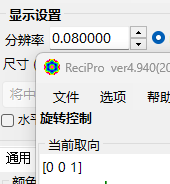

| 菜单项 | 说明 |
|-----------|-------------|
| **保存图像** | 保存显示的衍射图样，可选 **为图像（PNG 格式）** 或 **为图元文件 (EMF)**。 |
| **保存探测器区域** | 仅保存探测器区域的裁剪（PNG / EMF）。仅在显示探测器区域时出现。 |
| **保存 CBED 盘** | 仅限 CBED 模式：将计算得到的盘保存为 **为单张图像（PNG 格式）** / **为单张图像（TIFF 格式）**，或 **为合并图像（PNG 格式）** / **为合并图像（TIFF 格式）**。 |
| **复制** | 将显示的图像复制到剪贴板（**为图像** / **为图元文件 (EMF)**）。 |
| **复制探测器区域** | 仅复制探测器区域的裁剪。仅在显示探测器区域时出现。 |
| **复制 CBED 盘** | 仅限 CBED 模式：将各盘 **为合并图像** 复制。 |
| **保存视频** | 录制 **衍射图样** 或 **倒易空间** 视图的视频。 |
| **页面设置 / 打印预览 / 打印** | 打印显示的图样。 |

### 预设

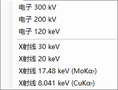

固定的波源预设，只设置辐射种类及其能量：**电子 300 kV**、**电子 200 kV**、**电子 120 keV**、**X射线 30 keV**、**X射线 20 keV**、**X射线 17.48 keV (MoKα₁)** 和 **X射线 8.041 keV (CuKα₁)**（后两项选择 Mo / Cu 的 Kα₁ 特征谱线）。其他设置（探测器几何、选项卡、斑点属性）不会被保存或更改。

### 选项与帮助菜单

| 菜单项 | 说明 |
|-----------|-------------|
| **选项 > 动态压缩** | 打开[动态压缩](#动态压缩)窗口（同时打开探测器几何窗口）。 |
| **选项 > ALCHEMI 模拟器...** | 打开 [ALCHEMI 模拟器](4-alchemi-simulation.md)。 |
| **帮助 > Bethe 方法基本概念** | 在浏览器中打开在线手册的[布洛赫波附录](../appendix/a3-bloch-wave/index.md)。 |

---

## 工具栏 {#toolbar}

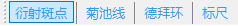

| 按钮 | 说明 |
|--------|-------------|
| 衍射斑点 | 显示 / 隐藏衍射斑点图层 |
| 菊池线 | 显示 / 隐藏菊池线图层 |
| 德拜环 | 显示 / 隐藏德拜环图层 |
| 标尺 | 显示 / 隐藏刻度线图层 |
| Index / d / 1/d / Distance / 2θ / χ / Excitation error / Structure factor | 选择附加到每个斑点的标签 |

---

## 屏幕与探测器信息

### 屏幕

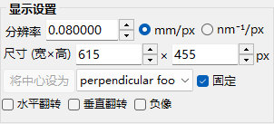

| 项目 | 说明 |
|------|-------------|
| **分辨率** | 一个屏幕像素的尺寸，单位为 **mm/px**（在探测器平面上）或 **nm⁻¹/px**（可选；默认 0.08 mm/px）。它不必等于探测器实际的像素尺寸；它被视为显示比例，并在你用鼠标缩放时自动更新。 |
| **尺寸 (宽×高)** | 绘制区的像素宽度和高度。取决于你的显示分辨率，过大的值可能无法设置。 |
| **将中心设为 / 固定** | 将绘制区的中心置于 **perpendicular foot**（垂足）、**direct spot**（透射斑点）或 **detector**（探测器）中心（最后一项仅在定义了探测器区域时可用）。勾选 **固定**（默认）时中心保持在该处：鼠标平移被禁用，缩放时也保持该中心。 |
| **水平翻转 / 垂直翻转 / 负像** | 对显示图样进行几何翻转（水平 / 垂直）和对比度反转。用它来匹配实验图像的取向或对比度。 |
| **倒易空间** | 在图样旁打开埃瓦尔德球和倒易点阵点的 3-D 视图，可视化哪些反射被激发。其 **选项** 面板用于设置颜色（靠近 / 远离埃瓦尔德球的斑点、埃瓦尔德球、原点、方向引导）、3-D 斑点半径（nm⁻¹）、相对强度阈值（%）、远离埃瓦尔德球的斑点的透明化、标签，以及观察方向（带角度 **步长** 的箭头按钮、**重置**）。 |

### 探测器（相机长度）

- **相机长度 2** : 从样品到探测器平面上垂足的距离（mm，默认 1000 mm）。探测器不倾斜（τ = 0）时，它等于通常的相机长度。
- **Details** : 打开探测器几何设置窗口（见下文 [探测器几何](#detector-geometry)）。

### 其他

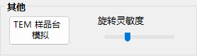

- **旋转灵敏度** : 鼠标每拖动一个像素时晶体旋转的幅度。
- **TEM 样品台模拟** : 打开与样品台联动的模拟窗口（见下文）。

---

## TEM 样品台模拟

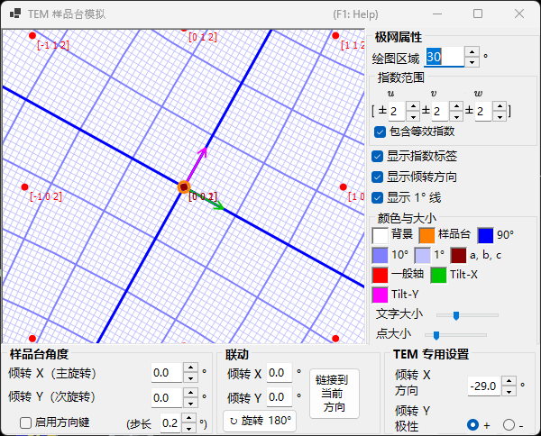

打开一个窗口，将衍射图样与双倾 **TEM 样品台**（**倾转 X** = 主旋转，**倾转 Y** = 次旋转）联动。设置样品台倾角会更新图样和晶体取向，可达取向可在极射赤平投影上显示（v4.914 新增）。**链接到当前方向** 以当前晶体取向作为样品台的基准（对应给定的倾转 X / 倾转 Y）；**TEM 专用设置** 给出屏幕上倾转 X 轴的方向（默认 −29°）和倾转 Y 的极性，**↻ 旋转 180°** 使晶体绕射束旋转 180°。在极射赤平投影上左键双击会将样品台倾角设为该点，勾选 **启用方向键** 后可用 ←/→ 逐步改变倾转 X、用 ↑/↓ 逐步改变倾转 Y（步长 0.1–2°，默认 0.2°）。只要此窗口处于打开状态，无论 ReciPro 的哪个窗口位于前台，方向键均有效。

---

## 绘制叠加层选项卡 {#drawing-overlay-tabs}

### 通用

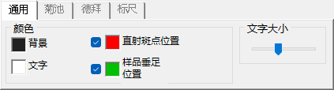

设置标签的 **文字大小**，以及标签 **文字**、**样品垂足位置** 标记、**透射斑点位置** 标记和 **背景** 的颜色（两个标记都可以分别关闭）。斑点颜色在 **外观** 中设置（见各模式页面）；菊池线、德拜环和刻度线的颜色在各自的选项卡中设置。此处的设置适用于所有渲染模式。

### 菊池线

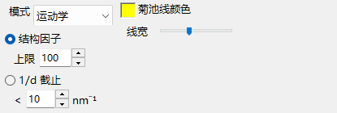

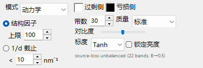

在工具栏启用菊池线时生效。

- **反射选择** : 选择由哪些反射生成菊池线。可选 **结构因子**（按 $\lvert F_{hkl}\rvert$ 排名的 **上限** *N* 个反射；1–1000，默认 100）或 **1/d 截止**（所有 1/d 低于阈值的反射；0–100 nm⁻¹，默认 10）。
- **模式** : 菊池线的绘制方式（默认 **运动学**）。组合框下方的设置随模式切换。
    - **几何** : 所有选中的线以同一固定颜色绘制。
    - **运动学** : 线的浓淡按各反射的运动学相对强度变化。
    - **动力学** : 以热漫散射为源的双束动力学过剩/亏损带轮廓，在后台线程中计算。过剩带出现在高角侧，亏损特征朝向直射束一侧；试样厚度与强度设置共用。计算期间先以几何线代替显示。
- **几何 / 运动学的设置** : **菊池线颜色** 和 **线宽**。
- **动力学的设置** :
    - **过剩侧** / **亏损侧** : 带的明亮侧（对比度为正）与暗侧（对比度为负）的颜色。
    - **带数** : 以动力学轮廓绘制的带数（按动力学对比度取前 *N* 条；1〜50，默认 30）。
    - **质量** : 横穿每条带的采样点数（快速 65 / 标准 129 / 高 257；默认为标准）。
    - **对比度** : 压缩前施加到带对比度上的显示增益。
    - **标度** : 亮度压缩曲线（Linear / Log / Tanh；默认 Tanh）。均为可视化变换，并非物理相机响应。
    - **锁定亮度** : 冻结亮度归一化，例如用于比较不同取向或厚度。
    - 下方灰色注记显示源与吸收不一致的提示、绘制的带数及诊断信息（例如对 *B* = 0 的原子代用默认 *B* 因子）。
- （以前单独的 **阈值** 参数已不复存在；反射仅由上面的选择来限定。）

### 德拜环

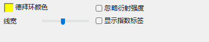

在工具栏启用德拜环时生效。

- **忽略衍射强度** : 若勾选，所有德拜环都以相同的颜色和强度绘制（忽略晶体结构因子）。用于纯几何比较。
- **显示指数标签** : 若勾选，(*hkl*) 会出现在每个环附近。

### 标尺

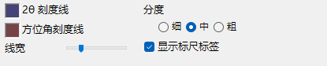

在工具栏启用刻度线时生效。

- **2θ / 方位角刻度线** : **2θ** 表示等散射角（同心圆），**方位角** 表示等方位角（从中心发出的径向线）。两者颜色可独立配置。
- **线宽** : 刻度线的粗细。
- **分度** : 刻度线的疏密，**细** / **中**（默认）/ **粗**。
- **显示标尺标签** : 是否在刻度线上绘制数字标签。

（没有单独的 *Misc* 选项卡；鼠标的 **旋转灵敏度** 位于右侧面板的 **其他** 组中，见上文[其他](#其他)。）

---

## 衍射斑点信息 {#diffraction-spot-information}

列出用布洛赫波法（动力学计算）计算的逐反射详情。用强度计算面板中的 **斑点详情** 按钮打开它。在 **仅激发误差** / **运动学** 模式下，该按钮列出当前绘制的反射及其电子势和 $P_g$、$Q_g$（没有动力学振幅）；在 CBED 模式下，表格对应 CBED 窗口中所选的厚度。

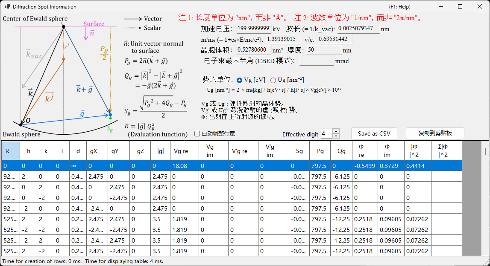

### 示意图与定义

示意图（左上）显示埃瓦尔德球上的矢量，并定义表中所用的量（$\hat{\mathbf{n}}$ 是垂直于样品表面的单位法向矢量，$\mathbf{k}$ 是入射波矢，$\mathbf{g}$ 是倒易点阵矢量）。

- $P_g = 2\,\hat{\mathbf{n}} \cdot (\mathbf{k} + \mathbf{g})$
- $Q_g = |\mathbf{k}|^2 - |\mathbf{k} + \mathbf{g}|^2 = -\mathbf{g} \cdot (2\mathbf{k} + \mathbf{g})$
- **偏离矢量:** $S_g = \dfrac{\sqrt{P_g^2 + 4 Q_g} - P_g}{2}$
- **评价函数:** $R = |\mathbf{g}|\, Q_g^2$ — 按反射被激发的强弱排序（越小 = 越接近埃瓦尔德球 = 激发越强；透射束 $g=0$ 的 $R=0$ 排在最前）。表按 $R$ 升序排序。

### 表格列

| 列 | 含义 |
|--------|---------|
| **R** | 评价函数 $R = \lvert\mathbf{g}\rvert\, Q_g^2$（见上；用于选择 / 排序反射） |
| **h, k, (i,) l** | 米勒指数（*i* 是冗余的六方指数，仅对六方晶体显示） |
| **d** | 晶面间距（nm） |
| **gX, gY, gZ** | 倒易点阵矢量 *g* 的分量（1/nm） |
| **\|g\|** | *g* 的模（1/nm） |
| **Vg re / Vg im** | 弹性散射的晶体势傅里叶系数 $V_g$（实部 / 虚部） |
| **V'g re / V'g im** | 热漫散射（TDS）的虚（吸收）势 $V'_g$（实部 / 虚部） |
| **Sg** | 偏离矢量 $S_g$（见上；1/nm） |
| **Pg** | 辅助量 $P_g = 2\,\hat{\mathbf{n}}\cdot(\mathbf{k}+\mathbf{g})$（见上） |
| **Qg** | 辅助量 $Q_g = -\mathbf{g}\cdot(2\mathbf{k}+\mathbf{g})$（见上） |
| **Φ re / Φ im** | 出射面上动力学衍射波的复振幅 $\Phi$（实部 / 虚部） |
| **\|Φ\|^2** | 该反射的衍射强度 $\lvert\Phi\rvert^2$ |
| **Σ\|Φ\|^2** | $\lvert\Phi\rvert^2$ 的累积和（对所有反射求和；可用作强度守恒检验） |

### 势的单位及其他控件

- **势的单位** : 在 **Vg [eV]**（静电势，eV）与 **Ug [nm⁻²]**（进入布洛赫波方程的缩放量 $U_g = (2 m_0/h^2)\, V_g$）之间切换显示的势。列标题也相应地在 *Vg / V'g* 与 *Ug / U'g* 之间变化。
- 表格上方显示加速电压、波长（$\lambda = 1/k_\text{vac}$）、相对论质量比 $m/m_0$、速度比 $v/c$、点阵体积、样品厚度，以及（在 CBED 模式下）电子束的最大半角。
- **Note 1:** 长度单位为 **nm**，而非 Å。**Note 2:** 波数单位为 **1/nm**，而非 2π/nm。
- **有效位数** : 表中显示的有效数字位数（1–16，默认 4）。**自动调整行宽** : 自动适配列宽。**复制到剪贴板** : 将表格导出为可粘贴到电子表格中的文本。**Save as CSV** : 将同一表格（可见列）写入 CSV 文件；小数点始终为句点，因此在以逗号作小数点的区域设置下文件仍然有效。

---

## 探测器几何 {#detector-geometry}

用于详细设置探测器几何（相机长度、倾斜、旋转）并叠加实验图像的窗口。从 **Detector geometry** 面板中的 **Details** 打开它。

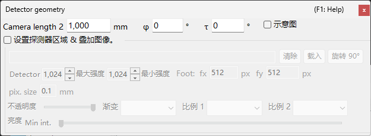

### 探测器几何设置

指定反射几何：**相机长度 2**（mm，1–10000，默认 1000），以及探测器绕方位角为 **φ** 的面内轴的倾斜 **τ**（−200 至 200°）。对于背反射劳厄，只使用 **相机长度 2**：图样总是投影到源侧与射束垂直的探测器上，τ / φ 不应用于该投影。拖入 `.prm` 文件会从中加载波长、相机长度 2、τ、φ、垂足位置和像素尺寸（波源切换为自定义波长的 X 射线，并开启探测器区域）。

### 探测器区域与叠加图像

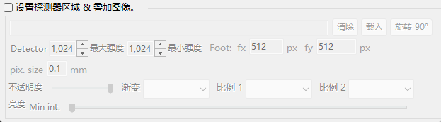

勾选 **设置探测器区域 & 叠加图像。** 以指定探测器：像素尺寸（默认 1024 × 1024）、**像素大小**（mm，默认 0.1）以及 **脚点** 位置 **fx, fy**（px，默认 512, 512）。可以加载实验图像（**载入** 或拖放），并以 **不透明度**、**渐变**（正片/负片）、**比例 1**（log/linear）、**比例 2**（Gray / Cold-Warm / Spectrum / Fire）、**最大强度** / **最小强度**、**旋转 90°** 和 **清除** 进行叠加显示。**示意图** 显示几何的草图。用它来叠加模拟图样与实验图像，并微调探测器几何。

坐标系定义另见 [探测器坐标系](../appendix/a1-coordinate-system/2-diffraction.md)。

---

## 动态压缩

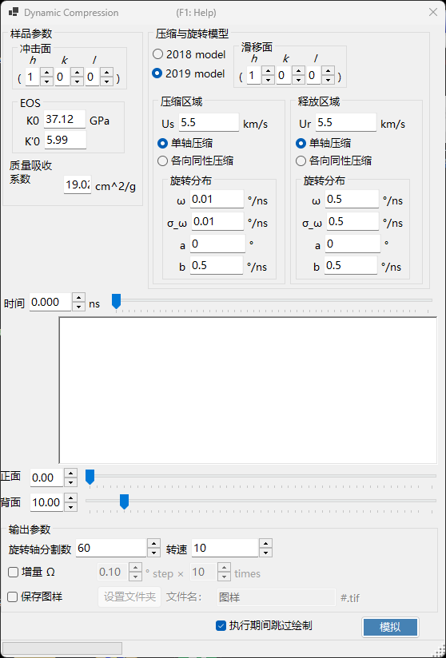

用于模拟冲击压缩（动态压缩）样品衍射的窗口。拖入含三列（位置、时间、压力）的制表符分隔 `.txt` 文件，即可加载各时刻的压力曲线；**时间** 滑块（ns）选择图中显示的曲线。图中的两条竖线（**正面** / **背面**）可以拖动，以设定压缩的前沿和后沿。该窗口还包含压缩模型（**2018 / 2019 model**）、冲击速度（**Us**、**Ur**，km/s）、**EOS**（K0、K'0）、**冲击面** / **滑移面**、压缩区域和释放区域的旋转分布、质量吸收系数、Ω 步进以及 **保存图样**（`#.tif`），并通过 **模拟** 运行。

---

## ALCHEMI 模拟器

打开一个计算**按位点分解的电离摇摆曲线**的子窗口：在晶体通过系统反射列的 Bragg 条件倾转时，所选电离通道的产额按原子位点分解给出。从 **选项** 菜单打开。与 CBED 窗口不同，它拥有自己的输出区域，不在上级窗口的画布上绘图。

→ 全部设置以及适用范围与已知限制，请参见 **[ALCHEMI 模拟](4-alchemi-simulation.md)**。

---

## 相关主题

- [X 射线衍射模拟](5-x-ray-neutron-diffraction.md)
- [SAED 模拟](1-saed-simulation.md)
- [PED 模拟](2-ped-simulation.md)
- [CBED 模拟](3-cbed-simulation.md)
- [ALCHEMI 模拟](4-alchemi-simulation.md)
- [动力学计算（共享内核）](../appendix/a3-bloch-wave/calculation.md)
- [探测器坐标系](../appendix/a1-coordinate-system/2-diffraction.md)
