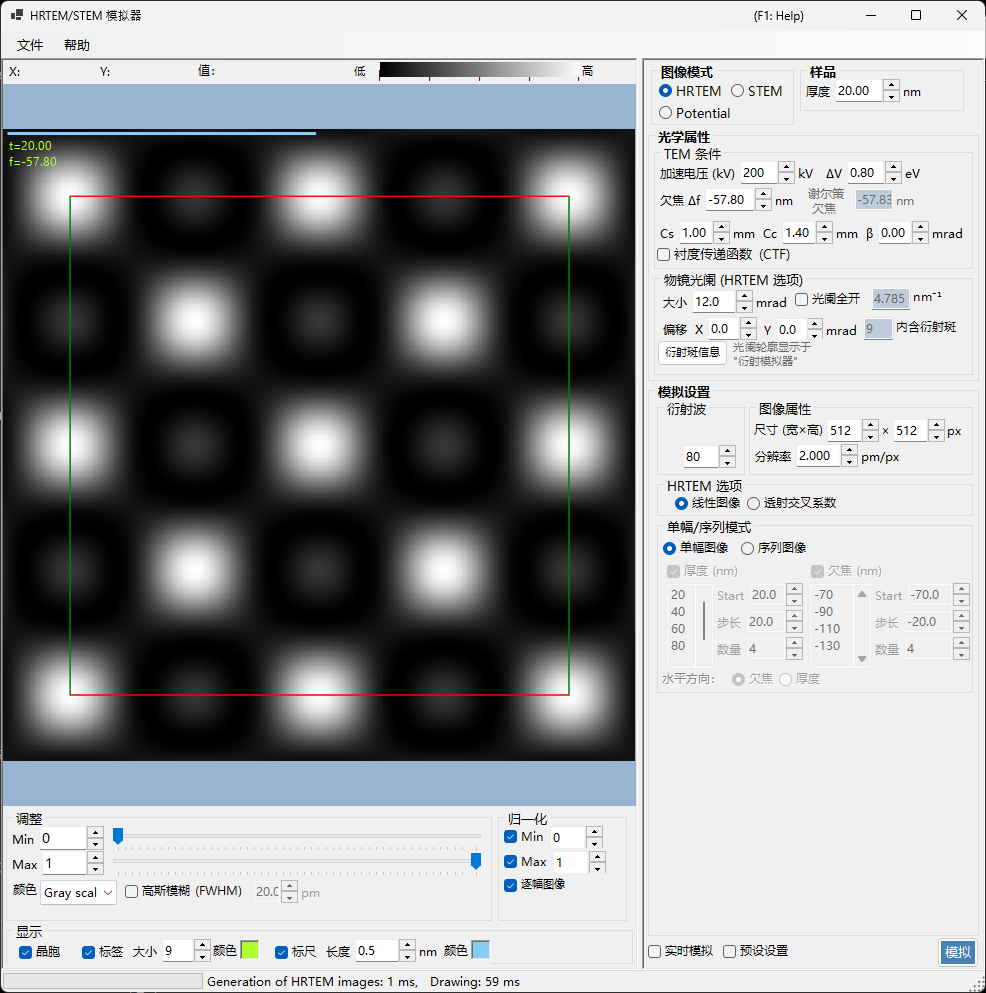
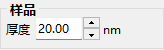
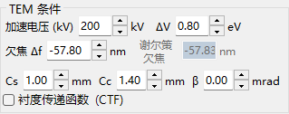
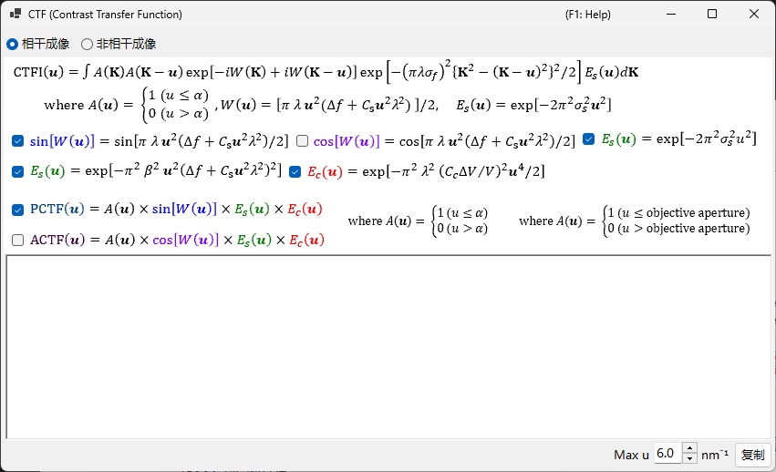
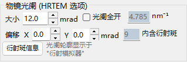
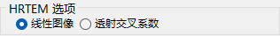
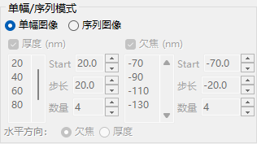
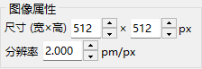
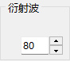

# HRTEM 模拟

**HRTEM（高分辨透射电子显微术）** 模拟用于计算高分辨 TEM 晶格条纹像。这是 [HRTEM/STEM 模拟器](index.md) 的主要模式。

> 本页说明 **图像模式 = HRTEM** 时右侧出现的所有设置。关于左侧的控件（结果的显示及亮度调整），请参见[概述页面](index.md#display-settings)。

---

## 概述

透过样品的电子波在物镜像差的影响下成像，从而形成 HRTEM 像。ReciPro 用布洛赫波法（动力学计算）计算电子波在样品内部的传播，并通过相位衬度传递函数 (PCTF) 生成 HRTEM 像。

### 计算流程

1. **布洛赫波法**：计算电子波在晶体势中的传播，得到出射波的振幅与相位
2. **透镜函数**：施加物镜的像差（球差 $C_s$、欠焦 $\Delta f$）
3. **部分相干**：考虑有限的光源尺寸（空间相干性）和能量涨落（时间相干性）
4. **成像**：计算强度分布 $|\psi(\mathbf{r})|^2$

理论部分请参见[附录 A3.2 — HRTEM 成像](../appendix/a3-bloch-wave/hrtem.md)。

---

## 样品

- **厚度** ：样品厚度 (nm)。HRTEM 像强烈依赖于厚度。在 **序列图像** 模式下，此值被忽略，改用下文所述的厚度列表。

---

## TEM 条件 {#tem-conditions}

设置物镜的成像条件。

| 参数 | 说明 | 默认值 / 典型值 |
|-----------|-------------|-------------------|
| **加速电压 (kV)** | 加速电压。右侧显示经相对论修正的电子波长 | 200 kV |
| **欠焦 Δf** | 物镜的欠焦量 (nm)。其下方显示作为参考的 **谢尔策欠焦** 值 | −57.8 nm |
| **Cs** | 球差系数 (mm)。影响 CTF 和谢尔策欠焦。可输入负值（−20 至 20 mm） | 1.0 mm（默认）；0.5–1.0（常规），< 0.01（球差校正） |
| **Cc** | 色差系数 (mm)。决定由能量展宽引起的图像模糊 | 1.4 mm（默认）；1.0–2.0 mm |
| **β** | 照明半角 (mrad)。表示有限光源尺寸的效应（空间相干性） | 0 mrad（默认）；0.1–1.0 mrad |
| **ΔV** | 电子能量展宽的半高全宽 (eV)。与 Cc 一起决定色差引起的焦点展宽 | 0.8 eV（默认）；0.5–2.0 eV |

上述默认值仅在首次启动时适用；之后会恢复上次使用的值。在内部，ΔV（FWHM）被换算为标准差 $\sigma_V = \Delta V / (2\sqrt{2\ln 2})$，焦点展宽为 $\delta = C_c\,\sigma_V / V$。像差函数为

$$\chi(u) = \pi\lambda\,\Delta f\,u^2 + \tfrac{\pi}{2}\,C_s\lambda^3 u^4 ,$$

每个衍射波乘以 $\exp[-i\chi(u)]$，因此 **负的 Δf 表示欠焦**（在此约定下谢尔策欠焦为负值）。

> **右键菜单**：在 TEM 条件面板上，可一键执行 **将欠焦设为 0 nm** / **将欠焦设为谢尔策值** / **将所有像差设为零**（最后一项把 Cs、Cc、β、ΔV **以及欠焦** 都设为 0）。同一菜单中还有四个显微镜预设——*300kV Cold-FEG Cs-free (Cs 0, Cc 2.8, ΔE 0.3) ARM300F*、*200kV Schottky-FEG UHR (Cs 0.5, Cc 1.1, ΔE 0.8) 2100F*、*200kV Schottky-FEG HR (Cs 1.0, Cc 1.4, ΔE 0.8) 2100F* 和 *200kV Lab6 HR (Cs 1.0 , Cc 1.4, ΔE 2.0) 2100*——它们按菜单项中所写设置加速电压、Cs、Cc 和 ΔV，然后将欠焦设为谢尔策值（β 保持不变）。右下方的 **预设设置** 复选框会打开保存您自己的条件的窗口（见[预设列表](index.md#preset-list)）。

### 谢尔策欠焦

相位衬度接近最佳的欠焦值，根据当前波长和球差 $C_s$ 计算（仅作参考显示）。$C_s$ 为负时，显示值为 $+\sqrt{\tfrac{4}{3}|C_s|\lambda}$。

$$\Delta f_{\text{Scherzer}} = -\sqrt{\tfrac{4}{3}\,C_s \lambda}\quad\left(\approx -1.155\,\sqrt{C_s \lambda}\right)$$

在此条件下，PCTF 在很宽的空间频率范围内为负，因此原子位置呈现为暗衬度。ReciPro 采用这一原始的谢尔策值（通过将像差相位 $\chi$ 的最小值设为 $-2\pi/3$ 推导得到），GUI 中显示的值也遵循此公式。注意，某些文献改用可进一步拓宽传递频带的*扩展谢尔策*值 $-1.2\sqrt{C_s\lambda}$。

---

## 透镜函数 / 衬度传递函数 (CTF)

勾选 **衬度传递函数 (CTF)** 会打开一个窗口，绘制透镜像差和欠焦在各空间频率上如何传递图像衬度。

- $\sin\chi(u)$ ：相位衬度传递函数（$\chi(u)$ 为透镜的像差函数）
- $E_\text{s}(u)$ ：空间相干包络函数；由有限光源尺寸 ($\beta$) 引起的衰减
- $E_\text{c}(u)$ ：时间相干包络函数；由能量涨落 ($C_c$, $\Delta V$) 引起的衰减

每条曲线都有各自的复选框：$\sin\chi$、$\cos\chi$、$E_\text{s}$、$E_\text{c}$、**PCTF** $=\sin\chi\,E_\text{s}E_\text{c}$ 和 **ACTF** $=\cos\chi\,E_\text{s}E_\text{c}$；在物镜光阑以外，PCTF 和 ACTF 被设为零。在 HRTEM 模式下

$$E_\text{s}(u)=\exp\!\left[-\pi^2\beta^2u^2\left(\Delta f+C_s\lambda^2u^2\right)^2\right],\qquad E_\text{c}(u)=\exp\!\left[-\tfrac{1}{2}\pi^2\lambda^2\delta^2u^4\right].$$

**最大 u**（nm⁻¹，默认 6）设定横轴的上限。**复制** 将绘制的曲线以制表符分隔文本放到剪贴板上。该窗口在 STEM 模式下也可使用（见 [STEM 模拟](2-stem-simulation.md#ctf-stem)）；在势模式下不可用。

---

## 物镜光阑 (HRTEM 选项)

限制通过物镜光阑的衍射波。布洛赫波计算本身始终使用 **衍射波** 中设置的波数；光阑随后从这些束中选出参与成像的束（当 $|\mathbf{g}-\mathbf{c}| < 2\sin(\alpha_\text{obj}/2)/\lambda$ 时束通过，$\mathbf{c}$ 为光阑中心）。若通过的束少于两个，计算会停止并提示您放大光阑。

- **大小** ：物镜光阑的半角 (mrad，默认 12)。值越小，被截去的高角度衍射波越多，高分辨细节越平滑。同时显示对应的倒易空间半径 $\sin\theta/\lambda$ (nm⁻¹)。
- **偏移 X** / **Y** ：物镜光阑中心的偏移量 (mrad)。用于移动光阑的暗场成像；照明本身并不倾斜。
- **光阑全开** ：将物镜光阑完全打开（无限大），使所有衍射波都参与成像。
- **内含衍射斑** ：落入光阑内的衍射束（衍射斑）数量（只读）。
- **衍射斑信息** ：打开一个表格，列出光阑内的衍射束（强度、复振幅等）。

> 物镜光阑的大小也会显示在 **衍射模拟器** 中。

---

## HRTEM 选项（部分相干模型）

选择如何计入部分相干性（β 和焦点展宽 δ）。出射波只针对单一入射方向（束轴）计算；照明发散和能量展宽仅通过下面的包络函数计入。

- **线性图像**（准相干模型） ：计算量小。动力学出射波的每个衍射波 $\psi_g$ 乘以 $\exp[-i\chi(g)]\,E_\text{s}(g)\,E_\text{c}(g)$，图像为 $\left|\sum_g\right|^2$。当图像以与透射束的干涉为主时（薄样品）是准确的。
- **透射交叉系数** ：计算量大，但更精确。对每一对束 $(g,h)$ 以互包络（完整的透射交叉系数）求和，适用于会激发许多强衍射波的强散射体。计算量随光阑内束数的平方增长。

详情请参见[附录 A3.2 — HRTEM 成像](../appendix/a3-bloch-wave/hrtem.md)。

---

## 单幅/序列模式

- **单幅图像** ：在当前厚度和欠焦下计算一幅 HRTEM 像。
- **序列图像** ：生成一组逐步改变厚度和欠焦的图像（厚度序列 / 欠焦序列）。便于寻找与实验图像最匹配的条件。

对于序列图像，需设置以下各项。

| 项目 | 说明 |
|------|-------------|
| **厚度 (nm)** / **欠焦 (nm)** | 要扫描的量（可同时选择两者） |
| **Start / 步长 / 数量** | 起始值、步长和图像数量。这些值会展开到下方的列表框中，也可以直接编辑该列表 |
| **水平方向：** | 同时扫描厚度和欠焦时，沿网格水平方向排列的量（**欠焦** 或 **厚度**） |

同时扫描厚度和欠焦时，会生成行 × 列的图像矩阵。每个量的 **数量** 上限为 20。只扫描一个量且图像多于两幅时，该行会被折成接近正方形的网格。

---

## 图像属性

- **尺寸 (宽×高)** ：模拟图像的像素数（默认为 512×512）。
- **分辨率** ：采样分辨率 (pm/px，默认 2)。视场为 尺寸 × 分辨率，因此值越小，在越小的区域内对条纹的采样越精细。图像在每个像素上通过对各束直接做傅里叶求和来合成（不使用 FFT），因此计算时间取决于像素数和束数，而与该值无关。

---

## 衍射波

- Bethe 法（动力学计算）中使用的布洛赫波最大数量，默认为 80。数量越大精度越高，但求解本征值问题需要 $O(N^3)$ 的时间。

---

## 另请参阅

- [HRTEM/STEM 模拟器（概述）](index.md)
- [STEM 模拟](2-stem-simulation.md)
- [势模拟](3-potential-simulation.md)
- [附录 A3.2 — HRTEM 成像](../appendix/a3-bloch-wave/hrtem.md)
