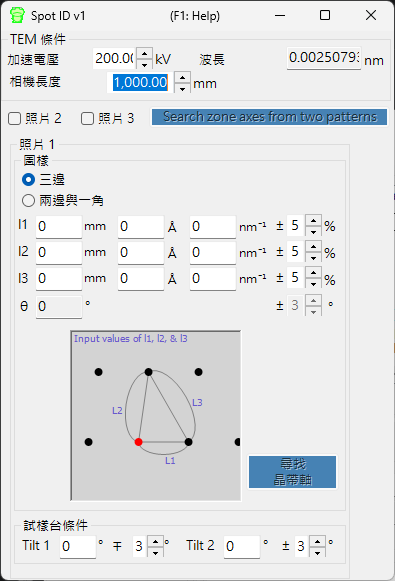

# Spot ID v1

**Spot ID v1**（即先前的 **TEM ID**）可從數值輸入的一至三張繞射圖樣的斑點幾何，搜尋候選晶帶軸。在影像上進行斑點偵測、擬合與標定，則在 [Spot ID v2](11-spot-id-v2.md) 中進行。

---

## 鍵盤與滑鼠快速鍵

Spot ID v1 以**數值輸入**的方式接收斑點幾何（即先前的 *TEM ID* 工作流程）；它沒有影像檢視（影像載入、滑鼠縮放、斑點偵測與手動挑選斑點屬於 [Spot ID v2](11-spot-id-v2.md)）。唯一的快速鍵位於結果視窗：

| 快速鍵 | 動作 |
|----------|--------|
| <kbd>F1</kbd> | 開啟線上手冊的本頁 |
| 雙擊結果清單中的某一列 | 選取該晶體並將其旋轉至對應的晶帶軸 |

→ 各視窗一覽請參見 **[21. 鍵盤與滑鼠快速鍵](21-shortcuts.md)**。

---

## 由斑點幾何進行晶帶軸搜尋（先前的 TEM ID）

當您沒有可載入的影像時，仍可手動輸入選區電子繞射（SAED）圖樣的幾何，以搜尋候選晶帶軸。輸入 TEM 觀測條件與斑點幾何，然後按下照片的 **尋找晶帶軸**（或按 **由兩張圖樣尋找晶帶軸** / **由三張圖樣尋找晶帶軸** 以同時使用多張照片）以找出候選晶體取向。

### TEM 條件

輸入 **加速電壓**（kV，預設 200）與 **相機長度**（mm，預設 1000）。**波長**（nm）由電壓計算，以唯讀方式顯示。

### 照片 1、2、3

輸入繞射斑點的幾何。

- 若要輸入偵測器上斑點之間的距離，請使用 **mm** 欄位。
- 若您已知 *d* 值，請以 **Å** 或 **nm⁻¹** 單位輸入。

**三邊** : 輸入以 direct spot 為其中一個頂點的三角形三邊長度。

**兩邊與一角** : 輸入兩邊的長度（含 direct spot）以及兩邊之間的夾角。

- 容許誤差（**±** 欄位）：每個長度各有以 % 表示的容許誤差（0–50，預設 5），θ 則以度表示（0–30，預設 3）。未輸入的值（三邊模式中的 θ、兩邊模式中的 l3）會計算並顯示出來，並在輸入欄旁繪出所得圖樣的示意圖。
- **試樣台條件** ：拍攝該照片時測角試樣台的 **Tilt 1** / **Tilt 2**（°），各自附有容許誤差（0–10°，預設 3°）。各照片之試樣台設定間的夾角會計算並顯示出來。
- **照片 2** / **照片 3** ：啟用第二與第三張照片。照片之間的核取方塊會將兩張照片的 l1（或 l2）視為同一個反射，並複製其長度。
- **尋找晶帶軸** 搜尋單一照片；**由兩張圖樣尋找晶帶軸** / **由三張圖樣尋找晶帶軸** 則搜尋與這些照片以及它們之間的試樣台傾斜角皆一致的組合；只有在勾選 **照片 3** 且其所有數值皆已輸入時才會使用照片 3，否則使用兩張照片。在單一照片（**尋找晶帶軸**）的結果表中，一律顯示 g1、d1、g2 與 d2，三邊模式另加 g3 與 d3，兩邊與一角模式則另加 θ。 <!-- 261105Cl 監査: buttonSearchAll_Click (afd65e0)、FormSpotIDv1Results.SetDataSet (46d91db) --> 搜尋會針對主視窗清單中所有選取的晶體進行（Spot ID v1 開啟期間可多重選取）。若找到超過 1000 個候選，則不會列出任何結果，並請您縮小條件；否則會開啟結果視窗。雙擊某一列即可選取該晶體並將其旋轉至該取向。各候選晶帶軸的正負號依循教科書的慣例 **g**₁ × **g**₂，因此與 2026-11 之前的版本相反（取向本身相同）。 <!-- 261106Cl 作者の決定 B16 -->

---

## 另請參閱

- [Spot ID v2](11-spot-id-v2.md)
- [繞射模擬器](7-diffraction-simulator/index.md)
- [主視窗](0-main-window.md)
- [晶體資料庫](1-crystal-database.md)
- [EBSD 模擬](12-ebsd-simulation.md)
