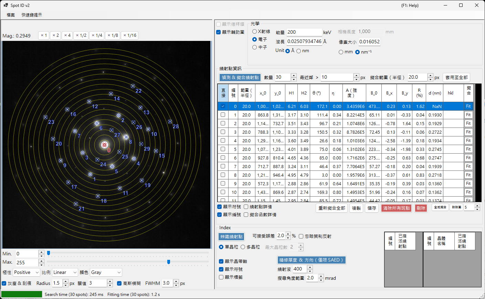
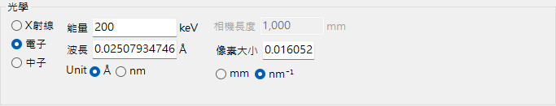
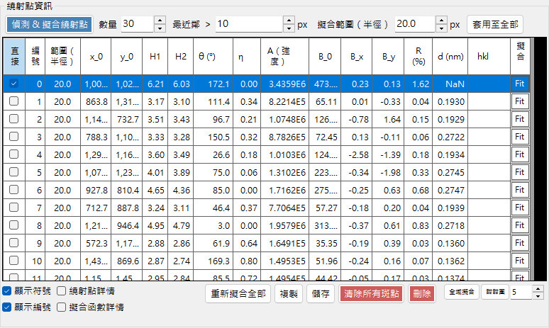
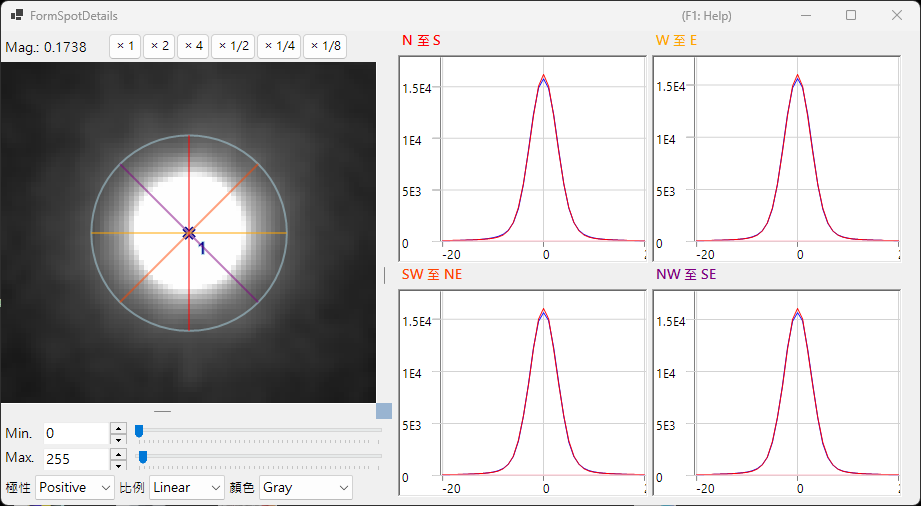
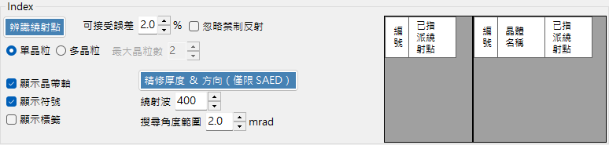

# Spot ID v2

**Spot ID v2** 可在實驗繞射影像上偵測、擬合並標定繞射點。[Spot ID v1](10-spot-id.md)（即先前的 TEM ID）則改為以數值輸入斑點幾何。

---

## 鍵盤與滑鼠快速鍵

您可直接在載入的影像上建立繞射點清單。影像窗格使用 ReciPro 標準的[影像檢視導覽](21-shortcuts.md)進行平移／縮放；繞射點編輯則新增下列組合鍵。

| 快速鍵 | 動作 |
|----------|--------|
| <kbd>F1</kbd> | 開啟線上手冊的本頁 |
| 在影像上左鍵雙擊 | 在該點新增一個繞射點（峰值擬合） |
| <kbd>CTRL</kbd> + 左鍵雙擊 | 新增一個繞射點並標記為直射（000）束 |
| 左鍵點按某繞射點 | 選取最接近的繞射點 |
| <kbd>CTRL</kbd> + 右鍵點按某繞射點 | 刪除最接近的繞射點 |
| <kbd>CTRL</kbd> + 方向鍵 | 將所選繞射點移動一個像素 |
| 左鍵拖曳／中鍵拖曳（空白區域） | 平移影像 |
| 滑鼠滾輪 | 在游標處放大／縮小 |
| 右鍵拖曳出方框 | 放大至所選區域 |
| 右鍵雙擊 | 縮小 |
| 雙擊某繞射點的列首（表格） | 縮放至該繞射點（×2） |

→ 請參閱 **[21. 鍵盤與滑鼠快速鍵](21-shortcuts.md)**，一覽各視窗的對應操作。

---

## 檔案選單

開啟繞射影像；**儲存** / **複製** 會將所顯示的影像寫成中繼檔 (EMF) 或影像 (PNG)。影像也可以拖放載入。對於以 nm⁻¹ 校正的 Gatan DM3/DM4 檔案，輻射會設為電子，並從檔案讀取加速電壓與像素大小（nm⁻¹）（此時不需要相機長度）。

**儲存 ▸ Candidate list (CSV)...** 可匯出指標化得到的取向候選，**複製 ▸ Candidate list (TSV)** 則把同一表格放入剪貼簿：每個候選 × 晶粒一列，包含排名、晶粒序號、晶體名稱、ZXZ 尤拉角（°）、旋轉矩陣的九個分量、均方殘差（nm⁻²）、已指派繞射斑數以及繞射斑 → (hkl) 的對應關係。CSV 的小數點一律為句點；TSV 可直接貼入試算表。

---

## 光學

### 入射源

選擇輻射類型（X 射線／電子／中子）並設定能量或波長。

### 相機長度／像素大小

相機長度（mm）與偵測器像素大小（mm 或 nm⁻¹）。載入以 nm⁻¹ 校正的 Gatan DM 檔案時，像素大小（nm⁻¹）會自檔案標頭讀入，且不使用相機長度（單位為 nm⁻¹ 時，相機長度方塊會停用）。變更波長、相機長度或像素大小的單位時，繞射點的位置（像素）保持不變，並以新的校正重新計算其 *d* 值。

視窗位置與校正（入射源、能量、相機長度，以及像素大小的單位與數值）會保留到下次啟動；開啟帶有校正資訊的影像檔時會覆寫這些值。 <!-- 261105Cl 監査: NumericBoxPixelSize_ValueChanged (8860d40)、FormMain.cs の保存・復元 (dc42de3) -->

**顯示德拜環**（預設關閉）會繪出主視窗中所選每個晶體的德拜環——選取多個晶體時各以其自身的顏色顯示——以直射點為中心，並使用目前的校正（波長、相機長度、像素大小）；依消光規則禁制之反射的環不會繪出。**顯示輔助圓**（預設開啟）會在圖樣上繪出輔助圓。 <!-- 261106Cl 作者の決定 I10 -->

---

## 繞射點資訊

- **偵測 & 擬合繞射點**：使用局部極大值與背景扣除的自動繞射點偵測。
- **數量**：要偵測的繞射點最大數量。
- **最近鄰**：所偵測繞射點之間允許的最小間距（px）。比此距離更接近的峰會被合併，以避免重複偵測同一繞射點。
- **擬合範圍（半徑）**：用以擬合每個繞射點峰值的圓形區域半徑（px）。此圓內的像素以 pseudo-Voigt 函式擬合。
- **套用至全部**：將每個繞射點的擬合半徑設為目前的 **擬合範圍（半徑）** 值。
- **刪除 / 清除所有斑點**：移除所選的繞射點，或全部已偵測的繞射點。
- **儲存** / **複製**：將繞射點表格儲存為 CSV 檔，或以 Tab 分隔的文字複製至剪貼簿。只有一個繞射點時也可使用。CSV 一律以句點作為小數點，並可用 **檔案 ▸ 載入** 讀回（須先載入影像；讀入的繞射點會加到已列出的繞射點之後）。 <!-- 261105Cl 監査: GetSpotListText / readCSV (7f65908) -->
- **重新擬合全部**：重新擬合所有已偵測繞射點的位置與強度。
- **顯示符號** / **顯示編號**：在觀測到的繞射點上顯示標記符號 / 編號（預設皆開啟）。
- **全域擬合**：一次對所有繞射點位置進行全域擬合（實驗性功能）。
- **甜甜圈**：套用甜甜圈形的背景扣除（實驗性功能）；旁邊的欄位設定每個繞射點周圍環形區域的寬度（px），該環形區域的平均值會作為局部背景扣除。
- **繞射點詳情**：勾選後會開啟一個視窗，顯示目前所選繞射點的詳細資訊。
- **擬合函數詳情**（開啟視窗時為關閉）：顯示繞射點表格所用之二維 pseudo-Voigt 函式及其參數（x_0、y_0、H1、H2、θ、η、A、B_0、B_x、B_y）的示意圖。

---

## 標定

- **辨識繞射點**：執行標定演算法，找出最相符的晶體與晶帶軸。執行期間，此按鈕會換成 **停止** 按鈕，可中斷搜尋。需要已載入的影像、至少兩個繞射點，以及在主視窗晶體清單中至少選取一個晶體；否則會有訊息說明缺少什麼。Spot ID v2 開啟期間，主視窗的晶體清單可多重選取。 <!-- 261105Cl 監査: buttonIdentifySpots_Click (494ef52)、FormMain.cs の複数選択 (4020433) -->
- **可接受誤差**：晶面間距的相對容許誤差，以 % 表示（0.1–10，預設 2）。繞射點之間的角度容許誤差由此導出，為 asin(容許誤差)/2。
- **忽略禁制反射**（預設關閉；僅限電子繞射）：勾選後，所有系統消光的反射（包含螺旋軸與滑移面所禁制者）都會從候選反射中排除。未勾選時，只排除因晶格心化（I、F、A、B、C、R）而消光者，因此可能經由多重繞射而出現的螺旋／滑移禁制反射仍保留為候選。對於 X 光與中子，所有消光反射一律排除（運動學處理）；此時該方塊顯示為已勾選且呈灰色，當入射源切回電子時會恢復先前的狀態。 <!-- 261106Cl 作者の決定 I4 -->
- **單晶粒 / 多晶粒**：搜尋單一取向（單晶），或搜尋多個取向（多晶／多晶粒區域）。對於多晶粒，**最大晶粒數** 設定要搜尋的晶粒數量上限。
- **顯示晶帶軸** / **顯示符號** / **顯示標籤**：疊加顯示晶帶軸，以及計算繞射點的符號 / 指數標籤。
- **精修厚度 & 方向（僅限 SAED）**：僅在入射源為 **電子** 時有效（否則狀態列會加以說明，且不進行計算）。 <!-- 261105Cl 監査: ButtonRefineThicknessAndDirection_Click / Bethe_CbedCompleted (ed018ca) --> 將觀測到的繞射點強度與動力學（布洛赫波）計算比對，精修所選晶粒的試樣厚度（nm）與入射束方向。**繞射波**（1–2048，預設 400）為繞射束數，**搜尋角度範圍**（mrad，1–10，預設 2）為所搜尋入射方向的角度半範圍。精修無法中斷（**停止** 按鈕僅屬於 **辨識繞射點**）；計算完成之前視窗會停用。程式會嘗試 50–549 nm（步進 1 nm）的厚度，以及在晶粒目前取向周圍正方形格點上的入射方向（步進 = 搜尋範圍的 1/15），並採用使已標定繞射點的 Σ (Iobs − a·Icalc)² 最小的組合（a：最佳比例因子）。最佳厚度會傳給繞射模擬器，而晶粒的取向（也會套用至主視窗，除非計算期間主視窗中的晶體已被變更）會傾斜，使最佳方向成為入射束方向；面內旋轉保持不變。結果（厚度、以 mrad 表示的傾斜量、晶帶軸、殘差）顯示於狀態列。若最佳方向落在搜尋範圍的邊緣，狀態列會加以提示，因為最佳值可能位於範圍之外：請再按一次此按鈕（搜尋會以精修後的取向為中心）或擴大範圍。 <!-- 261105Cl 方位の精密化の実装に合わせて追記 (根拠: FormSpotIDV2.cs: ButtonRefineThicknessAndDirection_Click / Bethe_CbedCompleted) -->
- **Results**：最佳相符結果會以晶體名稱、晶帶軸 [uvw] 及各繞射點指數 (hkl) 顯示。選取單一晶粒的列時，也會在主視窗中選取其晶體並設定該取向。 <!-- 261105Cl 監査: bindingSourceGrains_CurrentChanged (I11) -->

---

## 另請參閱

- [Spot ID v1](10-spot-id.md)
- [繞射模擬器](7-diffraction-simulator/index.md)
- [主視窗](0-main-window.md)
- [鍵盤與滑鼠快速鍵](21-shortcuts.md)
