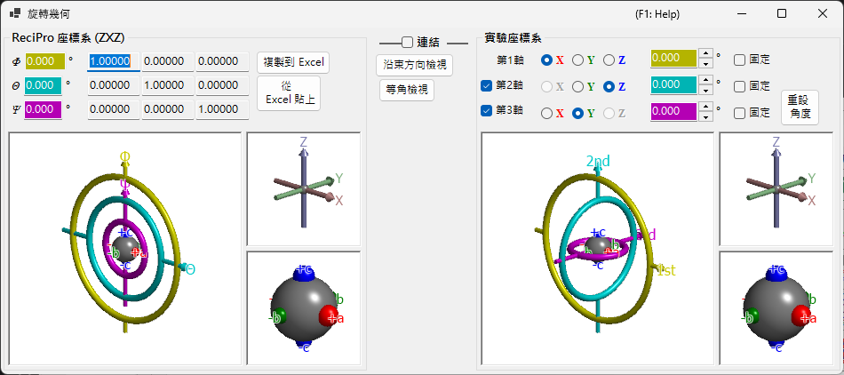

# 旋轉幾何

此視窗以 3×3 矩陣表示晶體的旋轉狀態，並在不同的歐拉座標系之間進行轉換。

ReciPro 使用三個歐拉角 — **Ψ**、**θ** 與 **Φ** — 並依 **Z–X–Z** 順序套用。然而，此慣例不一定與您實際儀器的測角儀軸相符。**旋轉幾何**視窗可讓您將 ReciPro 的歐拉角轉換到任意定義的座標系，從而支援實驗室中的測角儀調整。

---

## 鍵盤與滑鼠快速鍵

全部六個 3D 檢視（ReciPro 與實驗測角儀 / 軸 / 物件等面板）皆已**連動** — 旋轉其中任一個，六者便會一同旋轉。它們共用 ReciPro 的標準 [OpenGL 檢視導覽](21-shortcuts.md)。

| 快速鍵 | 動作 |
|----------|--------|
| <kbd>F1</kbd> | 開啟線上手冊的本頁 |
| 在檢視中左鍵拖曳 | 旋轉模型（六個檢視一同旋轉） |
| 滑鼠滾輪，或右鍵向上/向下拖曳 | 縮放（大型測角儀檢視） |
| <kbd>CTRL</kbd> + 右鍵向上/向下拖曳 | 變更相機距離（僅限透視模式） |
| <kbd>CTRL</kbd> + 右鍵雙擊 | 切換正交 / 透視投影 |

小型 *Axes* 與 *Objects* 檢視已停用縮放與平移。除 <kbd>F1</kbd> 外沒有其他鍵盤快速鍵。

---

## ReciPro 座標系 (ZXZ)

視窗的上半部以「ReciPro 座標系」顯示旋轉狀態。

- **Φ, θ, Ψ** 值與主視窗中設定的歐拉角同步。
- **Rotation matrix** 顯示對應於目前旋轉狀態的 3×3 矩陣。

### Φ, θ, Ψ (Z–X–Z 歐拉角)

晶體取向以三個旋轉參數化。以**固定於物體（內稟）**的參考系描述時，依下列順序套用：

1. **Φ** — 繞 **Z** 軸的第一次旋轉。
2. **θ** — 繞一次旋轉後參考系之 **X** 軸的旋轉。
3. **Ψ** — 繞兩次旋轉後參考系之 **Z** 軸的第二次旋轉。

在**固定的實驗室**參考系中觀察同一旋轉，則為相反的順序——先繞 $Z$ 轉 Ψ，再繞 $X$ 轉 θ，最後繞 $Z$ 轉 Φ——這正是[附錄 A1.1](appendix/a1-coordinate-system/1-orientation.md)所採用的描述。兩者給出下方完全相同的矩陣 $R$；Φ 只是最外側（類似測角儀）的軸，Ψ 則是最內側的軸。

Φ、θ、Ψ 方塊與九個矩陣方塊皆為**唯讀**顯示。若要變更取向，請在主視窗中旋轉晶體、使用 **從 Excel 貼上**，或（在 **連結** 開啟時）編輯下方的實驗軸角度；每次變更都會傳遞至主視窗以及所有連動的模擬器。

### 旋轉矩陣

由目前的 (Φ, θ, Ψ) 產生的 3 × 3 矩陣。使用 **複製到 Excel** / **從 Excel 貼上** 透過試算表來回傳遞矩陣。

該矩陣在 ReciPro 中出現的所有位置都遵循同一約定：

$$
\mathbf{v}_{\mathrm{rot}} = R\,\mathbf{v}_{0}
$$

- \(R\) 是晶體的**主動旋轉**（active rotation），在固定於顯示器的實驗室座標系（\(X\)=右、\(Y\)=上、\(Z\)=朝向觀察者 — 參見[附錄 A1.1](appendix/a1-coordinate-system/1-orientation.md)）中表示。
- \(\mathbf{v}_{0}\)：固定於晶體的方向在**初始取向**（\(c \parallel Z\)，\(b\) 位於 \(YZ\) 面內）下的笛卡兒座標（行向量）。
- \(\mathbf{v}_{\mathrm{rot}}\)：旋轉後同一方向的座標（仍在實驗室座標系中）。
- 當 \(\Phi=\theta=\Psi=0\) 時 \(R\) 為單位矩陣。\(R\) 為正交歸一矩陣且行列式為 +1，因此逆變換就是轉置：\(R^{-1}=R^{\mathsf T}\)。

以尤拉角表示為 \(R = R_Z(\Phi)\,R_X(\theta)\,R_Z(\Psi)\)（繞固定軸的右手旋轉；\(\Psi\) 最先作用於向量）：

$$
R=\begin{pmatrix}
\cos\Phi\cos\Psi-\cos\theta\,\sin\Phi\sin\Psi & -\cos\Phi\sin\Psi-\cos\theta\,\sin\Phi\cos\Psi & \sin\theta\,\sin\Phi\\
\sin\Phi\cos\Psi+\cos\theta\,\cos\Phi\sin\Psi & -\sin\Phi\sin\Psi+\cos\theta\,\cos\Phi\cos\Psi & -\sin\theta\,\cos\Phi\\
\sin\theta\,\sin\Psi & \sin\theta\,\cos\Psi & \cos\theta
\end{pmatrix}
$$

套用於晶體學指數時，先換算成初始取向下的笛卡兒座標：方向 \([uvw]\) 為 \(\mathbf{v}_0 = u\mathbf{a}+v\mathbf{b}+w\mathbf{c}\)，面法線 \((hkl)\) 為 \(\mathbf{v}_0 = h\mathbf{a}^{*}+k\mathbf{b}^{*}+l\mathbf{c}^{*}\)（倒晶格基向量）。

同一矩陣（\(R_{ij}\) = 第 \(i\) 列第 \(j\) 行）出現於：

- 本視窗的 **複製到 Excel** / **從 Excel 貼上**（3 × 3 定位字元分隔，由上而下逐列）；
- [巨集 API](20-macro/1-built-in-functions.md) 的 `Dir.GetRotationMatrix()` / `Dir.SetRotationMatrix()` 與 `Dir.GetEuler()`（9 個元素按列序 \(R_{11}, R_{12}, R_{13}, R_{21}, \ldots, R_{33}\) 排列）；
- [Spot ID v2](11-spot-id-v2.md) 儲存的候選清單中的 **R11**–**R33** 欄。

### OpenGL 視窗

3D 檢視以三個彩色圓環（甜甜圈）顯示目前的旋轉：

| 顏色 | 歐拉角 | 測角儀層級 |
|--------|------------|-----------------|
| **黃色** | Φ | 第 1（上）軸 |
| **淺藍色** | θ | 第 2（中）軸 |
| **粉紅色** | Ψ | 第 3（下）軸 |

**紅**、**綠**、**藍**箭頭表示實空間笛卡兒座標中的 X、Y、Z 軸。這些*並非*主視窗中所示的晶軸。

中央的灰色球體表示試樣。紅 / 綠 / 藍小球（標示為 **+a/−a**、**+b/−b**、**+c/−c**）標示旋轉後晶體正規化之 *a*、*b*、*c* 軸的方向（較大的球 = + 端）。當 Φ = θ = Ψ = 0 時，它們顯示晶體的初始取向（*c* ∥ +Z，*b* 位於 YZ 平面內），因此只有在正交晶胞時，*a* 與 *b* 才分別與 +X、+Y 一致。

> **注意**：在 OpenGL 視窗中拖曳僅會變更此檢視的*投影方向*，而非晶體取向本身。若要旋轉晶體，請使用主視窗。

### 按鈕

| 按鈕 | 動作 |
|--------|--------|
| 複製到 Excel | 以定位字元分隔格式複製 3×3 旋轉矩陣 |
| 從 Excel 貼上 | 從剪貼簿設定旋轉矩陣（定位字元分隔的 3×3） |
| 沿束方向檢視 | 與主視窗投影對齊（Z 軸垂直於螢幕） |
| 等角檢視 | 切換為等角投影 |

---

## 實驗座標系

下半部在任意一組旋轉軸上定義歐拉角，並讀取/設定測角儀狀態。此即所謂的**實驗座標系**。

### 第 1、第 2、第 3 軸

為測角儀的每個層級（第1軸 = 上、第2軸 = 中、第3軸 = 下）從 **X**、**Y** 或 **Z** 中選擇旋轉軸（僅限實驗室參考系的正方向）。第2軸不能與第1軸相同，第3軸也不能與第2軸相同（相衝突的選項按鈕會停用）。預設為 **X – Z – Y**。圖形會隨之更新。

各軸的角度顯示在對應的彩色方塊（黃色、淺藍色、粉紅色）中，也可以直接輸入（單位為度；超出 −180…180° 的值會被換算回此範圍）。實驗旋轉的合成方式與 ReciPro 自身的矩陣相同，以第1軸為最外側：

$$
R_{\mathrm{exp}} = R_{\mathbf{e}_1}(\omega_1)\,R_{\mathbf{e}_2}(\omega_2)\,R_{\mathbf{e}_3}(\omega_3)
$$

（繞固定實驗室軸 $\mathbf{e}_i$ 的右手旋轉）。

| 控制項 | 動作 |
|---------|--------|
| **第2軸** / **第3軸** | 啟用或停用該層級（只有一或兩個軸的測角儀）。停用時其角度設為 0。停用第2軸也會停用第3軸。 |
| **固定** | 在 **連結** 將新的取向分解為測角儀角度時（見下文），將該角度保持在目前的值。 |
| **重設角度** | 將三個實驗角度全部設為 0。 |

---

## 連結

當勾選 **連結** 時，ReciPro 座標系與實驗座標系即耦合：兩者的歐拉角會經過調整，使物件取向在兩個系統之間保持一致。

在勾選 **連結** 的當下，會儲存兩個系統之間的偏移 $R_{\mathrm{base}} = R_{\mathrm{exp}}^{-1} R$，此後 $R = R_{\mathrm{exp}}\,R_{\mathrm{base}}$。連結期間：

- 編輯某個實驗角度會使每個視窗中的晶體一起旋轉；
- 增量旋轉（箭頭按鈕、CTRL+SHIFT+方向鍵，或在主視窗或其他視窗中拖曳）會以數值方式分解為已啟用且未 **固定** 的測角儀角度，並將晶體設定為**測角儀所能到達的最接近取向**——因此在有固定或停用的軸時，晶體會遵循測角儀的限制，而不會完全跟隨滑鼠；
- 設定絕對取向（歐拉角方塊、**重設旋轉**、**視線方向** 的 軸/晶面、**從 Excel 貼上**）時，會精確套用該取向、重新啟用第2軸與第3軸、清除所有 **固定**，並將其重新分解為全部三個測角儀角度。

### 範例工作流程

1. 在實驗室中，設定測角儀使晶體的 *a* 軸與 X 射線入射方向對齊，且 *b* 軸保持水平。
2. 在實驗座標系中輸入實驗室測角儀的歐拉角。
3. 在主視窗中旋轉晶體，使 *a* 軸朝向螢幕法線，*b* 軸朝向水平。
4. 勾選 **連結** — 此後，每當您在主視窗中將晶體指向不同取向時，便會自動顯示所需的測角儀角度。

---

## 另見

- [主視窗](0-main-window.md)
- [極網](6-stereonet.md)
- [基本座標系與晶體取向](appendix/a1-coordinate-system/1-orientation.md)
- [鍵盤與滑鼠快速鍵](21-shortcuts.md)
