# 結構檢視器

**結構檢視器**使用 OpenGL 將選取晶體的結構繪製為三維影像。

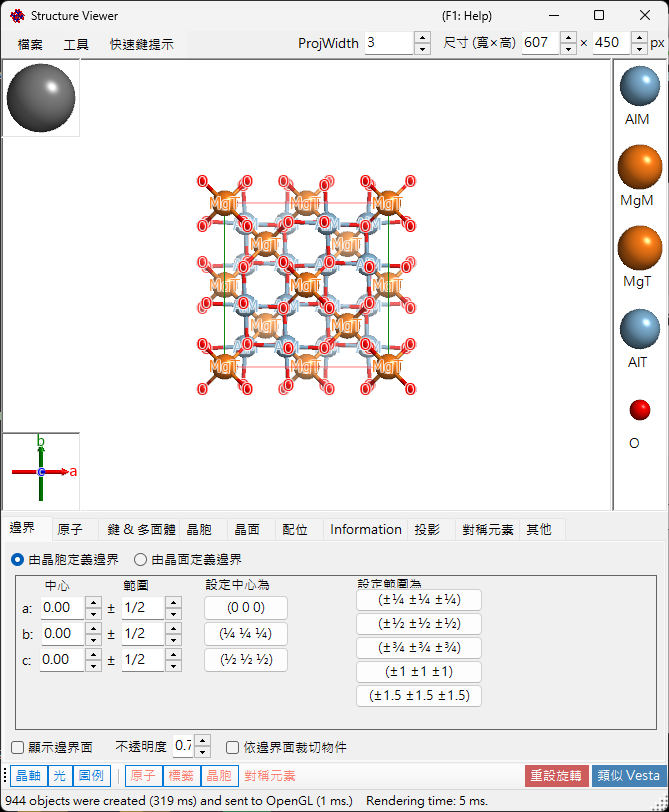

---

## 鍵盤與滑鼠快速鍵

此視窗包含一個主要的 3D 檢視，以及兩個小型操作器 — **晶軸**方塊（左下角）和**光源方向**方塊（左上角）— 各自對左鍵拖曳有不同的反應。主檢視使用 ReciPro 標準的 [OpenGL 檢視導覽](21-shortcuts.md)。

| 快速鍵 | 動作 |
|----------|--------|
| <kbd>F1</kbd> | 開啟線上手冊的本頁 |
| <kbd>CTRL</kbd>+<kbd>SHIFT</kbd>+<kbd>C</kbd> | 將算繪後的影像複製到剪貼簿 |
| 在主檢視中左鍵拖曳 | 旋轉模型 |
| 在原子上左鍵雙擊 | 顯示所點原子的座標，以及其周圍鄰近原子的距離與鍵角（只能選取已顯示的原子） <!-- 261105Cl 監査: 近接原子はクリックした位置の周り (ca87b772, 8cc95680) --> |
| 右鍵向上/向下拖曳，或滑鼠滾輪 | 縮放 |
| 中鍵拖曳 | 平移 |
| <kbd>CTRL</kbd> + 右鍵向上/向下拖曳 | 變更相機距離（僅透視模式） |
| <kbd>CTRL</kbd> + 右鍵雙擊 | 切換正交／透視投影 |
| 在**晶軸**操作器上左鍵拖曳 | 旋轉模型（無平面內自旋） |
| 在**光源**操作器上左鍵拖曳 | 變更照明方向 |

當此視窗取得焦點時，來自[主視窗](0-main-window.md#keyboard-mouse-shortcuts)的應用程式全域 <kbd>CTRL</kbd>+<kbd>SHIFT</kbd> 快速鍵同樣有效。

→ 請參閱 **[21. 鍵盤與滑鼠快速鍵](21-shortcuts.md)**，一覽所有視窗。

---

## 主區域

3D 晶體結構，並同時繪出光源方向操作器、晶軸操作器與原子圖例。視窗的位置與大小會保留到下次啟動。 <!-- 261106Cl 作者の決定 H6 -->
> 視窗右上角的 **尺寸 (寬×高)** 方塊設定 3D 檢視的像素尺寸（視窗會隨之調整大小）；儲存與複製的影像即為此尺寸。
> 其旁的 **ProjWidth** 方塊顯示投影檢視的寬度（nm）。編輯此值即可以數值方式縮放 — 它會與檢視上的右鍵拖曳／滾輪縮放保持同步。

---

## 選單列

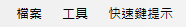

### 檔案選單

| 選單項目 | 說明 |
|----------|------|
| 儲存影像 ▸ 主影像 / 圖例 / 晶軸 / 光照方向 | 將主檢視、原子圖例或其中一個操作器儲存為 PNG |
| 複製影像至剪貼簿 ▸ 主影像 / 圖例 / 晶軸 / 光照方向 <!-- 261105Cl 監査: copyToClipboardToolStripMenuItem.Text --> | 複製影像（Ctrl+Shift+C 會複製主檢視） |
| 儲存影片 ▸ 主影像 / 晶軸 | 將主檢視或晶軸操作器的旋轉/平移影片儲存為 MP4（可設定速度、長度、fps、品質等） |
| Export 3D model (3MF/STL) | 將顯示中的結構輸出為可用於 3D 列印的立體資料 |

**工具** 選單：**我喜歡 VESTA**（與工具列的 *類似 Vesta* 按鈕相同）與 **Enable DDP**（顯示／隱藏[透明度模式](#透明度模式)中的 *Dual Depth Peeling* 項目）。

**快速鍵提示**（獨立的頂層選單）會列出鍵盤快速鍵。

**儲存影片**會開啟下方的影片設定對話框。影片可以旋轉檢視、平移投影中心，或同時進行兩者 — 請勾選 **旋轉** 和／或 **平移**：

- **旋轉**：以 **速度**（°/s；負值反轉方向）繞下方所選的軸旋轉檢視 — **目前投影**（以箭頭按鈕選取的傾斜方向）、**方向指數** [uvw]，或 **晶面** (hkl) 的法線。旋轉軸取自按下 **OK** 當下的晶體取向。開啟米勒-布拉維指數時，只有 **晶面** 會顯示四個指數；**方向指數** 一律為三指數的 [uvw]。 <!-- 261105Cl 監査: FormMovie.cs (OK の時点で回転軸を求め直す、4 指数は格子面だけ, 35fa72fc) -->
- **平移**：沿方向指數 [uvw] 以 **速度**（晶格週期/秒）移動投影中心。此選項僅在從結構檢視器開啟對話框時顯示，且啟用期間 **方向指數** 是唯一可用的方向模式。

設定影片長度（**持續時間**）、影格率（**FPS**，1–120）與編碼品質（**品質**，1–100；數值越高位元率越高、檔案也越大），選擇編解碼器（**H264** / **H265**），然後按 **OK** 以產生 MP4 檔案。**包含最後一個影格** 會在 t = 持續時間 處附加一個額外影格，使影片恰好結束於最終的方位／位置。（編碼速度清單現在僅用於標示進度顯示，不再影響實際編碼。）

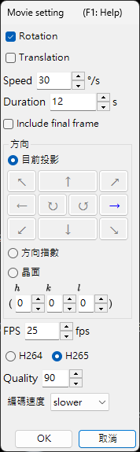

#### Export 3D model (3MF/STL)

**Export 3D model (3MF/STL)** 會將畫面上目前繪製的結構模型輸出為可用於 3D 列印的立體資料。只有封閉實體才能輸出——原子（球、橢球）、鍵（圓柱）與配位多面體。原子標籤、邊界面、晶面與對稱元素符號不會輸出。 <!-- 261105Cl 監査: 配位多面体を出力し、対称要素は出さない (6c31fc0d) --> 晶胞外框由線段構成，只有勾選對應選項時才會替換成圓柱（角落加球）後輸出。**依邊界面裁切物件** 不會套用於輸出：與邊界面相交的物件會整個輸出（對話方塊中有此註記）。 <!-- 261106Cl 作者の決定 H10 -->

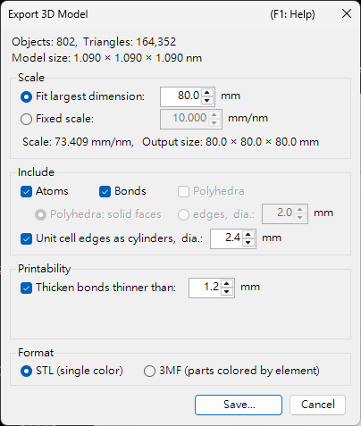

對話方塊上方會顯示參與輸出的物件數與三角形數，以及模型的實際尺寸（**模型尺寸**，nm）。

**比例尺** : 輸出尺寸的決定方式

- **最大尺寸** : 自動決定比例，使模型的最長邊達到指定長度（5–500 mm，預設 80 mm）。取代晶胞外框與多面體稜邊骨架的圓柱粗細也計入在內。 <!-- 261105Cl 監査: 円柱の太さを含めて合わせる (82e50b62) -->
- **固定比例尺** : 直接指定比例（mm/nm）。用於以相同比例製作多個晶體並排比較。切換到此項時，會以剛才生效的比例作為初始值。
- 下方一行會顯示決定後的比例與輸出尺寸（**輸出尺寸**，mm），同樣計入該圓柱粗細。

**包含** : 列印中要包含的要素

- **原子** / **鍵** / **配位多面體** : 只能選擇目前顯示的種類；取消勾選後仍留在畫面上，但不會進入列印。
- **多面體：實心面** / **稜, 直徑** : 選擇要將配位多面體輸出為有面的實心體，或僅稜邊的骨架（圓柱＋頂點球，預設 2.0 mm）。骨架可以看見內部的原子。
- **鏤空網格：桿直徑 / 間距** : 稜邊骨架再加上各面上的細桿格網（桿直徑 0.8–5.0 mm，預設 1.2 mm；間距 1.5–20 mm，預設 5.0 mm）。從遠處看各面像是填滿的，但內部仍然可見。
- **晶胞稜作圓柱, 直徑** : 將晶胞外框替換為指定直徑（預設 2.4 mm）的圓柱後納入。只要畫面上顯示晶胞外框，此方塊預設即為勾選。

**可列印性** : 列印適性

- **加粗細於此值的鍵** : 列印後直徑低於指定值（預設 1.2 mm）的鍵，會依原始圖元以該直徑重新產生，以免細鍵折斷。若關閉此項而存在過細的鍵，則會出現紅色警告。

**格式** : 檔案格式

- **STL (單色)** : 單色二進位 STL。
- **3MF (依元素著色)** : 依元素著色的 3MF；顏色名稱中帶有元素名。

按 **儲存...** 會詢問檔案名稱。輸出結束後，三角形數、輸出尺寸與比例會記錄在左下角的資訊欄中。

---

## 索引標籤選單

### 由晶胞定義的邊界

指定晶體的繪製範圍。有兩種模式，以上方的選項按鈕切換。

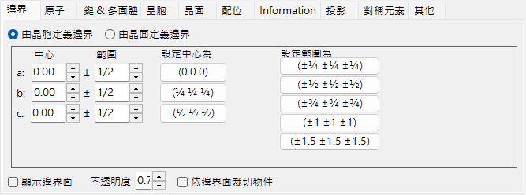

在此模式中，晶胞的 *a*、*b*、*c* 軸是繪製範圍的單位。

- **中心**：繪製範圍的中心相對於[投影中心](#投影中心)的偏移，以分數座標表示（正值朝 +*a*、+*b*、+*c* 移動）。繪製範圍為 (投影中心 + 中心) ± 範圍。 <!-- 261106Cl 作者の決定 H3/H18, C4 -->
- **範圍**：*a*、*b*、*c* 各軸的上限／下限。
- 右側的**預設按鈕**提供常用值（例如 1×1×1 晶胞、2×2×2 晶胞）。

### 由晶面定義的邊界

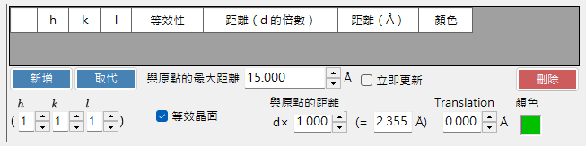

在此模式中，繪製區域由一組晶面所限定。若這些平面未定義出空間上封閉的區域，ReciPro 會加入一個半徑為 **最大距離 (投影中心)**（Å，自[投影中心](#投影中心)量起）的近球形多面體將其封閉。 <!-- 261106Cl 作者の決定 C4 -->

#### 邊界清單

為目前晶體所登錄的全部邊界平面。使用 **新增 / 取代 / 刪除** 操作此清單；最左側的核取方塊可暫時停用某個平面而不刪除它。

> 若要永久儲存變更，您還必須在**主視窗**中按 **Add** 或 **Replace**。否則，下次您在主晶體清單中變更選取時，變更將會遺失。

#### H k l 指數

以米勒指數設定邊界平面。核取方塊會納入由選取的 (*hkl*) 所產生的晶體學等效平面。

#### 與投影中心的距離

從[投影中心](#投影中心)（而非晶胞原點）到邊界平面的距離，可 <!-- 261106Cl 作者の決定 C4 --> 以所選 (*hkl*) 之 *d* 間距的倍數（**d×** 方塊）或以 Å（括號中的方塊）輸入。兩個方塊相互連動：變更其一會更新另一個。

各邊界面位於投影中心的 +**g** 一側（沿其 (*hkl*) 法線方向），繪製包含投影中心的一側。若只有一個平面，繪製區域即為該平面靠投影中心一側的半空間。 <!-- 261106Cl 作者の決定 D5 -->

- **平移量**（Å）：將由這些平面圍成的整個區域，沿所指定 (*hkl*) 的法線移動此量；正值朝 +**g** 移動，亦即朝 (*hkl*) 法線的方向。適用於任意數量的平面，包括未勾選 **等效晶面** 的單一平面。 <!-- 261106Cl 作者の決定 B11, C5 -->
- **最大距離 (投影中心)**（Å）：與投影中心的最大距離，亦即平面未圍出封閉區域時，用來封閉的多面體之半徑（見上文）。 <!-- 261106Cl 作者の決定 D3 -->
- **立即更新**：不必按 **取代** 即可套用所選平面的編輯。

#### 顯示邊界面 / 不透明度

顯示或隱藏邊界平面本身。顯示時，**不透明度** 設定透明度（0 = 透明，1 = 不透明）。

#### 依邊界面裁切物件

若勾選，則僅算繪由邊界定義的內部區域；與邊界相交的原子、鍵與多面體會被裁剪。

#### 隱藏原子

邊界索引標籤中沒有此用途的核取方塊。請改為關閉工具列的 **原子** 按鈕：如此便不會產生任何原子，因此鍵與多面體也會一併消失 — 當只需呈現晶胞或晶面時很有用。

### 原子

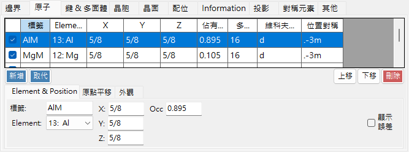

設定每個原子的種類、位置與佔有率，以及各原子的繪製方式（半徑、顏色、材質）。

#### 原子清單

晶體中的原子清單。使用 **Add / Replace / Delete** 操作此清單；最左側的核取方塊可暫時隱藏某個原子。

> 若要永久儲存變更，也請在**主視窗**中按一下 **Add** 或 **Replace**。

#### 元素與位置

- **標籤**：原子的自由文字標籤（用於圖例與工具提示）。
- **Element**：化學元素／離子化狀態。
- **X, Y, Z**：分數座標。0–1 之間的實數，或如 `1/2` 或 `2/3` 之類的分數。
- **Occ**：佔有率，0–1 之間的實數。

#### 原點平移

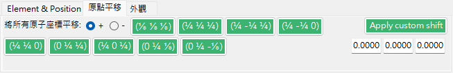

將每個原子平移相同的分數偏移量。按下一個預設按鈕（例如，為同一空間群在原點選擇 1 / 2 之間切換），或輸入自訂的 (Δx, Δy, Δz) 並按 **Apply custom shift**。

#### 外觀

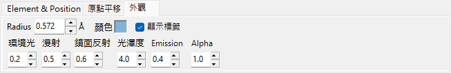

每個原子的半徑、顏色與材質。

- **Radius**：繪製的原子半徑。
- **顏色**：表面顏色。
- **Material**：OpenGL 著色器所使用的紋理／材質屬性。
- **套用至相同元素**：將目前的半徑與顏色套用至同一元素種類的每個原子。

### 鍵與多面體

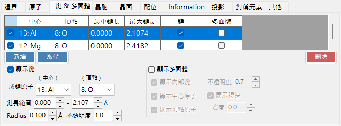

定義哪些原子對構成鍵（依原子種類與距離範圍），以及所產生的鍵與配位多面體的繪製方式。

#### 鍵清單

為晶體登錄的全部鍵／多面體規則。使用 **Add / Replace / Delete**；最左側的核取方塊可暫時停用某個項目。如同原子與邊界，需在**主視窗**中按 **Add** / **Replace** 才能使變更永久生效。

#### 鍵屬性

- **顯示鍵**：繪製此規則的鍵（鍵設定上方的核取方塊）。
- **成鍵原子** **（中心）** - **（頂點）**：用作鍵／多面體中心原子的元素種類，以及用作頂點（另一端）的元素種類。
- **鍵長範圍** … **-** …（Å）：下限與上限距離閾值。超出此範圍的原子對不會被繪製。
- **Radius**（Å）：繪製的鍵粗細（圓柱半徑）。
- **不透明度**：鍵的不透明度（0 = 透明，1 = 不透明）。

#### 多面體屬性

- **顯示多面體**：勾選時，繪製由目前的鍵所定義的多面體（僅在中心／頂點集合幾何上有效時）。
- **顯示內部鍵**：在 **顯示多面體** 開啟時，繪製從中心到各頂點的鍵（也需要 **顯示鍵**）。
- **顯示中心原子**：顯示／隱藏中心原子。
- **顯示頂點原子**：顯示／隱藏頂點原子。被隱藏的中心或頂點原子，若另一個顯示中的多面體會顯示它，或它是未定義多面體之鍵的端點，仍會被繪製。 <!-- 261105Cl 監査: 3 つのチェックが描画に効くようになった (7e198f9d) -->
- **不透明度**：面的不透明度（0 = 透明，1 = 不透明）。
- **顯示稜邊**：繪製連接頂點的邊。
- **寬度**：邊的線寬，以像素計（1–5）。舊版本儲存的小於 1 的值會以 1 px 繪製。 <!-- 261106Cl 作者の決定 H4 -->
- 此索引標籤中沒有顏色方塊：鍵採用其兩端原子的顏色，多面體採用其中心原子的顏色（原子顏色在[原子](#原子)索引標籤中設定）。 <!-- 261105Cl 監査: BondControl の colorControlPolyhedron/Bond/Edges は Visible=False。色は原子の材質から (FormStructureViewer.cs) -->

### 晶胞

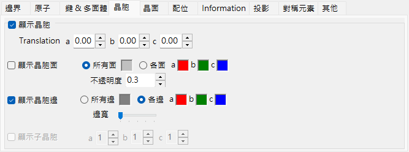

設定所繪晶胞的位置，以及是否顯示其面與邊。

#### 平移

每個空間群都有一個預設原點。若要將繪製的晶胞中心移離該原點，請沿 *a*、*b*、*c* 設定平移。

平移與[投影中心](#投影中心)連動：將投影中心設為 $(x, y, z)$ 時，平移會設為 $(x-0.5,\ y-0.5,\ z-0.5)$。正的平移會使繪製的晶胞朝 +*a*、+*b*、+*c* 移動。 <!-- 261106Cl 作者の決定 H3/H18 -->

#### 顯示晶胞平面

是否繪製界定晶胞的六個面。啟用時，您可以設定面的顏色與透明度。

#### 顯示邊

是否繪製晶胞的邊。邊的顏色可設定。

主核取方塊 **顯示晶胞**（= 工具列的 *晶胞* 按鈕）可切換整個晶胞的顯示。面與邊的顏色可一次為 **所有面** / **所有邊** 設定，或為 **各面** / **各邊**（*a*、*b*、*c* 分別）設定；**邊寬** 設定線寬，**不透明度** 設定面的透明度。

#### 顯示子晶胞

**顯示子晶胞** 會在晶胞的各面與內部繪製格線，將晶胞分割為 **a**、**b**、**c** 方塊所指定的份數（各為 1–10；只有勾選時方塊才可使用）。與晶胞邊重合的線不會繪出。這些線採用邊的顏色（**所有邊** / **各邊**）、邊寬的一半（至少 1 px）與不透明度 0.5，且與 **顯示晶胞邊** 無關地顯示。它們不包含在 3D 模型匯出中。 <!-- 261106Cl 作者の決定 H5 -->

### 晶面

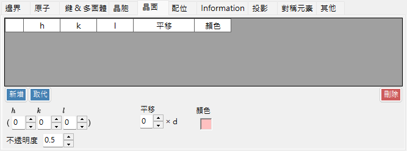

繪製以米勒指數指定的晶面，並可選擇一併繪出晶體學上等效的晶面。

#### H k l 指數

以米勒指數指定晶面。核取方塊可選擇性地納入由 (*hkl*) 所產生的晶體學等效平面。

#### 平移

將繪製的晶面沿其法線平移 *d* 間距的一個分數（**× d**，−0.5 至 0.5）；正值朝 +**g** 移動（晶面位於 **g**·**r** = (*m* + T)*d*）。因此，舊版本儲存在晶體清單中的值會畫在相反的一側（0 與 ±0.5 看起來相同）。 <!-- 261106Cl 作者の決定 C5 --> 該晶面族中與繪製範圍相交的每個晶面都會繪出，每個 *d* 一個。這些晶面固定於晶格：在 0 時通過格點，並在[投影中心](#投影中心)變更時隨結構一起移動。 <!-- 261105Cl 監査: LatticePlaneControl numericBoxDistance (−0.5〜0.5, × d)、FormStructureViewer.cs:SetLatticePlanes (4fd9e8c3)。「d の整数倍」は誤り -->

### 配位

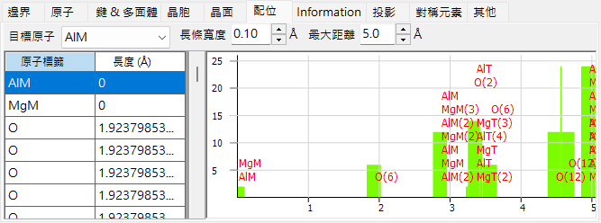

列出並繪製配位於所選目標原子周圍的原子。

#### 表（左側）

列出哪些原子環繞所選的目標原子，以及在何種距離。目標原子由表上方的下拉式選單選取。

#### 圖（右側）

鄰原子數對距離的長條圖，由與表相同的資料導出。調整 **半寬**（各長條的半寬 *w*，涵蓋 *d* ± *w*），直到長條清楚地分離出各配位殼層 <!-- 261106Cl 作者の決定 B18 --> — 這提供了配位數的視覺估計。

### 資訊

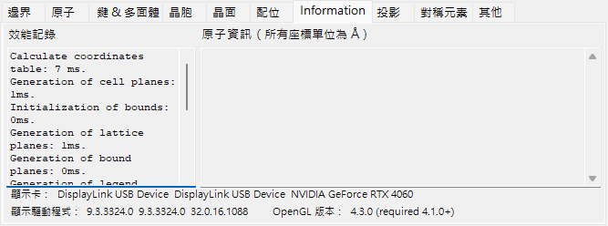

算繪記錄（影格時間、GPU 資訊）以及所選原子的基本資訊。建構中 — 欄位可能會隨時間增加。

### 投影

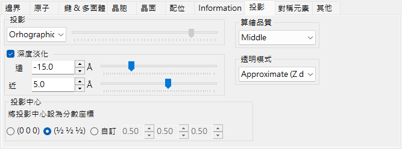

設定投影模式（正交 / 透視）、深度淡出、投影中心、算繪品質與透明度演算法。

#### 投影

- **Orthographic**：完美的平行投影（視點位於無限遠處）。
- **Perspective**：從滑桿所設定的視點距離進行透視投影。

#### 深度淡出

在深度方向淡出遠處的物件（**深度淡化**）。顏色會線性地朝**背景色**混合：比 **近** 更近的物件保持其本身的顏色，比 **遠** 更遠的物件呈現背景色，介於兩者之間的物件則內插。（不透明度本身不會改變。）**近** 與 **遠** 以 Å 指定。

#### 投影中心

將投影中心設定至指定的座標。開啟 **自訂** 以輸入任意座標。輸入的值（−1 至 1）會照原樣使用。**平移** 影片（參見[檔案選單](#檔案選單)）會自動驅動這些數值，並在移動時將每個座標折疊到 −0.5 到 +0.5 的範圍內（1 個晶格週期）。 <!-- 261105Cl 監査: 折り畳むのは SetProjectionCenter (動画の経路) だけ。マクロに投影中心の関数は無い -->

#### 算繪品質

繪製品質（網格細分、反鋸齒）。品質越高越慢 — 請選擇符合您 GPU 的設定。

#### 透明度模式

用於半透明原子與多面體的演算法。

- **Approximate (Z depth sorting, OpenGL 4.1+)**：快速，但當許多半透明物件重疊時可能不準確。
- **High quality (dual depth peeling, OpenGL 4.1+)**：以深度剝離 (depth peeling) 實現與順序無關的透明度。僅在 **工具 ▸ Enable DDP** 開啟時顯示（無法使用 PPLL 時預設為開啟）。剝離次數依[算繪品質](#算繪品質)設定而定。
- **High quality (per-pixel linked list, OpenGL 4.3+)**：精確的與順序無關的透明度；僅在 GPU 支援 OpenGL 4.3 時顯示。準確但慢，實際上需要獨立 GPU。

### 對稱元素

**對稱元素** 索引標籤將空間群的對稱運算子直接繪製到 3D 模型上（以工具列的 **對稱元素** 按鈕切換）。每一類元素可獨立顯示／隱藏：

- **對稱軸**：**旋轉**、**螺旋**、**旋轉反演**
- **面**：**鏡面**、**滑移面**
- **反演中心**

主開關為 **顯示對稱元素**。對每一組都可調整符號大小（%）與顏色，對軸與面還可調整線寬。

### 其他

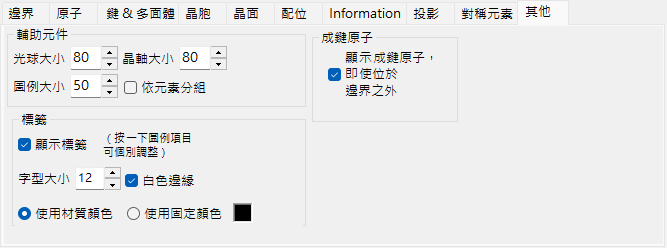

- **輔助元件**：設定顯示尺寸（光球、軸、圖例）。**依元素分組** 切換圖例顯示。
- **成鍵原子**：**顯示成鍵原子，即使位於邊界之外** 會持續繪製與繪製範圍內原子成鍵的原子，即使它們落在範圍之外。
- **標籤**：3D 檢視中原子標籤的設定（不是圖例）——**顯示標籤**、**字型大小**、**白色邊緣**，以及標籤顏色（**使用材質顏色** 或 **使用固定顏色**）。按一下原子圖例中的項目，可個別切換該原子（勾選 **依元素分組** 時則為該元素）的標籤。

---

## 工具列

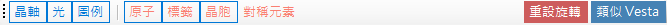

| 按鈕 | 說明 |
|--------|-------------|
| 晶軸 | 顯示軸方向（大小 = 晶格常數） |
| 光 | 設定光源方向 |
| 圖例 | 原子圖例 |
| 原子 | 顯示／隱藏原子；鍵、多面體與標籤都建立在原子之上，因此也會一併隱藏 <!-- 261105Cl 監査: toolStripButtonAtomObjects.ToolTipText (2028c4a1) --> |
| 標籤 | 切換原子標籤 |
| 晶胞 | 切換晶胞邊 |
| 對稱元素 | 切換對稱元素疊加（見上文） |
| 重設旋轉 | 回到初始方位 |
| 類似 Vesta | 切換為 VESTA 風格的外觀：原子顏色與半徑會被重設，且鍵清單會被**取代**為預設的鍵 |

---

## 另請參閱

- [主視窗](0-main-window.md)
- [晶體資料庫](1-crystal-database.md)
- [對稱性資訊](2-symmetry-information.md)
- [繞射模擬器](7-diffraction-simulator/index.md)
- [鍵盤與滑鼠快速鍵](21-shortcuts.md)
