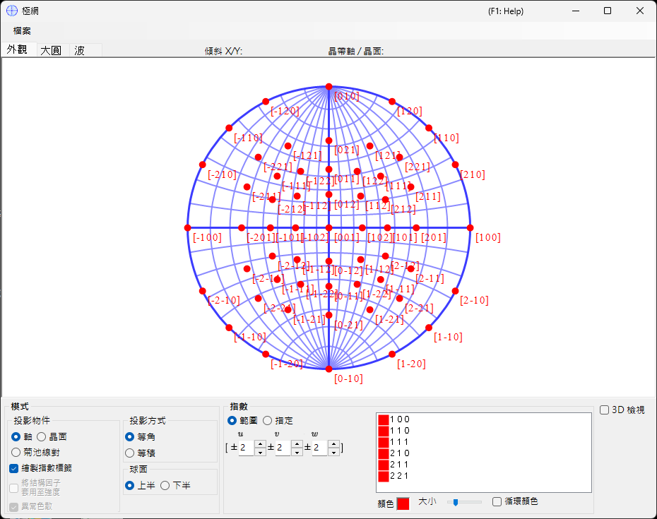
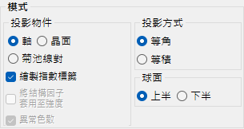
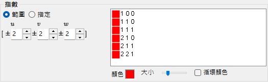
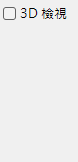
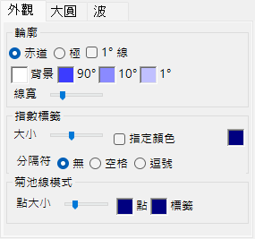
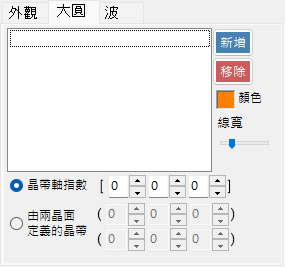
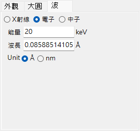

# 極網

**極網**使用立體投影顯示晶面與軸方向。

---

## 鍵盤與滑鼠快捷鍵

極網本身是 2-D 投影；可透過 **3D 檢視** 顯示選用的 3-D 球面。

| 快捷鍵 | 動作 |
|----------|--------|
| <kbd>F1</kbd> | 開啟線上手冊的本頁 |
| 在中心附近左鍵拖曳 | 傾斜晶體 |
| 在外圍區域左鍵拖曳 | 使晶體繞視軸自旋 |
| 左鍵雙擊 | 在 **晶面** 與 **軸** 投影之間切換 |
| 右鍵點按 | 縮小 |
| 右鍵拖曳框選 | 放大至選取的區域 |
| 中鍵拖曳 | 平移 |
| 移動滑鼠（不按任何鍵） | 讀取游標下的 (hkl)/[uvw] — 對量測斑點的指標化很有用（下半球中亦可） <!-- 261105Cl 監査: 下半球の読み取り (268779a1) --> |

在網上拖曳會旋轉**晶體**；旋轉狀態會在所有視窗間共用。

3-D 算繪使用 ReciPro 的標準 [OpenGL 視圖導覽](21-shortcuts.md)（左鍵拖曳旋轉、右鍵拖曳／滾輪縮放、<kbd>CTRL</kbd> + 右鍵雙擊切換投影），且僅旋轉 3-D 視圖，而非晶體本身。

當此視窗取得焦點時，來自[主視窗](0-main-window.md#keyboard-mouse-shortcuts)的應用程式全域 <kbd>CTRL</kbd>+<kbd>SHIFT</kbd> 快捷鍵也可使用。

→ 請參閱 **[21. 鍵盤與滑鼠快捷鍵](21-shortcuts.md)**，一覽每個視窗。

---

## 主區域

此處顯示所選晶體的晶面、方向指數與菊池線的極網投影。

---

## 檔案選單

可以點陣影像 (PNG) 或向量中繼檔 (EMF) 儲存或複製。貼上的中繼檔可在 PowerPoint 或其他向量編輯器中編輯字型與線寬。

| 選單項目 | 說明 |
|-----------|-------------|
| 儲存影像 ▸ 另存為影像 (PNG 格式) / 中繼檔 (EMF) | 將極網儲存為 PNG 檔或向量 EMF 檔 <!-- 261105Cl 監査: as Metafile (EMF) の保存を配線 (FormStereonet.cs, 268779a1) --> |
| 複製到剪貼簿 ▸ 影像 / 中繼檔 (EMF) | 複製極網 |
| 儲存影片 ▸ 極網 / 3D | 儲存極網或 3-D 檢視的旋轉影片 (MP4)，使用與[結構檢視器](5-structure-viewer.md#檔案選單)相同的影片設定對話框（僅旋轉） |
| 版面設定 / 預覽列印 / 列印 | 列印極網 |

---

## 模式

### 投影目標

選擇要投影到網上的內容。

- **軸** — 投影方向指數 \([uvw]\)。
- **晶面** — 投影晶面法線 \((hkl)\)。
- **菊池線對** — 投影菊池線對。

### 投影方法

| 方法 | 說明 |
|--------|-------------|
| **等角**（Wulff／立體投影） | 保留投影特徵之間的角度關係，但不保留立體角。古典結晶學家在讀取軸間或面間角度時使用。 |
| **等積**（Schmidt／等積／蘭伯特） | 保留各區域的立體角（面積），但會扭曲角度。在相對密度具有意義的統計極圖中較受偏好。 |

### 半球

選擇 **上半** 或 **下半** 半球作為投影來源 — 切換球面可見的一面是最靠近觀察者或離觀察者最遠的那一面。
上半 = $+Z$ 側（朝向觀察者，參見[附錄 A1.1](appendix/a1-coordinate-system/1-orientation.md)）；選擇 **下半** 時，每個方向的 $Z$ 分量在投影前會反轉，且各點以**空心圓**而非實心圓繪製。

### 顯示選項

- **繪製指數標籤**：顯示指數標籤。
- **將結構因子套用至強度**：當選取 **晶面** 或 **菊池線對** 時，依各項目的結構因子加權（在[波索引標籤](#wave)中設定波源與波長）。權重為所顯示集合中的 $I_{\mathrm{rel}} = |F_{hkl}|^2 / \max|F|^2$：在 **晶面** 模式下，點的半徑乘以 $\sqrt{I_{\mathrm{rel}}}$（即 $\propto |F_{hkl}|$）；在 **菊池線對** 模式下，線的不透明度為 $I_{\mathrm{rel}}$。
- **異常色散**：在結構因子中納入 X 光異常色散項 $f'$、$f''$。僅在 X 光且為 **晶面** / **菊池線對** 模式時可用。

> 對於三方／六方晶體，可在主視窗中透過 **選項 ▸ 使用米勒-布拉維 (hkil) 指數** 啟用米勒-布拉維（4 指數）標記法。

---

## 指數

設定要繪製哪些晶面／軸。

### 範圍模式

指定 \([uvw]\) 或 \((hkl)\) 指數的範圍。ReciPro 會列舉限制範圍內的每一個指數並逐一投影。

在範圍模式中，限制為所輸入值的 $\pm$；只取既約指數，並依結晶學上等價的指數分組（每組一種顏色）。

### 結構因子模式

僅適用於 **晶面** 與 **菊池線對**。投影目前波源下 $|F_{hkl}|^2$ 最大的晶面。**上限** 設定要繪製的晶面數（等價晶面分別計數；在 **晶面** 模式下，與較強反射平行者——即其高階或低階反射，例如 111 較強時的 222——會被略過）。

### 指定模式

逐一指定特定的軸或面。輸入一個指數，按 **新增** 將其登錄，或按 **移除** 將其刪除。當勾選 **包含等效指數** 時，所有結晶學上等價的指數也會被繪製。

### Colour / Size

設定所繪點的 **顏色** 與 **大小**。勾選 **循環顏色**，可為每一組等價軸／面以不同顏色編碼 — 對於在多指數圖上區分各族系很有用。

---

## 3D Options

勾選 **3D 檢視** 時顯示；3-D 球面會出現在網右側的窗格中。

- **重設視角**：將 3-D 檢視恢復為預設的方向與縮放。
- **標籤**：在 3-D 中繪製指數標籤。方向以 [uvw] 標示；四指數形式（開啟 **使用米勒-布拉維 (hkil) 指數** 時）僅用於晶面與菊池線。 <!-- 261105Cl 監査: 3D のラベル (FormStereonet.cs, 268779a1) -->
- **半球**：僅繪製上半球（$Z>0$）上的極點。
- **極網**：在 3-D 中繪製投影平面（網），以及上半球極點的投影點。
- **球面輪廓**：繪製球面的經緯網格。
- **投影線**（**極網** 開啟時）：繪製各上半球極點的輔助投影線——Wulff 為由南極 $(0,0,-1)$ 至該極點的直線，Schmidt 為圓弧。
- **深度淡化**：3-D 檢視的深度淡化強度。

---

## 索引標籤選單

### 外觀

#### 輪廓

極網外框的繪製方式 — 邊界圓以及選用的大圓緯度／經度格線。選擇 **赤道** 或 **極**，切換 **1° 線** 與 **背景** 填色，設定 **90° / 10° / 1°** 格線顏色，並以軌道列調整 **線寬**。

#### 指數標籤

- **大小** — 指數標籤的大小。
- **指定顏色** — 為所有指數標籤使用單一固定顏色，取代各斑點各自的顏色；當各點已以顏色編碼，但您希望所有標籤採用同一種顏色以利閱讀時很有用。
- **分隔符** — 置於各標籤指數之間的字元：**無**（例如 100）、**空格**（1 0 0）或 **逗號**（1,0,0）。

#### 菊池線模式

- **點大小** — 所繪點的大小。
- **點** / **標籤** — 點與其標籤的顏色。

### 大圓

繪製大圓（不支援小圓）。可透過 **晶帶軸指數** \([uvw]\)（由該軸的晶帶所形成的大圓）指定，或透過 **由兩晶面定義的晶帶**（晶帶軸為兩者的外積）指定。使用 **新增** / **移除** 編輯清單；取消勾選某個項目即可隱藏該圓。圓的顏色與線寬同樣可設定。這些圓依循[模式](#模式)中所選的投影方法與半球（Wulff 或 Schmidt，上半或下半）。 <!-- 261105Cl 監査: Schmidt・下半球の大円 (268779a1) -->

### 波 {#wave}

僅在選取 **晶面** 或 **菊池線對** 作為投影目標時使用（在 **菊池線對** 模式下，波長也決定布拉格角，亦即各線對的間隔）。設定波源（X射線 / 電子 / 中子）以及計算晶體結構因子所需的波長或能量，這些結構因子用於[模式](#模式)中的 **將結構因子套用至強度**。

---

## 另請參閱

- [主視窗](0-main-window.md)
- [旋轉幾何](4-rotation-geometry.md)
- [結構檢視器](5-structure-viewer.md)
- [繞射模擬器](7-diffraction-simulator/index.md)
- [基本座標系與晶體取向](appendix/a1-coordinate-system/1-orientation.md)
