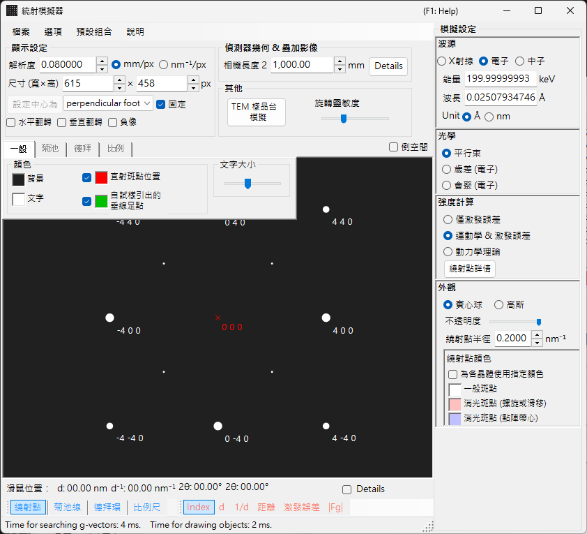
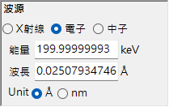
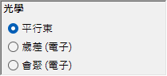
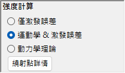
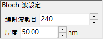
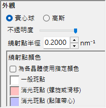

# SAED（選區電子繞射）模擬

**SAED（選區電子繞射）** 模擬計算由平行電子束所產生的單晶電子繞射圖樣。這是 [繞射模擬器](index.md) 的預設模式。

> 本頁列出當您選擇 **波源** = **電子** 與 **光學** = **平行束** 時，於右側 **模擬設定** 面板中出現的每一項設定。關於繪圖、儲存等視窗層級的操作，請參閱 [概覽頁](index.md)。

GUI 條件：波源 = 電子、光學 = 平行束、強度計算 = 僅激發誤差 / 運動學 & 激發誤差 / 動力學理論。

---

## 概覽

模擬平行電子束通過薄試樣時所產生的繞射圖樣。光點位置由厄瓦爾德球與倒易點陣點之間的幾何關係所固定，而每個光點的亮度則依所選的強度計算模式計算。

---

## 波源 {#wave-length}

將輻射源設為 **電子**。輸入能量（keV）或波長（Å 或 nm，可切換；預設 Å），即可計算經相對論修正後的波長。初始值為 200 keV；**預設組合** 選單可一鍵設定 300 / 200 / 120 kV。關於 X 光與中子源，請參閱 [X 光繞射模擬](5-x-ray-neutron-diffraction.md)。

---

## 光學 {#incident-beam-mode}

將 **光學**（入射束幾何）設為 **平行束**。這是 SAED 與 X 光繞射所使用的標準平面波幾何。

> **Note**：對於電子，您可以選擇 **平行束** / **進動 (電子)** / **會聚 (電子)**。選擇 **進動 (電子)** 會得到 [PED 模擬](2-ped-simulation.md)，選擇 **會聚 (電子)** 會得到 [CBED 模擬](3-cbed-simulation.md)；在這兩種情形下，強度計算都會自動切換為 **動力學理論**。

---

## 強度計算

選擇光點強度的計算方式。

### 僅激發誤差

強度僅由厄瓦爾德球與倒易點陣點之間的幾何距離（即偏離向量 $S_g$）決定。$S_g = 0$（即恰好位於球面上）時強度最大，並隨 $\lvert S_g\rvert$ 增大而減小，當 $\lvert S_g\rvert$ 超過為倒易點陣點所設定的 **繞射點半徑** 時則降為零。由於忽略了晶體結構因子，這是最快的模式，適合用於檢查繞射光點位置。

只有在此模式下，才會出現下列選項：

| 選項 | 說明 |
|--------|-------------|
| **排除所有禁制繞射** | 隱藏空間群所禁制的所有反射（晶格心化、螺旋軸與滑移面）。勾選此項也會勾選並鎖定下一個選項。 |
| **排除因晶格置心而禁制的繞射** | 僅隱藏因晶格心化而禁制的反射（預設開啟）。 |
| **以相同半徑繪製所有繞射點** | 不論 $S_g$ 為何，所有被激發的光點都以完整半徑 *R* 繪製。 |

仍然顯示的禁制反射會以 **消光斑點** 的顏色繪製（見[外觀](#外觀)）。

### 運動學

除了偏離向量之外，還將運動學結構因子 $\lvert F_{hkl} \rvert^2$ 納入強度。消光規則能被正確反映，使此模式適合用於薄試樣或弱繞射。

### 動力學（布洛赫波法，僅限電子）

以布洛赫波法（Bethe 法）進行嚴謹的動力學計算。它能重現多重散射以及強度隨厚度的變化，對於厚試樣或強繞射為必要。僅在選擇 **電子** 時可用。關於理論，請參閱 [附錄 A3. 布洛赫波法](../appendix/a3-bloch-wave/calculation.md)。

> **Note**：當選擇 **動力學理論** 時，下方會出現 **布洛赫波設定** 面板。

---

## 布洛赫波設定（動力學理論）

僅在 **強度計算** = **動力學理論** 時作用。

| 參數 | 說明 |
|-----------|-------------|
| **繞射波數目** | 本徵值問題中所納入的布洛赫波數目（8–1000，預設 240）。值越大，強度越精確，但計算時間以 $O(N^3)$ 增加 |
| **厚度** | 動力學計算中所使用的試樣厚度（nm；0.01–10000 nm，預設 50 nm） |

---

## 外觀

控制每個繞射光點的繪製方式。

- **實心球 / 高斯**：倒易點陣點的幾何模型（預設 **實心球**）。**實心球** 繪製球與厄瓦爾德球之間的截面（一個圓）：在 **運動學 & 激發誤差** 下球半徑為 $R\,I^{1/3}$（球體積 ∝ 強度），在 **僅激發誤差** 下為 $R$；在 **動力學理論** 下則不經厄瓦爾德球截切，直接繪製半徑 $R\,I_\text{dyn}^{1/2}$ 的圓盤（面積 ∝ 強度）。**高斯** 繪製 $\sigma = R$ 的 3 維高斯函數的截面（一個 2 維高斯函數），其積分對應於繞射強度。
- **不透明度**：光點的透明度（0 = 透明，1 = 不透明）。
- **繞射點半徑 (R)**：倒易點陣點的虛擬半徑（nm⁻¹；0.01–1，預設 0.2）。光點大小由 **外觀** 模式與 **強度計算** 的組合所固定（見上文）。
- **亮度**、**色階**、**對數刻度**：僅在 **高斯** 模式中顯示。**亮度** 縮放所繪高斯函數的積分強度；**色階** 可選 **Gray**（光點使用下方的繞射點顏色）、**Cold-warm**、**Spectrum** 或 **Fire**；**對數刻度** 以對數刻度顯示強度（對於強度對比很大的圖樣很有用）。
- **繞射點顏色**：在 **色階** 為 **Gray**（初始設定）時顯示。**一般斑點**、**消光斑點 (螺旋或滑移)** 與 **消光斑點 (晶格心化)** 分別設定容許反射與禁制反射的顏色。
- **按晶體指定顏色**：勾選時，光點以指派給各晶體的色彩繪製（只有一個晶體時亦然）。

---

## 繞射點標籤

疊加在光點上的標籤可從 [工具列](index.md#toolbar) 中選擇。

| 標籤 | 內容 |
|-------|---------|
| **Index** | 米勒指數 $(hkl)$；主視窗的 **選項 ▸ 使用米勒-布拉維 (hkil) 指數** 開啟且晶體使用六方軸時為四指數 $(hkil)$（菊池線、德拜環與 3-D 的標籤也依循同一設定） <!-- 261105Cl 監査: C23 --> |
| **d** | 晶面間距 $d$，依主視窗的長度單位以 Å 或 nm 顯示 <!-- 261106Cl 作者の決定 C20 --> |
| **1/d** | 晶面間距的倒數 $1/d$，依主視窗的長度單位以 nm⁻¹ 或 Å⁻¹ 顯示 <!-- 261106Cl 作者の決定 C2 --> |
| **距離** | 偵測器上光點到穿透（直射）斑點的距離（mm），以繪製位置之間量測，因此對傾斜的偵測器、X 光進動相機與背反射勞厄（自光束孔量起）也成立；穿透束未落在偵測器上時不顯示 <!-- 261105Cl 監査: DrawDiffractionSpotsLabel (C15)。L2 tan2θ は傾けない平板の検出器だけ --> |
| **2θ** | 散射角 $2\theta$ (與 2θ 刻度的同心圓定義相同) |
| **χ** | 方位角 $\chi$，以畫面正上方 (12 點鐘方向) 為 0°，順時針為正 (與方位角刻度的放射線定義相同) |
| **激發誤差** | 偏離向量 $S_g$，依主視窗的長度單位以 nm⁻¹ 或 Å⁻¹ 顯示 |
| **強度** | 在 **運動學 & 激發誤差** 模式下為相對強度（%）；在 **動力學理論** 模式下為相對強度（最強繞射束的 %，不含 000）與出射面的複數振幅。**僅激發誤差** 模式下不顯示任何內容 |

---

## 共通操作

偵測器資訊、翻轉、倒易空間顯示、菊池線、德拜環、刻度線、色彩設定、儲存等等，為所有模式所共通。請參閱 [概覽頁](index.md)。從動力學計算所得到的每個反射的詳細資料，可在 [繞射光點資訊](index.md#diffraction-spot-information) 中瀏覽。

---

## 另請參閱

- [繞射模擬器（概覽）](index.md)
- [平行束 SAED 計算](../appendix/a3-bloch-wave/calculation.md#parallel-beam-saed)
- [X 光繞射模擬](5-x-ray-neutron-diffraction.md)
- [進動電子繞射（PED）模擬](2-ped-simulation.md)
- [座標系的定義](../appendix/a1-coordinate-system/1-orientation.md)
