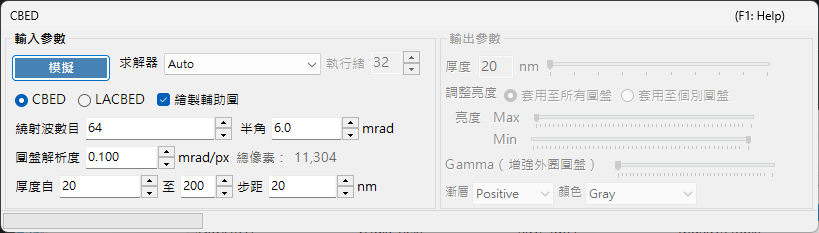
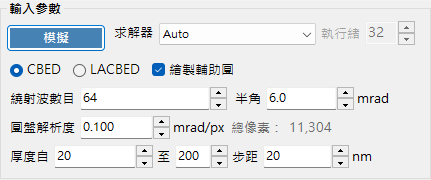
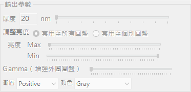

# CBED 模擬

**CBED（會聚束電子繞射，Convergent-Beam Electron Diffraction）模擬** 使用布洛赫波法（Bethe）計算並顯示會聚束繞射圖樣。CBED 圖樣顯示的是繞射盤而非繞射斑點，並含有關於晶體對稱性、厚度與結構的豐富資訊。

> 本頁列出在 [繞射模擬器](index.md) 中選擇 **波源** = **電子** 與 **光學** = **會聚 (電子)** 時所開啟之專用視窗的所有設定。選擇 **會聚 (電子)** 時，**強度計算** 會自動設為 **動力學理論**，並開啟此 CBED 設定視窗。以 × 按鈕關閉此視窗時，**光學** 會切回 **平行束**。 <!-- 261105Cl 監査: FormDiffractionSimulatorMultislice_FormClosing (UserClosing) --> 計算出的圓盤可從主視窗的 **檔案 > 儲存 CBED 圓盤** / **複製 CBED 圓盤** 儲存。關於繞射圖樣的繪製與儲存，以及繞射模擬器共通的其他操作，請參閱 [總覽頁面](index.md)。

GUI 條件：波源 = 電子 · 光學 = 會聚 (電子) · 強度計算 = 動力學理論（自動）

---

## 輸入參數

此視窗開啟期間，主視窗的 **布洛赫波設定** 與 **外觀** 面板會停用；波數與厚度改由此處取得。

| 參數 | 說明 | 預設 / 典型值 |
|-----------|-------------|-------------------|
| **CBED** / **LACBED** | **CBED**：標準的會聚束圖樣，每個盤對應一個反射，透射盤（000）位於中央。**LACBED**（Large-Angle CBED）：只計算並繪製透射（000）盤，不疊加相互重疊的鄰近盤，因此可使用大於布拉格角的半角（明場 LACBED；此模式本身不會擴大半角）。 <!-- 261105Cl 監査: BetheMethod.cs cbed_DoWork (LACBED は 000 だけ)、radioButtonLACBED.ToolTip。「ディスクが重なる」は誤り --> 適合用於觀察高階勞厄區（HOLZ）線與對稱性 | CBED |
| **半角 (mrad)** | 會聚束圓錐的半角 α（0–2000 mrad）。決定每個繞射盤的大小（盤在倒易空間中的直徑對應於 $2\alpha$） | 預設 6 mrad；典型值 5–30 mrad |
| **圓盤解析度 (mrad/px)** | 每個盤內的角度解析度。盤以 $N\times N$ 格點取樣，$N = \lceil 2\alpha / \text{resolution} \rceil$，只計算圓內的點。數值越小解析度越高，但束方向數會以平方成長，因此計算時間也以平方增加。最終得到的數目——每個盤內的像素數，即會聚圓內的入射束方向數，每個方向都需要一次布洛赫波計算——顯示為 **總像素** <!-- 261105Cl 監査: label2/labelDivisionNumber.ToolTip --> | 預設 0.1 mrad/px |
| **繞射波數目** | 在每個入射束方向下，納入布洛赫波計算的最大束數（1–2048）。束數越多精度越高，但本徵值問題的成本以 $O(N^3)$ 成長 | 預設 64；典型值 100–500 |
| **厚度自 / 至 / 步距** | 試樣厚度（nm，各為 1–1000）的起始值、結束值與步進值。會一併計算多個厚度，並以輸出側的厚度滑桿切換 | 預設 20 至 200 nm，步距 20 nm |
| **求解器** | 計算引擎。**Auto**；**Eigenproblem with Eigen lib.** / **Eigenproblem with MKL lib.**（對角化）；**Matrix exp. with Eigen lib.** / **Matrix exp. with MKL lib.**（矩陣指數法，v4.794）。**Auto** 在可使用 Eigen 時，以 Eigen 與所有邏輯處理器執行矩陣指數法，否則使用 MKL 的本徵值問題。矩陣指數法需要等間距的厚度，否則會退回本徵值問題。ARM64 上不提供 MKL 項目，原生 Eigen 函式庫無法使用時則會隱藏 Eigen 項目 | Auto |
| **執行緒** | 並行執行緒數（1–128）。選擇 **Auto** 時停用；選擇某個求解器時，會設為邏輯處理器數（MKL 時為其 ¼） | — |
| **繪製輔助圓** | 勾選時，會在主圖樣上以黃色圓標示每個繞射盤的邊界（LACBED 時，000 為圓，其他反射為十字） | 開啟 |

---

## 執行 / 停止

- **模擬**：以目前的輸入參數開始 CBED 模擬。
- **停止**：取消執行中的計算。最後一次完成之計算的結果會保持顯示（計算失敗時亦同）。 <!-- 261105Cl 監査: Bethe_CbedCompleted (completedDisks ほか) -->

---

## 輸出參數

計算完成後，輸出參數即可使用。所有這些參數都只改變顯示，而不會重新計算。

| 參數 | 說明 |
|-----------|-------------|
| **厚度** | 以滑桿在最後一次完成之計算的厚度中，選擇要顯示的試樣厚度（之後變更輸入的厚度方塊不會改變它）（[繞射斑點資訊](index.md#diffraction-spot-information)表格會隨之變更） <!-- 261105Cl 監査: CompletedThicknesses (最後に完了した計算の厚み) --> |
| **調整亮度** | **套用至所有圓盤**：使用單一亮度尺度，以所有盤中的最大值正規化。**套用至個別圓盤**：每個盤各以其自身的最大值正規化（γ 會重設為 0 並停用） |
| **亮度 (Max / Min)** | 所顯示強度的上限與下限，以最大值的比例表示（滑桿位置以 4 次方套用）。當您想強調微弱特徵時可加以調整 |
| **Gamma（增強外圈圓盤）** | 將每個像素乘上 $\exp(\gamma\,r)$（$r$ 為其與圖樣中心的距離），使大角度的暗外側盤相對於中央透射盤更易觀察。僅在 **套用至所有圓盤** 時有效 |
| **漸層** | 從 **Positive** / **Negative**（黑白反轉）中選擇強度漸層 |
| **顏色** | 顯示所用的色彩對映：**Gray**、**Cold-warm**、**Spectrum** 或 **Fire** |

---

## 物理背景

在 CBED 中，入射束被視為由不同方向的平面波所構成的圓錐。對每個方向（會聚光闌內的每一點 = 一個部分入射平面波），布洛赫波法在晶體內部求解電子薛丁格方程式，並將結果重新排列為繞射盤。HOLZ（高階勞厄區）線在盤內呈現為細緻的暗/亮線，源自高階勞厄區中的反射。它們對沿 $c$ 軸的點陣參數十分敏感，可用於三維結構分析。

關於理論細節，請參閱 [CBED 計算](../appendix/a3-bloch-wave/cbed.md)。

---

## 另請參閱

- [繞射模擬器（總覽）](index.md)
- [SAED 模擬](1-saed-simulation.md)
- [PED 模擬](2-ped-simulation.md)
- [CBED 計算](../appendix/a3-bloch-wave/cbed.md)
