# Crystal Diffraction (繞射模擬器)

**Crystal Diffraction (繞射模擬器)** 可模擬單晶 X 光、中子與電子繞射圖樣。

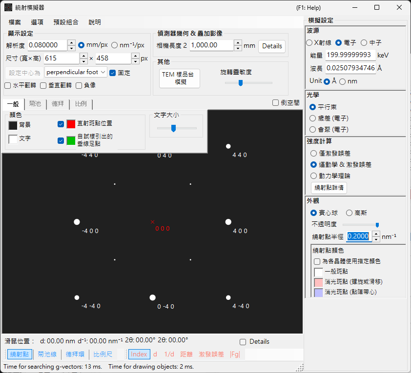

此視窗**左側**為繞射圖樣的繪圖區，**右側**為各反射性質的設定面板（波長、入射束、強度計算、外觀等）。波長與入射束的組合決定擷取模式（X 光繞射、SAED、PED、CBED），而右側面板會隨之重新配置。

---

## 本頁與各模式頁面如何分工

- **本頁（樞紐頁）**：彙整每個模式共通的操作（快速鍵、選單、工具列、螢幕/偵測器資訊、疊加層索引標籤、反射資訊、偵測器幾何、動態壓縮）。
- **各模式頁面**：涵蓋選取該模式時**右側出現的所有設定**（波長、入射束、強度計算、外觀、布洛赫波設定、進動設定等），因此每一頁皆能獨立閱讀（模式之間有部分重疊）。

| 模式 | 內容 | 頁面 |
|------|----------|------|
| **X 光（與中子）繞射** | 單晶 X 光 / 中子繞射圖樣（平行、進動 X 光、背反射勞厄） | [X 光繞射模擬](5-x-ray-neutron-diffraction.md) |
| **SAED** | 平行束電子繞射（選區電子繞射） | [SAED 模擬](1-saed-simulation.md) |
| **PED** | 進動電子繞射 | [PED 模擬](2-ped-simulation.md) |
| **CBED** | 會聚束電子繞射 | [CBED 模擬](3-cbed-simulation.md) |

> **ALCHEMI 不是一種模式。** 與由波長與入射束組合決定的 X 光 / SAED / PED / CBED 不同，ALCHEMI 模擬器是從 **選項** 功能表開啟的**子視窗**，故在此單獨列出。

| 子視窗 | 內容 | 頁面 |
|------|------|------|
| **ALCHEMI 模擬器** | 依位點分解的游離搖擺曲線（通道增強微分析） | [ALCHEMI 模擬](4-alchemi-simulation.md) |

---

## 模式快速對照

依**波長（射源）**與**入射束**的組合，查找您所需的頁面。

| 波長 | 入射束 | 模式 | 頁面 |
|------------|--------------------|------|------|
| 電子 | 平行 | SAED | [SAED 模擬](1-saed-simulation.md) |
| 電子 | 進動（電子 = PED） | PED | [PED 模擬](2-ped-simulation.md) |
| 電子 | 會聚（CBED） | CBED | [CBED 模擬](3-cbed-simulation.md) |
| X 光 | 平行 | X 光繞射 | [X 光繞射模擬](5-x-ray-neutron-diffraction.md) |
| X 光 | 進動（X 光） | 進動 X 光（進動相機） | [X 光繞射模擬](5-x-ray-neutron-diffraction.md) |
| X 光 | 背反射勞厄（X 光） | 背反射勞厄 | [X 光繞射模擬](5-x-ray-neutron-diffraction.md) |
| 中子 | 平行 | 中子繞射 | [X 光繞射模擬的中子章節](5-x-ray-neutron-diffraction.md) |

> **Note**：入射束（**光學**）的選項會隨波長而變。電子：**平行束、進動 (電子)、會聚 (電子)**；X 光：**平行束、進動 (X射線, ZOLZ)、背反射勞厄 (X射線)**；中子：僅**平行束**。變更波源時，光學一律重設為**平行束**。選取**進動 (電子)**或**會聚 (電子)**時，強度計算會自動切換為**動力學理論**；**動力學理論**僅適用於電子（選取 X 光或中子時會退回**運動學 & 激發誤差**）。背反射勞厄使用白色（多色）光束。

---

## 鍵盤與滑鼠快速鍵

下列適用於 X 光、SAED 與 PED 模擬共用的繞射圖樣視窗。在圖樣上拖曳會旋轉**晶體**。可使用滑鼠滾輪，或以右鍵點按 / 右鍵拖曳進行縮放。

| 快速鍵 | 動作 |
|----------|--------|
| <kbd>F1</kbd> | 開啟線上手冊的本頁 |
| 在中心附近左鍵拖曳 | 傾斜晶體 |
| 在外圍區域左鍵拖曳 | 繞束軸旋轉晶體 |
| 左鍵雙擊某一反射 | 顯示反射詳細資訊（指數、*d*、結構因子、偏離向量） |
| 中鍵拖曳 | 平移圖樣 |
| <kbd>CTRL</kbd> + 中鍵拖曳 | 移動偵測器中心（顯示偵測器區域時） |
| 滑鼠滾輪 | 每一格放大 / 縮小 ×2；游標下的點會移到檢視中心（勾選 **固定** 時則保持所固定的中心） |
| 右鍵點按 | 縮小（×1/1.2） |
| 右鍵拖曳出方框 | 放大至所選區域 |
| 右鍵雙擊狀態列 | 複製目前設定的文字摘要 |
| 右鍵雙擊已點亮的圖層按鈕（繞射點 / 菊池線 / 德拜環 / 比例尺） | 使該圖層閃爍開關 |

從此處開啟的輔助視窗另外增加了幾項：

| 快速鍵 | 動作 |
|----------|--------|
| 左鍵雙擊極網 — **TEM holder** | 將試樣台傾斜設為該點 |
| 方向鍵 — **TEM holder** | 逐步調整試樣台傾斜（先勾選 **啟用方向鍵**；無論 ReciPro 的哪個視窗在前景均有效） |
| 拖放 `.prm` 檔或影像 — **Detector geometry** | 載入偵測器幾何 / 疊加影像 |
| 拖放 `.txt` 曲線 — **Dynamic compression** | 載入位置/時間/壓力曲線（以 **時間** 滑桿選擇時間；拖曳圖中的垂直線設定 前面/背面） |

主視窗的應用程式層級 <kbd>CTRL</kbd>+<kbd>SHIFT</kbd> 快速鍵在此視窗取得焦點時也同樣有效（見[主視窗](../0-main-window.md)）。

→ 各視窗一覽請見 **[21. 鍵盤與滑鼠快速鍵](../21-shortcuts.md)**。

---

## 依目標的快速路徑

| 目標 | 從何處開始 | 參考 |
|------|------------|-----------|
| 產生平行束電子繞射（SAED） | 將 **光學** 設為 **平行束**，**Wavelength** 設為電子 | [SAED 模擬](1-saed-simulation.md)、[平行束 SAED 計算](../appendix/a3-bloch-wave/calculation.md) |
| 產生單晶 X 光繞射 | 將 **Wavelength** 切換為 X 光 / 同步輻射 | [X 光繞射模擬](5-x-ray-neutron-diffraction.md) |
| 產生進動電子繞射（PED） | 將 **光學** 設為 **進動 (電子)**，再設定半角與步階 | [PED 模擬](2-ped-simulation.md) |
| 產生會聚束電子繞射（CBED） | 將 **光學** 設為 **會聚 (電子)**，並在 CBED 視窗中設定條件 | [CBED 模擬](3-cbed-simulation.md)、[CBED 計算](../appendix/a3-bloch-wave/cbed.md) |
| 檢視動力學計算所得的反射清單 | 選取 **動力學理論** 並按 **繞射點詳情** | [動力學計算（共用核心）](../appendix/a3-bloch-wave/calculation.md) |
| 將偵測器幾何與實驗影像比對 | 從 **偵測器幾何 & 疊加影像** 中的 **Details** 開啟偵測器幾何設定，並使用疊加影像 | [偵測器座標系](../appendix/a1-coordinate-system/2-diffraction.md) |

---

## 主區域

繞射圖樣於畫面中央進行模擬。

### 滑鼠操作

見本頁開頭的「鍵盤與滑鼠快速鍵」。

### 滑鼠位置

圖樣上方的 **滑鼠位置：** 一行會顯示游標位置的 *d*（nm）、*d*⁻¹（nm⁻¹）與 2θ（以度及 rad 表示；低於 0.1 rad 時為 mrad）。勾選 **Details** 會再加入三組座標讀數：偵測器座標（mm，原點 = 自試樣引出的垂線足點）、實空間座標（mm，原點 = 晶體）與倒空間座標（nm⁻¹）。在背反射勞厄模式下，*d* 與倒空間的數值會顯示為「-」。

---

## 檔案選單

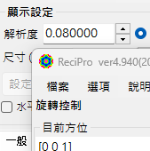

| 選單項目 | 說明 |
|-----------|-------------|
| **儲存影像** | 將顯示的繞射圖樣儲存為 **存為影像 (PNG 格式)** 或 **存為中繼檔 (EMF)**。 |
| **儲存偵測器區域** | 僅儲存偵測器區域的裁切（PNG / EMF）。僅在顯示偵測器區域時出現。 |
| **儲存 CBED 圓盤** | 僅限 CBED 模式：將計算出的圓盤儲存為 **存為個別影像 (PNG / TIFF 格式)** 或 **存為合成影像 (PNG / Tiff 格式)**。 |
| **複製** | 將顯示的影像複製到剪貼簿（**複製為影像** / **複製為中繼檔 (EMF)**）。 |
| **複製偵測器區域** | 僅複製偵測器區域的裁切。僅在顯示偵測器區域時出現。 |
| **複製 CBED 圓盤** | 僅限 CBED 模式：以 **複製為合成影像** 複製圓盤。 |
| **儲存影片** | 錄製 **繞射圖樣** 或 **倒空間** 檢視的影片。 |
| **版面設定 / 預覽列印 / 列印** | 列印顯示的圖樣。 |

### 預設組合

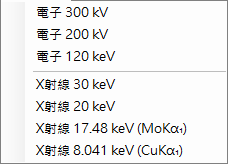

固定的波源預設組合，只設定輻射種類及其能量：**電子 300 kV**、**電子 200 kV**、**電子 120 keV**、**X射線 30 keV**、**X射線 20 keV**、**X射線 17.48 keV (MoKα₁)** 與 **X射線 8.041 keV (CuKα₁)**（後兩者選取 Mo / Cu 的 Kα₁ 特性譜線）。其他設定（偵測器幾何、索引標籤、斑點性質）既不會儲存，也不會變更。

### 選項與說明選單

| 選單項目 | 說明 |
|-----------|-------------|
| **選項 > 動態壓縮** | 開啟[動態壓縮](#動態壓縮)視窗（同時開啟偵測器幾何視窗）。 |
| **選項 > ALCHEMI 模擬器...** | 開啟 [ALCHEMI 模擬器](4-alchemi-simulation.md)。 |
| **說明 > Bethe 法基本概念** | 在瀏覽器中開啟線上手冊的[布洛赫波附錄](../appendix/a3-bloch-wave/index.md)。 |

---

## 工具列 {#toolbar}

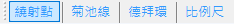

| 按鈕 | 說明 |
|--------|-------------|
| 繞射點 | 顯示 / 隱藏繞射斑點圖層 |
| 菊池線 | 顯示 / 隱藏菊池線圖層 |
| 德拜環 | 顯示 / 隱藏德拜環圖層 |
| 比例尺 | 顯示 / 隱藏刻度線圖層 |
| Index / d / 1/d / 距離 / 2θ / χ / 激發誤差 / Structure factor | 選擇附加於每個斑點的標籤 |

---

## 螢幕與偵測器資訊

### 螢幕

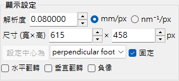

| 項目 | 說明 |
|------|-------------|
| **解析度** | 一個螢幕像素的大小，單位為 **mm/px**（在偵測器平面上）或 **nm⁻¹/px**（可選擇；預設 0.08 mm/px）。它不必是實際的偵測器像素大小；它被視為顯示比例，並在以滑鼠縮放時自動更新。 |
| **尺寸 (寬×高)** | 繪圖區的像素寬度與高度。視您的顯示器解析度而定，過大的數值可能無法設定。 |
| **設定中心為 / 固定** | 將繪圖區的中心置於 **perpendicular foot**（垂足）、**direct spot**（直射斑點）或 **detector**（偵測器）中心（最後一項僅在已定義偵測器區域時可用）。勾選 **固定**（預設）時，中心會保持在該處：停用滑鼠平移，縮放時也保持該中心。 |
| **水平翻轉 / 垂直翻轉 / 負像** | 對顯示圖樣進行幾何翻轉（水平 / 垂直）與對比反轉。用以匹配實驗影像的方向或對比。 |
| **倒空間** | 在圖樣旁開啟厄瓦爾德球與倒易點陣點的 3-D 檢視，可視化哪些反射被激發。其 **選項** 面板可設定顏色（靠近 / 遠離厄瓦爾德球的斑點、厄瓦爾德球、原點、方向導引）、3-D 斑點半徑（nm⁻¹）、相對強度閾值（%）、遠離厄瓦爾德球之斑點的透明化、標籤，以及檢視方向（附角度 **步進** 的箭頭按鈕、**重設**）。 |

### 偵測器（相機長度）

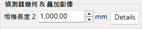

- **相機長度 2** ：從試樣到偵測器平面上垂足的距離（mm；預設 1000 mm）。偵測器未傾斜（τ = 0）時，它等於一般的相機長度。
- **Details** ：開啟偵測器幾何設定視窗（見下方[偵測器幾何](#detector-geometry)）。

### Misc

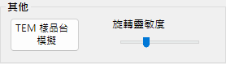

- **旋轉靈敏度** ：滑鼠每拖曳一像素的晶體旋轉量。
- **TEM 試樣台模擬** ：開啟與試樣台連動的模擬視窗（見下文）。

---

## TEM 試樣台模擬

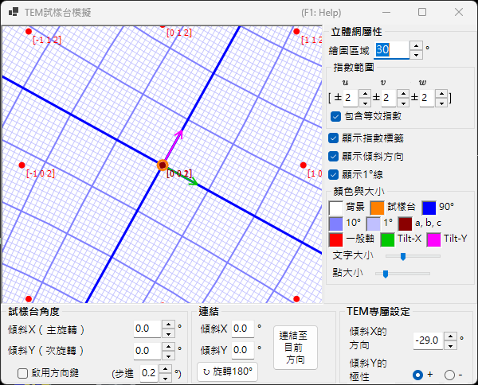

開啟一個將繞射圖樣與雙傾 **TEM 試樣台** 連動的視窗（**傾斜X** = 主旋轉，**傾斜Y** = 次旋轉）。設定試樣台傾斜角會更新圖樣與晶體取向，且可達的取向可在極網上顯示（v4.914 新增）。**連結至目前方向** 會將目前的晶體取向（在所給的 傾斜X / 傾斜Y 下）作為試樣台的基準；**TEM專屬設定** 給出 傾斜X 軸在螢幕上的方向（預設 −29°）與 傾斜Y 的極性，而 **↻ 旋轉180°** 會使晶體繞電子束旋轉 180°。在極網上左鍵雙擊會將試樣台傾斜設為該點，而勾選 **啟用方向鍵** 可讓 ←/→ 逐步調整 傾斜X、↑/↓ 逐步調整 傾斜Y（步進 0.1–2°，預設 0.2°）。只要此視窗處於開啟狀態，無論 ReciPro 的哪個視窗位於前景，方向鍵均有效。

---

## 繪圖疊加層索引標籤 {#drawing-overlay-tabs}

### 一般

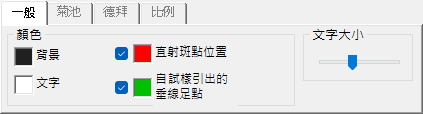

設定標籤的 **文字大小**，以及標籤 **文字**、**自試樣引出的垂線足點** 標記、**直射斑點位置** 標記與 **背景** 的顏色（兩個標記可各自關閉）。斑點顏色在 **外觀** 中設定（見各模式頁面）；菊池線、德拜環與刻度線的顏色則在各自的索引標籤中設定。此處的設定適用於所有繪製模式。

### 菊池線

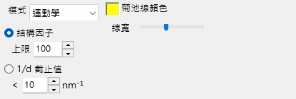

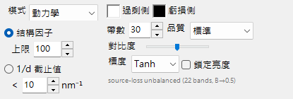

於工具列啟用菊池線時生效。

- **Reflection selection** ：選擇由哪些反射產生菊池線。可選 **結構因子**（依 $\lvert F_{hkl}\rvert$ 排序的 **上限** *N* 個反射；1–1000，預設 100）或 **1/d 截止值**（所有 1/d 低於門檻的反射；0–100 nm⁻¹，預設 10）。
- **模式** : 菊池線的繪製方式（預設 **運動學**）。組合方塊下方的設定隨模式切換。
    - **幾何** : 所有選取的線以同一固定顏色繪製。
    - **運動學** : 線的濃淡依各反射的運動學相對強度變化。
    - **動力學** : 以熱漫散射為源的雙束動力學過剩/虧損帶輪廓，在背景執行緒中計算。過剩帶出現在高角側，虧損特徵朝向直射束一側；試樣厚度與強度設定共用。計算期間先以幾何線代替顯示。
- **幾何 / 運動學的設定** : **菊池線顏色** 和 **線寬**。
- **動力學的設定** :
    - **過剩側** / **虧損側** : 帶的明亮側（對比度為正）與暗側（對比度為負）的顏色。
    - **帶數** : 以動力學輪廓繪製的帶數（依動力學對比度取前 *N* 條；1〜50，預設 30）。
    - **品質** : 橫越每條帶的取樣點數（快速 65 / 標準 129 / 高 257；預設 標準）。
    - **對比度** : 壓縮前施加到帶對比度上的顯示增益。
    - **標度** : 亮度壓縮曲線（Linear / Log / Tanh；預設 Tanh）。皆為視覺化變換，並非物理相機響應。
    - **鎖定亮度** : 凍結亮度正規化，例如用於比較不同取向或厚度。
    - 下方灰色註記顯示源與吸收不一致的提示、繪製的帶數及診斷資訊（例如對 *B* = 0 的原子代用預設 *B* 因子）。
- （以前另有的 **Threshold** 參數已不存在；反射只受上述選擇條件限制。）

### 德拜環

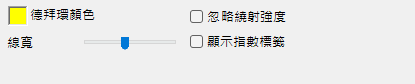

於工具列啟用德拜環時生效。

- **忽略繞射強度** ：若勾選，所有德拜環以相同顏色與強度繪製（忽略晶體結構因子）。可用於純幾何比較。
- **顯示指數標籤** ：若勾選，(*hkl*) 會出現在每個環附近。

### 比例尺

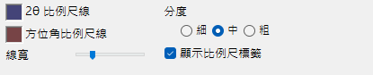

於工具列啟用刻度線時生效。

- **2θ / Azimuth scale lines** ：**2θ** 代表固定散射角（同心圓），**Azimuth** 代表固定方位角（自中心放射的徑向線）。兩者顏色可獨立設定。
- **線寬** ：刻度線的粗細。
- **分度** ：刻度線的密度，**細** / **中**（預設）/ **粗**。
- **顯示比例尺標籤** ：是否在刻度線上繪製數值標籤。

（沒有獨立的 *Misc* 索引標籤；滑鼠的 **旋轉靈敏度** 位於右側面板的 **其他** 群組中，見上方的 [Misc](#misc)。）

---

## 繞射斑點資訊 {#diffraction-spot-information}

列出以布洛赫波法（Dynamical 計算）所算得的逐反射詳細資訊。以強度計算面板中的 **繞射點詳情** 按鈕開啟。在 **僅激發誤差** / **運動學** 模式下，此按鈕會列出目前所繪的反射及其電子位能與 $P_g$、$Q_g$（無動力學振幅）；在 CBED 模式下，表格會跟隨 CBED 視窗中所選的厚度。

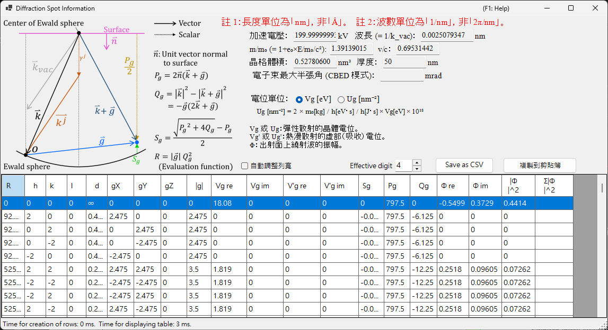

### 示意圖與定義

示意圖（左上）顯示厄瓦爾德球上的向量，並定義表中所用的量（$\hat{\mathbf{n}}$ 為試樣表面的單位法向量，$\mathbf{k}$ 為入射波向量，$\mathbf{g}$ 為倒易點陣向量）。

- $P_g = 2\,\hat{\mathbf{n}} \cdot (\mathbf{k} + \mathbf{g})$
- $Q_g = |\mathbf{k}|^2 - |\mathbf{k} + \mathbf{g}|^2 = -\mathbf{g} \cdot (2\mathbf{k} + \mathbf{g})$
- **偏離向量：** $S_g = \dfrac{\sqrt{P_g^2 + 4 Q_g} - P_g}{2}$
- **評估函式：** $R = |\mathbf{g}|\, Q_g^2$ ——依反射被激發的強弱排序（越小 = 越靠近厄瓦爾德球 = 激發越強；穿透束 $g=0$ 的 $R=0$ 並排在最前）。表格按 $R$ 遞增排序。

### 表格欄位

| 欄位 | 意義 |
|--------|---------|
| **R** | 評估函式 $R = \lvert\mathbf{g}\rvert\, Q_g^2$（如上；用於選取 / 排序反射） |
| **h, k, (i,) l** | 米勒指數（*i* 為冗餘的六方指數，僅對六方晶體顯示） |
| **d** | 晶面間距（nm） |
| **gX, gY, gZ** | 倒易點陣向量 *g* 的分量（1/nm） |
| **\|g\|** | *g* 的大小（1/nm） |
| **Vg re / Vg im** | 彈性散射的晶體位能傅立葉係數，$V_g$（實部 / 虛部） |
| **V'g re / V'g im** | 熱漫散射 (TDS) 的虛部（吸收）位能，$V'_g$（實部 / 虛部） |
| **Sg** | 偏離向量 $S_g$（如上；1/nm） |
| **Pg** | 輔助量 $P_g = 2\,\hat{\mathbf{n}}\cdot(\mathbf{k}+\mathbf{g})$（如上） |
| **Qg** | 輔助量 $Q_g = -\mathbf{g}\cdot(2\mathbf{k}+\mathbf{g})$（如上） |
| **Φ re / Φ im** | 出射面上動力學繞射波的複數振幅 $\Phi$（實部 / 虛部） |
| **\|Φ\|^2** | 該反射的繞射強度 $\lvert\Phi\rvert^2$ |
| **Σ\|Φ\|^2** | $\lvert\Phi\rvert^2$ 的累計和（對所有反射的總和；可作為強度守恆檢查） |

### 位能單位與其他控制項

- **Unit of potential** ：在 **Vg [eV]**（靜電位能，eV）與 **Ug [nm⁻²]**（進入布洛赫波方程式的縮放量 $U_g = (2 m_0/h^2)\, V_g$）之間切換所顯示的位能。欄位標題會隨之在 *Vg / V'g* 與 *Ug / U'g* 之間變換。
- 表格上方顯示加速電壓、波長（$\lambda = 1/k_\text{vac}$）、相對論質量比 $m/m_0$、速度比 $v/c$、點陣體積、試樣厚度，以及（在 CBED 模式下）電子束的最大半角。
- **Note 1：** 長度單位為 **nm**，非 Å。**Note 2：** 波數單位為 **1/nm**，非 2π/nm。
- **Effective digit** ：表格中顯示的有效位數（1–16，預設 4）。**Auto resize row width** ：自動調整欄寬。**Copy to clipboard** ：將表格匯出為可貼入試算表的文字。**Save as CSV** ：將同一表格（可見欄）寫入 CSV 檔；小數點一律為句點，因此在以逗號作小數點的地區設定下檔案仍然有效。（即使在日文介面下，此表單仍以英文顯示。）

---

## 偵測器幾何 {#detector-geometry}

用於詳細設定偵測器幾何（相機長度、傾斜、旋轉）及疊加實驗影像的視窗。從 **Detector geometry** 面板中的 **Details** 開啟。

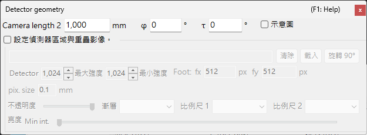

### 偵測器幾何設定

指定反射幾何：**相機長度 2**（mm，1–10000，預設 1000），以及繞方位角 **φ** 之面內軸的偵測器傾斜 **τ**（−200 至 200°）。對於背反射勞厄（Back Laue），只使用 **相機長度 2**：圖樣一律投影到位於射源側、垂直於光束的偵測器上，τ / φ 不套用於此投影。拖放 `.prm` 檔會從中載入波長、相機長度 2、τ、φ、垂足位置與像素大小（波源會切換為自訂波長的 X 光，並開啟偵測器區域）。

### 偵測器區域與疊加影像

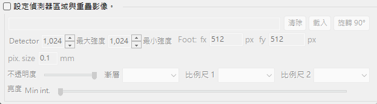

勾選 **設定偵測器區域與重疊影像。** 以指定偵測器：像素尺寸（預設 1024 × 1024）、**像素大小**（mm，預設 0.1）以及 **落點** 位置 **fx, fy**（px，預設 512, 512）。可載入實驗影像（**載入** 或拖放），並以 **不透明度**、**漸層**（正片/負片）、**比例尺 1**（log/linear）、**比例尺 2**（Gray / Cold-Warm / Spectrum / Fire）、**最大強度/最小強度**、**旋轉 90°** 與 **清除** 進行疊加。**示意圖** 會顯示幾何的示意圖。可用此將模擬圖樣與實驗影像疊加，並微調偵測器幾何。

座標系的定義另見[偵測器座標系](../appendix/a1-coordinate-system/2-diffraction.md)。

---

## 動態壓縮

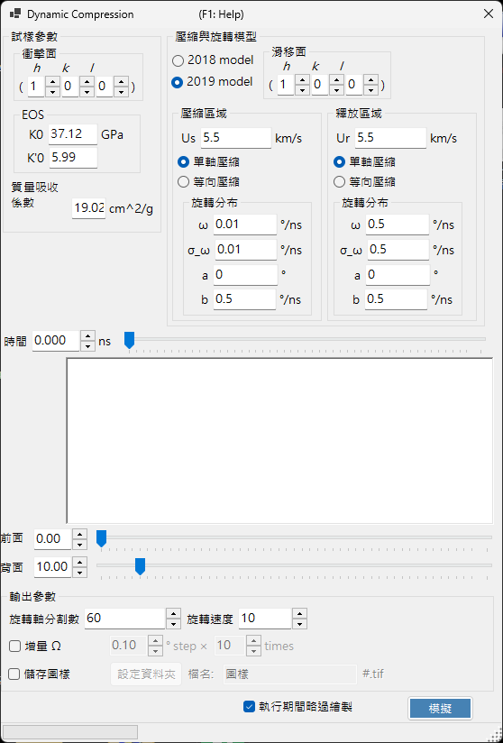

用於模擬受衝擊壓縮（動態壓縮）試樣之繞射的視窗。拖放一個以 Tab 分隔、含三欄（位置、時間、壓力）的 `.txt` 檔，即可載入各時間的壓力曲線；**時間** 滑桿（ns）會選擇圖中顯示的曲線。圖中的兩條垂直線（**前面** / **背面**）可拖曳以設定壓縮的前緣與後緣。此視窗也包含壓縮模型（**2018 / 2019 model**）、衝擊速度（**Us**、**Ur**，km/s）、**EOS**（K0、K'0）、**衝擊面** / **滑移面**、壓縮區域與釋放區域的旋轉分布、質量吸收係數、Ω 步進與 **儲存圖樣**（`#.tif`），並以 **模擬** 執行。

---

## ALCHEMI 模擬器

開啟一個計算**依位點分解的游離搖擺曲線**的子視窗：在晶體通過系統反射列的 Bragg 條件傾轉時，所選游離通道的產率依原子位點分解給出。從 **選項** 功能表開啟。與 CBED 視窗不同，它擁有自己的輸出區域，不會在上層視窗的畫布上繪圖。

→ 全部設定以及適用範圍與已知限制，請參見 **[ALCHEMI 模擬](4-alchemi-simulation.md)**。

---

## 相關主題

- [X 光繞射模擬](5-x-ray-neutron-diffraction.md)
- [SAED 模擬](1-saed-simulation.md)
- [PED 模擬](2-ped-simulation.md)
- [CBED 模擬](3-cbed-simulation.md)
- [ALCHEMI 模擬](4-alchemi-simulation.md)
- [動力學計算（共用核心）](../appendix/a3-bloch-wave/calculation.md)
- [偵測器座標系](../appendix/a1-coordinate-system/2-diffraction.md)
